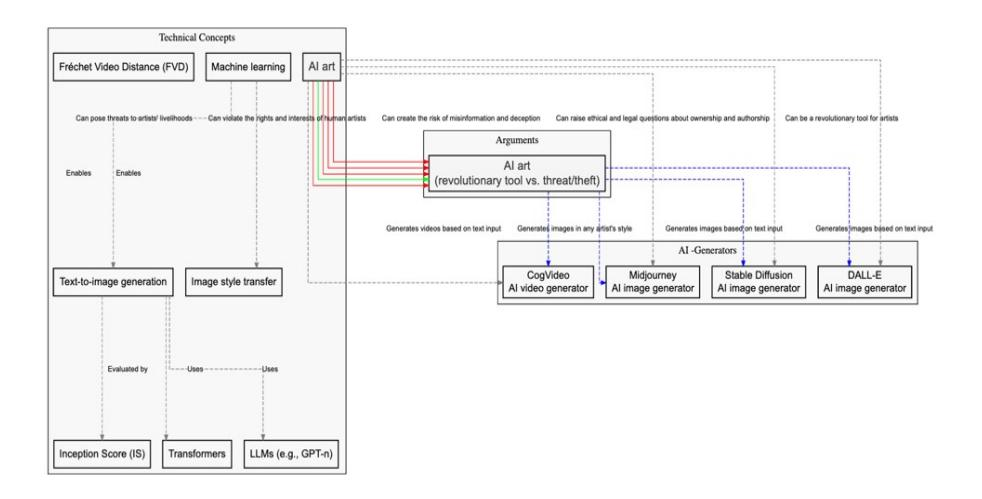
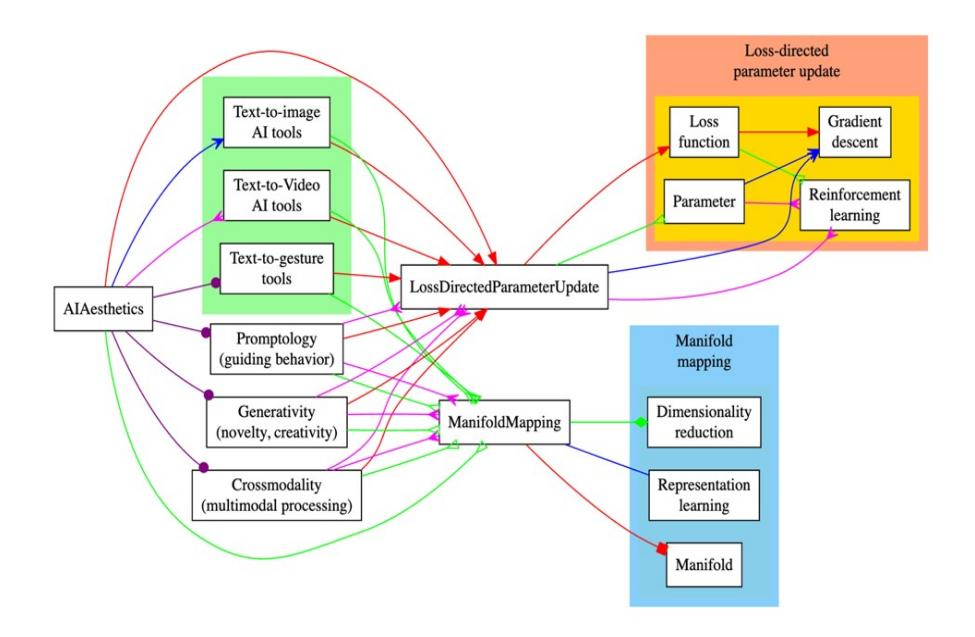
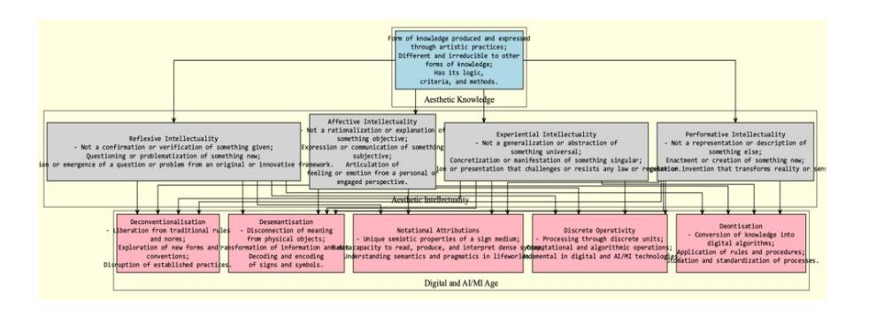
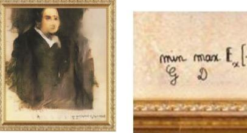
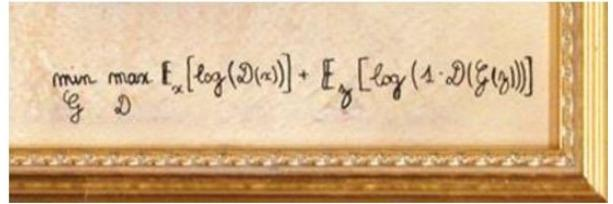
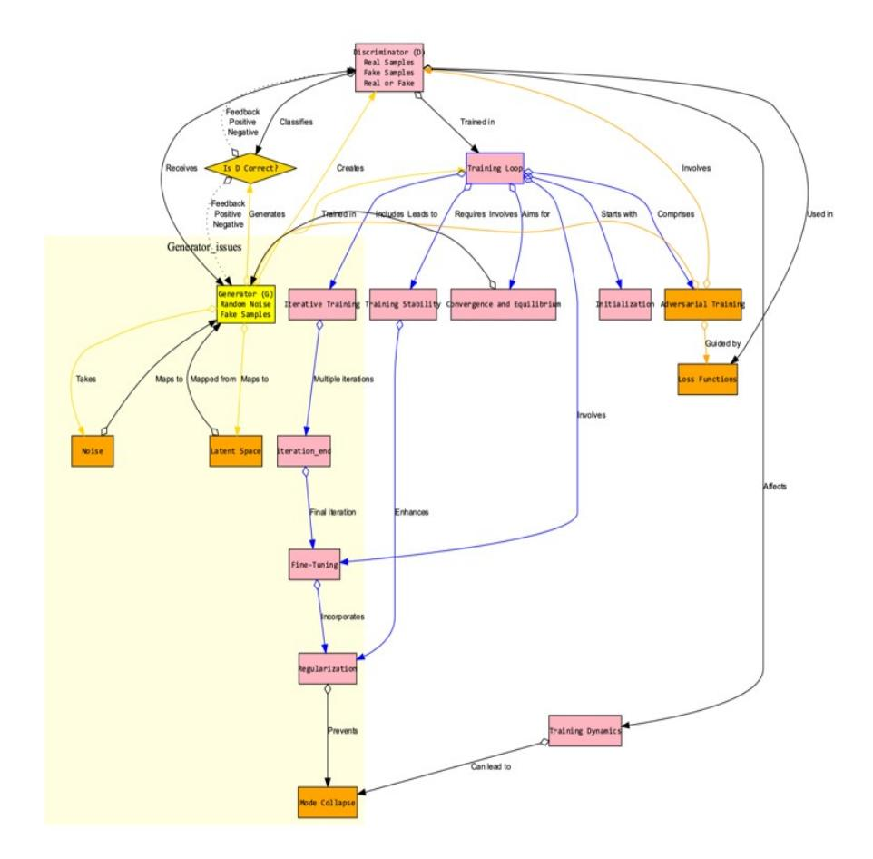
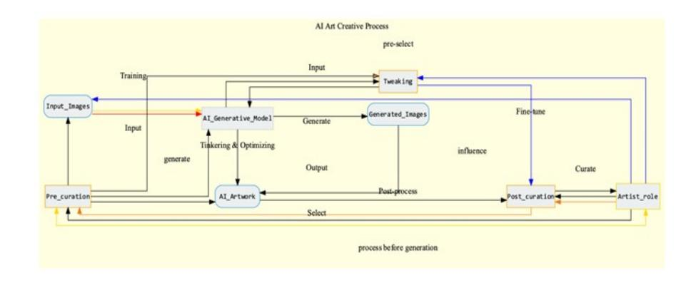

#### **Semeiosis**

#### **SEMIÓTICA E TRANSDISCIPLINARIDADE EM REVISTA.**

TRANSDISCIPLINARY JOURNAL OF SEMIOTICS

#### **Critical Generative AI Aesthetics**

Alexander Gerner Doctor of Philosophy - Researcher at Universidade Lusófona alexander.gerner@ulusofona.pt

#### **Resumo**

The article delves into the emergence of generative AI aesthetics from computational information aesthetics and whether it is a new discipline. It examines the debate on neural (networks) aesthetics and raises questions about creativity in AI. The challenges of curating art created by complex algorithms and the balance between intention and randomness in mimetic agents are explored. The article discusses how generativity -in for example Generative Adversarial Networks (GANs)- can be a prerequisite for creativity and innovation, and how the intersection of aesthetics and technology brings complexities related to governance, curation, authorship and responsible innovation in several ideation graphs presented. Furthermore, the article critically analyzes Birkhoff's aesthetic metrics, highlighting its limitations in the context of AI art and delves into Charles Sanders Peirce's ideas on semiotics concerning the interpretation of AI-generated art, offering a new perspective on understanding its aesthetics and meaning. Lastly, the article emphasizes the challenges and opportunities that come with generative AI aesthetics and encourages further explorations of the boundaries between human and machine creativity.

#### **PALAVRAS-CHAVE:**

generativity, generative AI aesthetics, Peirce, GANs, human-machine creativity, authorship, critic of Birkhoff

Dezembro/2023, v.11 n.1 **ISSN** 2178-5368 **DOI** 10.53987/2178-5368-2023-12-05

# **1. introduction**

*"One year ago, we published a hypothesis that generative AI would become a profound platform shift in technology. Then came the firestorm."(GRADY et al.: 2023)*

It was the year of the thriving of generative AI, 2023, and at the same time of the actors and writers strike in Hollywood against AI (ANGUIANO & Beckett, 2023; BRIA, 2023; CHENG 2023). In 2023 the Journal *NATURE(613/2023)[\[1\]](#page-19-0)* even banned not only the attribution of authorship of LLMs to write scientific articles, but as well the use of images and video material produced by generative AI in a call for "research integrity, consent, privacy and intellectual-property protection"(NATURE NEWS, 2023) and certainly banned apps or programs to be credited as co-authors of scientific articles, however, parts of scientific writing praxis such as grant writing proposals are deeply questioned in its usefulness by the writing capabilities of generative AI tools such as ChatGPT (PARILLA, 2023). The discussion around what ChatGPT and other chatbots that use LLMs can actually do (SHANANON, 2023) revolves around their ability to mimic human language to the point of passing a generative Writer's Turing Test (ELKINS & CHUN, 2020). This development seems to render us more vulnerable through technological anthropomorphization, which is a cause for concern as it can lead to the deskilling of individuals. The responsible use of generative AI chatbots requires new competencies, and highlights the dangers of the withering away of a) "perplexity" (the randomness of word choice), b) "burstiness" as the complexity or variation of sentences (BEAM, 2023 on GPTZero), as well as c) "critical thinking skills" (LIMBURG *et al.*, 2023) inside *scholarly writing* and its pedagogy (REINMANN, 2023; BUCK & LIMBURG, 2023), as well as d) possible loss of human originality (LIMBURG *et al.*, 2023) and cultural plural diversity- cf. the "The English Bias" (HORNYAK, 2023) - in texts in which writing processes would also hand over thinking processes to AI: Writing processes today are being growingly empowered by Artificial Intelligence, but might weaken[\[2\]](#page-19-1) the perception and attribution of human auctorial ownership (DRAXLER *et al*., 2023) of our creations, despite leading to a dynamic fusion of human creativity and machine assistance that is ushering in an era of collaborative text generation in which AI apps based on LLM ´s ought to become "trustworthy, accurate 'thought partners' for learning"(EXTANCE, 2023).

As a result, texts are becoming more fluid, adapting and morphing to the demands of an ever-changing digital environment, shedding their static nature for greater flexibility. Humans and machines share responsibility for generating text, blurring the lines between authorship, where both contribute to crafting meaningful content. Language is being standardized to embrace evolving linguistic norms, ensuring efficient cross-cultural communication. In addition, readers are now judging texts according to a broader spectrum of evaluation criteria that go beyond conventional standards. Knowledge-generating writing is changing, with a profound shift in how knowledge is created, shared, and disseminated, beside the growing difficulties to actually distinguish and detect AI generations such as text from human produce (SADASIVAN *et al.*, 2023).

As cognitive processes become more and more intertwined with external digital tools, thinking will be externalized even more so and dynamized, amplifying intellectual potential. Access to being an author is changing, empowering a wider range of individuals to become authors and democratizing the world of written expression. The relationship between author and recipient is also undergoing transformation, as dynamic, two-way communication becomes central to the exchange of ideas. Finally, the training of writers is evolving to encompass the diverse skills and competencies required in the contemporary era of writing, equipping authors for the digital age.

In 2023 Stokel-Walker & Van Noorden asked 1600 researches how they use and if they used Generative AI- " a new class of tools (…)" that "can produce highquality artistic media for visual arts, concept art, music, fiction, literature, video, and animation" (EPSTEIN et al., 2023) besides writing in any persona mask thinkable to write and to review scientific articles in a similar vision to EPSTEIN et al. (2023) that

> *"generative capabilities of these tools are likely to fundamentally alter the creative process by which creators formulate ideas and put them into production. As creativity is reimagined, so too may be many sectors of society." (EPSTEIN et al., 2023)*

The field of generative AI is deeply connected to philosophical concepts such as creativity, authorship, emergence, intentionality, and the interconnectedness of styles and traditions. These concepts are at the core of discussions regarding the influence and implications of generative AI on art and aesthetics. There are various types of generative AI, each with their own aesthetic concepts, subconcepts, and technical combinations. These have sparked debates and arguments in the field of aesthetics, including evolutionary and generative computing. These debates revolve around the perceptions of complexities of image outputs (CORMACK & CRUZ, 2022), the mere *simulation of indeterminacy* (ZEILINGER, 2023), and the inability of some generative AI to incorporate hypostatic abstractions, which according to Stjernfelt[\[3\]](#page-20-0) (2022), is necessary for the incarnation of signs. In my view Abstraction in the sense of Peircean attentive "prescission" and "hypostatic abstraction" are both necessary to create diagrams in diagrammatic reasoning and it seems to me that attention cannot be reduced to partake only in selective processes but also in *elective* processes as is the case of *hypostatic abstraction[\[4\]](#page-20-1)*, which becomes important in the field of creativity as cognitive novelty creation.

Despite being generated by the use of latent space, transformers, GANs, attention-based Transformers, cross-modality, promptology, and other means of generativity, all related to AI and computation as well as information aesthetics, we could argue that they do not have the openness for incarnating signs via hypostatic abstractions. These debates have historical roots and contemporary tendencies in art and computation, algorithmization, statistical probabilities, and metric measures and pose the following questions:

What role does diagrammatic perception (aisthesis), diagrammatic manipulation (techné), or diagram construction (poesis) play in generative AI aesthetics? Did the aesthetic relation between human beings and machines recently

change by generative AI models? Independently of the question if AI will or will *never* (SMITH & LANDGREBE, 2022) rule the world[\[5\]](#page-20-2) , we can ask: How is human creative behavior and issues of aesthetics simulated, co-generated, or mimicked with the help of diagram-technologies and theoretically staged in diagram strategies/dramaturgies by generative AI aesthetics?

# **1.1 from** *information aesthetics* **and** *computer art* **to** *ai aesthetics***: neural aesthetics**

Formalization, digital computerization, mechanization, and semiotics should be conceived as interrelated from the outset - as the philosopher HANS BLUMENBERG (2019{1954}) envisioned in a fragmentary text called "Automation" from 1954:

> *"What can be formalized, can be mechanized and what can be mechanized can be automatized. Technics slumbers in theory. Automation is the complete relief of the human being. Calculating Machines are practicable non-re-computable anymore. Already in the sign, the machine resides."*

*Algorithmic art* even became a way of expressing or questioning of its algorithmic rationality, order, and complexity in a modern scientific world explored by the aesthetic potential of mathematics and logic in which *Rechnen*- calculationwas proposed as a *maximally decontextualized* (NAKE: 1997, 34) form of general *quantitative thinking constructed for machines to master,* that do not have any Lifeworld grounded *fields of activity*: "They are Rechenknechte." (LANDGREBE & SMITH: 2023, 216). This is what Peirce meant with the *problem of originality* that machines lack *original initiative[\[6\]](#page-20-3)* ; their purpose is to *serve* human intent: In his work "Logical Machines" (1887), Peirce elucidates that machines, even capable of performing specialized tasks, remain devoid of autonomous creativity. He clarifies that this absence of original initiative is not a flaw; instead, it is aligned with the purpose for which machines are designed – to serve human objectives.

Besides *Genetic Algorithms*, Neural networks are computational models, based on statistical methods and mathematical functions that are based on training methods and evaluation metrics, that can learn from data and generate not explicitly programmed outputs. How can we account for the diversity and subjectivity of human aesthetic preferences and judgments? How can we ensure that AI aesthetics are not biased or limited by the data, algorithms, or objectives that shape them?

> *"The transition from traditional information aesthetics to AI aesthetics is particularly evident in a paper (...) in which 'a neural algorithm of artistic style' is described - GATYS, L.A., ECKER, A.S., BETHGE, M (2015) 'A Neural Algorithm of Artistic Style'. The article explains a program that can transform any photograph into any painting style. A photograph of the 'Neckerfront of Tübingen' was used as a template, and each was rendered in the style of William Turner's The Shipwreck of the Minotaur (1805), Vincent van Gogh's Starlight (1889), Edvard Munch's The Scream (1893), Pablo Picasso's Femme nur Asse (1910), and Vasilz Kandinsky's Compositions VII (1913). (IBID .p.5)" (LEHMANN, 2016: 115)*

Thus, neural aesthetics can be seen as a form of generative art, where the artist creates rules or systems that produce artwork rather than creating the artwork directly using neural networks for the outputs of their generations. Neural aesthetics in this sense is related to Style transfer [7], GANs[8], Text-to-image synthesis among other cross- or multimodalities. These techniques can learn the latent representation of a given dataset and sample new images from it. For example, one can generate realistic faces of people who do not exist or abstract artworks that resemble Mondrian's or Picasso's paintings. These techniques can be seen as a form of generative art, creating something new using an algorithm or a system. Supporters of A.I. art highlight its ability to generate images and videos, exemplified by programs like Midjourney, Stable Diffusion, Diffusion Bee or other diffusion-based programs, CogVideo, and DALL-E. These generation programs use technical means such as Text-to-image generation in their AI generated artworks to showcase A.I.'s capacity to generate various artistic styles, create images based on text input, and even produce videos based on textual descriptions. Machine learning is pivotal, enabling A.I. to learn from data and further demonstrating its versatile applications in art.

Figure 1: Conceptual Diagram on examples of Technical Concepts arguments concerning AI art and AI generators

The debates only hinted at in the above digraph map provide a rich and ambiguous and ethically challenging ground for exploring the evolving relationship between AI and the world of art and aesthetics.

# 1.2 ai aesthetics as a new discipline? generative ai as creative machines?

For Lehmann (2016) AI- aesthetics as a *new discipline* seeks to capture the aesthetic phenomena that arise because of AI research and its applications, as well as the research that uses AI programs to study aesthetic phenomena and its metric and mathematical and statistical data-driven approaches. In many ways, AI aesthetics builds on the tradition of information aesthetics, which includes mathematical

aesthetics. However, like empirical aesthetics, information aesthetics has been limited in its ability to make significant contributions to the understanding of art and aesthetics in the philosophical sense. While it has been able to describe simple formal aesthetic phenomena, it has not been able to provide empirical evidence to support these descriptions as LEHMANN notes in his reflections on Aesthetic Experience and AI Aesthetics in which he marks the impressive progress in the field of artificial intelligence (AI), use cases in art, and the emergence of a new aesthetic discipline. Lehmann notes that the realm of AI aesthetics comprises artworks that have been generated using AI programs, recommendations based on AI algorithms, experiments analyzing consumer taste profiles with intelligent systems, and theories explaining the aesthetic impact of art stemming from the efficient encoding of informationprocessing in the brain. For Lehmann just like empirical aesthetics, information system theorems can only be applied to basic aesthetic elements, such as simple shapes and forms. However, these theorems cannot be proven conclusively through empirical means. So, it's worth questioning why AI aesthetics should suddenly be considered a crucial aspect of understanding art and aesthetics, as a *second wave of information aesthetics*:

> *"To give this phenomenon a name, it could be called AI aesthetics. (…)Just as neuroaesthetics is localized in the tradition of empirical aesthetics, AI aesthetics ties into the tradition of information aesthetics ( where in the following the work of mathematical aesthetics will also be counted as part of information systems). And just as the empirical aesthetics of Fechner and Berlyne could hardly show any research results that were relevant for art and for philosophy aesthetics, neither could Information aesthetics in this regard make noteworthy contributions. Finally, as with empirical aesthetics, information systems theorems could only be used to describe very elementary aesthetic phenomena such as simple geometric polygons. And even then, they could not be unambiguously proven empirically. So why should AI aesthetics, as the second wave of information aesthetics, suddenly become significant for understanding art and aesthetics?" (LEHMANN, 2016: 112, my translation from the German original).*

Application of StyleGan or Styletransfer, enables us to achieve greater efficiency and accuracy in various applications, but does it achieve the "creative machines" or only envision this dream (RAUTERBERG, 2021) or its "hallucination"? Does GenAI produce art or show strong forms of creativity, novelty, aesthetic values or foster and intensify not only aesthetic poesis, but as well aesthetic aesthesis and epistemologically creates new diagrammatic relation and abductive jumps in aesthetic experience?

Even a shift of what can be considered art, who are the actors in the art process, that start with programming, is debated today and since the computational art in the XX century with the question if a programmer[\[9\]](#page-21-2) or even an automatic output producing program itself can be considered an artist and its result art.

*The problem of intention*: How do mimetic agents deal with the purpose or goal that influences or results from the communication of data or information in their input or output? How do they infer or provide the intention for their data? How do they handle the trade-off between intentionality and randomness in their data? How do they account for the creativity or ethics in their data? Other critics could be confronted with generative AI such as a critic of *promptology[\[10\]](#page-21-3)* : or *crossmodality*,

as visualized in the above graphs and modality fusion, that I will treat in a future paper.

**Figure 2:** AI aesthetics based on themes of promptology, generativity, crossmodality and technical concepts

The only critic, however, I will be treating in this paper in-depth will be the third critic of generative AI in the sense of a *critic of generativity* that highlights the excessive richness of details and the missing of gaps, the lack of thinking space pauses and jumps, and abductive voids in generative AI aesthetics and its generations in an approach grounded in a philosophy of the digital, here expressed as well in the question of manifold mappings (for example in relation to digital dimensionality reduction) and loss-directed parameter updates.

# **2. critic of generativity**

**Figure 3:** Diagram influenced by GRAMELSBERGER (2023) on the Digital and ML age and the manifesto on Artistic Research against its advocates (HENKE et al 2020)

Generativity is the ability or capacity to produce novel and valuable data or information, such as images, texts, and sounds or speech, but as well *evolutionary algorithms* for building blocks of biological-cybernetic systems[\[11\]](#page-21-4) . How can Generativity produce novel and diverse outcomes from a set of basic elements or rules? Generativity can also be seen as a precondition of creativity, innovation, or imagination and as such can be applied to various domains and purposes, but is it a necessary condition for aesthetics and creativity? In our view generativity can either be performed by biogenic systems such as organisms or anthropogenic systems such as humans or be constructed technically by machines or formal systems- even though simulating anthropomorphic form or behavior, or by both in collaboration do not have the same ontological status and might use simulation or not, generativity or/and perform discrete operational practices or not. Thus, it seems crucial top heed what GRAMELSBERGER (2023: 142-143) notes when she hints towards digital resolutions or invisibility phenomena in the human-machine and more so in the machine-machine communication field:

> *"The increasing autonomy of (networked) machines makes the invisibility of ubiquitous computing by Mark Weiser (...) even more fundamental to our lifeworld. Whether with or without direct (semiotic) control, monitoring, and interpretation of results, the digital weaves itself ever more deeply into our lifeworld, constituting the specific self-evidence of its signature."(GRAMELSBERGER, 2023: 142-143, my translation from the German original)*

The amalgamation of signature style transfer in generative AI aesthetics opens new dimensions. Once confined to images, style transfer mechanisms extend to film and performance, enabling us to question perceptions and aesthetic preferences in aesthetic knowledge- a form of knowledge produced and performed through artistic practices, different and irreducible to other forms of knowledge with a proper logic, criteria and methods in between a) reflexive, b) affective, c) experiential and d) performative intellectuality.

However, the intersection of aesthetics, technology, in generative AI that entails as well power-seeking behavior introduces complexities. Governance and responsible innovation are vital to avoid the pitfalls of unchecked technological dominion introduced by LLMs and its generative AI applications, that GRAMELSBERGER (2023: 125-143) in the graph above in pink) sees as structural digital substitution relations present in current developments and that is hinted at and grounds the phenomenological *signature* via semiotics, as digital worlds are sign world in the sense of collections, organizations and generations of data. In the below graph that in its bottom part of the digital in its multiple relations in the AI/ML age and within a semiotically mediated life-world signature in which humans for instance by *notational attributions* have the phenomenological capacity to read, produce, and interpret dense syntax for understanding semantics and pragmatics in lifeworlds:

*"So how does the transition from the purely quantitative-formal to the multifaceted phenomena of the digital as we encounter them in the lifeworld take shape? This transition can be understood as a change of perspective from the structure to the signature of the digital." (GRAMELSBERGER, 2023: 125)*

One of the key attributes of digital technology is *de-conventionalization*. This refers to the way that digital tools and algorithms enable us to explore new possibilities and generate new forms of expression that break with traditional habits and expectations. By suspending the rules and norms that usually guide our perception and interpretation of reality, we can use generative AI aesthetics to create novel and unexpected artworks that challenge established conventions in art and aesthetics. For example, artists can use AI to generate images, sounds, texts, or other media that do not follow the rules of realism, harmony, coherence, or meaning. This allows for experimentation with different styles, techniques, genres, and modes of representation that create ruptures and surprises for the viewer or listener. However, the idea of realism, harmony and coherence as well as meaning is deconventionalized.

Thirdly, in *desemantisation* resulting in decoding and encoding of signs. Forth the epistemological *Discreteness of its digital Operativity* and lastly *deontisation* in which knowledge is transferred into digital algorithms and its processes are automized and standardized.

As it is a crucial aspect of creativity and innovation, one of the primary challenges for generative agents is the problem of *Novelty* (cf. on novelty as part of a extension of the Peircean "dilemma of abduction" (cf. GERNER, 2012) or how the new enters our thinking), that can be concretely debated in generative AI outputs in terms of "generative variability" as proposed by WEISZ[\[12\]](#page-21-5) *et al*. (2023) for respective design principles of these genAI systems that surpass the capabilities of former AI system moving from analyzing ordering data or applying rules to generating data and the variability of recreating variations of data and new applications across modalities:

> *"Fostering safe use is a challenge because of the potential risks and harms that stem from generative AI, either because of how the model was trained (…) or because of how it is applied (…) In order to address these issues, we propose a set of design principles to aid the designers of generative AI systems. These principles are grounded in an environment of generative variability, indicating the two properties of generative AI systems inherently different from traditional discriminative AI systems: generative, because the aim of generative AI applications is to produce artifacts as outputs, rather than determine decision boundaries as discriminative AI systems do, and variability, indicating the fact that, for a given input, a generative system may produce a variety of possible outputs, many of which may be valid; in the discriminative case, it is expected that the output of a model does not vary for a given input."(WEISZ et al., 2023)*

## **2.1 the obfuscated aesthetic curation problem of generative ai**

In Rauterbach's (2021b) perspective, the role of AI in creating art and its implications for human creativity and society is compared to the Apollo-8-Moment, where astronauts saw the Earth from space for the first time. AI-generated art

represents a moment of detachment, where machines transcend their machine-like nature.

The author acknowledges AI's achievements in producing artworks that mimic the styles of renowned artists, such as Rembrandt, Bach, or Munch and generating original compositions based on algorithms and data, but still designates the idea of creative machines as a dream in which authorship can be interpreted as an algorithmic "Setzung" or "Behauptung" (STEINWEG[13], 2006: 7) and as such an confirmation of uncertainty rather than designation of truth as assertion, or historical index, rather AI aesthetics of generative GAN output becomes a case of a *speculative assertion* without indexical relation to an object of perception of a "Behauptung", a *claim, contention, allegation, affirmation*, or even a *simulated assertion* of truth claimed by signs (STJERNFELT[14], 2021) in a pre-proven performative setting.

Generative AI aesthetics is an intersection between artificial intelligence and artistic expression that has become a major area of interest. This field involves creating and appreciating art generated by autonomous AI systems. In our exploration of the philosophy of AI technology within generative art, we encounter profound questions and concepts, and we view these themes through different lenses such as the AI aesthetics specialist Lev Manovich: Lev Manovich's perspective on the comparison between superhuman AI and human creativity is one of nihilist caution (not intentions, ideas, plans, or meanings are at the core of human modern art) towards limiting AI and media analytics high skepticism of a wishful thinking of a sustainable collaboration stance as "Artists with AI tools"-due to our human limitations, that become the core for Manovich thinking about art in the AI age. Manovich (Manovich FACEBOOK post 20/10/2023) emphasizes that AI's capabilities continually surpass human creativity (in the sense of "superhuman" Artificial general Intelligence (AGI), which raises questions about the role of human artists in generative AI art in general and the importance of the topic of creativity itself as of no use in a pessimist outlook on the alignment problem. However, what Manovich does not reflect is that at the same time we have the drive towards superhuman or crowd-intelligence tools such as generative AI, we as well develop means to overcome ontological limitations of human beings as proposed by post-and transhumanist approaches to technology (e.g. Elon Musk's Neuralink project (FOURNERET, 2020) to level up human capacities beyond becoming a future "housecat" of AGI, besides killing animal trial monkeys in the meanwhile (MEHROTRA, 2023)), that in the sense of Herminio MARTINS[15] (2013) are highly paradoxical issues because we try to get away from the human fragility by officially overcoming fragility, while at least conceptually depriving humans of their humanness that lies as well in our experiential and existential imitations.

But let us come back to the anthropomorphisation of AI in aligning to cultural heritage of signature and meaning attribution, authorship. This means we need to look at the claims being made with generative AI: In this sense the *claim* of culturally mediated authorship as placement of a signature on a document or painting, as simulated intentional positioning of human authorship, becomes almost a cynical game of imitation, hopeless and senseless in the position of Manovich, that hollows

out human authorship even further, and is put into fundamental doubt what sense this could even have.

As example serves the AI generated "work of art" of Obvious Collectives obfuscated pre- and post-curation becomes a *rhetorical coup*, proposing but actually not filling in the place of a signing author or curator collective, besides the digital and machine learning processing of training sets of images is a collective and collaborative process between the *Obvious* collective, the algorithm scrapped partially at least- from *Github* and has technical authorship that is hidden- and their human group intention to make this a successful art sell, rhetorically and dramaturgically staging the algorithmic diagram representation on the bottom left corner of the image as the "signature" or to say it in a Peircean way, to relate the algorithm as index that in this case is actually a **conventional symbol**, staged as index in a game of assertion and trust in the tradition of artists of this style and epoch signing conventionally in the bottom left corner.

Figure 4 left: Obvious Collective. Figure 5 right: zoom in excerpt of the same image with equation[\[16\]](#page-22-3) as "digital" signature or digital authorship claim re-embodied turning *operative images* (Meyer, 2022) in a *retro-fictional-digital style* again a classical (inverting the outworn metaphor into a "(fake) oil (portrait painting)" is the "new data") portrait painting on Canvas.

The algorithm as a *humanist ideal of AI authorship claim[\[17\]](#page-22-4)* as aestheticeconomic strategic choice of a human collective to represent the algorithm that generated the images presented on canvas and in a value-indicating historization of value of the *golden frame* of the *AI algorithmic artist, as a future classic or present past*.

Figure 6: Conceptual map of AI Generative Model

What the first AI-Generative Model in the Graph above does not show is cited in ELGAMMAL 2018:

> *"The creative process heavily involves the artist. The artist chooses a collection of images to feed the algorithm (pre-curation); in the case of Edmond de Belamy, this was a set of traditional art portraits. These images are fed to a generative AI algorithm that tries to imitate these inputs. Finally, the artist heavily sifts through many output images to curate a final collection (post-curation). Basically, the algorithm fails in making correct imitations of the pre-curated input, and instead generates distorted images that surprise us. If the algorithm would succeed in imitating the input data, it would not be even interesting as art." ELGAMMAL (2018)*

This complex AI aesthetic process between computer-endowed output programmed by preselected images or image banks, as training data that involves different process and actions in the preselection pre-curation process and the involves the choice of an adequate algorithm or its programming from scratch, that then looks at the outputs and tweaks and twitches the results and in the post-curation phase selects the images to be shown is visualized in form of a multiple diagram below:

Figure 7: DIGRAPH DOT code visualization inspired by ELGAMMAL (2018)

In a second step we can apply a Peircean semiotic perspective to the GAN graph above to diagrammatically enhance the theme of internal GAN produced outputs: To understand generative AI aesthetics and Peircean semiotics, we need to consider the following aspects:

*The role of interpretation and inference*, *The role of abduction and creativity, The role of pragmatism and ethics*: Peirce's semiotics is based on the philosophy of pragmatism, which considers the practical consequences and effects of signs and actions. Pragmatism also implies an ethical dimension, as it considers how signs and actions affect the well-being and values of others. Generative AI aesthetics has practical and ethical implications, as it affects how we perceive and interact with reality and with each other. How do generative AI images influence our perception of reality? What are the social and cultural effects of generative AI aesthetics? How do we ensure that generative AI aesthetics is responsible and beneficial for humanity?

The above GAN model is remodeled with Peirce's classification of signs into icons, indices, and symbols. From a Peircean semiotics perspective, the graph shows a first step toward how the complexities of Generative Adversarial Networks (GANs) can be analyzed through various Perceian sub-concepts that highlight the interplay of sign types, objects, and interpretants. The Peircean perspective provides valuable insights into the content relation and signs depicted in the ML GAN system, revealing how the principles of semiotics are manifested as well on the level of automatic sign production in which some types of interpretants of the sign do not have to have human hermeneutic conscious experience and might in its sign reception still lead to AI aesthetic judgments. In the context of GANs, the concept of the interpretant takes center stage in understanding the graph's dynamics. Peirce's notion is that a sign creates an effect / e.g. a meaning in an interpretant. However, the interpretant in the Machine learning algorithmic processes aligns with the generator's role in transforming random noise into "Fake Samples." Some call this machine hallucinations and should be reread or hacked into with the notion of Peirce on hallucinations, as failed common socially accepted perception, but still as singular experience (cf. GERNER, 2020).

The interpretant emerges due to the generator's output, where the machine learning interpretant process unfolds in synthetic data generation. The ML interpretant's role as a cognitive representation- despite mostly hidden or network activity not accessible from the outside, echoes the ML generator's endeavor to capture the underlying distribution of the training data processing them.

Thus the GAN model can be read parallel to Peirce's emphasis on the interpretive nature of signs. Within the context of the first-order function of the interpretant, the graph's depiction of the generator (G) and the discriminator (D) establishes a relation between the sign and its object.

The generator's transformation of random noise exemplifies the creation of symbols, where a conventional or arbitrary relation is established between the noise and the generated data outputs.

The discriminator, in its binary classification, embodies the dynamics of indices as it points to and indicates the simulated "authenticity" of the samples.

Moreover, the semioticity is evoked by "Fine-Tune Training" and "Latent Space," as immediate interpretants, implying dumb, statistical, ML or *faked meanings* directly linked to their signs. The second-order function of the interpretant (AAMES, 2018) finds resonance in the "Is D [discriminators output] Correct?" – the checking of correctness in the sense of the expected output- node and the semioticities' role in reflecting the nature or quality of signs and objects automatized feedback.

Are we fundamentally experiencing a power-seeking technological A.I. rat race at the moment that is distracted by AI aesthetics and should be paused in its development, in which reality collapses (fake everything, including religion), Trust collapse, Collapse of law and contracts, AlphaPersuade ( hyper persuasive artificial agentiality via LLM self-play), exponential blackmail, automated lobbying, automated exploitation of code, automatized personalized narratives for manipulation, synthetic[\[18\]](#page-23-0) relationships (race to intimacy) that fosters the digital divide as an A.I. Aesthetics divide? This question is elaborated in the position of Hito Steyerl that sees A.I. aesthetics and A.I. art a way to "capture "the public as a strategy of "onboarding tool for Tech Conglomerates'' (Hito STEYERL, in BROWN, 2023) diminishing the *reality index* in which *mean/demeaning images[\[19\]](#page-23-1)* (IBID.) feed on latent spaces of exchange value, use value and commodity. Thus, critical assessment hints that we are basing our judgment on AI on a wrong idea of intelligence that could be designated dependently its perspective, "uncreative intelligence" (MERSCH, 2022), "artificial idiocy"[\[20\]](#page-23-2) (ZIZEK, 2023), "dumb meaning" (BAJOHR, 2023), or a *satisficing[\[21\]](#page-23-3)* (Hubert Simon cit. in KARPF, 2023) "cliché-generator"[\[22\]](#page-23-4) . While AI algorithms may be capable of *replicating iterating* and *normatively intensifying* the use and appreciation of certain styles or genres of art while excluding or ignoring others, they are claimed to lack the nuance, individuality, originality, authenticity. On the relation of aesthetics and epistemology of aesthetics we must also account for the criteria or metrics and quality of the data used but as well the limits of an empirical metric value (for the problem of value cf. the "KI-Ästhetik'' (LEHMANN, 2016: 112-124) as

"Gehaltsästhetik" (LEHMANN, 2016b) approach to aesthetics such as by cybernetic and semiotic information aesthetics since the English and Vienna empirical aesthetics schools and especially the information aesthetic school from Stuttgart around Max Bense and students (e.g. Nake) among other scholars.

*Quality* is another crucial aspect of generativity that generative agents must consider. The standards or rules that guide the value of their input or output are another important problem for generative agents: How do generative agents deal with the excellence or merit of data or information in their input or output (*the problem of {data}criteria*)? How do generative agents deal with the standards or rules that guide the value of their input or output? How do they select or apply the criteria in their input or output? How do they account for the logic or reason in their input or output? How do they measure or improve the quality of their data? They must select or apply the criteria in their input or output. Can generative agents account for the logic or reason in their input or output? Already COLTON & WIGGINS (2012: 24) doubted this as they defined generativity as the ability to produce novel and valuable outputs, but argued that it is a necessary but not a sufficient condition for creativity: "the generative poet (…) has no appreciation of what it is doing or what it is has produced."

Moreover, generativity must account for the *problem of metrics in AI aesthetics*: How do generative agential algorithmic systems deal with the measures or indicators that quantify the value of their input or output? How do we calculate or manipulate the metrics in input or output in relation to aesthetic value of AI aesthetics? How do they handle the trade-off quality or reliability between *metrics* and aesthetic values in their input or output?

#### **2.2 critic of birkhoff**

Our critic starts here: While valuable for assessing technical aspects of AIgenerated content, these metrics may only partially capture the essence of artistic creativity or aesthetic value because art is multifaceted, subjective, its performative experience often event-based and deeply rooted in human emotions, experiences, and cultural contexts. While the above metrics can provide important insights into the technical quality of AI-generated content, the accurate evaluation of art and the completeness or the alterity of aesthetic experience often requires human judgment, interpretation, and consideration of the emotional and intellectual impact on the audience and more so a break of expectations, felling categories, thinking schema, habit breaks abductive jumps and the renewal of our diagrammatic reasonings.

In a historical media archeological and aesthetic history perspective it is also important to note that already in 1928, the American mathematician George David Birkhoff proposed the formula **M = O / C**, where *M* designates the "aesthetic measure," *O* equals orders, and *C* stands for complexity. Birkhoff's descriptive aesthetic measure (M) is a formula that attempts to *quantify the beauty of an object* as part of an empirically measurable aesthetic sense to formalize aesthetic *unity in variety* (HÜBNER & UFKIN, 2023; HUTCHESON, 1725; FECHNER, 1876)– an approach to aesthetics among multiple others that we today do not see as exclusive or

necessarily universal when relating aesthetic questions to art (objects, atmospheres, scenes, relations) and society - as the ratio of its order (O) and complexity C, or M = O / C.

Birkhoff applied this "beauty" metric formula to various domains of human creative expression, such as polygons, vases, poetry, music; however, his approach has been criticized on several grounds, such as: Birkhoff's measure has yet to be supported by empirical studies comparing his calculated *M* values with the aesthetic judgments of human observers. For example, Davis (1936) found that M did not correlate well with the rankings of polygons, vases, poetry, harmony, and melody by trained and untrained observers. Already HOGARTH in 1753 saw the curved line as a center of beauty measures of the serpentine lines of a curvature inside 6 aesthetic principles. Besides fitness, variety, regularity, as well simplicity, intricacy, and specially the curvature as Line of Beauty is given in Hogarth.

- 1. *Fitness* is a crucial element in achieving beauty, according to Hogarth's six principles. However, it's important to note that fitness alone doesn't guarantee beauty. It's all about finding the proper relationship between form and function. A form that lacks fitness simply cannot be considered beautiful.
- 2. On the other hand, *variety* is another key factor in creating beauty for Hogarth. Sameness is unpleasant to our senses, which is why the presence of variety becomes important. It provides relief and enhances the overall aesthetic experience. Hogarth, nevertheless, stresses the importance of finding a balance between sameness and variety to achieve "true" beauty.
- 3. *Regularity* is also an important principle in Hogarth's theory of beauty as it adds a sense of order and harmony to a work of art or design, which can greatly enhance its visual appeal.

While these principles provide valuable insights into aesthetic appreciation, they have faced criticism for their subjectivity, limited scope, and potential to exclude certain individuals- thus WUNDT (1874) criticized that the underlying principles proposed by Hogarth do not take into consideration the correlation of beauty measure of the curvature in relation to other properties of the object beyond spatial – and diagrammatic (Peirce)- lineatures. It's important to view these principles as one among many perspectives and to adopt a more inclusive and multifaceted approach to understanding and appreciating art and aesthetics in general, that since long in modernity is not focused on romantic authorship or genius aesthetics nor on artistic or natural beauty as the main or sole aesthetic principle.

Birkhoff's measure relies on subjective and arbitrary definitions of order and complexity that may vary depending on the type of object, the pragmatic context, and the individual preferences of the observer. For example, what constitutes order or complexity in a vase may not be the same as in a poem, noise music or urbanistic planning and architecture. Frieder Nake one of the pioneers of computer art and generative information aesthetics – before the time of ML generative neural networks being applied in the production of contents in the cultural realm of art- confirms by showing the problematic reduction of "subjective" aesthetic *value* to *measure* as "objective" aesthetic metric inside a semiotic approach to aesthetics:

*basic ingredient for other measures. The intention was to establish an objective aesthetics of measure, as opposed to a subjective aesthetics of value." (NAKE, 2009: 80)*

The creation of the semiotic machine by computer science is worth remembering:

> *"If mathematics creates its things as signs of highest abstractness, computer science gives them a mobility as if they were tangible(stofflich/physical). If the engineering disciplines leave the world behind and replace it in the machine, computer science makes the computer science turn the sign themselves into machines, which act in relative autonomy on the classical machine processes. Not signs for machines have to be built, for which the sign are designs, but signs as machines - this is how computer science, in its concept of computability, takes modern semiotization to the extreme." (NAKE, 1997: 26)*

However, in the *decontextualization* of mathematical machines turned into computational machines lies a fundamental difference that Nake sees between what appears to us as sign and that in the computer is only a mere signal and that first in software the triadic sign structure is arises as it implies interest -bound pragmatic and practice-guided embedding in contexts:

> *"This kind of trinity is thus endowed in software. In short, we can say: Software is a triad of static program text, infinite amount of dynamic processes and interest-bound, practice-guided embedding in contexts. We recognize in this the representamen, the object and the interpretant of Peirce's sign." (NAKE, 1997: 28)*

But still in the end the triadic perception of an Art work or artefact independently of being created by a "creative" semiotic machine, a computer program or a computer tool used by a human being and even re-manipulated with his hands, what stays is the semiotics of signs producing meaning in the spectator and part of it can be resumed under "intention guessing" (EPSTEIN *et al.*, 2023: 6) in which even artefacts generated by generative AI systems, with or without recommender system involvement and its social human in the loop social engagements (EPSTEIN *et al.*, 2023), including engagement metrics - might become anthropomorphized (CHAMBERLAIN *et al.*, 2018)[\[23\]](#page-23-5) , by attribution of intentional purpose to its generation process and respective authorship. Birkhoff's measure assumes that beauty is a simple function of order and complexity, ignoring other factors that may influence aesthetic perception, such as emotion, meaning, novelty, and culture. Berlyne (1974) argued that multiple dimensions of stimulus properties, such as arousal potential, hedonic tone, and familiarity, determine aesthetic preference. Birkhoff's empirical formula for metric measure of aesthetics as well implies that beauty is an object's static and objective property that can be computed by a formula, neglecting the dynamic and creative aspects of artistic production and reception that might not be covered by semiotics alone. Artificial intelligence (AI) could not produce genuine art because it lacks the human capacities that precede the formalization and algoritmization of computational art that he describes in a relation of *poesis* and *techné* including critical judgments, leaps taken in imagination, intentionality, expression, interpretation, and the possibility of reflexivity as *cracks* and the activity of *leaping over a gap*. At the heart of AI aesthetic discourse lies the the interplay between human creativity, sign activity, social political treatment of us and the other and how machines, physical or simulation computation mediate and

instill these relations and intensify or accelerate these relations by their reembodiment in us and our social and work relation.

As LEHMANN (2016: 112) notes already ALSLEBEN[\[24\]](#page-23-6) (1973) had critically remarked that Birkhoff's quantification of *aesthetic measure* leads to a paradox between *sensual experience* and *intelligible plausibility*, as Birkhoff himself assumes that significant connotative elements of orders of beauty that in aesthetic experience go beyond formal structures, in his approach, cannot be integrated into analytics of beauty of metric aesthetics, so that aesthetic measure becomes highly limited in scope: it suffers from *formal metric reductionism* of holistic aesthetic experience that cannot integrate singular tastes or individual experiences as only the aesthetic *preferences* of an *idealized normal observer* (BIRKHOFF: 1933: 13, cit. in LEHMANN, 2016: 113) can be accounted for in his approach. Lehmann develops a discourse analysis of aesthetic experience in which three waves of empirical aesthetics are mentioned in the tradition of Gustav Theodor Fechner´s "Vorschule der Ästhetik" from 1876. Besides the experimental aesthetics, *Neuraesthetics* sand new experimental informational aesthetics as such as AI aesthetics. For LEHMANN (2016: 94-95) we have to break the Kantian and Hegelian Adorno influenced autonomous art aesthetics towards a comparative aesthetics of different aesthetic experiences, that include three levels of aesthetic values,

- a) *aesthetic values in itself* ("Eigenwerte der Wahrnehmung"(Ibid: 94) for example beauty, sublime, event, ambivalence)
- b) *transfer values of perception* "Übertragungswerte der Wahrnehmung" for example cultural values such as "coolness, sportiveness, wealth, nonconformity," and
- c) *reflection values of perception* ("Reflexionswerte der Wahrnehmung") in which a positive or negative value is ascribed or attributed to a shape, color, rhythm, temporality or sound.

According to Lehmann (2016) the transition from traditional *information aesthetics[\[25\]](#page-23-7)* such as proposed by FUCKS (1952: 122) in his mathematicalsyntactical[\[26\]](#page-24-0) proximity relations and orders approach to style to AI aesthetics is particularly evident in GATYS *et al.*, (2015) "A Neural Algorithm of Artistic Style" paper in which " a neural algorithm of artistic style" is described. The article explains a program that can transform any photograph into any painting style. This paper can be considered one of the pioneering works in the field of *generative AI aesthetics*, which uses deep neural networks to create novel and diverse artistic images. The authors propose a method to separate the a) *content* and b) *style* of an image, and then combine them in a new image that *"preserves the semantic information"* of the original image, but "*adopts the visual appearance of a chosen style"* image, thus in a rather binary image of semiotics would separate an *image sujet* (Husserl) from its phenomenal appearing (M.Seel) in an image "style" and semiotically mediate this process by a sign that then could be applied to another concrete incorporation in a sign process. The style of how the sign appears can be any painting or artwork that has a distinctive style of appearing, such as Van Gogh's Starry Night or Picasso's Cubism, that can be statistically mathematically analyzed and formally, discreetly operationalized. The method is based on the idea that different layers of a convolutional neural network (CNN) capture different aspects of an image, such as

low-level features, high-level features, and global patterns. By optimizing a *loss function* that measures the distance between the feature representations of the input and output images at different layers, the method can generate an output image that matches the content and style of the input images. AI can not only process but as well generate new images that have artistic value and appeal. BOLOJAN (2022) following Demis Hassibis- distinguishes *interpolative* (*average samples of a field of combinatoric possibilities*) from *extrapolative* (*achieving creative results outside the pre-given datasets and its combinatorial possibilities*) and hypothetically as well *inventive machine creativity* – in a sense of absolute historical (abductive) newness in its process of generation. The use of AI in art creation raises the philosophical question as well about the potential for leveling down or *homogenization* of artistic expression to standards and norms.

## **3. final thoughts on peirce in relation to sign producing generative ai aesthetics**

When comparing automated generative AI aesthetics outputs with Peirce's theory of diagrammatic reasoning, one can consider their different scopes, metrics, methods, and applications. *Generativity* methods aim to produce novel and diverse outputs from a given input or context. This means that generativity methods can be applied to various domains, such as art, music, literature, design or scientific endeavors and can be based on techniques such as randomness, rules, constraints, optimization, learning. Different criteria, such as quality, originality, relevance, coherence can evaluate generativity methods. When thinking about a Peircean approach how symbols grow and how we gain and develop habits that we break for new habit formation as habit change, this involves acquiring or modifying patterns of behavior – that means actions- that are repeated regularly and tend to occur not only but as well subconsciously, automatically. Various factors, such as motivation, reinforcement, cues, goals, feedback can influence habit formation and habit change. Habit formation and habit change can positively or negatively affect one's well-being, performance, health and this hold true as well in relation to generative AI aesthetics.

Peirce's habit formation and change theory is based on his semiotic and pragmatic philosophy. Peirce joins habit formation to sensation as an induction connected to attention and abstraction:

> *"Attention produces effects upon the nervous system. These effects are habits, or nervous associations. A habit arises, when having had the sensation of performing a certain act, m, on several occasions a, b, c, we come to do it upon every occurrence of the general event, l, of which a, b and c are special cases. That is to say, by the cognition that every case of a,b, or c, is a case of m, is determined the cognition that every case of l is a case of m. Thus the formation of a habit is an induction, and is therefore necessarily connected with attention or abstraction. Voluntary actions result from the sensations produced by habits, as instinctive actions result from our original nature." (CP 5.297).*

However habit breaks and changes to his generative or evolutionary epistemology including deductive steps and abductive jumps. Peirce defines *a habit* as "a rule of action which self has imposed upon self" ("Minute Logic," CP 2.170, 1902). NÖTH (2010) reminds us on an important point of distinction in Peirce definition of the sign types:

*"In a definition of 1909, Peirce describes symbols as those signs which "represent their objects, independently alike of any resemblance or any real connection, because dispositions or factitious habits of their interpreters insure their being so understood" (EP 2:460f). This formulation characterizes the symbol in contrast to the icon, the sign "by resemblance," and the index, the sign with a "real connection" to its object." NÖTH (2010: 83)*

Following RANSDALL´s paper from 1992 on semiotic autonomy and Peirces writing from 1886 on circularity as *circulo virtuosus* NÖTH (2010) reminds us of the *virtuosity* and autonomy of how symbols grow and mutual education of sign and human, that today might be also true for a mutual education of a machine produced sign that human endowed with meaning that is partly responsible for feeding the machine as a *crowd intelligence* of many human beings of using and posting and publishing in a sense-making digital way independently how we critically analyse the general internet complex (cf. CRARY, 2022; PAGE GALLERY, 2023).

> *"Man makes the word, and the word means nothing which the man has not made it mean, and that only to some man. But since man can think only by means of words or other external symbols, these might turn round and say: "You mean nothing which we have not taught you, and then only so far as you address some word as the interpretant of your thought." In fact, therefore, men and words reciprocally educate each other. (PEIRCE [W2:241] cit. in NÖTH, 2010: 88)*

Peirce extends the concept of habit from human to nonhuman habits and habits in the animate and inanimate nature. Today unanimated sign processes grow in the transition from mathematical formal structures to the digital phenomena present in our Life-world. Peirce attributes the plasticity of habits to the laws of cosmic and biological evolution, so the question stays: should we embrace this new development of generative AI aesthetics?

Peirce leads us to valid answers in this field, leveling up the importance of educating and teaching each other as well as sharing our perspectives and preoccupations in social encounters about the new generative AI tools, and its ethical and aesthetic impacts and possibilities in our diverse and multiple cultures and practices.

# **notes**

[\[1\]](#page-1-0) "As Nature's news team has reported, other scientific publishers are likely to adopt a similar stance (see page 620). First, no LLM tool will be accepted as a credited author on a research paper. That is because any attribution of authorship carries with it accountability for the work, and AI tools cannot take such responsibility. Second, researchers using LLM tools should document this use in the methods or acknowledgements sections. If a paper does not include these sections, the introduction or another appropriate section can be used to document the use of the LLM." (NATURE 613, 26. January 2023).

[\[2\]](#page-1-1) In the study of DRAXLER *et al*. (2023), different aspects of participants' perception of authorship during the text creation process with the help of AI were evaluated. These aspects included the sense of ownership, which represented the extent to which participants felt like the authors of the text versus the AI being the

author. The sense of leadership indicated who took the lead in the writing process, while the sense of control measured the level of control the participants felt over the resulting text. The declaration of authorship was also assessed, which referred to entities that participants listed as the credited authors in the blog upload form. Additionally, the subjective and objective quality of personalization was evaluated, which measured how well the texts produced with Interaction Methods matched their style. The study found that users rationalized their authorship similarly for AI ghostwriters and human ghostwriters, but felt more ownership for human ghostwritten texts than for AI-generated texts. This showed that the *AI Ghostwriter Effect* differed from human ghostwriters in terms of ownership but not authorship.

[\[3\]](#page-2-0) "A human specificity is the instinct and growing ability to incarnate signs of all sorts in hypostatized external structures able to outlast the lives of their creators." STJERNFELT (2023: 360)

[\[4\]](#page-2-1) Categories are not easily identifiable in their pure forms according to Peirce. Instead, he suggests that they are interdependent and can be classified into triads: Firstness, Secondness, and Thirdness. In a second, firstness is present, and in a third, both firstness and secondness exist together. This interdependence is the reason why certain things may appear differently to different people. Peirce also differentiates between selective or "exclusive" attention and I would add "elective attention"(GERNER, 2012), which is linked to only one level of abstraction. Peirce further distinguishes between prescission and hypostatic abstraction, the latter being a process of transformation through abstractive observation that takes a concrete attribute and transforms it into a conceptual generalization. Hypostatic abstraction can be a useful tool for active abductive suggestions. Peirce notes that logicians of his time overlooked the importance of abstraction, interpreting it only as a psychological concept of selective separation. Peirce, on the other hand, views abstraction as a form of observation and is more interested in the controlled, fine-grain methodological process of abstractive observation. Attention is not limited to empirical perception but can also be part of the observation of ens rationis, created as proper thought-signs in which hypostatic abstractions as the transformations of *ens rationis* take up a central part of diagramaticity or how I would put it: Attention is the distraction that abstracts: Becoming attentive is impossible without a constitutive abstractive hypostatic distraction.

[\[5\]](#page-3-0) LANDGREBE & SMITH (2023) make a case on the mathematical-formal science side of the complex system problem -" experimentally unrepeatable in detail, irregular, and time-irreversible; it has chaotic element-interactions, anisotropy, inanimate drivenness, and it is non-ergodic" (Ibid.: 183) and on the human or organic Lifeworld side the difficulties of AI that do not as "human perception and cognition depend on an intimate interaction of sensory and motor behaviour."(Ibid:262).

[\[6\]](#page-3-1) "And even if we did succeed in doing so, it would still remain true, that the machine would remain utterly devoid of original initiative and would only do the special kind of thing it had been calculated to do. This, however, is no defect in a

machine; we do not want it to do its own business, but ours." C.S. Peirce, Logical Machines (PEIRCE, 1887).

[\[7\]](#page-4-0) **Style transfer**: A technique that allows the transfer of the style of one image to another while preserving the content of the original image. For example, an image of a city can be transformed into the style of Van Gogh's Starry Night. Style transfer is based on the idea that neural networks can separate and recombine images' style and content features.

[\[8\]](#page-4-1) **Generative adversarial networks (GANs**): **GANs** are based on learning from adversarial feedback by having two competing neural networks: This is a type of neural network that consists of two competing models: a generator and a discriminator. The generator produces fake data, while the discriminator tries to distinguish between real and fake data, or to say it differently: The generator tries to create realistic images from random noise, while the discriminator tries to distinguish between real and fake images. Thus, **the generator learns from the discriminator's feedback, improving its ability to fool it**.

[\[9\]](#page-5-0) Cf. *The Next Rembrandt* [project: https://news.microsoft.com/europe/feature](https://news.microsoft.com/europe/features/next-rembrandt/) s/next-rembrandt/.

[\[10\]](#page-5-1) On a technical and pragmatic level, promptology is related to designing and implementing interactive systems, including AI systems, that use prompts to guide AI systems and the user's behavior and response. Prompts can be written in natural language, or produced in visual, bodily-gestural, sound, and haptic modalities, among others, to elicit specific responses or behaviors from and with us. The design of prompts is based on the principles of human-computer interaction, phenomenological experience design, and social psychology. AI aesthetics involves understanding goals, preferences, personality, social-affective interaction, embodied plasticity, co-presence, immersion, and all kinds of cognitive process, especially Attention. Thus, the use of attention and aesthetic modality fusion can generate forms of AI aesthetics that potentially transform the creative industries, our way of image making, and artifact creation.

[\[11\]](#page-7-0) "The pipeline is organized as a sequence of generators and filters. (…) The first generator is an evolutionary algorithm that discovers different ways of combining the biological building blocks together to realize the desired behavior." (KRIEGMAN *et al*., 2020)

[\[12\]](#page-8-0) For WEISZ *et al.* (2023) the GenAI design principles inside humancentered computing and human-computer interfaces have to heed 1) multiplicities of generations that take into account a) Versioning b) Curation c) Annotation d) Visualization of Differences 2) Design for Imperfection 3) Design for human control 4) Design for Exploration 5) Design for Mental Models 6) Design for Explanations and 7) Design against Harms.

[\[13\]](#page-9-0)" Neither philosophy nor art is about proof and intention. It is about a setting, about a claim. Claim differs from proof or intention in that it must do without certainty. Philosophy of claim is philosophy in uncertainty." (STEINWEG, 2006:7).

[\[14\]](#page-9-1)STJERNFELT (2021) observes in Peirce that assertion claims "that the sign itself is indexically connected to its object as a truth grant; another is the assumption of social responsibility for the sign's truth on the part of the utterer; the third is the purpose of asserting a proposition".

[\[15\]](#page-9-2) "The question of progress through science is posed in very different terms. In the past, science advanced, then technology advanced, then the economy advanced and then social progress advanced, in a logical, harmonious, relatively harmonious sequence, a model of perfection. But now everything is changing. And in the life sciences, we don't postulate the good for man, the good for society, but we postulate the transformation of the human condition, of the ontological structures of the human being. The question is no longer how to satisfy human needs, but how to transform the being that has needs. Transforming the neediness of the human being is, in fact, extremely paradoxical." MARTINS (2013) Translation from the Portuguese Original (A.G.)

[\[16\]](#page-10-0) A Generative Adversarial Network or GAN (GOODFELLOW, 2007) is a deep learning model that can create realistic images from random noise using two neural networks: a *generator* and a *discriminator*. The generator tries to fool the discriminator by producing fake images, while the discriminator tries to distinguish between real and fake images. The algorithm shows how the generator, and the discriminator are trained in a min-max game, where they compete against each other. The equation GminDmaxEx[log(2x)]+Ey[log(1−D(G(z)))] is a mathematical expression representing an objective function of a generative adversarial network (GAN) for image generation, where: G is the **generator** network, which takes a random vector z as input and outputs a fake data sample G(z), D is the **discriminator** network, which takes a real data sample x or a fake data sample G(z) as input and outputs a probability D(x) or D(G(z)) of being real and Ex[…] and Ey[...] are the **expectations** over the real data distribution px(x) and the random noise distribution pz(z), respectively. The expressions minG and maxD are the **optimization** operations that **minimize the loss for** *G* and **maximize the loss for** *D*, respectively. Cf. MIRZA: *et al.* (2014).

[\[17\]](#page-10-1) ZEILINGER (2021: 92) refers to a *sales narrative* that supposedly leaves the art market intact besides the changes to IP brought about by AI influences on artistic works: "The story told by Obvious Collective and Christie´s concerning a speculative decentering of human agency enacted through Portrait of Edmond Belamy does not proceed along tactical vectors that might disturb IP. Instead, the work represents a strategic effort to transpose a humanist ideal of authorship into an AI context, such that the art market´s existing value propositions continue to function."

[\[18\]](#page-13-0) Max Bense´s (1998) on the growing syntheticity in algorithmic aesthetics: "36. The progress of the world is that it becomes more synthetic. So we also have to become more synthetic. But the progress of the world also consists in the fact that it becomes more exact. So we too must become more exact... in life and in thinking. We touch a lot, more than we used to, but still we have to sharpen the contours and we [have to watch over the differences." Bense Technical Existence, p 58 cf. as well http](https://monoskop.org/images/f/f8/Bense_Max_Programmierung_des_Schoenen.pdf) s://monoskop.org/images/f/f8/Bense\_Max\_Programmierung\_des\_Schoenen.pdf.

Dieter Mersch in a 2018 essay on Bense´s existential rationalism, distinguishes Benses reconstructive justification approach from C.S. Peirce´s realist prospective (CP2.222) approach. "For every symbol is a living thing (…)The body of the symbol changes slowly, but its meaning inevitably grows, incorporates new elements and throws off old ones« Peirce CP2.222. Mersch notes:" Peirce's terminological development proceeds prospectively, while Bense essentially works reconstructively, because he is concerned with justification structures, with the foundations of semiotics - for where a choice, a selection lies at the basis, we are confronted with a beginninglessness, insofar as every selection already happens necessarily symbolically and is based on an interpretation that motivates the choice as a choice." A future paper will exclusively be focussed on the comparison of different conceptual groundings in the history of semiotic (informational/computational and AI) aesthetics.

[\[19\]](#page-13-1) Steyerl underlines that AI image generation "shift(s) the focus from photographic indexicality to stochastic discrimination. They no longer refer to facticity, let alone truth, but to probability." (STYERL, 2023)

[\[20\]](#page-13-2)[https://www.project-syndicate.org/commentary/ai-chatbots-naive-idiots-no](https://www.project-syndicate.org/commentary/ai-chatbots-naive-idiots-no-sense-of-irony-by-slavoj-zizek-2023-03)sense-of-irony-by-slavoj-zizek-2023-03

[\[21\]](#page-13-3)"The best way to influence the development of generative AI isn't to ban LLMs; it's to put restrictions on how it is monetized."

#### [\[22\]](#page-13-4) <https://twitter.com/davekarpf/status/1603021477049421825?lang=en>

[\[23\]](#page-16-0) The study of Chamberlaine *et al.* (2018) concludes that the degree of anthropomorphic features exhibited by robotic agents producing art has been found to greatly influence the aesthetic reactions of viewers towards robotic art. Therefore, by enhancing the anthropomorphic traits of robotic and computational art, they hint at encouraging greater involvement from society and higher mitigation of any negative sentiment towards the future development of artistic AI, such as put into praxis in the anthropomorphized robot artist AI.DA (cf AUTHOR upcoming).

[\[24\]](#page-17-0) ALSLEBEN, KURD (1973: 331). Informationstheorie und Ästhetik. (Cit. in LEHMANN, 2016: 113).

[\[25\]](#page-17-1) "Information aesthetics was a progressive theory of the 60s: 1- It founded the beginning of electronic arts and 2- was a touchstone to combine cybernetics and humanities. In applying statistical information theory, it led to interesting and diverse

mathematizations of aesthetic phenomena. It was perhaps most successful in explaining art as a communication process, producing influential semiotic work. She remained attached to the message-technical model of the communication chain (sender/medium/receiver), although this was already broken in art at that time and the hypertext idea was just emerging." my translation of the German original

[\[26\]](#page-17-2) "Thus the synthetical method can generate artificial languages with 'Nahordnung' only. For style analysis, however, the very relations of connection and succession of text elements over a wider range are important. In order to characterize them, there are {inter alia) the following possibilities: (1) the description of correlation between the marks at different positions of the text by means of an appropriate measure of correlation, (2) the estimation of average distances between two equal or different marks in the text" FUCKS (1952: 124)

#### **referências bibliográficas**

- AAMES, Jimmy. The double function of the interpretant in Peirce's theory of signs. Semiotica 225, 2018, 39-55. https://doi.org/10.1515/sem-2017-0005
- AGARWAL, SHRUTI, & HANY FARID. Detecting Deep-Fake Videos from Aural and Oral Dynamics. 2021 IEEE/CVF Conference on Computer Vision and Pattern Recognition Workshops (CVPRW), 2021. https://doi.org/10.1109/cvprw53098.2021.00109.
- ANGUIANO, Dani, and Lois BECKETT. How Hollywood Writers Triumphed over AI – and Why It Matters. The Guardian, October 1, 2023. https://www.theguardian.com/culture/2023/oct/01/hollywood-writers-strikeartificial-intelligence. BAJOHR, Hannes.. Dumb meaning: Machine learning and artificial semantics. IMAGE The Interdisciplinary Journal of Image Sciences 37(1), 2023, 58-70 DOI: 10.1453/1614-0885-1-2023-15452 BARTHES, Roland. Camera lucida. Reflections on Photography. Translated by Richard Howard. New York: Hill and Wang, 1981.
- BEAM, Christopher. The Ai Detection Arms Race Is On-and College Students Are Building the Weapons. Wired, September 14, 2023. https://www.wired.com/story/ai-detection-chat-gpt-college-students/? mbid=social\_facebook&utm\_social-type=owned&utm\_brand=wired.
- BLUMENBERG, HANS. Automation {1954} (pp.214-233), in: Alberto Fragio, Martina Philippi & Josefa Ros Velasco (eds.) Metaphorologie, Anthropologie, Phänomenologie. Neue Forschungen zum Nachlass Hans Blumenbergs. Alber: Freiburg, 2019.
- BRIA, Francesca. Algorithms Are Hiring and Firing Us Now but Tougher EU Laws Could Protect Workers | Francesca Bria. The Guardian, October 12, 2023. https://www.theguardian.com/commentisfree/2023/oct/12/algorithms-eu-lawworkers-ai-data
- BROWN, K. Hito Steyerl on why Nfts and A.I. image generators are really just 'onboarding tools' for Tech conglomerates. Artnet News. Retrieved May 7, 2023, from https://news.artnet.com/art-world/these-renderings-do-not-relateto-reality-hito-steyerl-on-the-ideologies-embedded-in-a-i-image-generators-2264692
- BUCK, Isabella, LIMBURG, Anika. Hochschulbildung vor dem Hintergrund von Natural Language Processing (KI-Schreibtools). Ein Framework für eine zukunftsfähige Lehr- und Prüfungspraxis. die hochschullehre, Jahrgang 9/2023. DOI: 10.3278/ HSL2306W: wbv.de/die-hochschullehre, pp.70-84
- CHAMBERLAIN, R., MULLIN, C., SCHEERLINK, B., & WAGEMANS, J.. Putting the art in artificial: Aesthetic responses to computer-generated art. Psychology of Aesthetics, Creativity, and the Arts, 12(2), 2018, 177–192. https://doi.org/10.1037/aca0000136.
- CHENG, Michelle. AI Firms Are Paying Professional Actors \$150 an Hour to Lend Emotions to Avatars. Quartz, October 21, 2023. https://qz.com/ai-firms-arepaying-professional-actors-150-an-hour-to-1850946320.
- CHOI, Yunjey et al. Stargan v2: Diverse Image Synthesis for Multiple Domains. 2020 IEEE/CVF Conference on Computer Vision and Pattern Recognition (CVPR), 2020, https://doi.org/10.1109/cvpr42600.2020.00821.
- COLDEWAY, D. Maybe showing off an AI-generated fake TV episode during a writers' strike is a bad idea. Yahoo!, 2023. https://ca.style.yahoo.com/maybeshowing-off-ai-generated-223528412.html
- COLTON, Sinon, WIGGINS, Gerait. Computational Creativity: The Final Frontier? Luc De Raedt et al. (Eds.), ECAI 2012, 2012, 21-26.

- CRAIG, Carys J. The AI-Copyright Challenge: Tech-Neutrality, Authorship, and the Public Interest. SSRN, January 26, 2022. https://papers.ssrn.com/sol3/papers.cfm?abstract\_id=4014811.
- CRARY, Jonathan. Scorched earth: Beyond the digital age to a post -capitalist world. S.l.: London: Verso Books, 2022.
- ELGAMMAL, A.. What the Art World Is Failing to Grasp about Christie's AI Portrait Coup, artsy, 2018. https://www.artsy.net/article/artsy-editorial-artfailing-grasp-christies-ai-portrait-coup
- ELKINS, Katherine, and Jon CHUN. Can GPT-3 Pass a Writer's Turing Test? Journal of Cultural Analytics 5: 2, 2020 1–18. https://doi.org/10.22148/001c.17212.
- EPSTEIN, Z., HERTZMANN, A., HERMAN, L., MAHARI, R., FRANK, M.R., GROH, M., SCHROEDER, H., SMITH, A., AKTEN, M., FJELD, J., FARID, H.,LEACH, N., PENTLAND, A., & RUSSAKOVSKY, O. Art and the science of Generative AI: A deeper dive. arXiv.org, 2023. https://arxiv.org/abs/2306.04141. EXTANCE, Andy.. CHATGPT Has Entered the Classroom: How Llms Could Transform Education. Nature News, November 15, 2023. https://www.nature.com/articles/d41586-023-03507-3. FECHNER, Gustav Theodor. Vorschule der Aesthetik, Teil 1. Leipzig: Breitkopf & Härtel, 1876.
- FOURNERET, E. The hybridization of the human with brain implants: The Neuralink project. Cambridge Quarterly of Healthcare Ethics, 29(4), 2020, 668-672. https://doi.org/10.1017/S0963180120000419
- GERNER, Alexander. Philosophical Investigations of Attention. Repositório da Universidade de Lisboa, 2011. https://repositorio.ul.pt/handle/10451/6496.
- GERNER Alexander Matthias. Hacking into Cybertherapy: Considering a Gesture-Enhanced Therapy with Avatars (g+ta). Kairos. Journal of Philosophy & Science, 23, no. 1, 2020, 32–87. https://doi.org/10.2478/kjps-2020-0004.
- GRADY, Pat, HUANG, Sonya, & GPT-4. Generative AI's Act Two. Sequoia Capital, September 26, 2023. https://www.sequoiacap.com/article/generative-ai-acttwo/.
- GRAMELSBERGER, Gabriele. Philosophie des Digitalen. Zur Einführung. Junius Verlag: Hamburg, 2023
- HENKE, Silvia, MERSCH, Dieter, STRÄSSLE, Thomas, WIESEL, Jörg, MEULEN, Nicolaj van der, and HERTIG, Sabine. Manifesto of Artistic Research: A defense against its advocates: Mixed with "bildstücke" - a declination of the collage by Sabine Hertig (2019) = manifest der künstlerischen forschung: Eine Verteidigung gegen ihre verfechter: Versetzt mit 'Bildstücken' - Deklination Einer Collage von Sabine Hertig (2019). Zurich: Diaphanes, 2020.
- HOGARTH, William. The analysis of Beauty. Written with a view of fixing the fluctuating ideas of taste. Reilly & Lee, 1908 (1753).
- HORNYAK, Tim. Why Japan Is Building Its Own Version of Chatgpt. Nature News, September 14, 2023. https://www.nature.com/articles/d41586-023-02868 z#Echobox=1694697825.
- JOHNSTON, D. J. Aesthetic animism: Digital Poetry's ontological implications. The MIT Press, 2016.
- LEHMANN, Harry. Ästhetische Erfahrung. Eine Diskursanalyse. Wilhelm Fink: München, 2016.
- LIMBURG, Anika. et al. Zehn Thesen zur Zukunft des Schreibens in der Wissenschaft. Diskussionspapier 23. Hochschulforum Digitalisierung, 2023. URL:

- https://hochschulforumdigitalisierung.de/sites/default/files/dateien/HFD\_DP\_2 3\_Zukunft\_Schreiben\_Wissenschaft.pdf
- KAEGI, STEPHAN. Uncanny Valley. Rimini Protokoll. Accessed October 15, 2023. https://www.rimini-protokoll.de/website/en/project/unheimliches-tal-uncannyvalley
- KARPF, D. On generative AI and Satisficing. On Generative AI and Satisficing by Dave Karpf. Dave Karpf, 2023. https://davekarpf.substack.com/p/ongenerative-ai-and-satisficing
- MCCORMACK, J., CRUZ GAMBARDELLA, C. Complexity and aesthetics in generative and evolutionary art. Genet Program Evolvable Mach, 23, 2022, 535–556. https://doi.org/10.1007/s10710-022-09429-9
- KRIEGMAN, Sam, BLACKISTON, Douglas, LEVIN, Michaeal, and Josh BONGARD. A Scalable Pipeline for Designing Reconfigurable Organisms. Proceedings of the National Academy of Sciences, 117 (4), 2020, 1853–59. https://doi.org/10.1073/pnas.1910837117.
- LAKE, B.M., BARONI, M. Human-like systematic generalization through a metalearning neural network. Nature, 2023. https://doi.org/10.1038/s41586-023- 06668-3
- LIU, Ziming, LUO, Di, XU, Yilun, JAAKOLA, Tommi and Max TEGMARK. GenPhys: From Physical Processes to Generative Models. arXiv.org, April 5, 2023. https://arxiv.org/abs/2304.02637.
- MAAS, Phillipp, CAREY, Frank, WHEELER, Chris, SHAMASH, Edward, BILLIGTON, Pete, & Jessica Yaffa SHAMASH. SHOW-1 and Showrunner Agents in Multi-Agent Simulations. Fable Studio, 2023, https://fablestudio.github.io/showrunner-agents/
- MANKOO, Sandeep Singh. Deepfakes- the Digital Threat in the Real World. Gyan Management Journal 17, no. 1, 2023, 71–77. https://doi.org/10.48165/gmj.2022.17.1.8.
- MARTINS, Herminio. Em Casa de Hermínio Martins. Entrevista. Nada, 2013. https://www.nada.com.pt/?p=artigos&a=va&ida=40&l=pt
- MEHROTRA, Dhruv. The Gruesome Story of How Neuralink's Monkeys Actually Died. Wired, September 20, 2023. https://www.wired.com/story/elon-muskpcrm-neuralinkmonkey-deaths/
- MERSCH, Dieter. Kunstmaschinen. Zur Mechanisierung von Kreativität. Gerhard Gamm and Andreas Hetzel (eds.) Unbestimmtheitssignaturen Der Technik: Eine Neue Deutung Der Technisierten Welt,. Bielefeld: Transcript, 2005, 149– 67
- MERSCH, Dieter. (Un)creative artificial intelligence: A critique of "artificial art." 2022. https://www.researchgate.net/profile/Dieter-Mersch/publication/341882703\_Uncreative\_Artificial\_Intelligence\_A\_Critiqu e\_of\_%27Artificial\_Art%27/links/5ed807f045851529452d2dcf/Uncreative-Artificial-Intelligence-A-Critique-of-Artificial-Art.pdf
- MIRZA, MEHDI & OSINDERO, SIMON. Conditional Generative Adversarial Nets. arXiv.org, November 6, 2014. https://arxiv.org/abs/1411.1784.
- NAKE, Frieder. The Semiotic Engine: Notes on the history of Algorithmic Images in Europe. Art Journal, 68(1), 2009, 76–89. https://doi.org/10.1080/00043249.2009.10791337
- NAKE, Frieder. Der semiotische Charakter der informatischen Gegenstände. Semiosis 85-90, 1997, 24-35.
- NAKE, Frieder. Ästhetik als Informationsverarbeitung. Wien: Springer, 1974.

- NATURE 613, 26. January 2023 Editorial Nature Editorial. "Tools Such as CHATGPT Threaten Transparent Science; Here Are Our Ground Rules for Their Use." Nature News, January 24, 2023. https://www.nature.com/articles/d41586-023-00191-1.
- NATURE. "Why Nature Will Not Allow the Use of Generative AI in Images and Video." Nature News, June 7, 2023. https://www.nature.com/articles/d41586- 023-01546-4.
- NÖTH, Winfried. The criterion of habit in Peirce's definitions of the symbol. Transactions of the Charles S. Peirce Society, 46(1), 2010, 82–93.
- OTTERSON, Joe. Bryan Cranston Tells Bob Iger 'our Jobs Will Not Be Taken Away' by Ai in Rousing Speech: You Will Not 'Take Away Our Dignity. Variety, October 12, 2023. https://variety.com/2023/tv/news/bryan-cranston-bob-igersag-strike-speech-ai-1235679629/.
- PARRILLA, Juan Manuel.CHATGPT Use Shows That the Grant-Application System Is Broken. Nature News, October 13, 2023. https://www.nature.com/articles/d41586-023-03238-5
- OPENAI. GPT-4V(ision) system card cdn.openai.com, September 25, 2023. https://cdn.openai.com/papers/GPTV\_System\_Card.pdf. PAGE GALLERY. "Trevor Paglen- You've Just Been F\*cked by PSYOPS Past May 12 – Jul 21, 2023 New York." Pace Gallery, May 10, 2023. https://www.pacegallery.com/exhibitions/trevor-paglen-new-york/.
- RAUTERBERG, Hanno. Die Zukunft der Kunst. Über den Traum von der kreativen Maschine. Suhrkamp: Berlin, 2021.
- RAUTERBERG, Hanno. Die Kunst der Zukunft. Der Traum von der kreativen Maschine. Zeit online, 2021b. https://www.zeit.de/2021/16/die-kunst-derzukunft-hanno-rauterberg-kuenstliche-intelligenz
- RANSDELL, JOSEPH. Teleology and the Autonomy of the Semiosis Process. In Signs of Humanity / L'homme et ses signes, vol. 1, eds. Balat, M. & J. Deledalle- Rhodes. Berlin: Mouton de Gruyter, 1992. Retrieved March 13, 2003 from http://www.cspeirce.com/menu/library/aboutcsp/ransdell/autonomy.htm.
- REINMANN, Gabi. Deskilling durch Künstliche Intelligenz? Potenzielle Kompetenzverluste als Herausforderung für die Hochschuldidaktik (Diskussionspaper). 2023. https://hochschulforumdigitalisierung.de/sites/default/files/dateien/HFD\_DP\_2 5\_Deskilling.pdf
- SADASIVAN, Vinu Sankar et al. Can Ai-Generated Text Be Reliably Detected? arXiv.org, June 28, 2023. https://arxiv.org/abs/2303.11156.
- SHANANAN, MURRAY. Talking about large language models. arXiv.org. Retrieved February 21, 2023, from https://arxiv.org/abs/2212.03551.
- SIAROHIN, Aliaksandr, LATHUILIÈRE, Stéphane, TULYAKOV, Sergey, RICCI, Elisa, and Nicu SEBE. "First Order Motion Model for Image Animation." arXiv.org, October 1, 2020. https://arxiv.org/abs/2003.00196.
- STEINWEG, Markus. Behauptungsphilosophie. Merve: Berlin, 2006.
- STOKEL-WALKER, Chris, and Richard VAN NOORDEN. The Promise and Peril of Generative AI Researchers Are Excited but Apprehensive about How Tools Such as ChatGPT Could Transform Science and Society. Nature 614, no. 7947, 2023, 214–16. https://doi.org/10.1038/d41586-023-00340-6.
- STJERNFELT, Frederik. Peirce's Theories of Assertion. Transactions of the Charles S. Peirce Society 57 (2):, 2021, 248-269.

- STJERNFELT, Frederik. Sheets, Diagrams, and realism in Peirce. (=Peirceana, Vol. 6). Berlin/Boston: De Gruyter, 2022.
- STYERL, Hito. Mean images, NLR 140/141, March–June 2023. New Left Review, 2023. https://newleftreview.org/issues/ii140/articles/hito-steyerl-mean-images
- WGA (2023). 2023 Mba Contract Changes Faq. 2023 MBA Contract Changes FAQ, September 25, 2023. https://www.wgacontract2023.org/the-campaign/2023 mba-contract-changes-faq.
- WEISZ, Justin, MULLER, Michael, HE, Jessica and Steohanie HOUDE. Toward general design principles for Generative AI applications. arxiv.org, January 13, 2023. https://arxiv.org/pdf/2301.05578.pdf.
- WUNDT, Wilhelm. Grundzüge der Physiologischen Psychologie. W. Engelmann, 1903(1874).
- ZEILINGER, Martin. The politics of visual indeterminacy in abstract AI Art. Leonardo, 56(1), 2023, 76–80. https://doi.org/10.1162/leon\_a\_02291