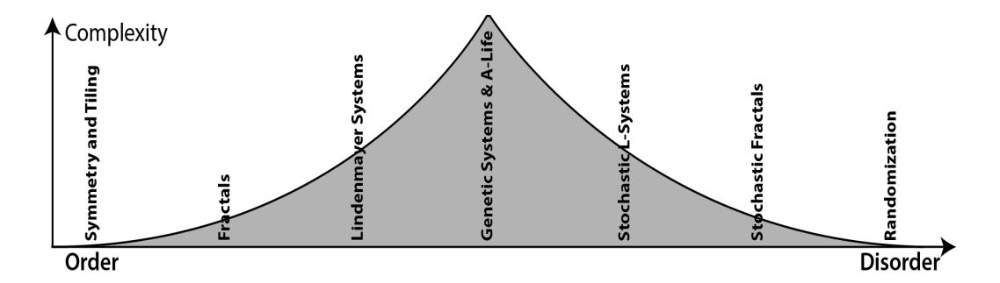
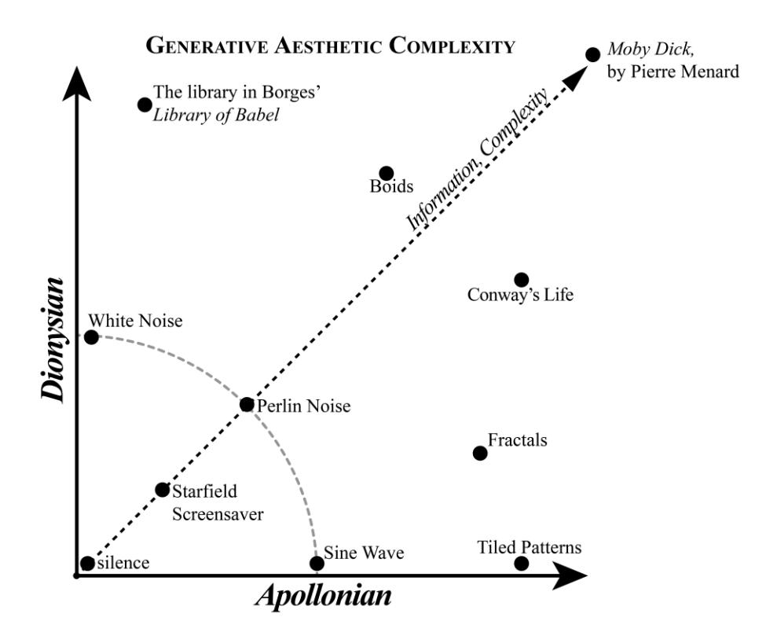
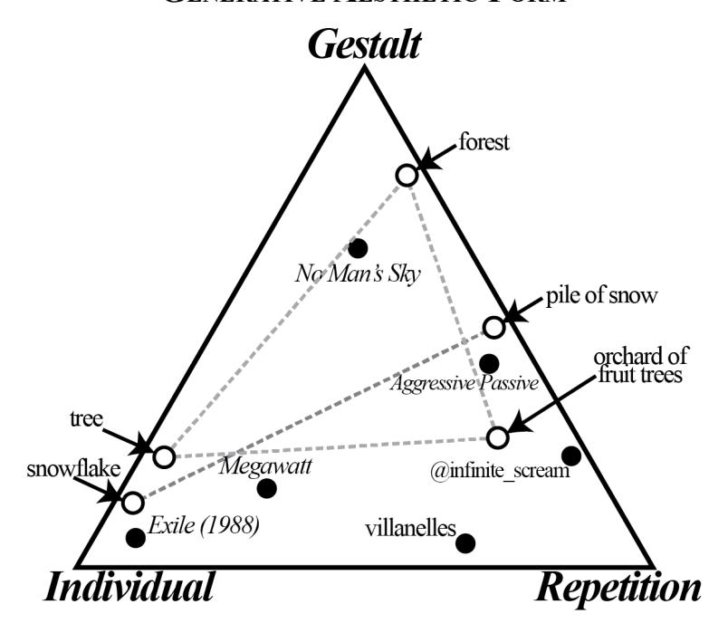

# **Preliminary Poetics of Procedural Generation in Games**

## **Isaac Karth**

University of California Santa Cruz Design Reasoning Lab 1156 High St, Santa Cruz, CA 95064 +1 (432) 301-9393 ikarth@ucsc.edu

### **ABSTRACT**

Procedural Content Generation (PCG) is deeply embedded in many games. While there are many taxonomies of the applications of PCG, less attention has been given to the poetics of PCG. In this paper we present a poetics for generative systems, including a descriptive framework that introduces terms for complex systems (Apollonian order and Dionysian chaos), the form that describes the shape of the generated output (formal gestalt, individual, and repetition), the locus of the generative process (structure, surface, or locus gestalt), the kind of variation the generator uses (style, multiplicity, and cohesion) and the relationship between coherence and the content used as input for the generator. Rather than being mutually exclusive categories, generators can be considered to exhibit aspects of all of these at once.

### **Keywords**

Procedural content generation, PCG, poetics, aesthetics, information complexity

### **INTRODUCTION**

Procedural content generation has a long history in games. Some of the earliest videogames used generative systems to create dungeons or save memory. And many analog games have used generative techniques (Smith 2015). As such, criticism of games needs to be able to effectively analyze the generative systems.

Michael Cook has recently called for an interrogation of the language we use to talk about procedural generation. According to Cook,

The old language of procedural generation needs to be done away with, and in its stead we need a new way of communicating about what we do, and why it's interesting. We need to debunk the idea of procedural generation as a dark art, and show people that it is accessible, understandable and interesting. (Cook 2016)

From a critical theory perspective, developing an aesthetic theory for procedural generation is akin to the need to document the Kuleshov effect (Kuleshov 1974, 5) in film or McCloud's study of panel composition in comics (McCloud 1993): an essential part of naming and studying the basic language of the medium. From the perspective of a practitioner, understanding the implications of the artistic decisions being made is an essential part of the craft.

### **Proceedings of DiGRA 2018**

© 2018 Authors & Digital Games Research Association DiGRA. Personal and educational classroom use of this paper is allowed, commercial use requires specific permission from the author.

Poetics, as used here, refers to a theory of form that studies the creative principles informing a creative work. Just as "Towards a Theory of Choice Poetics" (Mawhorter et al. 2014) describes a poetics of choices in games, we present a theory of generative forms.

While taxonomies of procedural generation exist, the focus has been on the how rather than the why. Many taxonomies of procedural generation, such as those presented in Togelius et al. (2011), Yannakakis et al. (2011), or Hendrix et al. (2011) have been oriented around either the domain where the generation is applied or the specific techniques that the generation uses. The poetics of generativity—what it means when we use a particular form of generation and what effect it has on the player—are underexplored.

This paper is a preliminary attempt to understand the poetics of generative content in games. We begin by establishing a series of generative aesthetic principles that both complement each other and operate in tension with each other. Using this vocabulary, we can examine what effect different configurations of principles produce. Like the visual vocabulary of montage in film or the use of meter and metaphor in language, the poetics of generative systems are built out of this vocabulary of forms.

### **PREVIOUS FRAMEWORKS**

There are several previous aesthetic frameworks for PCG that overlap somewhat with the ideas presented here. However, none of them describe a complete poetics.

### **Expressive Range Analysis**

One way of looking at procedural generation that has been proposed by PCG researchers and implemented in PCG analysis tools (Cook, Gow, Colton 2016) is expressive range analysis: "Expressive range refers to the space of potential levels that the generator is capable of creating, including how biased it is towards creating particular kinds of content in that space" (Shaker et al. 2016, 218).

Measuring the expressive range of a generator is a useful way to understand a generative system. But expressive range analysis relies on selecting the right metrics to measure. There is no one right answer: "The metrics used for any content generator are bound to vary based on the domain that content is being generated for" (Shaker et al. 2016, 220). Gillian Smith and Jim Whitehead also suggest that "These metrics should be based on global properties of the levels, and ideally should be emergent qualities from the point of the view of the generator" (2010). That is, rather than measuring the things the generator's parameters directly influence, it is better to measure something like the linearity of the generated level.

### **Gillian Smith's Design-Centric Analysis**

In "Understanding Procedural Content Generation" (2014), Gillian Smith uses the Mechanics-Dynamics-Aesthetics (MDA) framework to put forward an analytical framework for Procedural Content Generation. According to Smith, "it is vital that both AI researchers and designers have a common vocabulary for understanding not just what PCG is but how it can be used to induce particular experiences and what it uniquely offers to game design." Smith categorizes the approaches used in PCG into optimization, constraint satisfaction, grammars, content selection, and generation as a constructive process.

The *aesthetics* in the MDA framework refers to a narrow definition of aesthetics: "Aesthetics describes the desirable emotional responses evoked in the player, when she interacts with the game system" (Hunicke et al. 2004). Smith categorizes the forms of MDA aesthetics used in PCG as discovery, challenge, and fellowship.

### **The Annals of the Parrigues**

In 2015, in response to National Novel Generation Month ("NaNoGenMo") and ProcJam ("ProcJam: Make Something That Makes Something"), Emily Short created a travelogue novel called *The Annals of the Parrigues* (2015) in "collaboration with the machine" (97). As an outgrowth of earlier attempts to generate systematic vocabularies of symbols, after the manner of the symbolism in a tarot deck, she used a set of five principles as "an organizing iconography distinct from traditional groups of elements" (86). Importantly, the principles formed "a system of mutual partial opposition" that deliberately could only be used with a dynamic, rather than static, equilibrium, similar to the use of the color wheel in the design of *Magic: the Gathering* (86).

The five principles she chose—Mushroom, Salt, Venom, Beeswax, and Egg—became a vital part of the world-building. These principles were used as meta tags on the content in the corpus of data the generator used: for example, Short associated Salt with order and regularity, so a town associated with Salt would have austere buildings in desaturated colors and the religious beliefs would be "an organized kind of religion" (Short 2016b). This has influenced other designers: Bruno Dias developed a similar system for the procedural generation in the game *Voyageur* (Dias 2017).

But the principles were also reflected in the generative system itself: Salt is also about grammars and generators that operate without human input. Taken as a whole, the five principles form a working framework for a practical generative poetic, expressed as opposing aesthetic forces.

The framework in this paper is partially a response to Emily Short's framework. Our framework attempts to cover aspects her deliberately limited tarot suits of principles left out. At the same time, the deliberately overlapping aesthetic tarot has advantages that deserve further study outside of the present discussion.

### **Design Metaphors**

In "Design Metaphors for Procedural Content Generation in Games," Khaled, et al. (2013) establish a set of metaphors to describe the relationship between a designer and the generator. To distinguish between the generator being described via metaphor and the human "designer" performing a similar role, they signify the metaphor using small caps, so a "DESIGNER" is referring to the machine acting as a metaphorical game designer.

One of the metaphors is the DOMAIN EXPERT, a system acting in a role similar to a domain expert who is sometimes used in serious games to provide background expertise on a subject matter. We can extend this metaphor by drawing on the artificial intelligence concept of an expert system. An expert system emulates the knowledge of a human expert by encoding a decision-making process into a knowledge representation. Likewise, a procedural generator as EXPERT SYSTEM is an expert on the thing it generates. That is, the generator is an expert on itself. The definitive definition of what it means to be a dwarf in *Dwarf Fortress* (Bay 12 Games 2018) can be found in the data-files and processes of the *Dwarf Fortress* source code and executable.

### **Generative Art and Effective Complexity**

Games are far from the only place where generativity is used. In the fine art world, generative art has a long and venerable history. It predates computers but has come into its own as computers have enabled new forms of generativity to be explored. One influential definition for generative art is that of Phillip Galanter:

Generative art refers to any art practice in which the artist uses a system, such as a set of natural language rules, a computer program, a machine, or other procedural invention, that is set into motion with some degree of autonomy, thereby contributing to or resulting in a completed work of art. (Galanter 2003)

Galanter further applied the concept of effective complexity to generative art. Highly ordered systems (such as crystals or Penrose tiles) are simple, and highly disordered systems (e.g. randomization via cut-up techniques) are conventionally complex. But in information theory terms, effective complexity recognizes that highly disordered systems are nevertheless conceptually simple. Instead Galanter traces a bell curve of effective complexity, placing evolutionary systems and artificial life at the peak of the curve (Figure 1).

Galanter uses this to categorize generative art into highly ordered, complex, and highly disordered. Highly ordered generative art uses patterns and tiling but little or no randomness. Disordered systems, in contrast, are highly disordered generative art: aleatory music, cut ups, etc. Standing in contrast to the relative straightforwardness of tiled patterns and die rolls, Galanter's "complex systems" are self-organizing, emergent, and greater than the sum of their parts.

**Figure 1:** Galanter's complex systems: generative art on a continuum from order to disorder, with effective complexity peaking in the middle (Galanter 2016).

| Complexity | The balance between Apollonian (generation by rules and structures) and Dionysian (generation that uses chance and disorder). The combination of both produces Complexity and information (in the information theory sense).                                                                         |
|------------|------------------------------------------------------------------------------------------------------------------------------------------------------------------------------------------------------------------------------------------------------------------------------------------------------------------------|
| Form       | The balance between the Individual generated artifact, the Formal Gestalt of all the artifacts the generator produces, and the degree of Repetition (or obvious lack of perceived uniqueness).                                                                                                          |
| Locus      | Where the player's focus is centered, in a balance between the Structure of the generator's processes, the Locus Gestalt of the generator's output, and the Surface of the immediate experience of individual generated artifacts.                                                                   |
| Variation  | The generator's output can exhibit Multiplicity by generating many perceptually distinct things; Style by generating things that conform to an objective; or some combination of the two. Variation is also affected by the Content a generator uses as data and how Cohesive the results are. |

**Table 1:** A summary of the aspects of generative poetics this paper covers.

### **Procedural Aesthetics**

Matt Stockham presents an aesthetic taxonomy in "Procedural Aesthetics" (Stockham 2014), focusing on identifying a toolkit of aesthetic devices, including defining regions in generated landscapes, generating rules of play, and using modular music.

In contrast, the aesthetic principles in the present paper are not tied to any specific technique. There are many ways of expressing similar generator outcomes. To give one example: the choice of what kind of noise to use has an effect, but our focus is more on that effect rather than the specific algorithm used to achieve that effect.

### **POETICS OF PROCEDURAL GENERATION**

While sharing some of the same properties as other expressive processes, procedural generators can be characterized on aesthetic measures specific to generativity (Table 1). These aesthetic properties aren't an exhaustive list but rather the properties we judged to be the most relevant. It is also important to note that most of the properties presented here are not mutually exclusive. For example, gestalt and structure are in tension but a generator can exhibit both properties. Many generators use seemingly contradictory principles in different parts of the system, or encapsulate generators that are based on very different principles. Rather than a simple continuum, the poetics presented here can be thought of a multidimensional space, with some of the dimensions being connected with multiple other aspects.

Most of the examples in this paper will be drawn from either videogames or works made for the annual National Novel Generation Month (NaNoGenMo). Videogames are a broad category that exhibit a mass-media application of generative systems. In contrast, NaNoGenMo projects are participating in a specific artistic discourse, one that has been compared to the ideas in Ken Goldsmith's *Uncreative Writing* and the Dada art movement (Hume 2015).

**Figure 2:** Generative aesthetic complexity: rather than a linear continuum, the balance between the Apollonian and Dionysian aspects of generativity can be described as a two-dimensional space. Information and complexity increase towards the upper right, beyond which is the (hypothetical) computer-generated Great American Novel.

### **GENERATIVE COMPLEXITY: APOLLONIAN AND DIONYSIAN**

We here introduce terminology derived from Nietzsche's aesthetic dichotomy of Apollonian and Dionysian impulses. Unlike order and chaos, they are not mutually exclusive. The reason and order of the Apollonian impulse is balanced against the emotion and chaos of the Dionysian impulse in a dialectic.

Out of all the properties of procedural systems, perhaps the central tension is between the randomness that generators use for aleatoric novelty and their need for ordered structure give that novelty the context for it to have any meaning. But they are not a onedimensional spectrum, with order and chaos as mutually exclusive ends. Rather, Apollonian and Dionysian elements exist simultaneously in generative systems. They are both in tension with each other and support each other (Figure 2).

Departing from Galanter's complex systems, we argue that the PCG systems with the highest effective complexity can be viewed as both highly ordered and highly chaotic. That is, systems that have the most emergent complexity can exhibit both high levels of what we term Apollonian generation—being governed by structured rules—and Dionysian generation—being governed by noise and non-deterministic chaos.

There are also generative systems that exhibit low-order/low noise, though of course on the extreme low end we might hesitate to call them generative at all. Low-complexity generative systems generally use either a degree of structure or a degree of noise. A few use both: the Microsoft Windows "Starfield" screensaver1 , for example, has a structure (bright points always start near the middle of the screen and fly outwards) and randomness (the position and direction of the points). It is definitely generative, but is not particularly complex.

### **Dionysian Noise**

Procedural generation in games often starts with randomness. While there are deterministic generators that construct an output via a parametric processes, in practice they often have their parameters controlled by some form of noise or randomness. Clustered around the Dionysian pole, we find such things as aleatory music,2 the cut-up technique popularized by Burroughs (1961), random tables in Dungeons & Dragons which are themselves descended from prior wargames (Peterson 2012, 311-314) and terrain generation with Perlin noise (Perlin 1985).

The most basic use of noise—the die roll, the coin flip—is uniform white noise, with an even distribution and each outcome independent from every other. But noise can also be expressive: both the distribution and the frequency can be adjusted to produce new effects. Adjusting the distribution is a very common method of altering the kind of randomness used—rolling multiple dice and summing the result approximates a bell curve, and countless 20th century wargame and roleplaying designs revolved around applying distortion curves to a die result in the form of a lookup table (Peterson 2012, 289-290).

Less frequently discussed but equally practical is the spatial or temporal frequency of noise, also called the color of noise, in analogy to colors of light being determined by its wavelength (Mandelbrot 1983). The color of noise describes the timbre of the sound or the texture of its visual appearance. Red noise has less power in the higher frequencies, while blue noise is the reverse. Both appear in nature and have specific uses in audio production, visual effects, and procedural generation.

More coherent forms of noise, such as Perlin noise, have achieved such ubiquity in procedural content generation that they are sometimes synecdochically identified with procedural content generation itself. Coherent noise is still noise, in that the output can be calculated independently for each point, but the mathematical structure of the noise generator means that neighboring points have values that are related to each other.

Dice-metaphors are, of course, only one kind of randomness. A second frequently used paradigm is the shuffle, the metaphor of cards in a deck. This is still a random process, but with very different properties. In particular, sampling without replacement gives a designer much more control over the outcome of a generative system while still involving a large amount of hands-off randomness.

### **Apollonian Order**

Procedural generation is not just the Dionysian chaos of noise. What makes procedural generation distinct from just white noise is that it has coherence and structure that provides a logical relationship between the generation process and the result.

Generative art can exist with very little randomness, so long as the structure is interesting enough. The simple rules of Conway's Life (Gardner 1970) and the geometric tiling patterns in Islamic art, such as deployed in the game *Engare* (Bahrami 2017): both follow fixed rules but can create emergent results of startling complexity.

This complexity can also emerge in entirely deterministic systems. Chaos theory is the study of deterministic but unpredictable systems. Strange attractors (Lorenz 1963, 130- 141) and fractals (Mandelbrot 1983) are created by ordered processes but exhibit unpredictable emergent results.

This is complicated by the pseudorandom number generation that is used for most procedural content generation. While some generators use other sources of randomness (most typically crowdsourced or via some kind of data-feed) the vast majority of generators in games use a form of order to create their randomness. None of these categorizations are pure. Generators can nest inside other generators or be assembled into generative pipelines that mix different forms of generativity.

### **GENERATIVE FORM: REPETITION, GESTALT, INDIVIDUAL**

While the Apollonian and Dionysian aspects of generation are the most obvious aesthetic aspects of procedural generation, other aspects can be just as important. In what we term the *generative form*, the generator balances between the gestalt effect, individual generated artifacts, and repetition.

Repetition, in particular, is under-discussed but frequently used. In Emily Short's aesthetic tarot, the principle of Mushroom describes the repetition that grows on the forest floor of generativity:

Mushroom is propagative and indifferent to the individual. As long as there are spores, the fungal principle is content. Mushroom-writing does not care about an individual instance of output and does not regret the loss of any element. Mushroom-writing thrives on decay, the breakdown of old structures, and the creation of new structures. Mushroom-writing is indifferent to consistency or to the profile of the resulting whole. It is unapologetic about repetitions. (Short 2015, 89)

Here we can see that repetition (and being obviously created by a generative process) can be a desirable aesthetic goal in itself. Many existing generators make use of this: Short considers Markov chains to be "mushroomy" (Short 2015, 89).

Repetition as an aesthetic device is a common feature in different media. Many periods of architecture, from the Classical to Gothic to Modern involve repeated forms. Many poetic forms use repetition extensively, ranging from parallel imagery to repeating words verbatim, to the point that some poetic structures, such as villanelles, are premised on exactly repeated phrases. Some generators use this principle directly: the @infinite\_scream Twitter bot (Reed 2015) tweets variations on "AAAAAAHHH" for followers to interact with.

**Figure 3:** Generative aesthetic form: the tension between repetition, individual artifacts, and the generation as a whole.

Generativity allows us to recapture an older form of repetition: in contrast with the identical mass-produced objects of modernity, generativity can approximate the subtle variations of the handmade artisanal craft production. Individual generated artifacts can be made unique, even if they are not novel in the aggregate: bolts on an airplane wing generated with minute variations, as in Denis Kozlov's Project Aero (Kozlov 2017); a unique color scheme, as exhibited by the creatures in *Spore* (Maxis 2008); or the color of a star in *No Man's Sky* (Hello Games 2016). It returns a sense of individuality to the manufactured object, though this time it is the individuality of the machine rather than evidence of the direct human hand.3

Extending this view, generativity can create a fractal repetition, a repetition where no individual snowflakes are the same but the combination creates a formal gestalt impression, a generative snowbank.

This gestalt effect, where individual points are less important than the effect of the whole, is an underappreciated aesthetic outcome of generativity. This is one of the ways in which procedural generation can be generative in another sense: having the qualities of plant growth. The aesthetics of generativity are often organic, resembling the verdant emergent forest undergrowth.

A procedurally-generated forest is a good example of the gestalt aesthetic: the exact placement of individual trees is not important as long as there are enough plants to convey the idea of a forest. The gestalt is what matters, not any specific individual or the exact shape of the overall forest.

For the gestalt, both the individual tile and the overall pattern of tiles on an infinite tiled floor are a smaller part of the aesthetic experience. Instead the viewer's aesthetic experience of rules that create the pattern is most strongly felt through the perception of something else entirely, a Form that can only be glimpsed indirectly in this liminal space that is neither the whole nor the individual part.

Repetition is the Apollonian mirror of the more Dionysian gestalt-perception: the chaos of the forest-gestalt compared to the ordered rows of an orchard. In both cases, the overall perception dominates the aesthetic rather than any single artifact.

The designers of *No Man's Sky* (Hello Games 2016) intended for players to approach its planets as gestalt experiences. Each planet has a single environmental biome and a roughly even distribution of features specific to that planet. The idea was that this would let players quickly recognize what kind of planet they had found, encouraging exploration of new planets (*Special Edition Podcast: No Man's Sky*, 2014, 22:14). The player's lossof-interest pattern-recognition takes hold somewhere between visiting a single location (often too brief to grasp the entire pattern of the planet) and exploring the entire planet (virtually impossible).

### **LOCUS: STRUCTURE, SURFACE, GESTALT**

Rotating our perspective of gestalt, we contrast it against other centers of the generator's aesthetic locus. 4 The generative gestalt aesthetic is an abnegation of the immediate details of the sensory experience in favor of the hidden effects emanating from that experience. But there are also generators which are concerned with the macro-structure of the system itself. For Short, this is partially subsumed under the principle of Salt: "For the principle of salt, the machine-that-writes matters more than the thing-written" (2015, 88).

While often associated with the Apollonian order, a Dionysian generative system can also be structurally expressive: in Jonathan Basile's digital implementation of the *Library of Babel* (Basile 2015) the sheer scale of the permutations transcends the noisy gestalt and turns the player's focus to the ideas of infinity embedded in the architecture of the generator.

Short additionally associates Salt with the grammars she created that expressed specific ideas like kinds of cheese or scents of perfume (2015, 88). This echoes the design metaphor concept of an EXPERT SYSTEM: the system is an expert about itself. The map is literally the territory.5

Generative art that borders on conceptual art tends to be about expressing ideas through the structure. For example, Aaron Reed's *Aggressive Passive* (2013), Nick Montfort's *Megawatt* (2014), and Andrew Plotkin's *Redwreath and Goldstar Have Traveled to Deathsgate* (2013), all NaNoGenMo novel generators. One of the two NaNoGenMo rules is that code must be made public. Therefore, NaNoGenMo generators often are capable of outputting multiple novels. Or, as in the case of *Megawatt*, produce a deterministic output that nevertheless foregrounds the process of generation.

*Redwreath and Goldstar* operates by expanding a grammar to create a conversation that consists almost entirely of characters answering questions with more questions. *Aggressive Passive* uses a similar structure to tell stories about housemates blaming each other for not doing chores. In both cases, the individual sections of the novel are less important than the way the system as a whole operates.

**Figure 4:** Generative aesthetic locus: the player's experience of a generator is a balance between the **structure** of the process, the ideas and associations the player perceives indirectly in the **gestalt**, and the immediate **surface** interface of individual artifacts that the player can interact with or directly observe.

### **The Poetics of Structure**

One design feature of using generative forms that result from this emphasis on structure is that the player can infer how the hidden generator works and draw conclusions from that. Many generators have deliberate tells, such as the way that dungeon generation in *NetHack* (Nethack DevTeam, 2015) makes it easier to predict where a secret door might be once the player understands how the level generator lays out space.

There are many ways to achieve this. One way is to have a predictable distribution, such as the way weapon and item generation in *PLAYERUNKNOWN'S BATTLEGROUNDS* (PUBG Corporation, 2017) can be predicted from the kind of building they are found in, or the patterns that raw diamonds follow in *Minecraft* (Mojang 2011), only appearing in clusters at defined depths. Another way is to enforce consistent generative rules, such as the way that most levels in *Spelunky* (Mossmouth 2013) always generate the exit lower than its entrance. Yet another way is the inclusion of guaranteed or fixed content in an otherwise dynamic generator, such as the way that *NetHack* (Nethack DevTeam, 2015) has a number of special-case levels at predictable but slightly varying depths.

Aesthetic concepts, such as symmetry, can enable the player to infer information before actually encountering it. This speeds up the process of the player familiarizing themselves with the system and allows the designer to surprise the player by breaking the pattern.

### **Hierarchy and Distribution**

Hierarchy is an important aesthetic principle in many disciplines, such as visual hierarchy in graphic design (Clayton 2009, 48). One way that hierarchy is expressed in procedural generation is via the distribution of the generated artifacts.

Both frequency and rarity have specific effects on the player's perception. Rare artifacts, such as the villages and strongholds in *Minecraft* (Mojang 2011) are perceived as more important and examined individually. They have an expectation of uniqueness, although repetition at long distances can also engender a sense of ritual. In contrast, frequent results are generally closer to a gestalt effect, forming the background as a contrast to the figure of the rarer results.

Distributions that follow non-linear or biased curves are often more interesting than linear probabilities: pushing the generator to extremes gives more interesting results. Just as animators use easing to create more pleasing motion, rolling a pair of dice and adding them together creates more interesting random results than rolling a single 11-sided die would. Making the highs higher but rarer creates contrast that makes them stand out, with very unusual results acting as landmarks.

Adjusting the weighting or distribution of outcomes is often an important part of the design process when working with procedural generation: in *Voyageur* (Dias 2017a), Bruno Dias used both a salience system and hand-tuned weightings to control the frequency at which pieces of content would be used in the generator (Dias 2017b).

### **Individual: The Artifacts as Surface**

Of course, individual artifacts of the generator can be important in themselves, apart from how they relate to other generated artifacts. After all, the artifacts are usually the only surface through which the player can observe and interact with the generator.

This borrows from Noah Wardrip-Fruin's use: "the surface of a work of digital media is what the audience experiences: the output of the processes operating on the data, in the context of the physical hardware and setting, through which any audience interaction takes place." (2009, 10). We extend this to the idea that individual sub-processes have their own virtual surfaces: the map generator in *Minecraft* (2011) can only be experienced through the intermediate surface of the voxel blocks.

Therefore, the individual generated artifact is in triangular tension with the both the form and the locus of the system. Depending on the generative system, individual artifacts can be anywhere from nearly anonymous (a tree in a forest) to the only visible artifact: the BBC Micro game *Exile* (Irvin and Smith 1988) uses a fixed-seed generator to create its map, enabling it to fit a sprawling cave system on-disk. As with the Dionysian and Apollonian poles being distinct from complex systems, a generator that focuses on individual artifacts uses both gestalt and structure but is ultimately something else.

In Short's terminology, "Egg represents the egotistical, the view of the self as unique and special" (2015, 87) and "The egg principle is the principle of consensus, the principle of combination, or the principle of the authorial self" (2015, 96). Notably, Short also uses this to include human curation and mixed-initiative generation.

In a generative system that emphasizes the individual artifact, the player can be expected to scrutinize each individual result more closely. An individual-focused generator puts more depth into the generation of each artifact. Here, quality is far more interesting than quantity.

Individual artifacts can, nevertheless, participate in larger systems. While the artifact as a whole might be unique, parts of it can reflect the system that made it. The engravings in *Dwarf Fortress* (Bay 12 Games 2018) are each individual and unique (when created by a skilled dwarf) but the images they depict are linked to the history of the world and the interests of the character that made them.

In general terms, gestalt aesthetics tend to dominate in pure Apollonian or pure Dionysian systems, such as tile patterns or white noise. Structured aesthetics, such as *Spelunky*'s level generator, tend to be unbalanced mixtures of the two. Complex systems, such as the fixed-seed map generator in *Exile*, tend to favor individual aesthetics, because a single artifact has more scope to display internal variation. But these aesthetics are orthogonal to the Apollonian/Dionysian tension, and can be found in many different permutations.

### **VARIATION: MULTIPLICITY, STYLE, COHESION**

A third set of aspects involves *variation*. A common reason to use a generative system, after all, is that the results are not fixed, or at least not predictable. But there are different kinds of variation, including multiplicity, style, and cohesion.

### **Multiplicity**

The most obvious form of variation is a generator that can produce a wide variety of very different results. The naive form of this is popular: for example players and press gushing that a generator has 18 quintillion outputs (Higgins 2014). Just as the effective complexity of white noise is lower than its incompressibility implies, the perceptual uniqueness of a generator can be much lower than its theoretical variance.

Kate Compton has framed this as the "10,000 bowls of oatmeal" problem (Compton 2016): an oatmeal generator can produce an incomprehensibly vast number of configurations of individual oats but they all get glossed to the gestalt symbol of nearly indistinguishable bowls of oatmeal.

To maximize the effectiveness of multiplicity, the variation should be closely tied to both the visual presentation and the other systems in the game. Effective variation matches the importance of the variation with the significance of its presentation.

For example, human visual perception strongly relies on contour. When subjected to a blank, diffuse field of vision, such as in a homogenous Ganzfeld, the observer usually ceases to perceive color (Cohen 1958). Artists and animators use this in character design: silhouette is a stronger signal than interior color. We can likewise apply it to the design priorities in generative systems. At launch *Elite: Dangerous* (Frontier Developments 2014) featured a space station generator that was capable of creating a wide variety of different configurations for their large, spun-axis stations. However, due to the way that the docking mechanics worked, players typically observed the station from end-on. Since the station designs were roughly cylinders and the player was focused on the docking port in the middle, this lead to the wide range of variation being much less noticeable in practice.

### **Style**

Distinct from the aesthetics of multiplicity, variation also exists within individual artifacts. This can be either to constrain the artifact to conform to a set of constraints or to enable the artist to shape the artifact directly. For example, a tree generator that takes the surrounding space into account and adjusts the tree accordingly. Or alternately, gives an artist control of the parameters of the generator, selecting one specific tree out of the generator's possibility space. An instance of this in practice was the production of *The*  *Elder Scrolls IV: Oblivion* (Bethesda 2006), which involved using SpeedTree's generative system to generate the trees which the artist could adjust manually, enabling them to rapidly place trees and vegetation (Davenport 2017).

This aesthetic measure is the *style* of the artifact. Style, in this definition, measures the degree to which the generator is able to adjust an artifact to conform to an objective. In contrast to multiplicity's diversity of outputs, style is about getting the right generated result. My use of "style" here is inspired by Jo Mazeika's work on style generation (Mazeika and Whitehead 2017).

*Dwarf Fortress* (Bay 12 Games 2018) uses this frequently when generating poetic forms, books, legendary artifacts, and the engravings mentioned above. Using content from the simulated world history, they exhibit style that reflects both that history and the individual history of the fortress the player has created. Similarly, *Ultima Ratio Regum,*  Mark R Johnson's in-development roguelike, uses style for the culturally-influenced artifacts and the AI of NPCs (Johnson 2015).

### **Effective Variation**

Like effective complexity, effective variation is largely concerned with finding a balance between multiplicity and style (while also keeping the results coherent and consistent).

As mentioned above, one way to measure the variation of a generator is through the process of expressive range analysis, via a metric that is an emergent result of the generator rather than one of the parameters to the generator (Smith and Whitehead 2010, 1). Exactly which emergent result to measure depends on the designer's goals for the generator and the structure of the generative system itself.

Emily Short uses "Venom" to describe a concept related to effective variation:

Venom is meant in the sense of toxin, hallucinogen, bitterness, acid, etching, numbness, drugs, and release from the mortal coil. Venom represents that which is destructive, fictive, cruel, lovely, playful, unreliable. Poisonous things come in jewel colors. The principle of venom permits the use of connotation rather than denotation. (93)

When "writing venomously" Short recommends that when adding variation to text, the focus should be on finding the most statistically implausible, meaning-bearing words in a sentence. When writing a template describing a how a crime was committed, "the Principle of Venom suggests the use of a large, autogenerated corpus to supply the crime, rather than relying on the author's own imagination" to produce results that "are genuinely outside the expectations of the author" (Short, 2015, 95).

Separately, Short suggests that the number of conceptually-surprising variations should be kept to a few effective ones, to avoid creating overly-complex clashing images. Overvariation is prone to a kind of metaphor fatigue.

Elsewhere, Short suggests that one way to avoid the oatmeal bowl problem is to tie the generated results back into the other systems in the game. This can either be in a structured way—which she compares to the combinatorial effects of cards in a deckbuilding game—or in a low-level gestalt approach, with small-scale but persistent effects (Short 2016a).

### **Cohesion: Data, Metadata, Beeswax**

I have been asked about the possibility of a procedural content generator that creates everything from scratch, with no external content. This is a category error: every generator uses external content. In some cases that input can be supplied algorithmically via another generator, but every generator needs to ground-out in designer-created input. While it is possible to replace all textures with mathematical functions, the design of the texture-function itself is a form of expert content authoring.

Hand-authoring different generators can sometimes be the most effective way to create a generator with wide variation. Likewise, hand-authoring content is often the most efficient way to create certain kinds of inputs—many text generators exploit their specific authoring.

### *Data: Content*

All procedural generators use some form of data. It can be via algorithms, the parameters, or some more complex hand-authored content. Moreover, the data the designer chooses to include is intrinsically bound to the effect of the generator.

It can be useful to consider a system that deploys that data separately from the corpus of data. But the data itself often has a structure that affects the distribution of the generator. Take a Markov chain text generator. The algorithm remains fixed but the distribution of words in the corpus determines the distribution of words in the output. A change in the corpus has significant effect on the generated output. Even in more complex generators, such as the Deep Dream neural-network generator (Mordvintsev et al. 2015), the disproportionate number of dog-breed categories in the ImageNet image recognition dataset affected the aesthetic results of the generator: the "puppyslug" effect.

This should not be surprising: the Kuleshov effect (Kuleshov 1974, 5) works as a part of film language regardless of the content it is used with, but the meaning of a particular montage depends on the content being cut. The poetics of procedural generation exhibit analogous properties: the content used in the generator matters.6

Many generators produce very different results depending on the data that they use. *Spelunky* (Mossmouth 2013) uses different templates for each area (Jungle, Ice World, etc.) and room type in its level generator. *Dungeon Crawl Stone Soup* (2017) has a large library of vault templates that it similarly deploys across its dungeon branches. *Dwarf Fortress* (Bay 12 Games 2018) can be modded to generate very different worlds simply by editing the data files it uses.

### *Metadata: Cohesion*

The struggle with data is that it needs to be self-consistent enough for the generated content to be perceived as a unified, sensible result. Some forms of data are able to use implicit relationships, such as the relationship between points in Perlin noise (Perlin 1985), or the relationship between different instances of Perlin noise with similar parameters. But additional metadata is often needed to give the generator enough context to assemble a coherent result.

Metadata can be as simple as a tagging system giving context to the strings in a text generator. And for many generators that is enough, when combined with connotation, allusion, and elision, to maintain the illusion of complex relationships (Dias 2016). But, following the *SimCity effect,* where the expectations the surface creates connect to the

procedural system they represent (Wardrip-Fruin 2009, 301), the most effective metadata is visibly related to the shape of the underlying generative system.

Often the automated creation or use of metadata is an important step in automating the generator. The innovation of word vectors (Maas et al 2011, Mikolov et al 2013) has simplified natural language processing in useful ways, giving us a rough but effective way to quantify the meanings of words.

### *Beeswax*

When we analyze a generator we should also pay attention to how it integrates handauthored content and how it intersects with the fixed systems that it lives between. For Emily Short, the use of corpora falls under the heading of Beeswax, drawing on the image of a hive sharing the task of constructing a honeycomb. Short points out that using a human-assembled corpus inevitably also brings in the cultural assumptions of those who compiled it (Short 2016b), which is its own form of metadata.

Beeswax also includes the idea of one-off content and content that is "hand-written for particular cases" (90). This point should not be overlooked: when discussing procedural generators it is tempting to focus solely on the most generative parts, but the handauthored content often anchors the generator's structure. *NetHack* (2015) is well known for including hand-authored responses to unusual situations, inspiring the Usenet meme that "the dev team thinks of everything" (Bridgman 2016).7

### **ASSEMBLING THE POETICS**

Procedural generation can exhibit many different aesthetic attributes. The different principles are related but distinct, perhaps best imagined as a multidimensional vector with partially interrelated axes, or a series of contrasts and congruencies.

The way a generator expresses information can be through Apollonian tile patterns, Dionysian noise or complex combinations of the two. The form of the generator can expressively use gestalt forests, repetition of orchards, or the generation of individual trees. The locus of the generation can be on the details of an individual artifact, as in the map in *Exile*; the structure of the generation process, as in the pattern of diamonds in *Minecraft*; or the gestalt of the generator's output, as in the planets in *No Man's Sky*. Individual artifacts bridge both the form and the locus. Orthogonal to both form and locus, the variation can exhibit the multiplicity of perceptually unique output, cohesion of the results, and a style that conforms to a goal.

### **CONCLUSION**

We have presented a preliminary outline of the poetics of procedural generation in games, sketching out some of the principles that describe how generators are used and how we can meaningfully discuss the shape of the things they generate. It is our hope that this initial work can contribute to further refinements and foster deeper discussion of how procedural generation is used in games.

### **ACKNOWLEDGMENTS**

This paper exists thanks to the guidance of Noah Wardrip-Fruin and Adam M. Smith. Additionally, the author would like to thank Batu Aytemiz, Jesse Harder, Oleksandra Kheel, Max Kreminski, Jo Mazeika, Joseph Osborn, and Xiaoxuan Zhang for providing valuable feedback along the way.

### **ENDNOTES**

- 1. Sometimes titled "Starfield Simulation". A version of it was included in many editions of Windows (ending with Windows XP). It displayed small dots flying out from the center of the screen at random angles: https://www.youtube.com/watch?v=r5TmP\_tI5RI
- 2. Aleatory music is created with processes involving chance, such as found in many works by John Cage. But the use of dice in music composition goes back much further (Hedges 1978).
- 3. That is, each hand-crafted object is subtly unique. I consider this to be related to the Arts & Crafts movement's aesthetics, which arose from the rejection of mass-production, as well as more contemporary reactions to mass production in the age of 3D printing.
- 4. This idea of a generator's "locus" is coined here in a very loose metaphor with Rotter's "locus of control" (Rotter 1990).
- 5. On this point, see also Martin O'Leary's NaNoGenMo novel *The Deserts of the West* (O'Leary 2015) which itself references Borges' "On Exactitude in Science" (Borges 1998).
- 6. This is, notably, a point Kuleshov might disagree with: his original formalist point was that the content was subsumed by the form, influenced by the scientific management techniques of Taylor (Prince and Hensley 1992). Though Kuleshov's later writings revised his view to emphasize that, "In no case should one assume the entire matter of cinematography to be in montage" (Kuleshov 1974, 195).
- 7. See, for example, Ashmead (2004).

### **BIBLIOGRAPHY**

Ashmead, Ben. [b...@minimalist.org.uk] "Re: TDTTOE and RGRNTOE? (Still learning the acronyms...)" In [rec.games.roguelike.nethack]. 6 March 2004.

Bay 12 Games (2018) *Slaves to Armok: God of Blood Chapter II: Dwarf Fortress*. [PC, v0.44.05.] Bay 12 Games

Bahrami, Mahdi. (2017) *Engare*.

Basile, Jonathan. "Library of Babel." Library of Babel [website] 2015. <https://libraryofbabel.info/> (accessed December 12, 2017)

Bethesda Game Studios (2006) *The Elder Scrolls IV: Oblivion* [Windows]. 2K Games.

Borges, Jorge Luis. "On Exactitude in Science" Collected fictions. Translated by Andrew Hurley. New York, N.Y., U.S.A.: Viking. 1998.

Bridgman, John. 2016. "The story behind NetHack's long-awaited update--the first since 2003." Gamasutra Article. April 15, 2016. Available at [https://www.gamasutra.com/view/news/269726/The\\_story\\_behind\\_NetHacks\\_l](https://www.gamasutra.com/view/news/269726/The_story_behind_NetHacks_longawaited_updatethe_first_since_2003.php) [ongawaited\\_updatethe\\_first\\_since\\_2003.php](https://www.gamasutra.com/view/news/269726/The_story_behind_NetHacks_longawaited_updatethe_first_since_2003.php) (Accessed January 21, 2018)

Burroughs, William S. 1961. "The cut-up method of Brion Gysin." *The New Media Reader*. Edited by Noah Wardrip-Fruin and Nick Montfort. Cambridge, MA: MIT Press, 2003.

Clayton, M, & Hashimoto, A. *Visual Design Fundamentals: A Digital Approach*, Charles River Media / Cengage Learning, Boston, 2009.

- Cohen, Walter. (1958) "Color-Perception in the Chromatic Ganzfeld." The American Journal of Psychology, Vol. 71, No. 2 (Jun., 1958), pp. 390-394. Accessed January 28, 2018. <http://www.jstor.org/stable/1420084>
- Compton, Kate. (2016) "So you want to build a generator." Published online: <http://www.galaxykate.com/blog/generator.html> (Last checked: February 1, 2017)
- Cook, Michael (2016) "Alien Languages: How We Talk About Procedural Generation." Gamasutra. (August 25, 2016). Accessed December 12, 2017. [https://www.gamasutra.com/blogs/MichaelCook/20160825/279938/Alien\\_Lang](https://www.gamasutra.com/blogs/MichaelCook/20160825/279938/Alien_Languages_How_We_Talk_About_Procedural_Generation.php) [uages\\_How\\_We\\_Talk\\_About\\_Procedural\\_Generation.php](https://www.gamasutra.com/blogs/MichaelCook/20160825/279938/Alien_Languages_How_We_Talk_About_Procedural_Generation.php)
- Cook, Michael, Gow, J. and Colton, S., (2016) "Danesh: Helping bridge the gap between procedural generators and their output." In: *7th Workshop on Procedural Content Generation*. Dundee, United Kingdom. August 1 2016. Accessed February 6, 2018.
- Davenport, James. (2017) "From The Elder Scrolls to the US Secret Service: where videogame trees come from." Pcgamer.com. September 06, 2017. [http://www.pcgamer.com/from-the-elder-scrolls-to-the-us-secret-service-where](http://www.pcgamer.com/from-the-elder-scrolls-to-the-us-secret-service-where-videogame-trees-come-from/)[videogame-trees-come-from/.](http://www.pcgamer.com/from-the-elder-scrolls-to-the-us-secret-service-where-videogame-trees-come-from/) Accessed December 12, 2017.
- DCSS Devteam (2017) *Dungeon Crawl Stone Soup* [Windows, 0.21.1].
- Dias, Bruno. "Procedural meaning: Pragmatic procgen in Voyageur" (2016) [https://www.gamasutra.com/blogs/BrunoDias/20160718/277314/Procedural\\_m](https://www.gamasutra.com/blogs/BrunoDias/20160718/277314/Procedural_meaning_Pragmatic_procgen_in_Voyageur.php) [eaning\\_Pragmatic\\_procgen\\_in\\_Voyageur.php](https://www.gamasutra.com/blogs/BrunoDias/20160718/277314/Procedural_meaning_Pragmatic_procgen_in_Voyageur.php)
- Dias, Bruno (2017a) *Voyageur* [Android].
- Dias, Bruno (2017b)<https://twitter.com/NotBrunoAgain/status/867098020596285442>
- Frontier Developments. (2014) Elite: Dangerous [Windows, 1.0.2]. Played December 2014.
- Galanter, Philip. 2016. "Generative art theory." A Companion to Digital Art (2016): 146-180.
- Galanter, Philip. 2003. "What Is Generative Art? Complexity Theory as a Context for Art Theory." In Proceedings of the International Conference on Generative Art, Milan, Italy. Generative Design Lab, Milan Polytechnic: City.
- Gardner, Martin. 1970. "The fantastic combinations of John Conway's new solitaire game 'life'" In Scientific American. 233. October 1970. 120-123.
- Hedges, Stephen A. 1978. "Dice Music in the Eighteenth Century." Music & Letters 59, no. 2 (1978): 180-87.<http://www.jstor.org/stable/734136>
- Hello Games (2016) *No Man's Sky* [Windows, 1.0].
- Hendrikx, Mark, Sebastiaan Meijer, Joeri Van Der Velden, and Alexandru Iosup. "Procedural content generation for games: A survey." ACM Transactions on Multimedia Computing, Communications, and Applications (TOMM) 9, no. 1 (2013): 1.
- Higgins, Chris. 2014. "No Man's Sky would take 5 billion years to explore." In Wired.com. Aug 18 2014[. https://www.wired.co.uk/article/no-mans-sky-planets](https://www.wired.co.uk/article/no-mans-sky-planets)
- Hume, Kathryn. 2015. "NaNoGenMo: Dada 2.0." Accessed January 27, 2018. <http://arcade.stanford.edu/blogs/nanogenmo-dada-20>
- Hunicke, Robin, Marc LeBlanc, and Robert Zubek. 2004. "MDA: A formal approach to game design and game research." In Proceedings of the AAAI Workshop on Challenges in Game AI, vol. 4, no. 1, p. 1722. 2004.
- Johnson, Mark R. 2015. "Modelling cultural, religious and political affiliation in artificial intelligence decision-making." In Proc. AI & Games Symposium. 2015.

- Khaled, Rilla, Mark J. Nelson, and Pippin Barr. 2013. "Design metaphors for procedural content generation in games." In Proceedings of the SIGCHI Conference on Human Factors in Computing Systems, pp. 1509-1518. ACM, 2013.
- Kuleshov, L.V. 1974. Kuleshov on Film: Writings. University of California Press, Berkeley and Los Angeles, CA. Translated by Ronald Levaco.
- Lorenz, E.N., 1963. Deterministic nonperiodic flow. Journal of the atmospheric sciences, 20(2), pp.130-141.
- Maas, Andrew L., Raymond E. Daly, Peter T. Pham, Dan Huang, Andrew Y. Ng, and Christopher Potts. 2011. "Learning word vectors for sentiment analysis." In Proceedings of the 49th Annual Meeting of the Association for Computational Linguistics: Human Language Technologies - Volume 1 (HLT '11), Vol. 1. Association for Computational Linguistics, Stroudsburg, PA, USA, 142-150.
- Mandelbrot, Benoit B. 1983. The Fractal Geometry of Nature. W.H. Freeman: San Francisco (1983)
- Mawhorter, P.; Mateas, M.; Wardrip-Fruin, N.; and Jhala, A. 2014. Towards a Theory of Choice Poetics. In Proceedings of the 9th International Conference on the Foundations of Digital Games.
- Maxis. 2008. Spore. Windows. Electronic Arts.
- Mazeika, Jo and Jim Whitehead. "Solving for Bespoke Game Assets: Applying Style to 3D Generative Artifacts." In proceedings of the Thirteenth AAAI Conference on Artificial Intelligence and Interactive Digital Entertainment (2017). October 5–9. 2017. Snowbird, Little Cottonwood Canyon, Utah USA.
- McCloud, Scott. 1993. Understanding comics: The invisible art. Northampton, Mass (1993).
- Meggs, Philip B. 1998. A History of Graphic Design. New York: John Wiley & Sons, 1998.
- Mikolov, Tomas, Kai Chen, Greg Corrado, and Jeffrey Dean. "Efficient estimation of word representations in vector space." arXiv preprint arXiv:1301.3781 (2013).
- Mojang AB. 2011. Minecraft. Windows (Java Version 1.0).
- Mossmouth, LLC. 2013. Spelunky. Windows.
- Mordvintsev, Alexander, Christopher Olah, and Mike Tyka. 2015. "DeepDream-a code example for visualizing neural networks." Google Research Blog. (2015).
- "NaNoGenMo" NaNoGenMo. Accessed January 27, 2018. <https://nanogenmo.github.io/>
- NetHack DevTeam. 2015. Nethack. PC, 3.6.0.
- O'Leary, Martin. "The Deserts of the West: A travel guide to unknown lands." Last accessed January 27, 2018. [https://github.com/dariusk/NaNoGenMo-](https://github.com/dariusk/NaNoGenMo-2015/issues/156)[2015/issues/156](https://github.com/dariusk/NaNoGenMo-2015/issues/156)
- Peterson, Jon. 2012. Playing at the World: A History of Simulating Wars, People and Fantastic Adventures, from Chess to Role-Playing Games. Unreason Press, 2012.
- Perlin, Ken. 1985. "An image synthesizer." ACM Siggraph Computer Graphics 19, no. 3 (1985). pp. 287-296
- Plotkin, Andrew. 2013. Redwreath and Goldstar Have Travelled to Deathsgate. <http://eblong.com/zarf/essays/r-and-g.html>
- Prince, Stephen, and Wayne E. Hensley. 1992. "The Kuleshov Effect: Recreating the Classic Experiment." Cinema Journal 31, no. 2 (1992): 59-75. doi:10.2307/1225144.
- "ProcJam: Make Something That Makes Something," procjam.com. Last accessed January 27, 2018. http://www.procjam.com/

- PUBG Corporation. (2017) PLAYERUNKNOWN'S BATTLEGROUNDS. [Windows] PUBG Corporation.
- Irvin, Peter, and Jeremy Smith. (1988) Exile [BBC Micro]. Superior Software.
- Reed, Aaron. 2013. Aggressive Passive.
  - <http://aaronareed.net/if/NaNoGenMo13/sample.html>
- Reed, Nora. 2015. "endless screaming ⚧" @infinite\_scream. [https://twitter.com/infinite\\_scream](https://twitter.com/infinite_scream)
- Rotter, Julian B. "Internal versus external control of reinforcement: A case history of a variable." American Psychologist 45, no. 4 (1990): 489-493.
- Shaker, Noor, Gillian Smith, and Georgios N. Yannakakis. 2016. "Evaluating content generators." In Procedural Content Generation in Games, 215-224. Springer International Publishing, 2016.
- Short, Emily. 2015. "The Annals of the Parrigues," Self-published PDF. December 18, 2015.
  - <https://drive.google.com/file/d/0B97d5C256qbrOHFwSUhsZE4tU0k/view>
- Short, Emily. 2016a. "Bowls of Oatmeal and Text Generation." Emily Short's Interactive Storytelling. September 21, 2016. Accessed December 12, 2017. <https://emshort.blog/2016/09/21/bowls-of-oatmeal-and-text-generation/>
- Short, Emily. 2016b. "Emily Short Five Strategies For Collaborating With A Machine [PROCJAM 2016]." YouTube. October 27, 2016. Accessed December 12, 2017.<https://www.youtube.com/watch?v=narjui3em1k>
- Smith, Gillian, and Jim Whitehead. "Analyzing the expressive range of a level generator." In Proceedings of the 2010 Workshop on Procedural Content Generation in Games, p. 4. ACM, 2010.
- Smith, Gillian. 2014. "Understanding procedural content generation: a design-centric analysis of the role of PCG in games." Proceedings of the 32nd annual ACM conference on Human factors in computing systems. ACM, 2014.
- Smith, Gillian. 2015. "An Analog History of Procedural Content Generation." Proceedings of the 10th International Conference on the Foundations of Digital Games (FDG 2015). Monterey, CA, June 22-25, 2015.
- Special Edition Podcast: No Man's Sky. 2014. GameInformer. [http://www.gameinformer.com/cfs](http://www.gameinformer.com/cfs-filesystemfile.ashx/__key/CommunityServer-Components-SiteFiles/media-audio-theshow-nomanssky/nmsspecialedition.mp3)[filesystemfile.ashx/\\_\\_key/CommunityServer-Components-SiteFiles/media](http://www.gameinformer.com/cfs-filesystemfile.ashx/__key/CommunityServer-Components-SiteFiles/media-audio-theshow-nomanssky/nmsspecialedition.mp3)[audio-theshow-nomanssky/nmsspecialedition.mp3](http://www.gameinformer.com/cfs-filesystemfile.ashx/__key/CommunityServer-Components-SiteFiles/media-audio-theshow-nomanssky/nmsspecialedition.mp3)
- Stockham, Matt. "Procedural Aesthetics—Building a toolset of aesthetic devices for generative games design." The Computer Games Journal 3, no. 2 (2014): 153- 187.
- Togelius, Julian, Georgios N. Yannakakis, Kenneth O. Stanley, and Cameron Browne. "Search-based procedural content generation: A taxonomy and survey." IEEE Transactions on Computational Intelligence and AI in Games 3, no. 3 (2011): 172-186.
- Wardrip-Fruin, Noah. 2009. Expressive Processing: Digital fictions, computer games, and software studies. MIT press, 2009.
- Yannakakis, Georgios N., and Julian Togelius. "Experience-driven procedural content generation." IEEE Transactions on Affective Computing 2, no. 3 (2011): 147- 161.