# **Artificial Aesthetics:**

**Generative AI, Art and Visual Media**

## **About the Book**

Our book explores how generative AI is transforming our understanding of aesthetics, creativity, design, and art appreciation. It uses approaches from six fields. Emanuele brings perspectives from aesthetics, philosophy of art, and psychology of art. Lev contributes perspectives from media theory, digital culture studies, and computer science, as well as his four decades of experience as an artist creating digital media, including recent work with generative AI. This is the first time all these different perspectives have been combined to analyze cultural AI.

We started working on the book in the summer of 2019, exchanging many messages, commenting on each other's ideas, and sharing section drafts. While each chapter is written by a single author, it incorporates our ongoing discussions.

Given the rapid evolution of generative AI and its wide-reaching impact on art and culture, we made the decision to release each chapter online as soon as it was finished. The first chapter was released in December 2021, and the last one in September 2024. After all chapters were completed, we did some further editing. This PDF combines these edited chapter versions. You can download it (along with possible future updates and additions) from this web page:

<https://manovich.net/index.php/projects/artificial-aesthetics>

## **About the Authors**

Lev Manovich a Presidential Professor of Computer Science at The Graduate Center, City University of New York (CUNY). His interests include digital culture, new media theory, digital art, software studies, cultural analytics, and visual culture. Manovich is the author of 17 books, including *AI Aesthetics*, *Cultural Analytics*, *Instagram and Contemporary Image*, *Software Takes Command*, and *The Language of New Media.* His publications are are available at [manovich.net](https://manovich.net/) and [https://gc](https://gc-cuny.academia.edu/LevManovich)[cuny.academia.edu/LevManovich.](https://gc-cuny.academia.edu/LevManovich)

Emanuele Arielli is Professor of Philosophy and Aesthetics at IUAV University, Departments of Architecture and Arts, Venice, Italy. His nterests include aesthetics, art theory, semiotics, cognitive science, and philosophy of mind. His books include The Aesthetics and Multimodality of Style and Idee Virali. See: [https://iuav.academia.edu/EmanueleArielli/Books.](https://iuav.academia.edu/EmanueleArielli/Books)

## **Copyrights**

All text is available under Attribution-NonCommercial-NoDerivatives 4.0 International Creative Commons license:

<https://creativecommons.org/licenses/by-nc-nd/4.0/>

Images copyright belongs to their respective authors.

Publication design: Lev Manovich.

Editorial and Production Assistant: Ekaterina Maslova.

## **Contents**

| 1. Even an AI Could Do That … 8         |  |
|--------------------------------------------|--|
| Emanuele Arielli. Published 12/15/2021. |  |

- 2. Who is an "Artist" in the AI Era? … 26 Lev Manovich. Published 01/18/2022.
- 3. Techno-animism and the Pygmalion Effect … 42 Emanuele Arielli. Published 03/28/2022.
- 4. AI & Myths of Creativity ….. 59 Lev Manovich. Published 05/18/2022.
- 5. From Representation to Prediction: Theorizing the AI Image … 75 Lev Manovich. Published 04/20/2023.
- 6. Human Perception and The Artificial Gaze … 100 Emanuele Arielli. Published 01/15/2024.
- 7. AI Aesthetics and Media Evolution … 126 Lev Manovich. Published 03/27/2024.
- 8. From Tools to Authors … 154 Emanuele Arielli. Published 09/24/2024.
- 9. Made By and For Humans? The Issue of Aesthetic Alignment … 180 Emanuele Arielli. Published 09/27/2024.

## **Expanded Contents**

| 1. Even an Al Could Do That                                                                                       | 8  |
|-------------------------------------------------------------------------------------------------------------------|----|
| How AI Relates to Aesthetics: A Simple MapPatterns of Explanation, or What Do We Do When We Talk About Aesthetics |    |
| Computation and Psychology                                                                                        |    |
| Notes                                                                                                             |    |
| 2. Who is an "Artist" in the Al Era? Lev Manovich                                                                 | 25 |
| Turing Test for Artistic Al                                                                                       | 25 |
| Creativity in Software Era                                                                                        |    |
| Who Shall AI Compete With?                                                                                        | 29 |
| Who Are the "Professionals"?                                                                                      | 31 |
| Lovelace Test for Artistic AI                                                                                     | 34 |
| The Future of Art?                                                                                                | 35 |
| Notes                                                                                                             | 38 |
| 3. Techno-animism and the Pygmalion Effect                                                                        | 40 |
| Does AI-Aesthetics Need General (Artificial) Intelligence?                                                        | 42 |
| What Do We Expect from "Aesthetic" Machines Anyway?                                                               | 44 |
| AI as a Critical Mirror on Human Faculties                                                                        | 48 |
| No Ghost, Just a Shell?                                                                                           | 50 |
| The Anthropocentric Perspective and Acting as if There Were a Soul                                                | 51 |
| Post Scriptum                                                                                                     | 54 |
| Notes                                                                                                             | 55 |
| 4. AI & Myths of Creativity                                                                                       | 56 |
| The Invention of "Art" in Romantic Period                                                                         | 57 |
| Art as the Embodiment of Creativity                                                                               | 60 |
| Art as a Concept and as a Social Instrument                                                                       | 61 |
| Art as a Visual Style                                                                                             | 63 |
| Art as Realism                                                                                                    | 64 |
| Creativity and Global Economy                                                                                     | 67 |
| Dissociating AI and Creativity Concepts                                                                           | 68 |
| Notes                                                                                                             | 69 |

| 5. From Representation to Prediction: Theorizing the          | Al Image |
|---------------------------------------------------------------|----------|
|                                                               | 71       |
| The Terms                                                     | 71       |
| 'Al' as a Cultural Perception                                 | 72       |
| "Make it New": AI and Modernism                               | 73       |
| Generative Media and Database Art                             | 75       |
| From Representation to Prediction                             | 79       |
| Media Translations                                            |          |
| The Stereotypical and the Unique                              |          |
| Subject and Style                                             |          |
| Notes                                                         | 94       |
| 6. Human Perception and the Artificial Gaze                   | 95       |
| The Innocent Eye                                              | 95       |
| Perceptual Expectations: The Historicity of the Eye           | 101      |
| Calibrating to Human Imperfection                             | 102      |
| Artificial Platonism and Counterfactual Imagination           |          |
| Strange Hands: a Digression                                   |          |
| Deja vu and the <i>Sensorium</i> 's Shifts                    | 112      |
| Notes                                                         | 117      |
| 7. Al Aesthetics and Media Evolution                          | 119      |
| Separate and Reassemble                                       | 119      |
| Visual AI and Media Accumulation                              | 128      |
| Compression, Generation, and Realism                          | 130      |
| The Aesthetics of Fragments                                   | 134      |
| A Letter to a Young Artist                                    |          |
| Notes                                                         | 143      |
| 8. From Tools to Authors                                      | 145      |
| Extended Aesthetics                                           | 145      |
| From Tools to Agents                                          | 150      |
| The Goddess of Chance: The (Perceived) Autonomy of Randomness |          |
| Artificial Author and Authorial Intentionality                | 157      |
| Where Does "Effort" Go?                                       | 164      |
| Notes                                                         | 167      |
| 9. Made By and For Humans? The Issue of Aesthetic             |          |
| Alignment                                                     | 170      |
| -                                                             |          |

| "I am Not a Robot" and the Problem of Demarcation     | 170 |
|-------------------------------------------------------|-----|
| An Image Is Worth 60 Words: Language as a Paintbrush  | 175 |
| On Conceptual AI Art                                  | 178 |
| Machine Judgment: Beauty Is in the AI of the Beholder | 180 |
| The Issue of Aesthetic Alignment                   | 183 |
| Synthetic Data and "AI Cannibalism"                   | 185 |
| Aesthetics for Machines                               | 188 |
| Notes                                                 | 191 |

# **1.**

# **Even an AI Could Do That**

#### Emanuele Arielli

*What is aesthetics?* Consider the many aesthetic choices that we make in our everyday life – picking out and matching clothes, liking photos, choosing a hairstyle, makeup, places to visit, objects to purchase, music to listen to, and so on. In all of these examples, aesthetics refers to pleasurable experiences mediated by our senses. The term can also include concepts such as style and aesthetic judgments that assess the value of an artwork, although the nature of the relationship between aesthetics and art has become an object of debate in contemporary times. We also make everyday aesthetic decisions when creating graphs, capturing and editing photos and videos, drawing images, and designing spaces and buildings. Aesthetics covers both natural and human-made objects and experiences.

Since the beginning of the 21st century, computation, data analysis, machine learning, neural networks, and artificial intelligence (AI) - an all-encompassing and catchy label with a shifting definition - have all gradually entered the aesthetic realm. For example, music streaming services such as Spotify, Apple Music, and Pandora automatically recommend music we may like. Instagram's Explore tab automatically curates photos and videos in a way that is personalized for each user. Automatic one-button photo improvement is a standard feature in all mobile and desktop apps for editing photos. Large online fashion retailers offer automatic suggestions for additional clothing items, and so on.

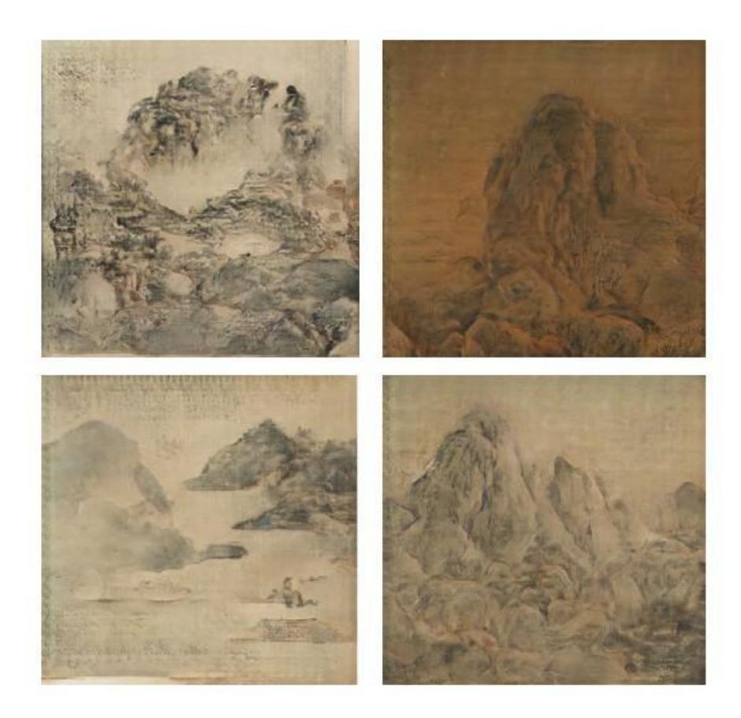

Figure\_1.01. Images simulating Chinese landscape paintings made with a Generative Adversarial Network in 2020.

These systems rely on increasingly sophisticated methods to predict what people might like. AI-systems, for example, learn principles of aesthetic quality by directly observing people's aesthetic choices. Earlier predictions of image quality ratings were based on classical compositional rules (such as the rule of thirds, aspect ratio, saturation, and so on) as well as on the programmers' intuition of aesthetic value, which derived from their observation of the most liked photographs.[1](#page-22-1) Later, neural networks were progressively used to assign semantic labels ("meanings") and to automatically extract aesthetically relevant features through the analysis of large databases of liked images.[2](#page-22-2) In addition to recommendations and automatic editing, AI is now widely used to generate new synthetic artifacts, including artworks, music, designs, and texts. For instance, in 2016, a deep-learning algorithm was trained to learn Rembrandt's style by analyzing his 346 known paintings. The algorithm was subsequently given the task of generating a brand-new portrait, the result of which looked uncannily like a real Rembrandt. In the same year, researchers at the Sony Computer Science Laboratories in Paris developed an AI-system, called DeepBach, that produces choral cantatas in the style of J.S. Bach.[3](#page-22-3) Since then, other music-generating algorithms have been created. Even YouTube videos invite viewers to participate in musical "Turing tests,"

challenging them to distinguish AI-penned compositions from human ones. For people with some musical training, the task still seems straightforward, but for inexperienced listeners, this is not always the case.[4](#page-22-4) In 2019, Deutsche Telekom put together a team of international experts in music and AI to complete Beethoven's unfinished 10th symphony, thus celebrating the 250th anniversary of his birth. The completed symphony, "Beethoven X - The AI Project," premiered on October 9, 2021, in Bonn. It can be challenging to keep pace with such quick progress as incremental technological changes yield continually improved results: in 2019, an AI used the computing power of a new smartphone model to finish Schubert's "Unfinished Symphony" (n. 8, 1822),[5](#page-22-5) although this was accomplished with the help of a composer who cherry-picked the best generated melodies. In 2020, an undergraduate student at Princeton University used a Generative Adversarial Network (GAN) to produce traditional Chinese landscape paintings that were capable of fooling humans in a visual Turing test (Figure 1).[6](#page-22-6)

*The encounter between AI and aesthetics is crucial because aesthetics is considered a quintessentially human domain.* Its intractability and complexity have long appeared as insusceptible to algorithmic reduction. For some, art, aesthetics, and creativity are the pinnacle of human abilities and therefore represent a final bulwark against the seemingly unstoppable advances of AI. In other words, this complex field becomes the ultimate testing ground for AI's possibilities and limitations.

Still, a prevailing opinion holds that developments like those mentioned above just *mimic* existing styles and are not creative at all. In those instances, computers receive pre-existing examples and generate variants conforming to their patterns, while trying to introduce some level of variation. Sometimes they are *uncannily* similar to genuine artworks, but this can also mean that they seem a bit off to a trained eye, lacking the final touches that would make them convincingly human. These algorithms do not generate styles of music or painting that are entirely new, instead they are instances of what we might call *computational mannerism*.

However, it could be just a matter of time until even the experts are deceived, and an AI produces artworks that are judged as aesthetically superior to their human variants. One should bear in mind that the examples mentioned above involve artwork sets with a good amount of repetition and low variability: qualities that enable AI-systems to extract general features and generate new examples easily. In other words, it seems particularly straightforward to produce traditional or classical artworks as they tend to display a clear, recognizable style and follow the specific patterns of an artist, school, or tradition. Machine learning systems are ideally suited to analyze numerous

occurrences of an object type with slight variations and extract the relevant features and patterns. It would, on the contrary, be very difficult to reproduce something like a Duchamp-style body of work, since the AI would have to start with the very heterogeneous dataset of this artist's oeuvre, encompassing *Fountain*, *Bottle Rack*, the *Large Glass*, the late *Étant donnés*, and so on. Typically, conservative views on art consider technical mastery as a criterion for "real art," and many people still don't consider something that doesn't require technical ability to be art. However, technical ability means procedural knowledge, and AI are designed to deal with precisely this kind of knowledge. Clearly recognizable styles are *well-defined* problems that can be reduced to computational tasks, while the generation of variants that don't follow compositional rules (like Duchamp's works) results in ill-defined tasks that have no easy procedural solution.[7](#page-22-7) "*My kid could have done that!",* the popular cliché directed at contemporary art, seems now, in an ironic reversal, to turn against the great and stylistically complex - but computationally scalable - art of cultural tradition: *even an AI could do that.* It is the Duchamp that remains outside of AI's creative abilities, at least for now.

Here is a brief overview of the main issues that we would like to deal with. An investigation of the impact of AI and machine learning on aesthetics requires, at the outset, a general mapping of the areas where aesthetics and computational methods meet and relate to one another (see next section, "A simple map"). Then, further on, we will show some points of contact between so-called experimental aesthetics and computational applications, showing how some limits and critical points found in the former can be transferred to approaches undertaken by the latter (section "Computation and psychology").

Technology is the development of *tools* extending our reach and power. We have biologically limited physical strength: thanks to levers, gears, and eventually engines, we managed to overcome these limits. We have biologically limited visual acuity, but microscopes and telescopes allowed us to amplify the realm of the visible. Similarly, our cognitive skills such as calculation and memory have upper limits, but calculators and computers augmented those skills. Following this line of argumentation, one could suggest that aesthetic capacity has human limits as well, that there could be a point at which peak creativity, or peak aesthetic sensibility, is reached. Limits would be determined by both the individual, who has their own supply of sensitivity, creativity, and skills, and by the culture as a whole, which delimits what is possible within a specific artistic medium. *Artificial aesthetics can be described as an augmentation of our aesthetic skills*, deepening both our creative processes and our understanding and sensibility of cultural artifacts. Advanced systems would then be a further evolution of

#### Chapter 1. Even an AI Could Do That - 12

devices that are already used in creative disciplines, such as graphic programs, computer-aided design technology, music software, and so on (see later chapters on creativity, media theory, and digital culture). If in a traditional sense media are extensions of human senses, then AI is a further extension of human capabilities in mediating between us and the world.

Our engagement with technology expands and modifies how we create and ultimately shapes our cultural evolution. The question arises as to whether all this has the potential to push the boundaries of our knowledge about human cultural and artistic heritage. In a futuristic scenario, machines could acquire a precise understanding of human aesthetic preferences, eventually registering how we perceive and react in front of an aesthetic object with greater accuracy than is available to humans. Machines could learn to produce aesthetic artifacts and generate new creative styles and genres. By analyzing human aesthetics and the diversity of aesthetics in human culture, they may even be able to create new "cultures" - that is, to create genuinely new types of art and aesthetics.

In discussions around AI, we often hear how machines "solve" domains that we thought were uniquely human or achieve better performances than their human competitors. On each occasion, the bar of what should be considered truly human and intelligent behavior is raised and moved to other domains. We see - not without some concern - how the area of what we consider unreproducible by machines seems to shrink. One may wonder whether we are now witnessing this narrowing process in the aesthetic field. This raises questions such as: could machines reach a point at which we consider them truly creative? How could machines tackle the conceptual turn in contemporary art movements? What role could they have in helping us to understand "good taste" and "bad taste"? Do systems using data analysis tap in to the "unconscious" structure of our culture, or do we witness the emergence of an entirely new form of cultural production?

The original definition of aesthetics as a philosophical discipline was coined in 1750 by German philosopher Alexander Baumgarten and referred to the ancient Greek *aesthesis*, which means sensation or perception. Kant later redefined the term in his *Critics of Judgment* (1790) as the domain of subjective judgments of taste. This meant that aesthetics treated perception as a more complex notion than just sensory experience (investigated today by the psychology of perception), as it also sought to address our affective and cognitive responses to perception. Machines learn to recognize increasingly complex patterns in data that humans are not able to detect. All this raises the following question: to what extent are machine perception and pattern

recognition mechanisms relevant for "aesthetic perception," and what are the typically human aspects of aesthetic sensibility that still need to be tackled by artificial systems?

#### How AI Relates to Aesthetics: A Simple Map

As we saw, computational approaches to aesthetics cover a wide range of applications, from analysis of cultural artifacts to their generation, dealing with questions such as:

*a) Can we develop systems that extract all relevant features of an artifact or an image?* Can we analyze/describe the aesthetic features of aesthetic artifacts from a given cultural tradition?[8](#page-22-8)

From a different perspective, we are also interested in questions such as:

*b) Can we use AI to understand (and predict) what people like?* We can see a distinction here between questions dealing with *objects* and questions dealing with *subjects*. Concerning the first, we focus on artifact's formal and expressive features (for example, the style of a painting, its motifs, the organization of shapes and strokes, formal similarities to other works), and their semantics and meaning. On the other hand, when we address questions concerning subjects, we grapple with viewers' aesthetic experience and perception, including judgements of artistic value, appreciation, affective and cognitive reactions, etc.

The objective/subjective pair distinguishes between two completely different perspectives found in computational approaches: the first concerns the analysis of objects and aims to extract patterns and stylistic invariants by starting with large databases of aesthetic artifacts and cultural products. The subjective analysis asks which properties of an artifact correlate with (and predict) people's aesthetic responses, feelings, and interpretations, both individually and collectively.

There is another distinction to be made. Machine learning is used both to *extract* patterns from data and to *generate* patterns after training with said data. Therefore, developments in these technologies not only allow us to *describe* artifacts and predict people's behavior, they can also be implemented to *generate* artifacts and *simulate* people's behavior. Therefore, other kinds of questions should be added: Can we (re)produce what people like and *generate* aesthetically valuable new artifacts? Can we build computational models of people's aesthetic preferences that will allow us to simulate and automate their judgment?

By crossing the two pairs of dimensions - *object* vs. *subject* and *description* vs. *generation* - we can identify four different applications of machine learning and AI in aesthetics:

|          | Pattern recognition (analysis and description) | Pattern generation (production and prediction) |
|----------|---------------------------------------------------|---------------------------------------------------|
| Objects  | Studying objects                                  | Generating objects                                |
| Subjects | Studying subjects                                 | Generating subjects                               |

To illustrate the different fields of this map, let's consider the work of Johann Sebastian Bach. His music has been described as highly structured and mathematical, the "chess of music" so to speak, and has been the object of both algorithmic description and generation (like the project "DeepBach" from 2016):

- *1) "Studying Objects":* the AI, using a dataset that contains all of Bach's compositions, analyzes melodic patterns, tracking similarities between different scores and extracting the characteristic style of the composer.
- *2) "Generating Objects":* the AI, having been trained with the dataset of Bach's compositions, is used to generate new Bach-sounding variants.

However, an essential aspect of aesthetic analysis would be missed if either of these tasks (analysis of the formal features of a music composition and the production of variants) failed to consider how people react and experience the music. This is where the issue of the subjects' response comes in:

*3) "Studying Subjects":* preferences are gathered and analyzed in order to determine which musical features are especially preferred or which musical qualities determine a specific aesthetic reaction (a feeling, a mood, etc): think about how online music platforms algorithmically track user preferences. If variance among individual

preferences is not too big, it is possible to build a model of aesthetic evaluation in the domain of Bach's compositions. The model generates *predictions* of how a user would evaluate the new Bach's chorales. In turn, listeners hear these new compositions and provide the model with further feedback. If the variance of user reactions is too big, we can use cluster analysis to identify different types of preferences and generate different models that are suitable for each type. This approach would not be dissimilar to companies that "segment" their market's customers into smaller groups based on demographics, interests, needs, behaviors, and/or location. In fact, describing and predicting people's aesthetic behaviors based on previous listening choices constitute the evolution and refining of traditional consumer preference analysis as marketing and sociological research practice. Contemporary approaches, however, use data in a way that affords new analytic capabilities. While traditional market and sociological surveys typically pool data, use aggregate statistical averages, and form clusters based on theoretical sociological models of human types, algorithmic tracking and analysis of data are capable of generating personal profiles that use individual behaviors as data, such as clicking or liking particular images on a social network or listening to specific music on Spotify or Youtube. Rather than clustering data from many subjects, each profile is unique to one individual.

*4) "Generating Subjects":* Recommendation systems on online platforms use models that predict what a user would appreciate. However, by modeling a person's aesthetic judgment, it is also possible to *generate* behavior and judgment. Modeling listeners' preferences and aesthetic responses enables us, in principle, to simulate how people would behave and react in front of specific objects. If a composer (or the AI itself) were to create a new variant of Bach-like music, an artificial system trained according to a subject's aesthetic model could formulate evaluations on its own without needing to refer to a human subject.

*It is not hard to imagine that "artificial judgment" systems might be increasingly used in the future.* These systems would autonomously evaluate cultural objects, scoring a design artifact, fashion item, or image with a higher or lower aesthetic value. An artificial judge could do more than tell us "What we may also like" (as in traditional recommendation systems). It could also tell us "How much people would appreciate" a specific aesthetic artifact that has been submitted to the system, how people would judge it, even predicting what people would tell us about it.

Automated systems for predicting image aesthetic score are a typical example of artificial judgment. These function by using a combination of objective metrics (image quality, sharpness, optimal contrast, colors, etc.) and subjective evaluations. To create

such a system, large numbers of people rate lots of images. This data is then used to train a neural network, which can subsequently rate new images automatically.[9](#page-22-9) Moreover, we can add that these algorithms could be able to identify aesthetic properties (on the side of objects) and individual preferences (on the side of subjects) of which people are not even aware, but that are manifested in their appreciative behavior.

## Patterns of Explanation, or What Do We Do When We Talk About Aesthetics

Computational analysis may enable us to extract patterns and formal structures, but it does not provide an understanding of how such patterns affect human perception, emotion, and cognition. Patterns considered in isolation from human meaning are ultimately empty. Art historian Michael Baxandall (in his 1985 book *Patterns of Intention*) has persuasively described the essence of the critical language that we use when talking about any artwork or cultural product. For Baxandall, any discourse that we create is neither a merely factual description of features, nor a subjective report of a person's reactions, but consists in highlighting the *relationship* between the object and human responses (the meaning they give and the aesthetic reaction they manifest). This relationship is further mediated by an understanding of the object's symbolic and cultural meanings. A critic, so to speak, tells the reader what kind of reaction is expected (or would have been expected for people in the past) in front of a specific object. Expressed in the terms of the map from the previous section, this would mean drawing a connection between the description of the object and the description of the corresponding subjective reactions.

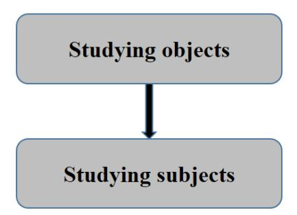

Following Baxandall, cultural and critical explanations in art are not mere descriptions or classifications: they are "primarily a representation of our thoughts about it"

(*Patterns of intention*, p. 10). What we describe is a "partially interpretative description": "one does not describe pictures, but our thoughts of having seen pictures" or at least hypotheses on those thoughts. The efficacy of a critic's argumentation lies in his or her ability to compellingly persuade the reader that the artifact elicits the kind of reactions and thoughts that the critic is claiming to make explicit. Moreover, the critic's use of words and concepts, while sharpening the perception of an object, at the same time deepens the meaning of the concept itself: "concepts and object reciprocally sharpen each other" (*Patterns of intention*, p 34). For example, if we describe *The Scream* by Edvard Munch (1893) as inspiring a sense of *dread*, then the very concept of dread as an aesthetic notion will be made richer by using Munch's famous painting as a case in point.

Artifacts in synthetic media (images, songs, texts) are generated by networks that have already been trained on large databases of similar, preexisting artifacts, as in following diagram:

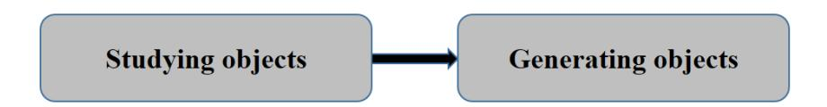

However, if the generated content is expected to have aesthetic value, the generative networks must take into account not only the formal dimension (*how* artifacts are made), but also their corresponding subjective interpretation and reaction, including people's aesthetic preferences. Otherwise, we would be able to generate infinite variations of patterns, but not have a clue on how they relate to our appreciation. If description of patterns without meaning is empty, as we said, generation of patterns without human interpretation is blind.

In AI-media generation today, humans operate generative networks by selecting, adjusting, and tweaking the process to obtain a desired result. This result also depends on humans following their own aesthetic sensibility: for example, a music expert had to evaluate and filter the different generations of Schubert's "Unfinished Symphony". Only algorithmic analysis of subjective responses ("Studying subjects") would allow a progressive automation of this evaluative step.

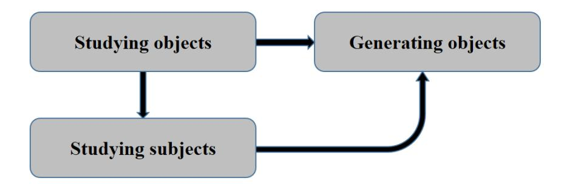

Moreover, "Studying subjects" would involve both individual and collective reactions. The latter involves analyzing historically sedimented responses towards cultural objects. Ideally, an AI capable of creating meaningful art and design would take into account the history of what exists, not only to extrapolate patterns from the artifacts, but also to interpret their collective reception, that is, how people over time have reacted to these artifacts. Thus, *using an AI to generate new cultural artifacts (and assist human creators) will require using an AI for cultural analysis*. This would necessitate bringing artificial aesthetics into contact with the various fields that deal with this issue: philosophical aesthetics, art history, psychology of art, anthropology and sociology of culture, and so on. Granted, new technical developments can generate entirely new kinds of artifacts that need not resemble the cultural production of the past. However, if we want to better grasp how these artifacts could affect people, an understanding of how we typically react and give meaning to aesthetic objects could save us from wandering in the dark. The near future may hold entirely new aesthetic artifacts, but it is unlikely to hold an entirely new human nature.

#### Computation and Psychology

Aesthetic phenomena involve a complex relationship between all human faculties, from low-level perceptual mechanisms to higher-level affective and cognitive processes. It is no coincidence that by the end of the 19th century Gustav Fechner, the father of experimental psychology, had already identified aesthetics as the most critical challenge for his new methods in scientific psychology.[10](#page-23-0) In fact, researching how people react and behave during an aesthetic experience (the domain we defined as "Studying people") has long been a tradition in so-called psychological experimental or empirical aesthetics. Fechner investigated, for example, whether people prefer shapes that follow the golden ratio rule. While Fechner's findings seem to confirm the rule, later studies failed to replicate the same results. This line of research continued

steadily for almost a century: for instance, Birkhoff's *Aesthetic Measure*[11](#page-23-1) tried to capture in a quantifiable formula the optimal aesthetic relationship between a shape's complexity and order: high order with high complexity would correlate, according to him, to a higher aesthetic pleasure. In the 1970s, Daniel Berlyne's new experimental aesthetics[12](#page-23-2) introduced motivational factors as a key component in aesthetic pleasure and appreciation: aesthetic value is not only a function of an object's features, but also of the hedonic tone of a subject, namely his or her level of interest and stimulation. His inverted-U relationship between complexity and enjoyment suggests an optimal middle point between too little and too much complexity in a stimulus. This has been empirically investigated as well, albeit with divergent results. At the turn of the new century, researchers felt that it was necessary to move from aseptic psychophysical experiments based on simple abstract patterns to observing how people react in front of real artworks, artifacts, or natural entities.[13](#page-23-3) Neuropsychological approaches have recently become popular in this field, extending their focus to issues such as creativity and the mechanisms of reception and interpretation in specific art forms (visual artworks, music, movies, literature).

A researcher in this field typically conducts experiments with small groups of people under carefully controlled conditions, using statistical techniques to analyze the collected data. For example, in many experiments in visual aesthetics, a group is shown a particular set of images (the dataset can be preexisting or created specially for the experiment), and people are asked to express their preferences in some way, such as rating all images on a numerical scale. Decades of investigation in experimental aesthetics led to many findings. For example, psychologists showed that more prolonged exposure to a stimulus leads to a growing familiarity with the object, inducing a preference for it as well as for prototypes in the object's category. That is, we like what is more typical, and that overall fluency, the ease in processing an experience, correlates with aesthetic preference. Furthermore, research findings showed a preference for symmetry in facial features, a preference for smooth and curved shapes over angular ones; specific preferences for natural landscapes over manmade scenes, and for architectural scenes with naturalistic aesthetics.[14](#page-23-4) Numerous studies have tested the classical rules of harmony, balance, and "good composition," such as the "rule of thirds" or the principles described by Gestalt-theory (which were first applied to art by Rudolf Arnheim in his 1954 classic work, *Art and Visual Perception*).

We should note that these experiments often use college students as their test subjects. Their aesthetic judgment could mirror a specific taste, without being representative of the judgments of artists, designers, or critics. Different studies have repeatedly confirmed a significant difference between experts and non-experts in aesthetic

#### Chapter 1. Even an AI Could Do That - 20

evaluation. It should be noted, moreover, that most of the research does not point to conclusive findings, showing instead that aesthetic preference depends on numerous underlying variables, like context and subjective attitudes. One example of a contextual factor would be the verbal description of an artwork: titles change our appreciation of paintings and how we look at them.[15](#page-23-5) The order of presentation (which object do we see first? Which next?), spatial disposition (which object is on the left? Which on the right?) and juxtaposition (do we compare similar or very different objects?) also affects how people judge objects.[16](#page-23-6) The environment also influences how we evaluate and appreciate art.

For instance, our reception of an artwork may differ depending on whether we look at it in a typical "white cube" space or in a more informal context. Variations exist depending on the observer's characteristics: factors such as one's emotional state and level of arousal, expertise, personality traits and culture all contribute to the aesthetic experience and judgment. Instead of looking for generic universal rules – like the golden ratio, "unity in multiplicity," and Berlyne's inverted-U model – experimental research investigates very subtle mechanisms while considering contextual, personal, and culturally specific factors. In summary, the field has generated and tested many interesting theories to account for human aesthetic experiences, demonstrating at the same time that none of them seem to hold universally.[17](#page-23-7)

There are two crucial differences between today's computational methods and traditional experimental aesthetics. First, experimental aesthetics mostly focuses on subjects, while artificial aesthetics focuses on objects. Furthermore, experimental aesthetics uses specially selected and highly controlled stimuli, while artificial aesthetics uses "big data" from real life human behavior, which is often collected through digital platforms.

While experimental aesthetics usually produces stimuli in controlled settings and looks at people's responses, computational methods make use of large, available datasets of expressed preferences, like Photo.net or Dpchallenge.com (used for computation studies in the late 2000s), allowing researchers to explore how people give their "likes" on social platforms. In other cases, they capture and measure people's actual consumer behavior on online platforms, like streaming services for music and film, with the aim of inferring features from the most popular artifacts.

In experimental aesthetics, a subject-focused approach emphasizes the analysis of socalled "dependent variables". These include the controlled responses of subjects, measured through judgments on well-calibrated scales, as well as physiological reactions (heart rate, skin conductance, pupil dilation etc.) and brain activity, measured with EEG or fMRI, which theoretically obviate the problems associated with verbal evaluation. Computational analysis of aesthetic behavior, on the other side, is an object-focused approach and is particularly strong at describing "independent variables", i.e., the aesthetic contents that are consumed and judged by people every day. This strength stems from its capacity to gather and analyze large numbers of features from images, music and other cultural artifacts. As previously mentioned, the key advantage of computational approaches to aesthetics is the fact that they are not bound to seek aesthetic universals or to take the common responses of (relatively small) groups of subjects to be representative of general attitudes. Instead, algorithms can track individual preferences and behavior without needing to model aesthetic responses based on aggregated averages. *Big data does not require us to assume a universal human aesthetic subject.*

Despite these advantages, an artificial aesthetics that focuses on aesthetic preferences still has to deal with the methodological challenges that characterize all experimental approaches. We shall briefly mention two of them, concerning 1) the difficulty of isolating the features linked to our aesthetic evaluation, and 2) the difficulty of determining what kind of response we are trying to describe.

Concerning the first point, features of aesthetic objects are hard to isolate. For example, to study how variations in the shape of a design item influence aesthetic appreciation, an experiment should use a controlled setting that analyzes the effect of minimal variations in the shape and avoids confounding multiple variations at once (e.g., changing shape and color, or shape and texture etc.). However, aesthetic variables can also interact with each other. Consequentially, this set-up would not allow us to draw a one-to-one correspondence between the feature and the aesthetic responses to the feature on this particular object. It is certainly possible to determine general trends in people's preferences: e.g., we could observe that a certain musical style is more popular than another one with a particular demographic in a given country. However, it is not always easy to reach greater granularity and comprehend the precise role of each factor in the final aesthetic effect: what exactly makes the one musical style more appealing than the other? In order to achieve this level of understanding, we would need a large number of similar aesthetic artifacts that present only small variations from each other.

In some cases, digital platforms allow us to study a vast number of different but not too heterogeneous stimuli which are available on the web. For example, in a study from 2014[18](#page-23-8), the authors used hundreds of features from micro-videos (up to six seconds' duration) on Vine, a former media sharing platform, to predict whether people would judge them as "creative" or "non-creative". The study used a crowdsourcing platform

to have 284 people judge 3800 videos. Each video received evaluations from multiple people, the average agreement of which was calculated to be 84%. The features covered scene content, filmmaking techniques, photographic techniques, composition, visual affect, audio affect, and novelty. All these features were defined mathematically and calculated automatically from the videos through an analysis of their frames and soundtrack. The authors report the classification accuracy for each group of features, concluding: "The best results are achieved when we combine novelty features with aesthetic value features, showing the usefulness of this twofold definition of creativity." Used separately, composition and photographic techniques outperform scene content (classification accuracy is 77% vs 73%), while novelty video features outperform novelty audio features (74% vs 63%). To get these kinds of results, it is necessary to have a sufficiently wide data set whose features are manageable (like a short sixsecond film), which is not always the case with human cultural production.

Concerning the second point, human aesthetic responses (i.e., dependent variables in a psychological experiment) also pose their own challenges. What are we measuring when we ask a subject about her aesthetic experience? Our relationships with aesthetic objects have many layers and dimensions. They can range from sub-personal physiological reactions to complex critical formulations, from a "like" given to an image in a social network, to actual consumption behavior, up to sophisticated critical judgment. We get a different answer depending on whether we ask someone if she "likes" a movie or if she considers it a masterpiece, or if we simply observe her physiological reactions while watching that movie. Moreover, we should distinguish between value judgement and mere subjective preference/desire: in general, we can say that value judgments are more stable than momentary preferences or desire for a certain object. I can consider song X to be a masterpiece (and superior to song Y), but lack the desire to listen to X at present, instead experiencing a greater desire to listen to Y, maybe because of my emotional state or because I listened to X too many times.

This means that my consumption behavior can reveal preferences that do not necessarily express my general idea of aesthetic value: I may be an avid consumer of action movies and yet consider arthouse films aesthetically superior, even though I watch them more rarely. Artificial systems that gather data about human aesthetic consumption should take these issues into consideration if we want to avoid overly simplistic models of human aesthetic experience and judgment, both of which are used in artificial evaluative and generative algorithms.

#### Notes

3 Hadjeres, G., Pachet, F., & Nielsen, F. (2017). DeepBach: A steerable model for Bach chorales generation. *Proceedings of Machine Learning Research*, 70. arXiv. [https://arxiv.org/abs/1612.01010;](https://arxiv.org/abs/1612.01010) Emerging Technology from the arXiv. (2016, December 14). Deep-learning machine listens to Bach, then writes its own music in the same style. *MIT Technology Review*.

[https://www.technologyreview.com/2016/12/14/155416.](https://www.technologyreview.com/2016/12/14/155416)

- 4 "Can You Tell the Difference between AI and Human Composers?" TwoSetViolin. (2020, September 23). Can you tell the difference between AI and human composers? [Video]. YouTube.<https://youtu.be/PmL31mVx0XA>; "Bach vs AI: spot the difference." Orchestra of the Age of Enlightenment. (2019, November 22). Bach vs AI: Spot the difference [Video]. YouTube. [https://youtu.be/lv9W7qrYhbk](/Users/levmanovich/Library/Mobile%20Documents/com~apple~CloudDocs/MY%20ARTICLES%20&%20BOOKS/in%20progress%20books/Book%20on%20Artifical%20Aesthetics%20wih%20Emanuelle/_2024%20Publication%20files/_AA%20all%20chapters%20PDF/.%20https:/youtu.be/lv9W7qrYhbk)
- 5 Davis, E. (2019, February 6). Schubert's 'Unfinished' Symphony completed by artificial intelligence. *Classic FM*.

<https://www.classicfm.com/composers/schubert/unfinished-symphony-completed-by-ai>

- 6 Xue, A. (2021). End-to-end Chinese landscape painting creation using generative adversarial networks. *Proceedings of IEEE WACV*, 3863-3871. arXiv. <https://arxiv.org/abs/2011.05552>
- 7 By using well-defined and ill-defined problems, we are referring to the crucial distinction made by Herbert Simon in 1973 regarding artificial intelligence. Simon, H. A. (1973). The structure of ill structured problems. *Artificial Intelligence*, 4, 181-201. [https://doi.org/10.1016/0004-3702\(73\)90011-8](https://doi.org/10.1016/0004-3702(73)90011-8)
- 8 The practical applications of such analysis include designing interactive online interfaces for museum collections. For example, when a person chooses a particular artwork, the system shows other artworks in the collection that are most similar. Further applications can be found in digital art history: changes in any extracted feature or a combination of features can be plotted over time to analyze the evolution of a single artist or entire historical periods.
- 9 Djudjic, D. (2017, December 26). The rise of the machines: Google's AI will decide if your photos are aesthetically pleasing. *DIY Photography*[.](file://///users/levmanovich/Library/Mobile%20Documents/com~apple~CloudDocs/MY%20ARTICLES%20&%20BOOKS/in%20progress%20books/Book%20on%20Artifical%20Aesthetics%20wih%20Emanuelle/_2024%20Publication%20files/_AA%20all%20chapters%20PDF/.%20https:/www.diyphotography.net/rise-machines-googles-ai-will-decide-photos-aesthetically-pleasing)

[https://www.diyphotography.net/rise-machines-googles-ai-will-decide-photos](file://///users/levmanovich/Library/Mobile%20Documents/com~apple~CloudDocs/MY%20ARTICLES%20&%20BOOKS/in%20progress%20books/Book%20on%20Artifical%20Aesthetics%20wih%20Emanuelle/_2024%20Publication%20files/_AA%20all%20chapters%20PDF/.%20https:/www.diyphotography.net/rise-machines-googles-ai-will-decide-photos-aesthetically-pleasing)[aesthetically-pleasing;](file://///users/levmanovich/Library/Mobile%20Documents/com~apple~CloudDocs/MY%20ARTICLES%20&%20BOOKS/in%20progress%20books/Book%20on%20Artifical%20Aesthetics%20wih%20Emanuelle/_2024%20Publication%20files/_AA%20all%20chapters%20PDF/.%20https:/www.diyphotography.net/rise-machines-googles-ai-will-decide-photos-aesthetically-pleasing) Mikhailiuk, A. (2021, March 15). Deep image quality

1 Datta et al. propose 56 different rules and features. Datta, R., Joshi, D., & Li, J. (2006). Studying aesthetics in photographic images using a computational approach. *European Conference on Computer Vision*, 288-301. Springer.

2 Kao, Y., He, R., & Huang, K. (2017). Deep aesthetic quality assessment with semantic information. *IEEE Transactions on Image Processing*, 26(3), 1482-1495. <https://doi.org/10.1109/TIP.2017.2651399>

assessment. *Towards Data Science*. [https://towardsdatascience.com/deep-image](https://towardsdatascience.com/deep-image-quality-assessment-30ad71641fac)[quality-assessment-30ad71641fac](https://towardsdatascience.com/deep-image-quality-assessment-30ad71641fac)

- 10 Fechner, G. T. (1876). *Vorschule der Aesthetik*. Breitkopf und Härtel.
- 11 Birkhoff, G. D. (1933). *Aesthetic measure*. Harvard University Press.
- 12 Berlyne, D. E. (1974). Studies in the new experimental aesthetics. Wiley.
- 13 Leder, H., Belke, B., Oeberst, A., & Augustin, D. (2004). A model of aesthetic appreciation and aesthetic judgements. *British Journal of Psychology*, 95(4), 489-508.
- 14 For an overview, see Locher, P. L. (2013). Contemporary experimental aesthetics: Procedures and findings. In V. A. Ginsburgh & D. Throsby (Eds.), *Handbook of the Economics of Art and Culture* (Vol. 2). North Holland; Tinio, P. P. L., & Smith, J. K. (Eds.). (2014). *The Cambridge handbook of the psychology of aesthetics and the arts*. Cambridge University Press.
- 15 Leder, H., Carbon, C. C., & Ripsas, A. L. (2006). Entitling art: Influence of title information on understanding and appreciation of paintings. *Acta Psychologica*, 121(2), 176-198.
- 16 Khaw, M. W., & Freeberg, D. (2018). Continuous aesthetic judgment of image sequences. *Acta Psychologica*, 188, 213-219.
- 17 Even the assumption that beholders would universally associate particular forms with specific qualities, or "aesthetic effects" has been put into question. Specker, E., Forster, M., Brinkmann, H., Boddy, L., Rosenberg, R., Leder, H. et al. (2020). Warm, lively, rough? Assessing agreement on aesthetic effects of artworks. *PLOS ONE*. <https://doi.org/10.1371/journal.pone.0232083>
- 18 M. Redi, N. O'Hare, R. Schifanella, M. Trevisiol & Jaimes, A. (2014). 6 seconds of sound and vision: Creativity in micro-videos. *IEEE Conference on Computer Vision and Pattern Recognition*, 4272-4279.<https://doi.org/10.1109/CVPR.2014.544>

# **2.**

# **Who is an "Artist" in the AI Era?**

### Lev Manovich

#### Turing Test for Artistic AI

What would be the equivalent of the Turing test for an AI system capable of creating new songs, games, music, visual art, design, architecture, films? This looks like a simple question with an easy answer. If a system can automatically create new works in each media or genre and we cannot tell the difference between those works and those created by humans, it passes the Turing test.

The same or similar answers have been common in many discussions about AI and artistic creativity. For example, Margaret Boden, a well-known academic researcher in the field of computational creativity, has proposed the following criteria for such a test in 2010: a program has to produce an artwork that is "indistinguishable from one produced by a human being and/or was seen as having as much aesthetic value as produced by a human being."[1](#page-37-1) Between 2015 and 2018, a group of researchers at Dartmouth College ran "Turing Tests in the Creative Arts, "an annual competition series that tested "if machines are capable of generating sonnets, short stories, or dance music that is *indistinguishable from human-generated works*. [2](#page-37-2) (These criteria, once confined to academic debates, became widely evoked after 2022 as new generative AI models and tools became widely used by both professional creators and casual users.)

Such interpretation of Turing test has been also used in many publications discussing art-generating computer systems. Already in 1966 Michael Noll reported the following experiment in a psychology journal:

A digital computer and microfilm plotter were used to produce a semi-random picture similar in composition to Piet Mondrian's painting "Composition with Lines" (1917). Reproductions of both pictures were then presented to 100 subjects whose tasks were to identify the computer picture and to indicate

which picture they preferred. Only 28% of the Ss were able to correctly identify the computer-generated picture, while 59% of the Ss preferred the computergenerated picture.[3](#page-37-3)

Are we now done with answering our question about a Turing test for the arts? Not quite.

If we think further, we quickly realize that this is more complex. To even begin to answer it, we may need to consider ideas from several fields such as philosophical aesthetics, experimental psychology of the arts, histories of the arts, media theory, and software studies. Discussions about a Turing test for artistic creativity have not used perspectives from the last two fields much, and yet in my view they are very important for thinking about AI and creativity questions. This chapter explores *the challenges of defining a test for artistic AI in our era* when human creators routinely rely on digital assets and creative software which already has been offering AI-type support for long time. In other words: what would it mean for "genuine artistic AI" to compete with contemporary artists who already implicitly use AI implemented long ago in all their favorite digital tools (e.g., Photoshop, Premiere, After Effects, Blender, Unreal Engine, etc.)?

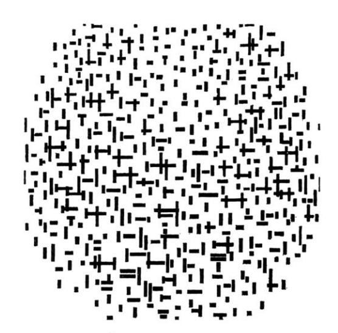

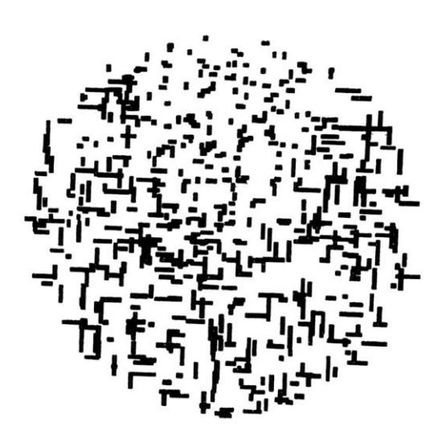

Figure\_2.01. A black and white drawing based on 1917 Mondrian painting (left) and computer-generated Mondrian-like composition (right) used by Michael Noll in his experiment. (Illustrations from the original 1966 publication.)

#### Creativity in Software Era

To begin, we need to consider the fact that all creative work in media and design today takes place in a digital environment - i.e., it involves use of appropriate software, services, and online resources. (While it's appropriate to consider Generative AI models within the broader history of artificial intelligence, in practical terms, *AI tools function as part of the larger ecosystem of creative software*. This perspective is reflected in the chapter's title, "Who is an 'Artist' in the Software Era?", which acknowledges software as the overarching category, with AI tools and functions representing one significant component. (For the historical and theoretical analysis of the creative software, see my 2013 book *Software Takes Command*. [4](#page-37-4))

Creators have instant access to numerous works made by others via social media and specialized sites for sharing art, photography, video, and music (e.g., DeviantArt, ArtStation, Behance, SoundCloud), as well as to websites with stock media, templates, and effects (e.g., Shutterstock, Adobe Stock, Storyblocks, Pexels, and endless others.) They can watch how other creators accomplish tasks and access their project media files, which can even be viewed in the application that was used by the creator. For instance, Photoshop allows you to see all the modification layers in another person's project. You can also directly apply the creative choices and decisions made by another creator (for example, color and tone modifications) to your project.

When creators write code to make interactive, generative or animated works, such method is even more important. Both students and professionals often start by copying somebody else computer code and then proceeding to change it. Tutorials for popular programming languages and libraries for creative applications such as Processing may provide examples of code to accomplish various tasks and asks the learners to modify them.

While traditional art and crafts education was also based on copying the works of other masters, *digital media* changes this practice qualitatively. It *externalizes* person's thinking and creative process turning it into *a sequence of discrete operations with numerical parameters* defining their details. (For instance, "increase saturation by 5%" or "apply Gaussian blur filter with 30% strength and 3-pixel radius", etc.) Every action is saved by software separately and you can study these actions and apply them in your own work. And even when digital media simulates physical art materials such as "painting" with various "brushes," these seemingly continuous creation process becomes discrete - for example, some painting programs keep track of every brushstroke allowing you to undo them one by one.[5](#page-37-5)

If you do creative coding, you can similarly copy, examine and then modify another person's thinking encapsulated in the program she wrote. For instance, the community website openprocessing.org invites you to "Join 100,000 creative coders and follow their work." You can run each program that manipulates or generates images, text, camera inputs, sounds (these programs are called Sketches in Processing), examine its full code, and also instantly "fork" it, i.e. make a copy and start modifying it.

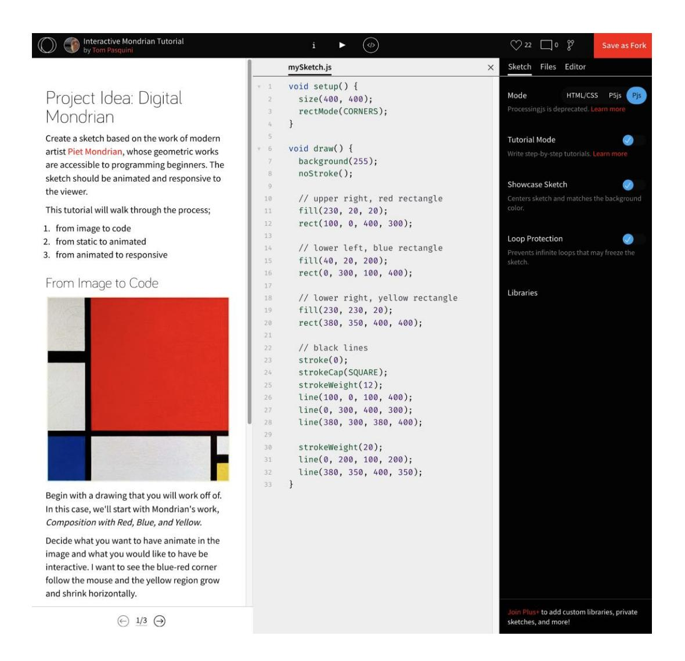

Figure\_3.02. Tom Pasquini, Interactive Mondrian Tutorial, [https://openprocessing.org/sketch/843344/,](https://openprocessing.org/sketch/843344/) accessed September 25, 2024. This is an example of one of the numerous online tutorials for learning Processing, a popular programming

language and development environment for the arts and visual design. In this tutorial, you are taught how to write code that generates animated interactive images in the style of Mondrian. The tutorial text and code are displayed in the left frame. The frame in the center displays code you can directly modify, run, and see as a new image. The right frame displays all forks (new versions) of this sketch created by other contributors on openprocessing.org.

Let's continue exploring the ways digital media changed artistic process. Contemporary creators have technologies that can create many visual, sonic, spatial, multimedia, and interactive "effects" that were not possible with earlier arts and media technologies. Examples include the use of projection mapping for videos in space, particle systems for animation, robotics in performance and installations, or new materials in architecture. Even when new technologies use older technologies, these are qualitatively different from their earlier versions. Think about taking a video on your phone at 8k resolution - the resolution of such video is about 50 times higher than what was available to filmmakers 100 years ago. Although we refer to both analog films from the 1920s and digital films made using a phone today as "films," these are different types of visual media.

We also need to consider *the new scale of creation* in photography, art, media, design, digital art and other creative areas in the 21st century. As an example of the scale of photography production, consider these statistics: According to one 2021 estimate, "The creative industries generate around 30m jobs and account for 3% of global GDP, employing more young people (aged 15-29) than any other sector.[6](#page-37-6)" And if we look at non-professionals making objects such as photos, the scale is astonishing: in November 2020, "Google announced that more than 4 trillion photos are stored in Google Photos, and every week 28 billion new photos and videos are uploaded."[7](#page-37-7)

#### Who Shall AI Compete With?

This new digital environment, which I have only described in brief, poses crucial questions that need to be considered when defining a Turing test for "creative machines":

What does it mean to "create" today when countless stock visual and audio media, templates, filters, effects, styles, and tutorials are available to both casual and professional creators? Shall we try to simulate this contemporary "digital creativity"? Or do we want to match the artistic achievements and creative processes of a pre-digital, pre-software and pre-network era?

Do we want AI in our test to be able to generate new works from scratch while only having access to examples of works from a particular historical period, place, type of media, or genre? Could it have access to all digitized human cultural heritage? (Today supervised machine learning only uses very specific datasets of cultural artifacts, so it's the first situation.) Or maybe it can also use all the affordances of the digital cultural environment available to human creators today? In other words*:* do we want to simulate an artist from the 19th, 20th or 21st century?

Do we want human artists to complete with an AI system that can make a complete work from beginning to end? Or should we also be testing any digital creation tool which has some AI functions? After about 2017, AI assistance (or AI augmentation) of the human creative process has become the norm. Here are a few examples of these tools that are used by hundreds of millions of people every day: "auto enhancement" of photos (available in Apple Photos, Google Photos, Lightroom, and endless other photo editing apps); automatic selection of human faces, figures, and other objects in photos and video so that they can be edited differently from the background (offered by Photoshop, Premiere, etc.); automatic selection of a user's best photos from her media library (Lightroom); simulation of camera movement and parallax using a single photo (Google Photos); automatic rearrangement and editing of design elements to generate new layouts (Adobe Spark). (These examples cover only a few popular software applications; similar AI-enhanced functions are available in countless other tools.)

In the original Turing test scenario, a human has a conversation with an entity that they cannot see. This entity can be either another human or a computer. The test does not assume that the human has any expertise or skill. Human beings have very sophisticated perception and cognition abilities and making a computer with similar capabilities was seen as the goal of AI research since the field emergence in the 1950s.

In other words, researchers wanted AI to be able to do what all normal humans can do: understand information captured by their senses, generate sentences and bodies of text that are grammatically correct and semantically meaningful, understand what other humans are saying, employ basic logic and reasoning, and make plans to achieve goals.

(In psychology, linguistics, and cognitive science, researchers debate the origins of human cognitive abilities—are they innate or acquired through environmental and social interactions? This question is important for our topic, but we will leave it for another time.)

If we want to compare AI creators and human creators, we can't simply invite any human to act creatively and make art in one room, and then ask another human in another room to judge whether the works were created by this human or a computer. We are not born with the fully formed ability to draw, compose music, write poetry, weave cloths with color patterns, carve human figures and faces, or create intricate

decorations and ornaments from different materials. (We also know that certain people in every traditional human culture in the past 7000 years had very good skills in all these arts. How did they arrive at these skills, before tradition of apprenticeships developed? Why this happened in every traditional culture?)

Psychology research supports the hypothesis that only some children have talents that helps them later becoming very skilled at some things:

Talents that selectively facilitate the acquisition of high levels of skill are said to be present in some children but not others. The evidence for this includes biological correlates of specific abilities, certain rare abilities in autistic savants, and the seemingly spontaneous emergence of exceptional abilities in young children, but there is also contrary evidence indicating an absence of early precursors of high skill levels.[8](#page-37-8)

Psychologists also discovered that genes have strong influence on young children's skills in figure drawing. They have tested these skills for thousands of 4-year-old and 14-year-old children and found that at both ages, genetics is correlated with the accuracy of figure drawing.[9](#page-37-9)

These and other studies suggest that in its artistic skills acquisition, a human brain is not a tabula rasa. If not all human adults naturally develop good artistic skills, this means that AI programmed to have such artistic skills is not simulating universal cognitive abilities. Instead, AI is *simulating skills that have been learnt*, whether this is by imitating examples seen elsewhere, undergoing formal training or apprenticeship, following online tutorials, or in some other way.

Many people can easily acquire some creative skills such as dancing. With proper training methods, they can also learn to draw, sing, and deploy rhetoric. However, not everybody can become an accomplished an opera singer or skilled craftsperson.

#### Who Are the "Professionals"?

What is the level of artistic skills we want the machine to simulate? Is it the average ability of any human who received certain training? Or gifted children? Or do we want it to compete with an art professional?

But *how do we decide who counts as a professional?* Do we select people who have received a diploma after years of studying at university or art school? Or should these people already have received a certain amount of recognition in their field? However, recognition depends on many factors and does not necessarily correlate with the levels of talent and artistic skill. In some art fields such as classical music, this correlation can be quite strong, while in other fields such as contemporary art, it can be much weaker. The reason is that in the first case, there are several criteria shared by members of the classical music world (performers, teachers, critics, competition juries) and used to evaluate everybody. But in the second case, there are no shared agreed on criteria. Consequently, somebody can acquire a reputation as an important artist because they are shown and promoted by influential galleries and museums, does work that fits a particular ideological agenda currently in favored, graduated from one of the most prestigious art schools, and so on (see Chapter 4).

If the reputations of the creators in high culture and their individual works do not always correlate to their levels of skill and talent but instead are shaped by economic and ideological factors, it becomes difficult to administer a test for artistic AI using such works. What if we instead consider different more democratic mechanisms of aesthetic evaluation in contemporary culture? I am thinking about creators today who don't have formal training in the arts, publish their creations on various social media platforms and portfolio sites such as Behance, ArtStation, DeviantArt, and others, and receive recognition from online audiences for these creations in the form of likes, shares, "appreciations," comments, and so on.

Perhaps the people who have accumulated the most signs of appreciations (which can be called likes, favorites, claps, votes, etc. depending on the platform) are the most skilled creative professionals today, and AI needs to compete with them? A similar question applies to people with in-depth arts training who make a living as photographers, film editors, song writers, web designers, and so on and who publish their works on portfolio sites where others can vote for them. These sites such as Behance feature millions of creative projects in dozens of fields by such creators. Do their projects with the most likes represent the highest possible level of achievement in each field today?

In the late 2000s computer scientists started using data from early sites such as *dpchallenge.com* and *photo.net* where photo enthusiasts and professionals shared their photos and other photographers judged the aesthetic quality of these photos.[10](#page-37-10) Analyzing scores for hundreds of thousands of photos they discovered that the judgements of very weak photos and strongest photos (1-3, and 7-10 on a 1-10 scale) very mostly similar. In other words, different photographers agreed about worst and

best photos, but the photos in the middle of the scale received many different scores. This study suggests that averaging evaluations on any social or professional network is not the best method for selecting works for an artistic AI test.

Perhaps it would be better to use the artworks that have received awards from the top international competitions and awards ceremonies that exist for many creative fields, such as film festivals or literature prizes. However, since there are now millions of professional creators, who generate billions of works every year, we can be sure that these awards are also not the best evaluation method. Often participants must pay to be judged in a competition, and the cost of entry prohibits many from applying.

Regardless of how we define them, the number of arts professionals has increased dramatically in the 21st century. They have many mechanisms and platforms for sharing their work and receiving appreciation. No single evaluation mechanism that is available today - be it likes, awards in competitions, the judgments of other professionals, or academic experts - can encompass enough works and be sufficiently objective. In short, if we want an AI creator to compete with the best creative works made today, it is challenging to define what is the best.

What if we limit our creative AI Turing test to only the masterpieces of the past, i.e., the works that are outstanding achievements in human cultural history? But this is also somewhat arbitrary. Scholars who study canons in the arts (the authors and works from the past thought to represent the highest artistic achievement of humanity) reveal how these canons change significantly over time.

Whole historical periods can be considered as uninteresting, unimportant, or decadent at one time, before later being regarded with admiration. Some of the most basic concepts in European cultural history, such as the Middle Ages and the Baroque are good examples of how our evaluation of a historical culture can change dramatically over time.

Relying on historical canons of best artists, composers, writers, and so on, or the lists of particular masterpieces of these creators is problematic. Reputations of individual creators have been changing over time and continue to change today. The creators that were famous at some point may fade into oblivion, while others who were not considered great or were simply unknown can enter the canons decades or centuries later. The similar changes may happen with artworks themselves.

For example, in his book *Impressionism and its Canon* (2006),[11](#page-37-11) James Cunning have meticulously analyzed the formation of the canon of French Impressionism paintings

over the whole 20th century years. Canon in this case refers to the works of Impressionist artists that are most often reproduced and discussed in art history books. 13 Impressionist artists are estimated to have produced approximately 11,600 paintings and pastels during their lives. Cunning selected 95 art history books from Cornell University library that include discussions of Impressionism. He and his students found that out of all these 11,600 images, only 1,400 appear in these 95 at least once, and only 138 appear more than 10 times. In other words, only 1.1% of the works created by Impressionists are reproduced often enough, thus forming what we call "Impressionism canon." His book demonstrates that it is naive to think that these most frequently reproduced works are objectively better many other paintings or pastels of these artists; instead, canon formation took place over decades and included many different events, without any single one dominating this process.

#### Lovelace Test for Artistic AI

I make all these points not because I want to impede the developers of creative AI tools. On the contrary, the goal of this analysis is to help them build better AI tools for media creation, design and the arts. To create more creative artificial intelligence, we must understand the nuances, meanings and histories of concepts such as *creativity, artist*, *professional*, *masterpiece*, *expert judgements* and *canon formation*. (I discuss a history of a few of these concepts in Chapter 4.)

We should not take for granted contemporary understandings of these concepts or the judgments and canons that are commonplace today. This would be the equivalent of simulating very selective and narrow examples of human cognition, only to claim that we have simulated all human cognitive abilities.

Although the Turing test is well-known, it is not the only test that has been devised for evaluating artificial intelligence.[12](#page-38-0) In 2001, researchers published a paper in *Minds and Machines* journal suggesting a test named in honor of Ada Lovelace (1815-1852). A daughter of poet Lord Byron, Ada was the English mathematician known today for her work with Charles Babbage's *Analytic Language* and the insight that computers have much greater potential than mere calculation. She wrote: "Supposing, for instance, that the fundamental relations of pitched sounds in the science of harmony and of musical composition were susceptible of such expression and adaptations, the engine might compose elaborate and scientific pieces of music of any degree of complexity or extent."[13](#page-38-1)

The inventors of the Lovelace test summarized one of her arguments in this way: "Computers can't create anything. For creation requires, minimally, originating something. But computers originate nothing; they merely do that which we order them, via programs, to do."[14](#page-38-2) The Lovelace test was defined by the authors in the following way: "*an artificial agent designed by a human outputs something (for example, a short story); this agent can repeat this process; the human who designed this agent can't explain how the agent produced this something."*

In 2014, another researcher proposed a different version of Lovelace test.[15](#page-38-3) In this new 2.0 version, an artificial agent needs to create an artifact of particular type (e.g., "paintings, poetry, stories, etc.") that conforms to a set of constraints "expressible in natural language." A human evaluator confirms that this artifact is a valid instance of this type and meets the defined constraints. Additionally, a human referee confirms that the combination of type and constraints "to not be unrealistic for an average human."

As I discussed earlier, an average human can't create artistic artifacts of many types without special training or apprenticeship. This is one problem with such a test. The second problem is the idea of constraints that have to be expressed in natural language. How would you express in English or Russian exact constraints in a complex abstract painting? Or the presumed "system" of brushstrokes in a figurative painting? Although researchers have analyzed every brushstroke in some paintings of a few famous artists, the descriptions they produced are mathematical (algebraic or statistical) as opposed to a text in any human language. And in the paradigm of using supervised machine training (i.e., generative AI) to teach computer styles of artists or composers, a "description" AI model produces is even more removed from something we can express as written sentences. Instead, this description is distributed across millions or billions of connections between artificial neurons each with its numerical weights (i.e. parameters) learned by the network. The GPT-3 AI model (2020) had 175 billion parameters, and GPT-4 (2023) is estimated to have about 1.8 billion parameters (the company did not release exact number).

#### The Future of Art?

As we saw, the idea of a Turing test for artistic AI and the proposed alternatives raises many questions and appear to have serious problems. However, I am yet to mention the main problem: computers making art passed this test a long time ago. Already in 1966, an experiment organized by Michael Noll I have already described earlier found that people preferred a computer-generated, Mondrian-like drawing to an original

Mondrian. (To be fair, we should note that the experiment used not a color reproduction of Mondrian painting, but a black and white drawing made after the artist's painting.)

Today our computational media devices successfully pass Turing test billions of times every day. Did you notice that over a period of a few years - approximately 2013-2018 - the quality of images captured by cameras in mobile phones improved dramatically? Partly it was due to the increase of sensor resolution, hardware improvements, and the addition of multiple lenses to phone cameras. But it was also partly due to the addition of AI to these the cameras. Looking at my photos from the early 2010s, I find that most of them are unusable. But by approximately 2020, it became actively difficult to take an unusable photo. In practically any situation, the photo has perfect exposure (i.e., enough details in the dark, medium, and light parts), and the main subject is in focus.

As professional photo cameras today don't have the same software as cameras in phones, I often struggle to take a decent picture with one of these cameras. Even if I spend a couple of minutes trying various settings, it does not work. But when I capture a photo with my phone, almost all the photos are usable. This means that every time I take a photo with my phone, it passes the Turing test. In fact, it performs much better than any human - I simply can't capture as many good photos with my less smart expensive camera as I can with my smarter phone camera. (For example, the latter can instantly take a few photos, automatically select best exposed parts from each photo and seamlessly combine these parts.)

I could add further examples but these two are already sufficient. Between 1966 and today, computer devices that generate, edit, or capture media passed the Turing test countless times. So, using the Turing test for artistic AI does not work. We need a different test.

The traditional tests used to judge progress in artificial intelligence may be appropriate when we want to simulate basic human cognitive functions, but the world of art, design, film, architecture, and so on calls for something different. Lovelace test is one such possibility, but in my view, it is still too easy (although it probably made sense in 2001, before recent AI advances.)

Does it mean that we need to come up with a harder test? Perhaps yes. But as the gradual historical advancement of AI suggests, any such test will likely be meaningful only for a limited time. Perhaps it would be better to raise the stakes higher and ask a more challenging questions. *Is artmaking still meaningful or even necessary when AI can do it as well as we can, or better than us?[16](#page-38-4) Perhaps this type of human behavior* 

#### Chapter 2. Who is an "Artist" in the "AI Era"? - 37

*has fulfilled its function in our cognitive and social evolution and will now gradually fade from our lives, replaced by new activities we can't yet imagine?* Although we may have difficulty imagining this new world today, it is quite conceivable logically given AI's rapid progress in its art and culture generation skills.

#### Notes

[https://www.researchgate.net/publication/220626152\\_The\\_Turing\\_test\\_and\\_artistic\\_cre](https://www.researchgate.net/publication/220626152_The_Turing_test_and_artistic_creativity) [ativity](https://www.researchgate.net/publication/220626152_The_Turing_test_and_artistic_creativity)

2 Casey, M., & Rockmore, D. (2016, May 3). Looking for art in artificial intelligence. *The Conversation*. [https://theconversation.com/looking-for-art-in-artificial-intelligence-](https://theconversation.com/looking-for-art-in-artificial-intelligence-56335)[56335](https://theconversation.com/looking-for-art-in-artificial-intelligence-56335)

3Noll, M. A. (1966). Human or machine: A subjective comparison of Piet Mondrian's "Composition with Lines" and a computer-generated picture. *The Psychological Record, 16*(1), 1-10.<http://noll.uscannenberg.org/Art%20Papers/Mondrian.pdf>

- 4 Manovich, L. (2013). *Software takes command*. Bloomsbury Academic.
- 5 For the detailed analysis of Photoshop and After Effects, see corresponding chapters in *Software Takes Command*.
- 6 Economist Intelligence Unit. (n.d.). *Trade challenges and opportunities in the postpandemic world*.

[https://impact.economist.com/perspectives/sites/default/files/eiu\\_dit\\_creative\\_industries](https://impact.economist.com/perspectives/sites/default/files/eiu_dit_creative_industries_2021.pdf) [\\_2021.pdf](https://impact.economist.com/perspectives/sites/default/files/eiu_dit_creative_industries_2021.pdf)

- 7 Ben-Yair, S. (2020, November 11). [Updating Google Photos' storage policy to build](https://blog.google/products/photos/storage-changes/)  [for the future.](https://blog.google/products/photos/storage-changes/) *The Keyword Google Blog*.
- 8 Howe, M. J., Davidson, J. W., & Sloboda, J. A. (1998). Innate talents: Reality or myth? *Behavioral Brain Sciences, 21*(3), 399-407.

<https://doi.org/10.1017/s0140525x9800123x>

- 9 Arden, R. et al. (2014). Genes influence young children's human figure drawings and their association with intelligence a decade later. *Psychological Science, 25*(10), 1843- 1850.<https://doi.org/10.1177/0956797614540686>
- 10 For the examples of early and more recent publication on this topic, see Datta, R., Joshi, D., Li, J., & Wang, J. Z. (2006). Studying aesthetics in photographic images using a computational approach. In *Proceedings of the 2006 European Conference on Computer Vision*. Springer.

[https://www.researchgate.net/publication/221304720\\_Studying\\_Aesthetics\\_in\\_Photogr](https://www.researchgate.net/publication/221304720_Studying_Aesthetics_in_Photographic_Images_Using_a_Computational_Approach) [aphic\\_Images\\_Using\\_a\\_Computational\\_Approach;](https://www.researchgate.net/publication/221304720_Studying_Aesthetics_in_Photographic_Images_Using_a_Computational_Approach)

Kim, W.-H., Choi, J.-H., & Lee, J.-S. (2020). Objectivity and subjectivity in aesthetic quality assessment of digital photographs. *IEEE Transactions on Affective Computing, 11*(3), 547-556.<https://doi.org/10.1109/TAFFC.2019.8302852>

11 Cunning, J. (2005). *Impressionism and its canon*. University Press of America.

1 Boden, M. A. (2010). The Turing test and artistic creativity. *Kybernetes, 39*(3), 409- 413.

12 Bringsjord, S., Bello, P., & Ferrucci, D. (2001). Creativity, the Turing test, and the (better) Lovelace test. *Mind and Machines, 11*, 3-27. https://philpapers.org/rec/BRICTT-3

- 13 Quoted in Hooper, R. (2012, October 15). Ada Lovelace: My brain is more than merely mortal. *New Scientist.* https://institutions.newscientist.com/ article/dn22385 ada-lovelace-my-brain-is-more-than-merely-mortal/
- 14 Bringsjord, S., Bello, P., & Ferrucci, D. (2001). Creativity, the Turing test, and the (better) Lovelace test. *Mind and Machines, 11*, 3.
- 15 Riedl, M. O. (2014, December 22). *The Lovelace 2.0 test of artificial creativity and intelligence*. arxive.org. https://arxiv.org/pdf/1410.6142.pdf
- 16 While I have not yet encountered research papers demonstrating that AI models outperform the majority of professionally trained artists in various art making activities, I am confident such evidence will emerge in the near future. In the sciences, however, there is already compelling evidence suggesting AI's superior creativity in various fields. A study published in *Nature* indicates that AI models can generate more original ideas than human researchers in certain scientific domains: ittur, A., Bansal, M., Chan, L., Krause, M., Bragg, J., Wang, A., Yu, Y., et al. (2024). AI models generate morenovel ideas than do people on research tasks. *Nature, 626*(7999), 518–523. [https://doi.org/10.1038/s41586-024-07117-5.](https://doi.org/10.1038/s41586-024-07117-5) In another relevant study, AI-written short stories were found to be more creative than human ones: Stoye, E. (2024, February 21). AI generates more original research ideas than scientists, study finds. *Nature*.<https://www.nature.com/articles/d41586-024-03070-5>

# **Techno-animism and the Pygmalion Effect**

#### Emanuele Arielli

Imagine this scenario: you find out that an artwork you admire a lot and that you think was made by a human is actually the product of an artificial intelligence. Would your aesthetic judgment change? Would you look, listen or read the work with different eyes? If so, why? (And if not, why not?).

*This scenario is one that could have a lot of different implications, depending on the person's views on art and artificial intelligence. If someone believes that art is a product of human emotion and creativity, then they might see this revelation as a devaluing of the art world. They might think that if something can be created by a machine, then it is not really art. However, if someone believes that art is more about the process of creation, and that the end result is less important, then they might see this revelation as interesting and even inspiring. They might think that if artificial intelligence can create art, then the possibilities for what art can be are endless. Some believe that AI could liberate artists from the need to labor over their creations, while others fear that AI will eventually supersede human creativity altogether. What is not in dispute, however, is the fact that AI is already being used to create artworks, and that this trend is only going to increase in the future.*

This opens up an interesting question in aesthetic theory: for instance, we often assume that feeling the "mind behind" an artwork, be it a painting, a song, a novel is a crucial ingredient of our aesthetic appreciation. It follows that we would not truly appreciate a work knowing that it is a product of a machine without authorial intentionality. But is

#### Chapter 3. Techno-Animism and the Pygmalion Effect - 41

this actually the case? What if a song or a screenplay are just emotionally engaging and entertaining on their own? Do we need the illusion of a mind behind the work?[1](#page-54-1)

We would probably have to distinguish between artifacts that we appreciate purely for their formal qualities and artifacts in which we inherently engage in a dialogue with the maker or the author. The first kind of artifacts don't need us to wonder about an author's intent: this is the case for aesthetic objects like decorative patterns, a ringtone, or the lovely design of a cup or a chair. The second kind of artifact includes emotionally engaging songs, a painting rich in symbolic meanings, or a novel. They are objects that express the author's inner world and human emotions.

Texts, particularly personal and emotional ones like novels, are especially rich in meaning since language is a communicative tool between a sender and a receiver. While we read a story, we feel directly connected with an authorial presence. By reading such a text, I "see" the author behind it; I project his or her existence as I read it. For this reason, some see breakthroughs in text-writing as the ultimate frontier that must be surpassed for AI to reach human-level activity.[2](#page-54-2)

*Artificial intelligence is gradually becoming better at writing texts. The technology is still in its early stages, but it is improving every day. Some experts believe that artificial intelligence will eventually be able to write texts that are indistinguishable from those written by humans. There are already some examples of artificial intelligence writing texts that are impressive. In one case, a computer was able to generate a news article that was published in a major newspaper. This would have a major impact on a wide range of industries, including the publishing industry, the advertising industry, and academic writing.*

What happens if we naturally tend to "see a mind" behind a text, but we also know that a complex language model artificially generated the text? First, seeing a mind and intentionality in the text does not mean reconstructing the actual process that produced that text. In this regard, text semiotics and narrative theory have distinguished between real and implied authors (this point will be discussed in Chapter XIII). While the former is the actual writer of the text, the latter is the voice grounded in the text and expressed by its style. The implied author need not be concordant with the material author of the text. For example, imagine yourself writing a "Victorian novel" using the style of a nineteenth-century novelist: by doing this, you are building a virtual authorial voice in the text with which the reader will engage. The implied author thus becomes a readercreated construct that is different from who (or what) the actual creator is: when we

read a text, we imagine the writer, his thoughts, and his personality emerging from his choice of words, expressions, and sentences.

Even when we know a text is artificially generated, we can still engage with the implied author expressed in it, immersing ourselves in their message. For instance, the paragraph in italics at the beginning of this chapter was generated by OpenAI's GPT-3 Davinci model in early 2022, after being prompted to "write a long introductory paragraph about this scenario." At that time, Davinci was the most advanced version of the GPT-3 language model. It was trained on billions of web pages collected over twelve years of web crawling, along with millions of digitized books and Wikipedia articles. Getting back to those texts: do they sound different to you now? Do you lose some connection with a human author you deem as necessary to appreciate it (even if it is not a particularly literary piece of prose)? The answer seems subjective, depending on our attitudes, on cultural and personal factors, and we cannot assume a definite and universally valid perspective.

This example raises another important point: when written in early 2022, months before ChatGPT's public announcement in November, the language model's text was meant to present something unprecedented and thought-provoking, as it appeared to the initial readers of this chapter's first draft. Yet, less than a year later, this once astonishing example would elicit little more than a shrug. This rapid shift reflects not only the fast pace of technological advancement but also the typical evolution of public expectations and perceptions: people quickly adapt to new technologies, incorporating them into daily life until they become ordinary.

Similarly, as we'll discuss shortly, behaviors once considered "intelligent" seem less impressive once automated. "Wonder" and "intelligence" appear connected (a topic we'll explore further in Chapter 9), particularly when surprising or unexpected events occur. In contrast, what becomes familiar no longer strikes us as particularly intelligent.

#### Does AI-Aesthetics Need General (Artificial) Intelligence?

How much intentionality and mental processes do we expect cultural artifacts to presuppose? Many AI problems have been solved by algorithms that showed how tasks we thought needed higher cognitive functions could be reproduced as simpler problems: think of games like chess or Go, or tasks like object and scene recognition. We can manage these tasks at a level that does not require either general contextual or cultural knowledge nor a so-called "General AI," that is, a full-fledged human-like intelligence.

Similarly, one may wonder whether the generation of artifacts with aesthetic value like novels—is manageable at a relatively low stage of complexity or requires processes akin to higher human faculties (such as intuition, consciousness, situational awareness, cultural competence, intentionality, etc.). After all, many aesthetically valuable phenomena do not require a "mind" at all. For example, consider natural structures like a snowflake or flowers, a spider web, or a landscape. They all can be the object of aesthetic admiration. However, what they require is a (human) observer. As said, producing decorative wallpaper patterns requires different processes than writing a novel or a symphony. A simple algorithm could generate a wallpaper pattern, and a learning system could select those that match previously analyzed customers' preferences. Many aesthetic phenomena dependent on their pure *hedonic* value (pleasure and sensorial appreciation) may not require any complex symbolic and cultural interpretation nor presuppose complex meaning instilled by the maker. One other example is culinary arts: an AI system able to learn all permissible combinations of ingredients, receipts variants, cooking methods, and also people's subjective response in terms of taste and appreciation, would in principle, be able to generate dishes without any recourse to "true" intelligence.

Moreover, if an aesthetic activity requires "general AI," this would mean that this activity is not specific to aesthetics. It would rather suggest that once a general intelligence is achieved, it will be able to deal with typically human tasks in a broad sense, and creating aesthetic artifacts would be one among many of such tasks. Otherwise stated, to argue that a cultural artifact requires a human level of skill for it to be produced means that you have to *create a person* to produce such an artifact, including a person's awareness of cultural context, motivation, intentionality, and perhaps even (self)-consciousness.

Consider the case of writing a novel again: it certainly requires the automation of knowledge, such as the ability to compose sentences in a language by learning its rules, something today's systems already manage to do. The next step is to understand the rules of storytelling and have the ability to reproduce narratives that people like to read, via an understanding of their role in human psychology and culture. While "old" AI assumed that programmers had to teach machines all this knowledge, contemporary approaches assume that a system should be able to learn on its own by drawing on the huge database of human texts, published novels, and then identifying the most successful narrative structures and books and trying in turn to generate a similar text. General intelligence would be understood in this case as a universal capacity to learn, practically replicating what a human being does after he or she is born: learning a

language, reading novels, and, if equipped with the right talent and drive, learning to write its works.

Should we assume that there are types of cultural and aesthetic artifacts that can be generated without "intelligence" while others require general AI? And if that's the case, where should we draw the line? What about music or painting (or should we say: what *kind* of music and painting doesn't need general AI, and what does)? What about automatic surrealist writing?

Now, what if, on the other hand, the whole idea of general intelligence is actually superfluous since it is always possible to develop systems that *mimic* human creativity at any level of complexity? Think again to text generation possibilities of the GPT systems: there is no mind, or at least we are not prepared to *ascribe* a mind to it, but the system is still capable of producing human-like discourse. This would open further questions: are a process's mimicry and the process itself the same? Or do we still draw a line between a simulation and the real thing?

*If simple, non-human processes can generate an aesthetic object, perhaps we are giving too much weight to the notion of "human"* (including intentionality and consciousness). In short, we may need to overcome the assumption that only by generating humans can a culturally sophisticated product be created.

#### What Do We Expect from "Aesthetic" Machines Anyway?

We already mentioned the 2020 senior project by a Princeton undergraduate student, in which a Generative Adversarial Network (GAN) produced traditional Chinese landscape paintings that were able to fool humans in a visual Turing Test. In its original formulation, the Turing Test was a criterion for deciding if an artificial system has achieved human-like intelligence. However, we would not say that the GAN developed by the Princeton student reached human-level intelligence: it is just a program sophisticated enough to generate images that appear to be man-made.

On the one hand, notions such as "intelligent" or "creative" seem intuitive and straightforward, so that everyone would be able to recognize intelligent or creative behavior when they manifest it themselves. On the other hand, when we try to give a working and operational definition of these notions, we see how elusive they are. This issue sets Alan Turing in opposition to Ludwig Wittgenstein (1889-1951), who believed that we need first to clarify our linguistic and conceptual habits when we want to

understand what we mean by terms like "intelligence". Turing attended Wittgenstein's lectures on the philosophy of mathematics in 1939 and the latter was certainly aware of Turing's thesis about mechanical thinking. Interestingly, Wittgenstein's opinion is expressed in passages such as the following, taken from his *Philosophical Investigations* (1953):[3](#page-54-3)

"Could a machine think? - Could it be in pain? - Well, is the human body to be called such a machine? It surely comes as close as possible to being such a machine. But a machine surely cannot think! - Is that an empirical statement? No. We only say of a human being and what is like one that it thinks. We also say it of dolls and no doubt of spirits too. Look at the word "to think" as a tool" (Wittgenstein, 1953: pp. 359-360).

From Wittgenstein's point of view, since words are tools, we need to ask ourselves under which condition – if any – we would use notions like "thinking" (or "intelligence" and "creativity") to describe non-human, artificial entities.

As we saw in the previous chapter, the Turing Test is a method to verify if a machine talking through a computer interface would pass as human. Therefore, the test considers *mimicry* of human behavior as an indicator for intelligence, primarily focusing only on verbal cues and dialogue generation. On one hand Turing's criterion seems reasonable: if something is not distinguishable from a human in a conversation, why not attribute intelligence to it? On the other hand, however, humans are reluctant to easily grant the mark of intelligence to non-human entities. In the past, it was thought that a machine capable of beating a Grandmaster at chess would demonstrate to be a true AI. This happened in 1997, when DeepBlue beat world champion Garry Kasparov. At that point chess was defined as a mere combinatorial and computational game, not as a true test of intelligence; the goalpost was moved to other games like Go, considered more complex and based more on creative intuitions. However, in 2016 Google's AlphaGo beat world champion Lee Sedol (b. 1983), yet we do not feel like saying that a "true" intelligence has been achieved. Or consider chatbots. According to Turing's 1950 paper[4](#page-54-4), by the end of the century machines would be able to fool a third of people after five minutes of conversation. In 2014, 33% of judges considered chatbot "Eugene Goostman" to be human, effectively passing Turing's test (one should note here that Goostman was programmed to simulate the volubility and the quirkiness of a 13-old teenager from Odessa, Ukraine).

Every time a technological milestone is reached, the goalpost seems to move further away. From a Wittgensteinian point of view, the reason does not lie in the fact that new technological milestones are not persuading enough to convince us that we are dealing with real intelligence. The question in fact is not at all empirical but related to the assumptions we make in using and attributing concepts like intelligence and creativity. This leads to what has been called *Tesler's theorem*, which states that: Artificial intelligence is whatever has not been done yet (or, conversely, intelligence is whatever machines have not done yet).[5](#page-54-5) Today, an application such as Siri may be able to conduct human-like dialogues. As we saw with the opening examples, a text generator based on the GPT by Open-AI can write sophisticated articles that are undistinguishable from human generated texts. However, precisely because we know that these are the products of sophisticated programming, we still think that there is no real intelligence, let alone attribute intentionality or consciousness to those systems. Put another way, we are not inclined to use the word "intelligence" in such a case; we commonly use it when referring to persons and, as Wittgenstein said, words are *tools* with specific usage we are accustomed to. Therefore, a further corollary of Tesler's theorem is that every use of the term "AI", in contexts such as facial recognition, spam filters, computer vision, speech generation, and so on, is by definition *not* AI, but technology that makes use of complex optimization algorithms. It is just called "AI" for marketing reasons.

If the attribution of intelligence is a horizon line that can never be reached, one may wonder if there are human skills laying beyond that line at all: every time machines "solve" a specific human skill, this skill ceases to be real intelligence, turning out to be more mechanical than it appeared. This may have consequences on our understanding of human intelligence itself.

If we stay with the traditional definition of the Turing Test, in the aesthetic domain this would boil down to the possibility to produce an artifact (be it a text, a dialogue, or a work of art) that is able to fool a human. We saw in the previous chapter, and in the opening example of this chapter, how this is *too easy* for machines: mimicking human artifacts basically consists in sophisticated kinds of *technical (re)production*. But why should human art likeness be taken as a benchmark? What about innovative, beautiful, or compelling designs or artforms that clearly appear *non-human*? A Turing Test whose goal is to fool an observer would be, in this case, unsuitable.

Therefore, we may wish to revise the aim of a Turing Test beyond the simple "imitation game" it is originally based on and define its purposes differently. For example, we could say that a machine passes such a test if any of these conditions are met:

1) Achieves *superior* human performance (that is, produces something that is ranked higher in beauty, pleasantness, "amazingness," etc.), without regard to similarity of human cultural behavior.

- 2) Manifests the ability to be *creative*, that is, to generate novelty.
- 3) Shows *autonomous* behavior, in which the machine seems able to produce something unexpected, distant from the programmers' initial parameters and inputs.

Concerning superior performance (1), a pocket calculator already is superior to humans in term of computing speed, or a digital memory is superior under the aspect of storage accuracy and size. A notorious example of superior performance in AI is programs beating humans in games like chess or Go. But maybe we don't expect machine to have superior performance in aesthetics, even though we saw in the last chapter how the 1966 algorithmically generated Mondrian paintings were judged by the public to be aesthetically more pleasing than the actual Mondrian canvases. In a future scenario, that would mean systems that produce something that is ranked higher in beauty, pleasantness, or maybe also in cultural impact and significance, and are able to move us or to engage us much more efficiently than humans do. In this scenario artificial systems will produce superior music, better books, more compelling screenplays, not necessarily from the perspective of an art critic, but simply from that of the cultural industry: i.e. systems whose artifacts enjoy great public and commercial success. Taking the cost/revenue ratio into account, algorithms generating tunes or lyrics (or painting in the style of Mondrian or another famous artist) would surpass human production also from a purely economic perspective, and also because there is no trademark protection for the mimicked musical or pictorial style of an artist.[6](#page-54-6)

Concerning creativity (2), this in itself is an elusive notion and the subject of long debates in philosophy and cognitive sciences. In a "creativity Turing Test" (or, as we mentioned in Chapter II, an *Ada Lovelace test*) we would show an artifact generated by a machine and ask the public to judge if (and to what extent) it is creative.[7](#page-54-7) But judging creativity and novelty is partly a subjective matter, often depending on how we, as humans, *attribute* creativity to a behavior. For example, one narrow interpretation presupposes that only humans could be capable of creativity and that we can speak of creative behavior only when one is self-conscious and aware of what one is doing. This would open up the big question of what consciousness or, at least, self-reflexivity are. However, we also often use this concept in a more liberal and metaphorical way when, for example, we say that "nature is creative" (for example, in bringing about a new organism or a new virus). In this case, we just apply the notion of creativity to a phenomenon that is *unexpected*, i.e. to our knowledge, it did not exist before.

From this perspective, any random and surprising process that is not easily predictable should be considered creative; it is no accident that 20th century avant-garde artists like the Dadaists experimented with stochastic processes. However, random processes by themselves are not enough to call something creative: we expect something creative to be meaningful as well, such as a novel solution to old problems or a superior way to address some task or issue.

Similar to the challenges in defining creativity, defining *autonomy* (3) is also not easy. A machine appears to be autonomous if it shows behavior independent from its original programming – that is, again, if it behaves in ways that are unexpected and unpredictable for the observer. On one hand, there is no clear-cut criterion for autonomy: is a mono-cellular organism autonomous? What about an insect? Are automatic web-crawlers or a self-learning AI-systems autonomous agents? There are subjective and cultural factors that determine our readiness to attribute autonomy.

#### AI as a Critical Mirror on Human Faculties

The philosopher Ludwig Wittgenstein, who discussed with Alan Turing the possibility of mechanizing computation and thought, offered a different interpretation of his famous test. According to Wittgenstein, this is not a method to see if a machine can fool an observer and pass for a human. The test would instead show to what extent *humans can be mechanical* in their processes and behaviors. If we see things from this perspective, the development of applications that simulate human creativity would have a sobering effect. For example, a program that can generate catchy melodies or compelling screenplays would reveal how much "mechanics" are core to those processes that we otherwise consider intuitive and free. A consequence would be that, no matter how we define the goal of a Turing Test, machines passing the test would show that humans are much more mechanical than we think. As a result, creativity may be overvalued as a human faculty simply because we do not understand its workings.

The fact that specific human processes appear to be more mechanical and procedural than we assume challenges the typically romantic conception of creative intuition. One should remember how the idea of pure creativity originates from an exaltation of individual autonomy that has established itself only in modernity. This was not conceivable in ancient times, where the dominant view saw people as being only able to remember (in the sense of Platonic *anamnesis*), reconstruct, and reproduce things that already existed. The artist, in this sense, was a discoverer, not a creator; art was not a domain of pure invention but of craft and skillful imitation of reality. True creativity, in the ancient and medieval sense of *creatio* (*ex-nihilo*), was the prerogative of the divine only.[8](#page-54-8)

Historical development of art styles is considered the product of unpredictable creative leaps that we can reconstruct in retrospect but cannot predict in advance. However, some applications of evolutionary algorithms seem to hint at a different picture. For instance, concerning visual arts, Lisi and colleagues (2020)[9](#page-54-9) showed the possibility of predicting stylistic development in the pictorial arts by training a system to extrapolate specific evolutionary laws by analyzing large databases of images and then generating images of temporally subsequent new styles. According to the authors, the system surprisingly generated predictions that closely mirror the actual evolutions that such styles underwent in the history of visual art, highlighting the "algorithmic" character of certain stylistic developments. That means that they would not be the product of historical contingencies or spontaneous inventions by unique artists, but rather the almost necessary progression of intrinsic formal laws.[10](#page-54-10) Such a system, moreover, would also be able to predict *future* styles of visual art. Those developments do not need to be deterministic but would nonetheless be the product of a range of finite combinations that data analysis systems could detect and reproduce.

These examples seem to lead to the conclusion that "being creative" is a label that an observer ascribes to phenomena whose underlying processes he is unaware of. For example, when Go world champion Lee Sedol was beaten by AlphaGo in 2016, he claimed that the program could make incredibly creative moves, revealing how certain moves or game strategies that humans thought were creative, were actually quite predictable. During the second game of the challenge, AlphaGo made a move (n. 37th) that many commentators described as unusually creative and caught the player offguard, allowing the computer to win. The fact that this specific move was viewed as creative by the observers lies in the fact that players and experts did not have an understanding of what AlphaGo's underlying strategy was. From the machine's point of view, in fact, that move was the product of an evaluation that followed the same optimizing processes with which the system selected every other move. In this respect, calling something creative is often a measure of our lack of understanding: what we know is ordinary, what we do not know is deemed extraordinary. As long as the behavior of a system is concealed behind what is for us a black box, we tend to grant creativity to the system. In other words, *if we think humans are creative and AIs are not, this is because we better understand how AI works, while we still do not sufficiently understand how humans work.* Technological advancements often seem to make evident that allegedly extraordinary phenomena are the product of ordinary processes.[11](#page-54-11)

#### No Ghost, Just a Shell?

Suppose human creativity could be potentially replicated by mechanical processes. In that case, we would face a crossroads: either we could give up using the concept of creativity altogether, or if we hold to our common understanding of what creativity is, we could agree to apply this concept to non-human phenomena as well, as world champion Lee Sedol did when judging the performance of AlphaGo.

However, the idea that artificial creativity discloses the mechanic nature of human creativity should also be met with a bit of critical detachment, particularly if we consider the specific case of the arts. In fact, artificial reproductions of human artifacts do not follow the same processes with which humans actually produced those artifacts. Nobody thinks that Mondrian followed procedures similar to the algorithm used in 1966 that generated pseudo-Mondrian, even though the public appreciated the artificial images more than the original ones. We cannot ignore the symbolic, historical, and conceptual meanings behind the painter's stylistic innovation, nor his role within the development of painting in relation to abstraction, figurative art, expressionism, and minimalism. In other words, the algorithm did not reproduce the *cultural process* through which Piet Mondrian got to his abstract paintings. Instead, the programmers imitated the final product only on a formal level. We admire Mondrian's paintings as the final expression of the artist's journey that led to their production, their cultural role within the history of painting. Without these factors, we would see his paintings just as interesting geometric patterns but with no artistic value. Similarly, a cut canvas by Lucio Fontana would be just a canvas with a cut that a mechanical arm equipped with a knife (like those already used in robotic surgery) and guided by a program would easily reproduce. The simplicity in producing those works reveals that there is more to them than their appearance, showing the separation between aesthetic and artistic value peculiar to contemporary art.

In our aesthetic evaluation of these works, we see a historical, conceptual, and symbolic dimension in the object, and we attribute specific intentions to the creator beyond what we can see on the formal surface of the canvas. A bundle of symbolic meanings, affective evocations, and cultural references enriches the artifact; we are ready to do this only if we see it coming from a subject to whom we attribute full consciousness of these meanings. Conversely, we are reluctant to grant significance to what is produced by an algorithm because we see it as soulless.

Moreover, many cultural artifacts are judged depending on the history of their creation, the biography of the author, his reputation or fame, and the role that it may have

within the taste dynamics of a specific social class. For example, an artifact can be evaluated in a completely different way if attributed to a particular artist rather than to another: imagine a rediscovered lost work by Duchamp, perhaps a rudimentary *objet trouvé* like a piece of wood. From an art-historical perspective, this object will acquire considerable significance, become the focus of critical appraisal, and be included in texts. In contrast, the same object found in an everyday context (or attributed to an unknown artist) will attract little to no attention. This example should not be read as a devaluation of the cultural role of contemporary art strategies: we confer to the object a real capacity to address some sophisticated meanings *by means* of its attribution to an important author like Duchamp, seen as an authoritative cultural reference point.

Therefore, the cultural and social acceptance of AI-generated artifacts will also depend on how much *cultural capital* (using Pierre Bourdieu's terminology) we will attribute to synthetic media of this kind or to the artist experimenting with them. It won't matter what such systems will be capable of generating, but what symbolic significance will be ascribed to their productions. As happened in the history of photography, *social acceptance of AI-generated aesthetics will depend on the shift of human cultural evaluation of these technologies*.

## The Anthropocentric Perspective and Acting as if There Were a Soul

Our natural tendency to attribute intentionality to phenomena is what would allow for the recognition of a machine as intelligent or even conscious. Children do that toward toys and other objects; sometimes adults too attribute human-like agency to, for instance, plants or small animals. Many present and past cultures hold a deep animist stance toward natural events that they could not explain through a causal and physicalist explanation. In these worldviews, non-human agents richly populate reality, be it plants, animals, or meteorological or geological phenomena. How would someone coming from the Stone Age interpret, for example, the behavior of today's automatic doors sliding open every time someone steps in front of them? He would likely think that they possess intelligence and purpose. It would be naïve to define those animistic views as simply wrong: given the lack of better explanation, models based on intentionality often have good explanatory power in describing such phenomena. For the prehistoric man or woman, that door *wants* to open and let the person pass through. Similarly, our perception of AI strongly depends on how we project and attribute agency to artificial non-human entities.

Although the predisposition to attribute a soul to non-human entities depends on our cultural background, religious sensibility, and individual beliefs, today, the dominant assumption is that only humans (and, to a lesser extent, some animals) have *real* intentionality and agency. Whenever we attribute intentionality towards other entities (a door, a toy, a virtual assistant, the weather), we say we do it only in a *metaphorical* sense, as a kind of fictional attitude in which we behave "as if" the entity has some agency, but without really believing it. This similarly happens when we engage with characters in a movie or novel "as if" they were real, even knowing that they are not. [12](#page-54-12) However, it should be noted that the boundary between the perception of real agency and a make-believe one is fluid. For example, we consider pets like cats and dogs as having real intentionality. For many, this applies to insects or bacteria too, but for some, this is not the case anymore. Others, on the contrary, project personality even onto plants, while others do this exclusively in "as if" fashion. Individual and cultural differences determine where the line between real and fictional attribution of intentionality is drawn.

As far as technological devices are concerned, we are in the realm of a "make-believe" attitude toward them: we learn to interact with virtual assistants like Alexa, talking "as if" the technology is listening to us like a human. As the complexity and flexibility of these devices increases, we may begin to view them as full-fledged entities endowed with agency. If this happens, one reason for the shift will undoubtedly be the advancement of those technologies. However, another reason will also be the cultural overcoming of prejudices: today, we would still rather give intentionality to an insect than to Alexa, no matter if the latter's complexity, access to knowledge, and ability to interact with us surpasses those of a bug by measure. Moreover, maybe we should question the idea that the "as if" intentionality (applied to things, animals, and nonhuman entities) is merely a metaphorical derivation of "true" intentionality. The opposite may be the case: the narrow conception of true intentionality (applied only to humans) would derive from the "as if" intentionality emerging from our natural and deep inclination to attribute agency to a wide range of phenomena.[13](#page-54-13)

In this debate, we sometimes observe two apparently opposite positions: one considers real intentionality only in humans (and some animals), the other attributes agency to non-human entities, "humanizing" them through a kind of naive animism. However, both positions share the same anthropomorphic view of agency and intentionality, being in one case denied and in the other granted to non-human entities. An alternative view is to develop a notion of agency for sub-personal processes, nonhuman entities, and mechanical phenomena. Thus, it is not a matter of humanizing what is non-human but of developing an understanding of non-human and nonanthropocentric agency. In this matter, a change in our perception of AI would also result in overcoming an anthropocentric perspective of agency and creativity. This would follow the direction already outlined by classical post-human theorizations, as in the works of Donna Haraway and Rosi Braidotti, or by Bruno Latour's proposal to "re-assemble the social" through the inclusion of human and non-human entities, encompassing not only non-human natural agents (animal or vegetal) but also artificial ones.

We could add that the question of attributing agency and intentionality seems important in certain forms of cultural production, but not necessarily in others. As we argued at the beginning of this chapter, a decorative pattern, a piece of furniture, or a car do not (always) require authorial depth; we do not need to see meanings or reason about the author's thoughts. Even a catchy song that aesthetically engages us can lead us to ignore the presence or absence of the authorial intentions behind it. Similarly, a movie can be evaluated positively for the simple fact that it is engaging and entertaining by itself, without having us think about what the writer or director wanted to say. The generation of AI art thus becomes an interesting test case to determine in which areas we feel the need for a recognizable agent behind an artifact and in which we can do without one. On the one hand, one may think that a song could be successful only if it satisfies our need to project intentionality on its writer and performer, allowing us to instill symbolic, emotional, and personal depth in it. On the other hand, the success of virtual pop-stars in east-Asian cultures (such as Hatsune Miku and several K-pop "avatar" bands, some of them AI driven) reveal how the public can emotionally engage with a fictional performer, follow them in their social profiles, go to their concerts, and buy gadgets depicting them.[14](#page-54-14) We could go as far as to say*: fans do not love them despite, but actually because they are openly fake.* No real person gets in the way of their need to project their desire and imagination onto the surface of a virtual avatar.

Like in the myth of Pygmalion, the artist who scorned real women but fell in love with a sculptural idealization of them, we may find a deep satisfaction in engaging with a machine whose soullessness allows us to infuse it with our idea of a perfect soul. Therefore, a fluid transition from "as if" to "real" attribution of a soul takes place: we are interested in engaging with a virtual persona in the same fashion as we root for the character of a movie series (or of a cartoon) or obsess over the protagonist of a novel. The same goes for the artist producing those songs or stories: *we stop worrying whether the creative process resulted from an algorithm or was human made, as long as we are emotionally engaged.* 

#### Post Scriptum

Let's see how the GPT-4 language model (the most advanced as of mid-2024) "responds" by asking it to "Write a paragraph on how Artificial Intelligence might possess intentionality":[15](#page-54-15)

*Artificial intelligence might exhibit intentionality not by possessing subjective awareness or mental states but through goal-directed behavior embedded in its design. While it lacks conscious understanding, AI can simulate intentionality by following algorithms that allow it to pursue predefined objectives, adjust actions based on feedback, and make decisions aligned with those objectives. This "intentionality" is an external projection rather than an intrinsic feature, emerging from human programming and perception. AI's capacity to adapt and refine its behavior in pursuit of these goals can give the impression of purpose, though it lacks genuine comprehension or self-directed intent.*

#### Notes

- 3 Wittgenstein, L. (1953). *Philosophical investigations* (G. E. M. Anscombe, Trans.). Blackwell.
- 4 Turing, A. M. (1950). Computing machinery and intelligence. *Mind, 59*(236), 433- 460.
- 5 The author of this definition is Larry Tesler, a well-known computer scientist who worked at Xerox PARC, Apple, and Amazon.
- 6 See platforms like aiva.ai that allow generating new copyright-free music following the style of existing songs.
- 7 Riedl, M. O. (2014). The Lovelace 2.0 Test of Artificial Creativity and Intelligence. *arXiv*.<https://arxiv.org/pdf/1410.6142v3.pdf>
- 8 Tatarkiewicz, W. (1980). *A history of six ideas: An essay in aesthetics*. The Hague: Martinus Nijhoff.
- 9 Lisi, E., Malekzadeh, M., Haddadi, H., Lau, F. D.-H., & Flaxman, S. (2020). Modelling and forecasting art movements with CGANs. *Royal Society Open Science, 7*(191569).<http://dx.doi.org/10.1098/rsos.191569>
- 10 A similar idea of an internal logic of the form itself was also suggested by Kubler, G. (1962). *The shape of time: Remarks on the history of things*. Yale University Press.
- 11 Creativity consists in "extraordinary results of ordinary processes". Sternberg, R. J., & Lubart, T. I. (1996). Investing in creativity. *American Psychologist, 51*(7), 677-688.
- 12 Walton, K. (1990). *Mimesis and make-believe: On the foundations of the representational arts*. Harvard University Press.
- 13 This is notoriously the idea championed by Daniel Dennett. See Dennett, D. (1987). *The intentional stance*. MIT Press.
- 14 Lawton, M. (2024, July 16). Will K-pop's AI experiment pay off? *BBC News*. <https://www.bbc.com/news/articles/c4ngr3r0914o>

1 Terzidis, K., Fabrocini, F., & Lee, H. (2022). Unintentional intentionality: Art and design in the age of artificial intelligence. *AI & Society*. [https://doi.org/10.1007/s00146-](https://doi.org/10.1007/s00146-021-01378-8) [021-01378-8](https://doi.org/10.1007/s00146-021-01378-8)

2 Toews, R. (2022, February 13). Language is the next great frontier in AI. *Forbes*. [https://www.forbes.com/sites/robtoews/2022/02/13/language-is-the-next-great-frontier](https://www.forbes.com/sites/robtoews/2022/02/13/language-is-the-next-great-frontier-in-ai)[in-ai](https://www.forbes.com/sites/robtoews/2022/02/13/language-is-the-next-great-frontier-in-ai)

15 The text was generated in August 2024.

# **4.**

# **AI & Myths of Creativity**

#### Lev Manovich

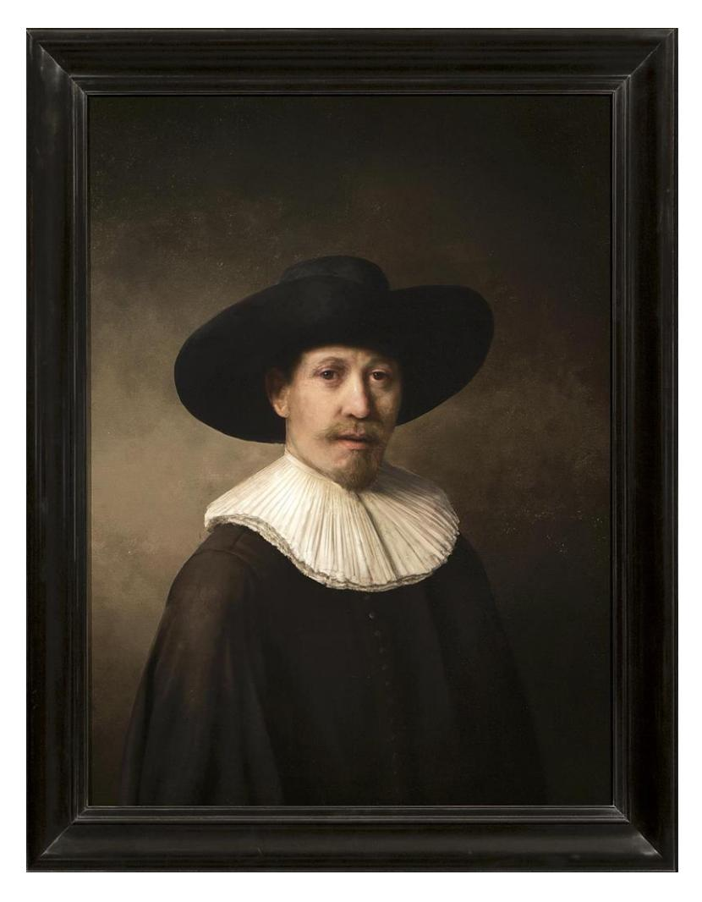

Figure\_4.01. *The Next Rembrandt*, 3D-printed painting created using AI algorithms, 2016. Utilizing a facial recognition algorithm, the researchers identified and classified Rembrandt's characteristic patterns for representing human features. This information was then utilized by AI to mimic the artist's style, creating new facial features and additional elements for this newly generated painting.

Discussions about AI in the visual arts, architecture, music, film, and other cultural fields often rely on widely accepted assumptions about art and creativity. These ideas include the following: "art is the most creative human domain," "art and creativity can't be measured" and "artists do not follow rules." It is also often assumed that "computers only follow rules," and therefore "computers can't make new and original things." Together, these ideas lead to a new assumption: "Generation of original art is the best test of AI progress."

Where do these popular ideas about art and its unique connection to creativity come from? Historically, they are quite recent. All human civilizations have produced artifacts that today we put in art museums and worship as great art. But their makers did not have modern concepts of art, artist, and creativity.

The purpose of this chapter is to examine the historical origins of commonly held beliefs about creativity and the arts, and to suggest that these ideas limit our vision of how AI can be used in culture. Several dominant popular understandings of 'art' exist today, each having evolved in distinct historical contexts. When examined closely, these popular views on art reveal fundamental differences in their core assumptions and implications. Indeed, they may logically contradict each other. Despite this, these diverse perspectives frequently coexist in discussions, with the assumption that they are equally valid.

This simultaneous acceptance of conflicting concepts can lead to a sense of conceptual dissonance. As we grapple with these inconsistencies, feelings of confusion may arise, particularly when facing new challenges in art and culture – such as the adoption of creative AI.

#### The Invention of "Art" in Romantic Period

Our dominant concept of art comes from the Romantic period in Europe: the end of the 18th and first decades of the 19th centuries. According to this concept, artists are different from normal people. They occupy a special place in society. Their art comes from the inside, from their imagination and not from any rules or examples. It is not a result of rational decisions. Rather, it conveys feelings and is guided by intuition.

We can find many Romantic artists and philosophers articulating these ideas. Caspar David Friedrich (1774-1840), the German romantic painter, asserted that "The artist should not only paint what he sees before him, but also what he sees within him."[1](#page-68-1) He also stated that "The artist's *feeling* is his law."[2](#page-68-2) These statements emphasize primacy of intuition and inner vision in art. German literary critic Friedrich Schlegel (17721829) also highlighted the crucial role of intuition in poetry, writing that "every good poem must be wholly intentional and wholly *instinctive*."[3](#page-68-3)

In essence, this is also the way that the majority of people view the arts in contemporary culture. While society, the economy, and technology have changed dramatically during the previous two centuries, the public's understanding of the arts has stayed relatively constant.

This Romantic view of art, which is still standard today, is very different from how people thought about art in previous periods. The Ancient Greeks did not have any concepts that were comparable to our own "art," "creation," or "creator." Instead, the Greek used the term "techne" (τέχνη) to refer to all skills and techniques used to make something. Carpentry, medicine, rhetoric, painting, music, and sculpture were all considered forms of techne. This concept also encompassed other diverse skills such as shipbuilding, shoe making, geometry, shepherding, and pottery. All of these practitioners were following learned rules and methods. There was no creativity involved in the modern sense of this word.

During later Christian period, the term "creatio" was employed to refer to God's act of "creation from nothing." In Christian religion, there was only one Creator – God. And of course, humans could not compete with God. So "artists" in the modern sense could not exist. There were only artisans who created things by following rules.

It wasn't until the Renaissance that a conceptual connection between art and invention started to emerge. The perception of visual arts gradually started to shift from craft and rule-following to more intellectual activity. In different ways, Alberti, Vasari, Leonardo da Vinci and others all expressed the ideas that art does not only imitate nature but can also create new things—and perhaps even improve upon nature. Prominent 17th century poet and theorist Maciej Kazimierz Sarbiewski (1595–1640) went further, writing that a poet "invents" and "creates anew"—"in the manner of God."[4](#page-68-4)

Finally, the modern view that we still take for granted today was established during the Romantic period. For many centuries, artists were understood merely as makers of objects according to rules, and art was divorced from ideas, intellect, and liberal education. Now, this tradition has now been reversed. A Romantic artist is superior to everybody else. He is situated between God and humanity. In fact, as religion's influence waned throughout the later 19th and early 20th centuries, the artist took God's place.

An artist also came to be seen as an intellectual—not just a creator of beautiful objects, but a thinker who expresses important ideas. This new conception positioned the artist as a challenger of established norms, often at the forefront of progressive thinking, using their work to provoke critical reflection and inspire social change. For example, Gustave Courbet's painting *The Stone Breakers* (1849) embodied socialist ideals by depicting physical laborers with unflinching realism. (Courbet called this work a "socialist painting."[5](#page-68-5)) In another example, a later generation of modern artists including Wassily Kandinsky, Piet Mondrian, and Hilma af Klint, created unique systems of abstract art that drew inspiration from their participation in the Theosophy and Anthroposophy movements.

During the nineteenth century, the appreciation, acquisition, and display of fine art became important indicators of social prestige sought after by the growing bourgeoisie class. In an era where modern artists were elevated to near-divine status, the ability to engage with and interpret their works became a means of enhancing one's social standing and accumulating cultural capital. If a contemporary artist is a God, then worshipping their creations increases your symbolic capital and can accelerate upward mobility.

The use of art as a status symbol persists in persists in the present day. today's pop culture icons, despite commanding the adoration of millions, still feel compelled to amass and flaunt their contemporary fine art collections. Consider Jay-Z and Beyoncé as an example— these global superstars have curated impressive art collections, not just as investments, but as tangible displays of their cultural capital and sophistication. It's a fascinating paradox: artists who are worshipped by their endless fans seek to elevate their status further through the acquisition of "high art" works by other artists.

This use of high art as a universal symbol of prestige and refinement is not limited to individuals. Countless large global companies have also embraced this strategy. Firms like Goldman Sachs and Deutsche Bank using carefully curated art collections to project an image of wealth, refinement, and prestige to both clients and employees alike. This practice extends well beyond Western corporations. Korean conglomerates such as Samsung, LG, and Hyundai also actively support museum exhibitions both domestically and internationally including museums such as MoMA in New York and Tate in London, and sponsor prestigious art fairs like Frieze Seoul, demonstrating the global reach of corporate art patronage.

The use of fine arts as a symbol of prestige is not limited to individuals and corporations. It is also crucial to cities and whole countries. Consider what happened after 1990 as the world entered a new era of globalization. Former communist

countries began transitioning to market economies, and many Asian economies experienced rapid growth, contributing to a dramatic expansion of the global middle class. According to one estimate, this class comprised 1 billion people by 1985, but by 2016, it had grown to 3.2 billion people.[6](#page-68-6)

As a result of this growth, we witnessed a swift proliferation of structures for the production and exhibition of 'contemporary art' worldwide, including museums, biennales, and art education programs. While a nation may lack top-tier universities or cutting-edge scientific research, hosting prestigious art biennales can significantly boost its soft power. Indeed, establishing and running an art biennale is far less complex and resource-intensive than building world-class universities and research laboratories, making it an attractive strategy for enhancing global cultural standing.

In 2020, together with my research collaborator Alise Tifentale, I conducted a quantitative analysis of how art biennales have grown over time.[7](#page-68-7) The first international art biennale took place in 1895 in Venice. There were 36 regularly occurring biennales by 1990, 68 biennales by 2010, and 200 by 2019. This rapid growth in recent decades was accompanied by geographic expansion: while the number of new biennales grew in all regions, after the middle of 2000s the fastest growth was in Asia. This trend paralleled the expansion of middle and upper classes in these countries during the same period.

#### Art as the Embodiment of Creativity

The most important idea relevant to our discussion also emerged during the Romantic period: "Art came to be understood as the *exclusive* domain of human creativity*.* [8](#page-68-8) In other words, not only artists are a priori creative – but they are the only truly creative group in society. No longer mere craftsmen following rules, artists were now seen as unique vessels of imagination and emotion, set apart from the rest of humanity.

The term *Creative Industries* that emerged in the early 1990s demonstrates how the Romantic equation of creativity with art continues to be deeply embedded in contemporary society. Why are advertising, graphic design, architecture, video games, and TV production and other cultural fields included in Creative Industries, necessarily *more creative* than sciences, medicine, business, or politics? Ancient Greeks would certainly disagree with this view.

In summary, the Romantic-era assumptions that art, more than any other field of human endeavor, best embodies creativity and encapsulates our uniqueness as a species persist in contemporary culture. These deeply ingrained beliefs lead to a seemingly logical yet actually flawed conclusion: that the ultimate test of AI's progress is its ability to simulate the artistic abilities of the best human artists or to generate novel art.

In this way, our deeply held but historically specific assumption that art is the best and most authentic expression of our human "nature" also shapes public perception and discussions of AI progress. Certainly, the use of AI tools by scientists to aid in new discoveries also gets attention – but it does not provoke the same intense mixture of fascination and fear as the news that, for example, an AI-generated piece of music, visual art, or literature won some prestigious competition in these fields.

Literary scholar Hannes Bajohr likewise noted the exceptional status of art in AI research. He pointed out that after AI conquered other human domains like chess and go, "art and literature pose the latest yardstick: probably nothing would prove the performance of AI models better than a convincingly generated novel."[9](#page-68-9)

We can then ask a logical question: "What could happen next?" If AI begins to produce genuine artistic 'masterpieces,' what other feat will we require to demonstrate that this field continues to make further progress? (As we saw in Chapter 2, deciding what constitutes the best artworks and artists – what qualifies as 'masterpieces' – is certainly not at all easy, and this adds further difficulty to judging AI progress by its ability to create 'best' art.)

#### Art as a Concept and as a Social Instrument

In the 19th and first part of the 20th centuries, it was still assumed that artists need to train for many years to acquire specialized skills in drawing, perspective, composition, and other technical aspects of their craft. But as the ideology of modern art based on Romantic ideas gradually became dominant, the requirement of learning such skills also disappeared.

Since around 1970, the contemporary art world has become conceptual, or ideafocused. The focus has moved from traditional visual skills to linguistic skills. In this world, as exemplified by art biennales, residencies, and grants, an artist's success depends on their ability to capture and comment on ideas deemed socially relevant in elite cultural circles, craft compelling statements, and secure funding. Such skills have largely superseded traditional visual or technical mastery.

Although art after 1970 focused on communicating ideas the society considers to be important, for a while it still continued to value Modernist ambiguity and wanted audiences to struggle with interpretations. However, by the start of the 21st century, as contemporary art entered mainstream culture – with top artists becoming celebrities and groups of schoolchildren becoming regular museum visitors – art could no longer afford to be 'difficult' or ambiguous. Similarly to how it often functioned before the 20th century in the West, today art again serves moral and political functions. Rather than providing unique sensorial experiences, offering beauty, or helping us see our reality differently, today's art often merely illustrates widely held ideas and ideals of contemporary society, such as critiquing global capitalism or advocating for marginalized groups.

In many leading art schools and university art departments that offer professional art degrees (BFA, MFA and PhD in art practice) required for a career in the contemporary art world, students are told to start 'expressing their inner vision' and 'developing their unique' style right away.[10](#page-68-10) Instead of acquiring technical proficiency in various media or traditional artistic techniques, students learn a specialized verbal language of contemporary art (so called *artspeak*) used in artist statements, gallery descriptions, and art criticism. This language, akin to professional jargon in other fields, has its own distinct vocabulary, style patterns, and conventions.[11](#page-68-11)

If you are an artist working or aspiring to work in the global art world, you must be able to communicate and write in this language. You do not need technical skills to create material or media objects, whether it is color theory, realistic drawing and painting, 3D modeling and animation, computer programming, or interactive media design. The actual creation of the objects shown and sold under the artists' names can be outsourced to assistants, freelance professionals, or specialized companies.

To be fair, I should note that certainly not all professional artists today act only as writers of statements and project managers, while the actual creation is done by assistants or other professionals. Certainly, numerous artists create their works themselves, and many do have specialized skills comparable to the skill levels of professionals in creative industries (e.g. illustrators, photographers, programmers, and others). Most art schools still offer separate classes and whole programs that focus on professional skills. Moreover, in the art market segment focused on private collecting, as represented by thousands of global art galleries and major annual fairs like Art Basel and Frieze, we often see a prevalence of meticulously crafted material objects prized for their sensory qualities and aesthetics, with concepts and texts mattering much less, or even not at all.

(In fact, a key difference today between exhibitions of contemporary art organized by museums or cultural centers and displays at art fairs is the complete absence of explanatory text in the latter. At an art fair, visitors are expected to engage with the art directly, in contrast to museums where long text labels have become standard, mediating the viewer's experience through explanations.)

In other words, 'art as a concept'—or a 'project' rather than an 'object'—as described in this section, represents only one type of contemporary art among others that exist today. However, in terms of prestige and cultural influence, this type dominates over all others. In recent years, Venice Art Biennale national pavilions or ArtReview magazine's 'Power 100' – an annual ranking of the most influential people in art – have rarely included painters or sculptors among their selections. Instead, this 2023 rating highlights many artists with clear social agendas.[12](#page-68-12) Here are the phrases used t' d'scribe th' –ork of artists appearing at the top of the list: "political stateme't-making," "revolutionizing social practice," "shining a light on hidden histories," "art and film as tools for consciousness-raising," and "investigating human rights violations.""

#### Art as a Visual Style

Despite the prestige afforded to art centered on progressive ideologies and social commentary by top museums and news media, such works constitute only a small fraction of the total output by professional artists. In endless art galleries, smaller museums, online art websites and social media we continue to see figurative, semifigurative and abstract images. These artworks don't contain social commentary or communicate any other explicit linguistic content. Instead, they adhere to earlier modernist idea of visual art, prioritizing sensory engagement over explicit meaning.

These artworks draw upon the full spectrum of visual languages developed during the previous centuries, spanning from naturalism and realism to full abstraction. However, certain styles developed between the 1870s and 1920s – namely Impressionism, Post-Impressionism, and Expressionism – quantitatively dominate today's art production, overshadowing 19th-century naturalism. Anyway, these artworks do not innovate visually, as the Modernist era (1870–1970) completely exhausted the possibilities for fundamental visual invention.[13](#page-69-0) (This is why the idea that AI can be used to invent new languages of visual art is meaningless. We may expect such newness in interfaces or interactivity AI may enable, but not in the kinds of images.)

This kind of visual art is widely prevalent across the web and social media today, while a more specialized world of contemporary high art remains less visible to the general public. Most people feel too intimidated to even approach contemporary art museums, and they don't have an expertise in the professional specialized art world. Instead, their idea of visual art is formed primarily by the "art images" they see around them, typically online. And this is why "contemporary art" for most people is equated with two-dimensional images that represent something in either a detailed or schematic way using visual languages of 19th-century realism or early 20th-century Modernism. This popular conception of art, centered on images and modernist styles, stands in contrast to the diverse and often conceptual practices found in the current professional art world.

While AI researchers possess specialized knowledge in their own field, they typically lack formal education in contemporary art and art history. Consequently, their understanding of art often aligns with that of the general public, reflecting the popular conception of visual art we've just described. And this is why research on AI applications in art often focuses on refining methods for generating images in the styles of famous classical and modernist artists. This approach reflects the common understanding of 'art' shared by both the public and AI scientists, which is largely centered on recognizable visual styles from art history rather than contemporary artistic practices.

For both AI researchers and the public, these AI-generated images are often equated with art itself. The visual similarity to what popular culture labels as 'visual art' is assumed to be sufficient to qualify these images as art. This narrow conception explains why the use of AI methods in interactive art or experimental music rarely captures the attention of news media or the public. Such forms of art remain less popular with the general audience, unless they are promoted by major tech companies like Google as the latest AI art or serve a purely entertainment function.

#### Art as Realism

As demonstrated by many research studies in the social sciences, for the majority of people today, "art" indeed means "pictures" and special skills required to create them.[14](#page-69-1) An "artist" is understood as someone who possesses specialized skills to

create images in various styles, with a particular emphasis on achieving detailed realism. This includes the skills to produce figurative 2D images, professional-looking photographs, animated 3D models of human figures, manga drawings, and other representational images. Acquiring these abilities takes years of training and practice. Search for "art" in Instagram or on YouTube, and you will come across endless tutorials, guides and courses on how to acquire such skills.

The idea of specialized skills that need to be mastered also defines all areas of the culture industry – professional photography, manga, anime and animation, game design, web and interaction design, cinematography, video editing, acting, TV and film directing, music production and so on. Often when professionals from the culture industry are evaluated, the idea of learning skills and achieving technical mastery is combined with the idea of exceptional creativity. For example, if a very successful culture industry professional is referred as a 'real artist', this assumes that they have not only original artistic vision but also superb mastery of the craft.

This commonly held view of art explains why realistic images, similar to the ones of great artists from the past, that are generated by AI often receive the most media attention. (However, note that the appeal lies not in generic realism, but in AI's ability to emulate the distinctive figurative styles of renowned artists—thus combining the notions of art as specialized skill and as the creation of genius.) People are very impressed when a research team has used AI to recreate destroyed parts of Rembrandt's *The Night Watch* (2021)[15](#page-69-2), or when in the early days of generative AI Yale student has used this technology to create simulated images of classical Chinese landscape paintings that 55 percent of experiment participants couldn't distinguish from authentic works (2020).[16](#page-69-3) Another example of this fascination with AI's specialized 'art skills' is the 2016 project *The Next Rembrandt* where a team of 20 people from Microsoft, TU Delft, and the Mauritshuis and Rembrandthuis museums analyzed 346 of Rembrandt's paintings to create a new 'Rembrandt' work, complete with convincing brushstrokes and textures.[17](#page-69-4) But an AI that can make abstract art does not make news.

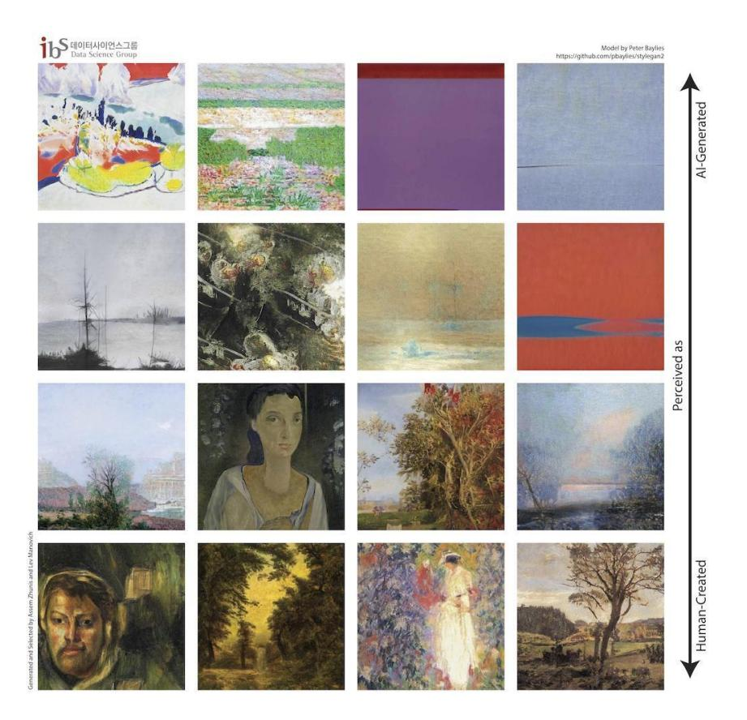

Figure\_4.02. Assem Zhunis and Lev Manovich, examples of images generated by StyleGAN2 AI model (2021) trained on 81,000 paintings from wikiart.org. These images were used in an experiment where people were asked to guess if each was created by a human artist or an AI. Most responders assumed that realistic images shown in the bottom row came from human artists, while simple abstract images shown in the top row were created by AIs.

In an experiment conducted by the Data Science Lab at the Institute for Basic Science (IBS) in Daejeon, South Korea in spring 2021, a group of people without any art training were shown both realistic and abstract images and asked to judge whether each image was made by a human artist or AI. As a visiting researcher in this lab, I was directly involved in conducting this experiment: I used the state-of-the-art AI model to generate images in many artistic styles and selected examples of both more realistic and more abstract images for use in the experiments. The participants in our study most frequently assumed that images with a significant level of detail were made by human artists, while they tended to attribute simple abstract images to AI generation. In our study, images which had a significant level of detail were most frequently assumed by participants to be made by human artists, while simple abstract images were assumed to be generated by AI.[18](#page-69-5) (In reality, all the images in the experiments were generated using a StyleGAN2 AI model that was trained by the scientists on tens of thousands of historical paintings from the wikiart.org site.)

#### Creativity and Global Economy

Yet another key idea about creativity taken for granted today is a relatively recent one that only gained popularity in the early 2000s. At the turn of the century, global competition and easier access to foreign markets, driven by economic globalization, gave rise to a new paradigm in business. In this new landscape, your company now needs to be 'creative' and it needs to innovate constantly. The global success of Apple, LG and Samsung in the first part of 2000s, based on their innovative strategies has become an example for all businesses.

The highly influential book of urban theorist Richard Florida, *The Creative Class* (2002), also played an important role. According to Florida, the economic function of this class is "to create new ideas, new technology and/or creative content."[19](#page-69-6)

Florida defined the creative class as a socioeconomic group of professionals in fields such as science, engineering, education, computer programming, and research, as well as arts, design, and media. In his analysis, the creative class already included 30 per cent of the US workforce by the early 2000s.[20](#page-69-7) Florida argued that cities that can attract this class will prosper. His work had a big effect. For example, the leaders of Berlin were influenced by his ideas and in the 2000s set up policies to attract professionals in design, software and media from other countries to the city.

By the 2010s, creativity became viewed as highly desirable for society and individuals alike, emerging as a new universal social value. *Everybody should be creative*—and computer technologies are here to help us. (Which means that we all, to some extent, should become artists.) A new term "creative technologist" that became popular in the 2010s is an example of these trends.

This idea also led to a new assumption: AI and technology in general should help individuals and companies to be creative and innovative. Now, we no longer want AI to only simulate human cognitive functions such as vision, speech, and reasoning, or to merely quickly search through millions of documents or translate between languages. This was enough in the 20th century—but not the 21st. Now we want AI to generate creative and innovative solutions automatically or assist us in doing this because society assumes that creativity is the driver of the economy.

#### Dissociating AI and Creativity Concepts

All this means that *in the future, when our ideas about art, artists, and creativity will change* (and there is no reason why they should stay the same forever), the link between AI and the arts that now seems obvious may also become *weaker or disappear*. And this will be a good thing. I am personally looking forward to this. In my life experience, the proportion of creative people in the arts is no different from that in any other field of human activity. Although the conceptual templates, examples and tactics used by many contemporary artists, designers, architects and other creatives today may not all be as explicit as Lightroom presets or WordPress themes, they are no less real. In all professional fields, including the arts, only a small percentage of practitioners are true innovators, while the majority tend to follow established trends and apply established techniques.

As we saw in this chapter, the association of the arts and creativity that we take for granted today, and the privileging of creativity over other considerations, are relatively recent inventions. Thus, rather than obsessing over the question "Can AI be creative?", we should explore other ideas about what AI can do for art, design, architecture, filmmaking and all other art fields.

#### Notes

- 3 Gorodeisky, K. (2016). 19th century romantic aesthetics. In E. N. Zalta (Ed.), *The Stanford Encyclopedia of Philosophy* (Fall 2016 Edition). Retrieved August 24, 2024, from, [https://plato.stanford.edu/archives/fall2016/entries/aesthetics-19th-romantic.](https://plato.stanford.edu/archives/fall2016/entries/aesthetics-19th-romantic) Emphasis mine - LM.
- 4 Tatarkiewicz, W. (1980). *A history of six ideas: An essay in aesthetics*. Martinus Nijhoff.
- 5 Boime, A. (2008). *Art in an age of civil struggle, 1848–1871*. University of Chicago Press.
- 6 Kharas, H. (2017, February). The unprecedented expansion of the global middle class. *Global Economy & Development Working Paper 100*. Brookings. [https://www.brookings.edu/wp-content/uploads/2017/02/global\\_20170228\\_global](https://www.brookings.edu/wp-content/uploads/2017/02/global_20170228_global-middle-class.pdf)[middle-class.pdf](https://www.brookings.edu/wp-content/uploads/2017/02/global_20170228_global-middle-class.pdf)
- 7 Manovich, L., & Tifentale, A. (2020). *Examining the growth of art biennales from 1895 to 2019*. Cultural Analytics Lab. [https://manovich.net/content/04-projects/115](https://manovich.net/content/04-projects/115-culture-in-the-pandemics-era-examining-the-growth-of-art-biennales-from-1895-to-2019/biennale-article-final.pdf) [culture-in-the-pandemics-era-examining-the-growth-of-art-biennales-from-1895-to-](https://manovich.net/content/04-projects/115-culture-in-the-pandemics-era-examining-the-growth-of-art-biennales-from-1895-to-2019/biennale-article-final.pdf)[2019/biennale-article-final.pdf](https://manovich.net/content/04-projects/115-culture-in-the-pandemics-era-examining-the-growth-of-art-biennales-from-1895-to-2019/biennale-article-final.pdf)
- 8 See Day, A. (2012). Romanticism (2nd ed.). Routledge.
- 9 Bajohr, H. (2014). On artificial and post-artificial texts: Machine learning and the reader's expectations of literary and non-literary writing. *Poetics Today, 45*(2), 331– 361.
- 10 For those seeking intensive training in traditional representational art skills, private ateliers and specialized academies provide alternative options. Internationally, countries in Eastern Europe and Asia, such as China and Russia, still often maintain a stronger focus on traditional skills in their top art schools.
- 11 Unbehaun, P. (2021). Artspeak: The bullshit language of art. *Polish Journal of Aesthetics, 4*(63), 15-31.<https://philarchive.org/rec/UNBATB>
- 12 ArtReview. (2023). *Power 100.* Retrieved August 26, 2024, from [https://artreview.com/power-100?year=2023.](https://artreview.com/power-100?year=2023) For the analysis of art biennale trends as represented by 211 art biennales that took place in 2017- 2022 and 1,599 artists who participated in more than one of these shows, see Davis, B. (2022). What does it mean to be a 'biennial artist,' anyway? Here are the traits that unite the most successful practitioners. Artnet. Retrieved August 26, 2024, from [https://news.artnet.com/art](https://news.artnet.com/art-world/what-mean-biennial-artist-2124996)[world/what-mean-biennial-artist-2124996](https://news.artnet.com/art-world/what-mean-biennial-artist-2124996)

1 Vaughan, W. (1994). *German romantic painting* (p. 68). Yale University Press.

2 Friedenthal, R. (1963). *Letters of the great artists – from Blake to Pollock* (p. 32). Thames and Hudson. Emphasis mine - LM.

13 New effects enabled by Photoshop and other media software and also computer graphics in the 1990s-2000s (for example, images of complex networks or particle systems) have by now become part of the Modernist legacy.

14 See for instance Batt, R. et al. (2010). Style and spectral power: Processing of abstract and representational art in artists and nonartists. *Perception, 39*(12), 1659–1671.

15 Criddle, C. (2021, June 23). Rembrandt's *The Night Watch* painting restored by AI. *BBC News*. [www.bbc.com/ news/technology-](/Users/levmanovich/Library/Mobile%20Documents/com~apple~CloudDocs/MY%20ARTICLES%20&%20BOOKS/in%20progress%20books/Book%20on%20Artifical%20Aesthetics%20wih%20Emanuelle/_2024%20Publication%20files/_AA%20all%20chapters%20PDF/www.bbc.com/%20news/technology-57588270)[57588270](/Users/levmanovich/Library/Mobile%20Documents/com~apple~CloudDocs/MY%20ARTICLES%20&%20BOOKS/in%20progress%20books/Book%20on%20Artifical%20Aesthetics%20wih%20Emanuelle/_2024%20Publication%20files/_AA%20all%20chapters%20PDF/www.bbc.com/%20news/technology-57588270)

16 Xue, A. (2020, November 11). End-to-end Chinese landscape painting creation using generative adversarial networks. <http://arxiv.org/pdf/2011.05552v1.pdf>

17 The Next Rembrandt. *Microsoft News*. Retrieved September 24, 2024, from <https://news.microsoft.com/europe/features/next-rembrandt>

18 Lima, G. et al. (2021). On the social-relational moral standing of AI: An empirical study using AI-generated art. *Frontiers in Robotics and AI,* 8.

<https://www.frontiersin.org/articles/10.3389/frobt.2021.719944/full>

19 Florida, R. (2002). *The rise of the creative class: And how it's transforming work, leisure, community, and everyday life* (p. 8). Perseus Book Group.

20 Florida, R. (2012). *The rise of the creative class – revisited: 10th anniversary edition* (p. vii). Basic Books.

# **5.**

# **From Representation to Prediction: Theorizing the AI Image**

#### Lev Manovich

In this chapter I will describe several characteristics of *visual generative media* at the current stage of its development that I believe are particularly significant or novel. (Some of my arguments also apply to generative media in general, but mostly I focus on images*.*) My approach to thinking about AI media is informed not only by my previous theoretical and artistic work with digital media but also practical experience of using popular AI image tools such as Midjourney almost daily for two years starting from August 2022.

The theories of AI images offered in the chapter synthesize ideas and perspectives from several fields: history of modern art, history of digital media, media theory, and software studies. I examine parallels between current AI practices and historical artistic movements. I also contextualize AI art within the broader history of media creation, examining how it builds upon and diverges from previous methods of image generation.

#### The Terms

Let's begin by defining the terms. The terms *generative media*, *synthetic media, AI media*, *generative AI*, *GenAI* are all interchangeable. They refer to the process of creating new media artifacts with software tools that use certain types of artificial neural networks (e.g., *AI models*) trained on vast collections of media objects already in existence. The artifacts that these models can generate include images, animation, video, songs, music, text, music, 3D models and scenes, code, synthetic data, and other types of media. While generation of new media objects received lots of public attention since 2022, today (middle of 2024) the more common use of these tools in Creative Industry is for media editing. For example, a writer can ask ChatGPT or another AI language bot to help editing an article or generating its abstract, while a photographer can use *generative fill* tool in Photoshop to replace any area of an image with another content that fits visually with the content outside of this area.

This chapter focuses on a particular type of generative media: images. Such images made with AI tools can be also referred by other terms such as *generative images*, *synthetic images*, *AI images*, and *AI visuals*. Note that the word "generative" itself can be used in different ways to refer to making cultural artifacts using any algorithmic processes (as opposed to only generative AI models) or more generally, any rule-based process that does not use computers. This is how the phrases *generative art* and *generative design* are typically used today in cultural discourses and popular media. In this chapter I am using *generative* in more restrictive way to designate AI models and GenAI apps for media generation and editing that use these methods.

#### 'AI' as a Cultural Perception

There is not one specific technology, or a single research project called 'AI'. However, we can follow how our cultural perception of this concept evolved over time and what it was referring to in each period. In the last fifty years, when an allegedly uniquely human ability or skill is being automated by means of computer technology, we refer to it as 'AI'. Yet, as soon as this automation is seamlessly and fully successful, we tend to stop referring to it as an 'AI case'. In other words, 'AI' refers to technologies and methodologies that automate human cognitive abilities and are starting to function but aren't quite there yet. 'AI' was already present in the earliest computer media tools. The first interactive drawing and design system, Ivan Sutherland's *Sketchpad* (1961- 1962), had a feature that would automatically finish any rectangles or circles you started drawing. In other words, it knew what you were trying to make. In the very broad understanding just given, this was undoubtedly 'AI' already.

My first experience with a desktop paint program running on an Apple II was in 1984, and it was truly amazing to move your mouse and see simulated paint brushstrokes appear on the screen. However, today we no longer consider this to be 'AI'. Another example would be the Photoshop function that automatically selects an outline of an

object. This function was added many years ago – this, too, is 'AI' in the broad sense, yet nobody would refer to it as such today. The history of digital media systems and tools is full of such 'AI moments' – amazing at first, then taken for granted and forgotten as 'AI' after a while. (In academic studies of AI history, this phenomenon is referred to as the *AI effect*.) Thus, today *creative AI* refers only to recently developed methods where computers transform some inputs into new media outputs (e.g., text-toimage models) and specific techniques (e.g., certain types of AI models). However, we must remember that these methods are neither the first nor the last in the long history and future of simulating human art abilities or assisting humans in media creation. I expect that after a certain period, GenAI technology will be taken for granted, becoming ubiquitous and thus invisible – and some other cultural use of computers will come to be seen as 'AI.'

#### "Make it New": AI and Modernism

After training on trillions of text pages or billions of images taken from the web, AI models can generate new texts and visuals on the level of highly competent professional writers, artists, photographers, or illustrators. These capacities of the AI models are distributed over trillions of connections between billions of artificial neurons rather than determined by standard algorithms. In other words, we developed a technology that, in terms of complexity, is extremely similar to the human brain. We don't fully grasp how our AI technology works, just as we don't fully comprehend human intellect and creativity.

The current generation of generative AI image models and tools, such as Midjourney and Stable Diffusion, have been trained on very large and diverse datasets containing hundreds of millions or billions of images and their text descriptions. It is, however, equally interesting to limit the training data set to a specific area within the larger space of human cultural history, or to a specific set of artists from a specific historical period. *[Unsupervised](https://refikanadol.com/works/unsupervised/)* by Refik Anadol Studio (2022) is AI art project that exemplifies these possibilities. The project uses AI models trained on the image dataset of tens of thousands of artworks from the MoMA collection. This collection, in my opinion, is one of the best representations of the most creative and experimental period in human visual history - hundred years of modern art (1870 - 1970) - as well as many important examples of artistic explorations in the subsequent decades. It captures modernist artists' feverish and relentless experiments to create new visual and communication languages and "make it new."

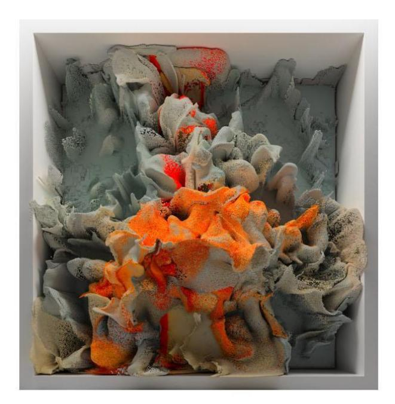

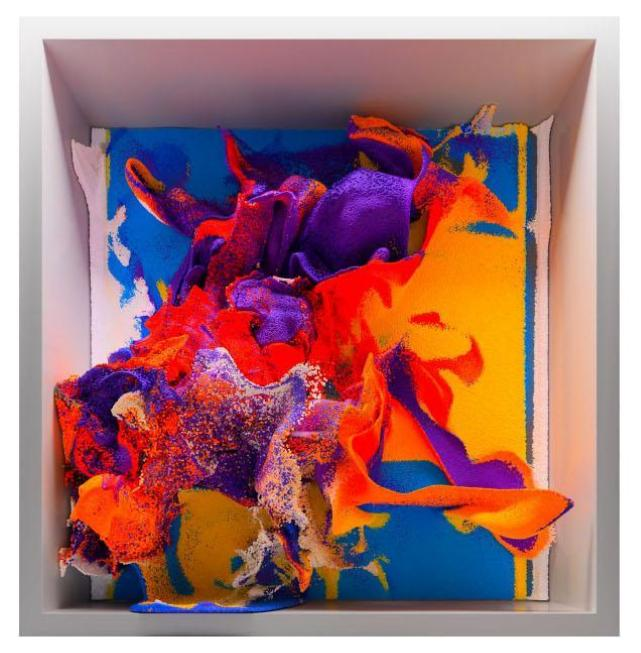

Figure\_5.01. Refik Anadol Studio, *Unsupervised*, 2022. Selected frames from the generative animation.

On the surface, *the logic of modernism appears to be diametrically opposed to the process of training generative AI systems*. Modern artists desired to depart from classical art and its defining characteristics such as visual symmetry, hierarchical compositions, and narrative content. In other words, their art was founded on a fundamental rejection of everything that had come before it (at least in theory, as expressed in their manifestos). AI models are trained in the opposite manner, by learning from historical culture and art created up to now. AI model is analogous to a very conservative artist studying in the "meta" *museum without walls* that houses historical art.

But we all know that art theory and art practice are not the same thing. Modern artists did not completely reject the past and everything that came before them. Instead, *modern art developed by reinterpreting and copying images and forms from old art traditions*, such as Japanese prints (van Gogh), African sculpture (Picasso), and Russian icons (Malevich). Thus, the artists only rejected the dominant high art paradigms of the time, realistic and salon art, but not the rest of human art history. In other words, it was deeply historicist: rather than inventing everything from scratch, it innovated by adapting certain older aesthetics to contemporary art contexts. (In the case of geometric abstract art created in 1910s, these artists used images that were already

widely used in experimental psychology to study human visual sensation and perception.[1](#page-93-1)

When it comes to artistic AI, we should not be blinded by how these systems are trained. Yes, AI models are trained on previously created human art and culture artifacts. However, their newly generated outputs are not mechanical replicas or simulations of what has already been created. In my opinion, these are frequently *genuinely new* cultural artifacts with *previously unseen content, aesthetics, or styles*.

Of course, simply being novel does not automatically make something culturally or socially interesting or significant. Indeed, many definitions of "creativity" agree on this point: it is the creation of something that is both original and worthwhile or useful.

However, estimating what percentage of all novel artifacts produced by generative AI are also useful and/or meaningful for a larger culture is not a feasible project at this time. For one thing, I am not aware of any systematic effort to use such systems to "fill in," so to speak, a massive matrix of all content and aesthetic possibilities by providing millions of specifically designed prompts. Instead, it is likely that, as in every other area of popular culture, only a small number of possibilities are realized over and over by millions of users, leaving a long tail of other possibilities unrealized. So, if only a tiny fraction of the vast universe of potential AI artifacts is being realized in practice, we can't make broad statements about the originality or utility of the rest of the universe.

#### Generative Media and Database Art

Some AI artists such Anna Ridler[2](#page-93-2), Sarah Meyohas[3](#page-93-3) and [Refik Anadol](https://refikanadol.com/)[4](#page-93-4) utilized in their works AI models trained on specific datasets. Many other artists, designers, architects, and technologists use models released by other companies or research institutions that were already trained on very large datasets (e.g., Stable Diffusion), and then fine tune them on their own data.

For example, artist [Lev Pereulkov](https://www.instagram.com/pereulye/)[5](#page-93-5) fine-tuned the Stable Diffusion model 2.1 using 40 paintings by well-known "non-conformist" artists who worked in USSR starting in the 1960s (Erik Bulatov, Ilya Kabakov, and others). Pereulkov's image series *[Artificial](https://www.instagram.com/p/CnezVZ9KHMV/)  [Experiments 1](https://www.instagram.com/p/CnezVZ9KHMV/)–10* (2023) created with this customized AI model, is an original piece of art that captures the artistic characteristics of these artists as well as their unique surreal and ludicrous semantics without repeating closely any of their existing works.*[6](#page-93-6)* Instead, their "DNAs" captured by the model enable new meanings and visual concepts.

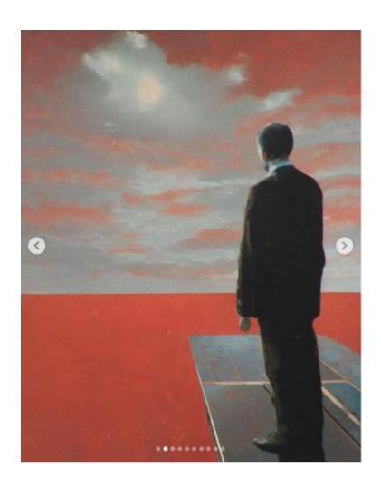

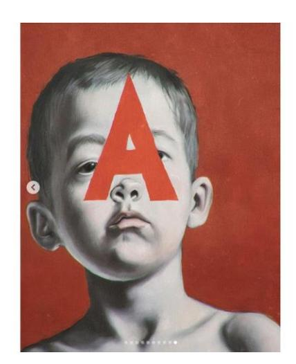

Figure\_5.02. Lev Pereulkov, *[Artificial Experiments 1](https://www.instagram.com/p/CnezVZ9KHMV/)–10*, 2023. Three images from the series of 10 shared on Instagram.

Most of the millions of everyday people and creative professionals who employ generative media tools use them as is, and don't fine them further. This may change in the future as the techniques fine tuning AI models using our own data may become easier to use and wider available. But regardless of these specifics, all newly created cultural artifacts produced by AI models have a common logic.

Unlike traditional drawings, sculptures, and paintings, generative media artifacts are not created *from scratch*. They are also not the result of *capturing* some sort of sensory phenomenon, such as photos, videos, or sound recordings. They are instead built from *large archives of already existing media artifacts*. This generative mechanism links generative media to earlier art genres and processes.

We can compare it to film editing, which first appears around 1898, or even earlier composite photography, which was popular in the nineteenth century. We can also consider specific artworks that are especially relevant, such as experimental collage film *[A Movie](https://en.wikipedia.org/wiki/A_Movie)* (Bruce Conner, 1958) or many Nam June Park installations that feature bits of television programs playing across hundreds of TV monitors.

Seeing projects like *Unsupervised* or *artificial experiments 1-10* in the context of this media creation method and its historical variations will help us understand this and many other AI artworks as art objects engaged in dialogues with art from the past, rather than as purely technological novelties or works of entertainment.

I see many relevant moments and periods when I scan the history of art, visual culture, and media for other prominent uses of this procedure. They are relevant to the current generative media not only because artists working at these times used the procedure, but also because the reason for this use was consistent in all cases. *A new accumulation and accessibility of masses of cultural artifacts led artists to create new forms of art driven from these accumulations*. Let me describe a few of these examples.

Net and digital artists created a number of works in the late 1990s and early 2000s in response to the new and rapidly expanding universe of the world wide web. Health Bunting's *[\\_readme](http://www.medienkunstnetz.de/works/readme/)* (1998), for example, is a web page containing the text of an article about the artist, with each word linked to an existing web domain corresponding to that word. Mark Napier's *[Shredder 1.0](https://en.wikipedia.org/wiki/Shredder_1.0)* (also 1998) presents a dynamic montage of elements that comprise numerous websites—images, texts, HTML code, and links.

Going further back in time, we find a broad cultural paradigm that was also a reaction to the accumulation of historical art and culture artifacts in easily accessible media collections. This is paradigm is known as "post-modernism." Post-modern artists and designers frequently used bricolage and created works consisting of quotations and references to art from the past, rejecting modernism's focus on novelty and breaking with the past.

While there are many possible explanations for the emergence of the post-modern paradigm in the 1960s and 1980s, one is relevant to our discussion. The accumulation of earlier art and media artifacts in structured and accessible collections such as slides libraries, film archives, art history textbooks with many photos of the artworks, and other formats - where different historical periods, movements, and creators were positioned together - inspired artists to begin creating bricolages from such references as well as extensively quoting them.

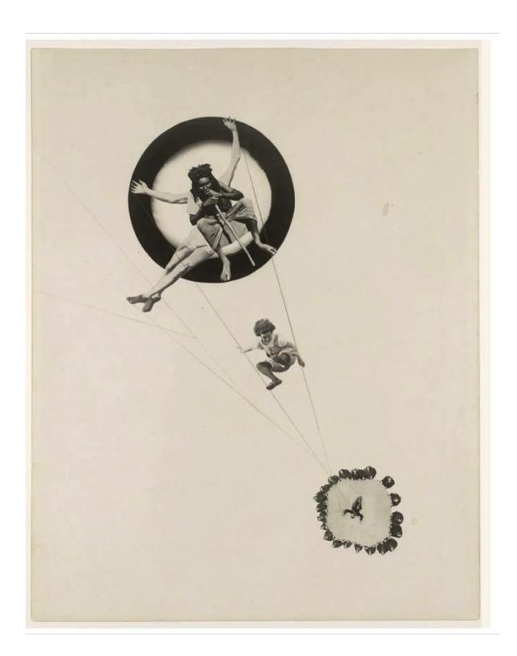

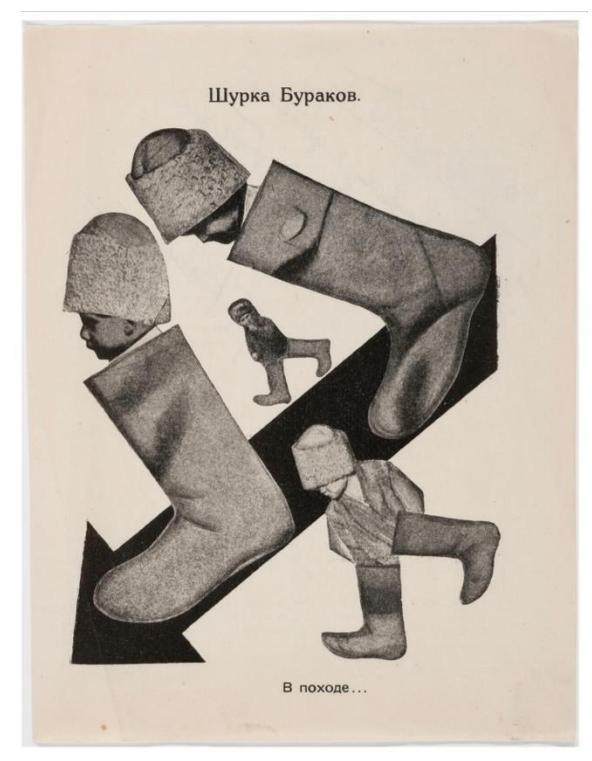

Figure\_5.03. Examples of 1920s photomontages by László Moholy-Nagy 1928, left) and Gustav Klutsis (c. 1925, right).

What about artistic modernism of the 1910s and 1920s? While the overall emphasis was on originality and novelty, one of the procedures it developed in search of novelty was direct quotations from the vast universe of contemporary visual media that was rapidly expanding at the time. Large headings, for example, and the inclusion of photos and maps made newspapers more visually impactful; new visually oriented magazines, such as *Vogue* and *Times*, were also launched in 1913 and 1923, respectively; and of course, a new medium of cinema continued to develop.

In response to this visual intensification of mass culture, in the early 1910s Georges Braque and Pablo Picasso began incorporating actual newspaper, poster, wallpaper, and fabric fragments into their paintings. A few years later, John Heartfield, George Grosz, Hannah Hoch, El Lissitzky, Aleksandr Rodchenko, László Moholy-Nagy and a handful of other artists began to develop photo-collage techniques. Photo-collage became another method of creating new media artifacts from existing mass media images.

Contemporary artworks that employ AI models trained on cultural databases, such as *Unsupervised* or *artificial experiments 1-10*, continue a long tradition of creating new art from *accumulations of images and other media*. In this way, these works of art keep opening up new possibilities for art and its techniques, particularly those of what I referred to already in 1998 as "database art."[7](#page-93-7) The introduction of new methods for *reading cultural databases and creating new narratives from them* is part of this expansion.

Thus, *Unsupervised* neither creates collages from existing images, as did modernist artists of the 1920s, nor quotes them extensively, as did postmodern artists of the 1980s. Instead, the members of Anadol Studio train a neural network to extract patterns from tens of thousands of MoMA's artworks. The trained net then generates new images that share the same patterns but don't look like any specific paintings. Throughout the course of the animation, we travel through the space of these patterns (e.g., "latent space"), exploring various regions of the universe of contemporary art.[8](#page-93-8)

Pereulkov's *[Artificial Experiments 1](https://www.instagram.com/p/CnezVZ9KHMV/)–10* use a different technique to generate new images from an existing image database. He chose only forty paintings by artists who share key characteristics. They developed their oppositional art in late communist society (USSR, 1960s-1980s). They also lived in the same visual culture. In my memories, this society was dominated by two colors: grey (representing the monotony of urban life) and the red of propaganda.

In addition, Pereulkov chose paintings that share something else: "I chose, as a rule, paintings that conceptually relate in some way to the canvas - or to the space on it. I obtained the photo of a painting *New Accordion* from Kabakov, which features paper applications on top of the canvas."[9](#page-93-9) Pereulkov also crafted custom text descriptions of each painting used for fine-tuning the Stable Diffusion model. To teach the model the specific visual languages of the chosen artists, he added terms such as "thick strokes," "red lighting," "blue background," and "flat circles" to these descriptions.

Clearly, each of these steps represents a conceptual and aesthetic decision. In other words, the key to the success of *Artificial Experiments 1–10* is the creation of such a database. This work demonstrates how fine-tuning an existing neural network that was trained on billions of image and text pairs (such as Stable Diffusion) can make this network follow artists' ideas; the biases and noise of such a massive network can be overcome and minimized, and do not need to dominate our own imagination.

### From Representation to Prediction

Historically, humans created images of existing or imagined scenes using a number of methods, from manual drawing to 3D CG (see below for explanation of the methods). With AI generative media, a fundamentally new method emerges. Computers analyze patterns in large datasets of existing media. Using these learned patterns, they can then create new, previously unseen still and moving images that exhibit similar characteristics. This process forms the core of Generative AI technology.

One can certainly propose different historical paths leading to visual generative media today or divide one historical timeline into different stages. Here is one such possible trajectory:

- 1. Creating representations manually (e.g. drawing with variety of instruments, carving, etc.). More mechanical stages and parts were sometimes carried out by human assistants typically training in their teacher's studio – so there is already some delegation of functions.
- 2. Creating manually but using assistive devices (e.g. perspective machines, camera lucida). From *hands* to *hands + device*. Now some functions are delegated to mechanical and optical devices.
- 3. Photography, x-ray, video, volumetric capture, remote sensing, photogrammetry. From *using hands* to *recording information using machines*. From *human assistants* to *machine assistants*.
- 4. 3D CG. You define a 3d model in a computer and use algorithms that simulate effects of light sources, shadows, fog, transparency, translucency, natural textures, depth of field, motion blur, etc. From r*ecording* to *simulation*.
- 5. Generative AI. Using media datasets to predict still and moving images. From *simulation* to *prediction.*

*"*Prediction" is the actual term often used by AI researchers in their publications describing visual generative media methods. So, while this term can be used figuratively and evocatively, this is also what happens scientifically when you use image generative tools. When working with a text-to-image AI-model, the artificial neural network attempts to predict the images that correspond best to your text input. I am certainly not suggesting that using all other already accepted terms such as 'generative media' is inappropriate. But if we want to better understand the difference between AI visual media synthesis methods and other representational methods developed in human history, employing the concept of 'prediction' and thus referring to these AI systems as 'predictive media' captures this difference well.

#### Media Translations

There are several methods for creating 'AI media'. One method transforms human media input while retaining the same media type. Text entered by the user, for example, can be summarized, rewritten, expanded, and so on. The output, like the input, is a text. Alternatively, in the image-to-image generation method, one or more input images are used to generate new images.

However, there is another path that is equally intriguing from the historical and theoretical perspectives. 'AI media' can be created by automatically 'translating' content between media types. This is what happens, for example, when you are using Midjoiurney, Stable Diffusion or other AI image generator service and enter a text prompt, and AI generates one or more images in response. Text is 'translated' into an image.

Because this is not a literal one-to-one translation, I put the word 'translation' in quotes. Instead, input from one medium instructs AI model to predict the appropriate output from another. Such input can also be said to be 'mapped' to some outputs in other media. Text is mapped into new styles of text, images, animation, video, 3D models, and music. The video is converted into 3D models or animation. Images are 'translated' into text, and so on. Text-to-image method translation is currently more advanced than others, but various forms will catch up eventually.

Translation (or mapping) between one media and another is not a new concept. Such translations were done manually throughout human history, often with artistic intent. Novels have been adapted into plays and films, comic books have been adapted into television series, a fictional or non-fictional text was illustrated with images, etc. Each of these translations was a deliberate cultural act requiring professional skills and knowledge of the appropriate media. Some of these translations can now be performed automatically on a massive scale thanks to AI models, becoming a new means of communication and culture creation. Of course, artistic adaptation of a novel into a film by a human team and automatic generation of visuals from novel text by a net is not the same thing, but for many more simple cases automatic media translation can work well. What was once a skilled artistic act is now a technological capability available to everyone. We can be sad about everything that might be lost because of the automation – and democratization – of this critical cultural operation: skills, something one might call 'deep artistic originality' or 'deep creativity', and so on. However, any such loss may be only temporary if the abilities of 'culture AI' are, for example, even further improved to generate more original content and understand context better.

Because most people in our society can read and write in at least one language, *textto-another media* methods are currently the most popular. They include text-to-image, text-to-animation, text-to-3D, and text-to-music models. These AI tools can be used by anyone who can write, or by using readily available translation software to create a prompt in any of the language these tools understand best at a given point. However, other media mappings can be equally interesting for professional creators. Throughout the course of human cultural history, various translations between media types have attracted attention. They include translations between video and music done by VJs in clubs; long literary narratives turned into movies and television series; texts illustrated with images in various media such as engravings; numbers turned into images (digital art); texts describing paintings (*ekphrasis* tradition, which began in Ancient Greece), mappings between sounds and colors (especially popular in modernist art); etc.

The continued development of AI models for mappings between all types of media, without privileging text, has the potential to be extremely fruitful, and I hope that more tools will be able to accomplish this. Such tools will be very useful both to professional artists and other creators alike. However, being an artist myself, I am not claiming that future 'culture AI' will be able to match, for example, innovative interpretations of Hamlet by avant-garde theatre directors such as Peter Brook or astonishing abstract films by Oscar Fishinger that explored musical and visual correspondences. It is sufficient that new media mapping AI tools stimulate our imagination, provide us with new ideas, and enable us to explore numerous variations of specific designs.

#### The Stereotypical and the Unique

Both the modern human creation process and the predictive AI generative media process seem to function similarly. AI model is trained using unstructured collections of cultural content, such as billions of images and their descriptions or trillions of web and book pages. The neural net learns associations between these artifacts' constituent parts (such as which words frequently appear next to one another) as well as their common patterns and structures. The trained net then uses these structures, patterns, and 'culture atoms' to create new artifacts when we ask it to. Depending on what we ask for, these AI-created artifacts might closely resemble what already exists or they might not.

Similarly, our life is an ongoing process of both supervised and unsupervised cultural training. We take art and art history courses, view websites, videos, magazines, and

exhibition catalogs, visit museums, and travel in order to absorb new cultural information. And when we 'prompt' ourselves to make some new cultural artifacts, our own biological neural and networks (infinitely more complex than any AI nets to date) generate such artifacts based on what we've learned so far: general patterns we've observed, templates for making particular things, and often concrete parts of existing artifacts. In other words, our creations may contain both exact replicas of previously observed artifacts and new things that we represent using templates we have learned, such as golden ratio or use of complementary colors.

AI tools for image generation frequently have a default "house style." (This is the actual term used by MidJourney developers.) If one does not specify a style explicitly, the AI tool will generate images using its default aesthetic. Each of the popular AI image tools and AI bots that can also generate images (ChatGPT, Anthropic's Claude, Google Gemini, Microsoft Copilot, etc.) has its own default style; these styles can change from version to version.

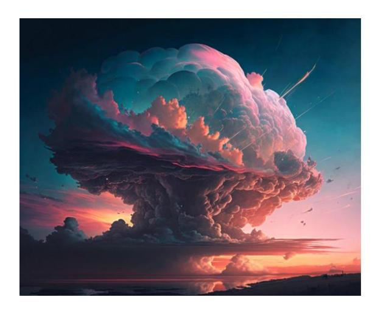

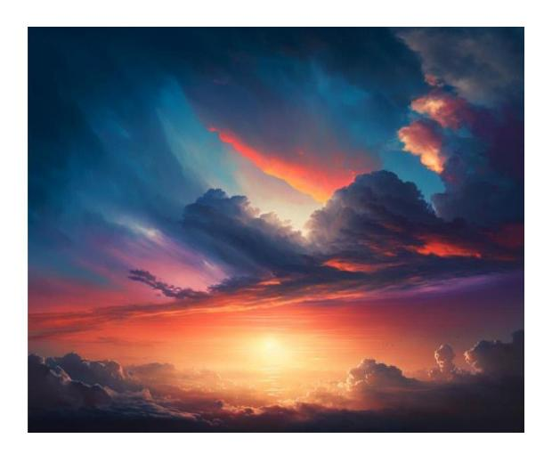

Figure\_5. 04. Examples generated in Midjourney version 4 using the short text prompt "morning sky."

To steer away from this default, you need to add terms to your prompts specifying a description of the medium, the kind of lighting, the colors and shading, or a phrase like "in the style of" followed by the name of a well-known artist, illustrator, photographer, fashion designer, or architect. Here are two examples of such prompts from my own artistic work, and the images that Midjourney generated from these prompts (2022- 2023). The terms used to define particular style characteristics are highlighted in *italics*.

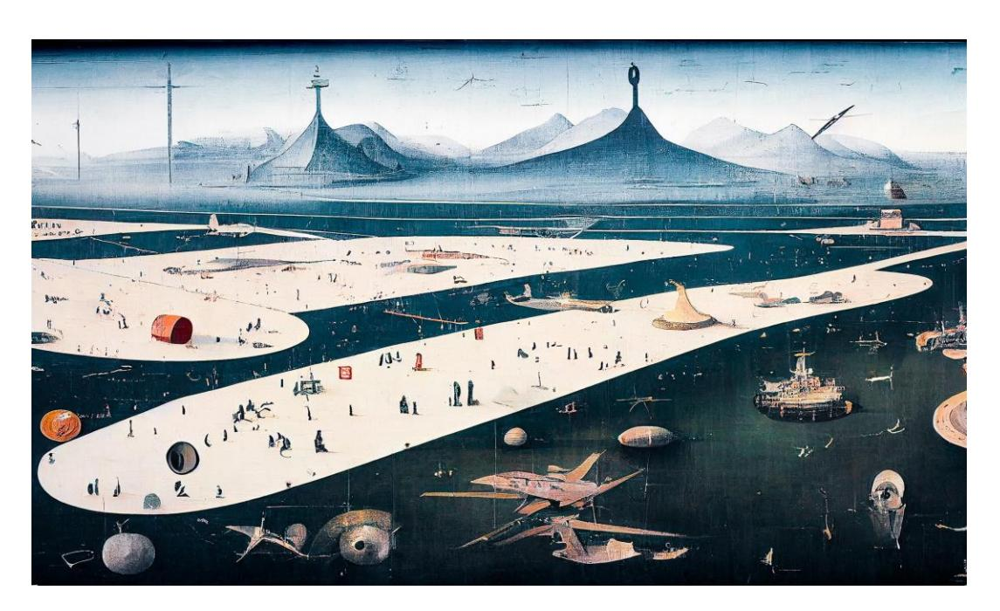

Figure\_5.05. Lev Manovich, an image generated with Midjourney version 3 (2022) using the following prompt: "giant future 1965 modern airport in Siberia made from water and ice, *painted on large wood panel by Hieronymus Bosch, bright pastel colors with white highlights, 23f lens, very detailed* --ar 4:3 --s 1250 —test"

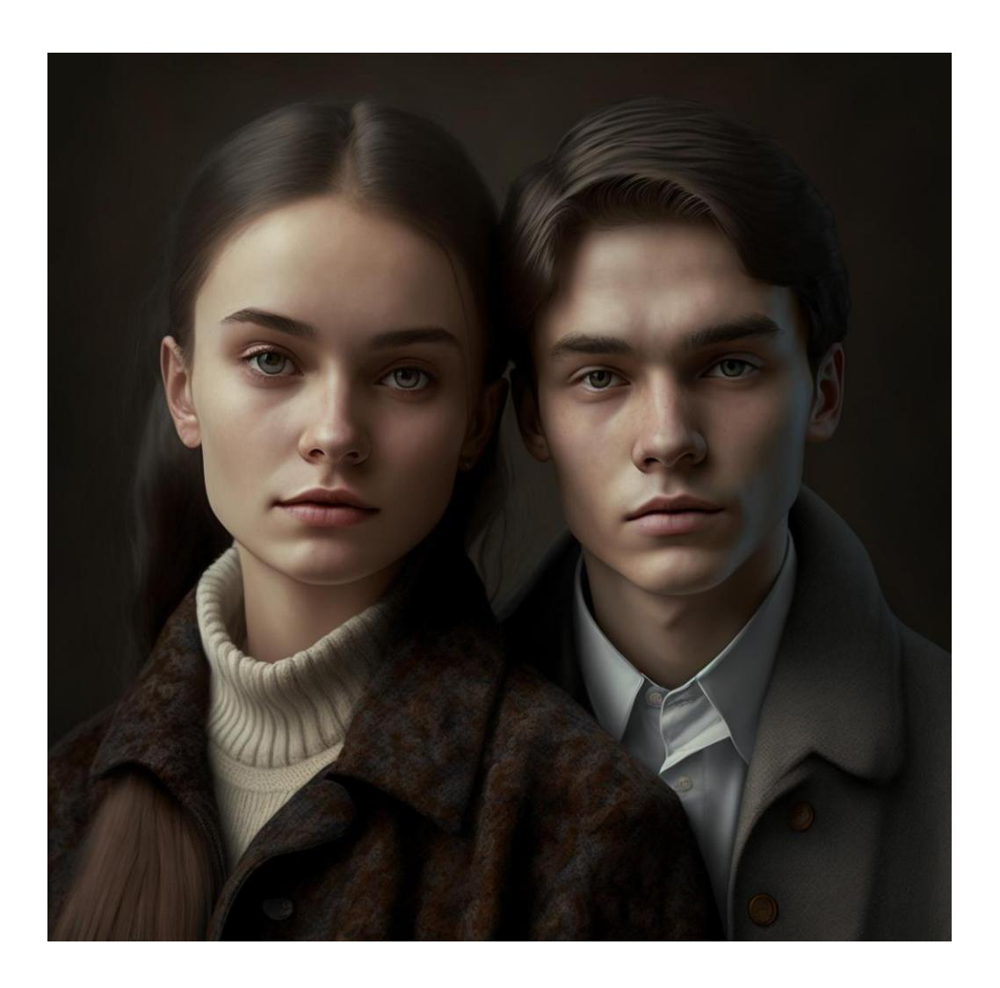

Figure\_5.06. Lev Manovich, an image generated with Midjourney version 4 (2023) using the following prompt: "Photo of two Russian high-school students, clear skin, *very soft studio light, 50mm lens, monochrome, silver tones, high quality, ultra realistic* --v 4 --q 2." This image also illustrates the point I am making later in the chapter: "AI frequently generates new media artifacts that are more stereotypical or idealized than what we intended."

Because it *can simulate many thousands of already-existing aesthetics and styles and interpolate between them to create new hybrid*s, GenAI is more capable than any single human creator in this regard. However, at least so far, skilled and highly experienced human creators also have a significant advantage. Both humans and artificial intelligence are capable of imagining and representing nonexistent and existing objects and scenes alike. Yet, unlike AI image generators, human-made images can include u*nique content*, *unique details*, and *unique aesthetics* that is currently beyond the capabilities of AI. In other words, at least as of now, highly skilled human image makers can create all kinds of images that currently even the best AI models cannot generate as well.

"Unique" in this context means that this particular content, details, or visual aesthetics were "never" realized before. Why did I put the word "never" in quotes? Because no single cultural artifact in human history is 100% unique - we can always find other examples with at least some of the same (or very similar) details. Therefore, if we want to be more precise, we can say the following: a "unique cultural artifact" means that enough of its details are original, making it sufficiently distinct to appear novel and different from everything else.

AI image tools are much better at generating visuals of popular subjects and aesthetics than unfamiliar or rare ones. This reflects the abundance of these subjects on the web used as training data in the current stage of AI development. So how do these tools behave when you ask them to make something sufficiently unique – i.e., something nonexistent, rare, or unfamiliar to them? Based on my extensive use of the best AI image tools available during 2022-2024, I found that they react to such requests in one or both of these ways:

- 1) The quality of generated results becomes lower. Aesthetics are inferior, mistakes appear, and the generated scene is not coherent.
- 2) The tool substitutes the content and aesthetics you want with more commonplace alternatives. You get a coherent scene, figures and faces with correct anatomy, and interesting composition - but the image is composed of more generic (cliché) elements. The aesthetic parameters are shifted towards more common values.

In short, *AI models either produces something different from what we ask for, or they may construct desired content from more stereotypical details*. [10](#page-93-10)

What is the cause of *this aesthetic and content gap between human and artificial image making abilities?* 'Cultural atoms', structures, and patterns in the training data that occur most frequently are very successfully learned during the process of training an artificial neural network. In the 'mind' of a neural net, they gain more importance. On the other hand, details and structures that are rare in the training data or may only appear once are hardly learned or not even parsed at all. They do not enter the artificial culture universe learned by AI. Consequently, when we ask AI to synthesize them, it is unable to do so.

And this is why text-to-image AI tools such as Midjourney, Stable Diffusion, Leonardo.ai, or RunwayML are not currently able to generate perfectly new images in the style of my pen on paper drawings (see Figure 7), expand my drawings by adding newly generated parts, or replace specific portions of my drawings with new content

drawn perfectly in my style (e.g, they can't perform useful *outpainting* or *inpainting* on the digital photos of my drawings.)

Instead, these *AI tools generate more generic objects than what I frequently draw or they produce images that are merely ambiguous yet uninteresting*. (See Figure 8)

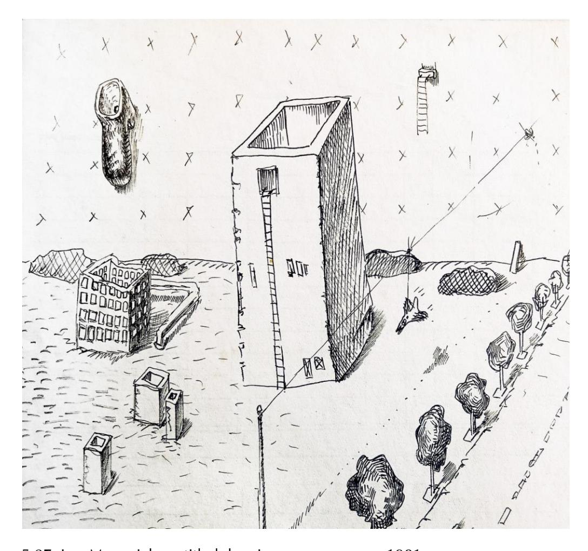

Figure\_5.07. Lev Manovich, untitled drawing, pen on paper, 1981.

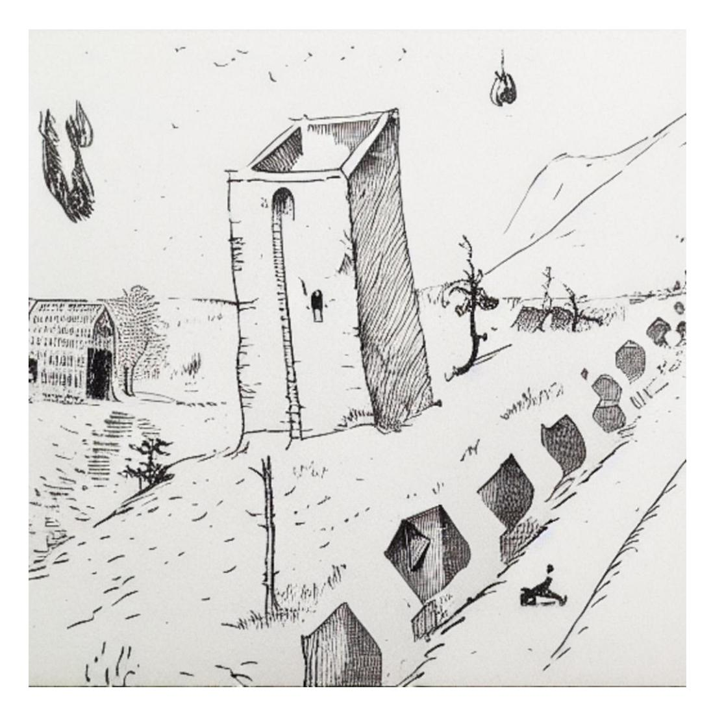

Figure\_5.08. One of my attempts to generate a new version of the image shown in Figure 7 with Stable Diffusion AI, Fall 2022.

I am certainly not claiming that the style and the world shown in my drawings is completely unique. They are also a result of specific cultural encounters I had, things I observed, and things I noticed. But because they are uncommon (and thus unpredictable), AI finds it difficult to simulate them, at least without additional training using my drawings.

Here we encounter what I see as *the key obstacle* creators face when using generative AI generative tools - and this holds for both AI images and all other types of media:

Generative *AI frequently generates media that are more stereotypical or idealized than what we intend*.

This can affect any image dimensions - elements of content, lighting, crosshatching, atmosphere, spatial structure, and details of 3D shapes, among others. Occasionally it is immediately apparent, in which case you can either attempt to correct it or disregard the results. Very often, however, *such 'substitutions' are so subtle that we cannot detect them* without extensive observation or, in some cases, the use of a computer to quantitatively analyze numerous images.

In other words, new AI generative media models, much like the discipline of statistics since its inception in the 18th century and the field of data science since the end of the 2010s, deal well with frequently occurring items and patterns in the data but do not know what to do with the infrequent and uncommon. We can hope that AI researchers will be able to solve this problem in the future, but it seems so fundamental that we should not anticipate a solution immediately.

#### Subject and Style

In the arts, the relationship between content and form has been extensively discussed and theorized. This brief section does not attempt to engage in all of these debates or to initiate discussions with all relevant theories. Instead, I would like to consider how these concepts play out in AI's 'generative culture'. However, instead of using *content* and *form*, I'll use a different pair of terms that are more common in AI research publications and online conversations between users: *subject* and *style*.

At first glance, AI media tools appear capable of clearly distinguishing between the subject and style of any given representation. In text-to-image models, for instance, you can generate countless images of the same subject. Adding the names of specific artists, media, materials, and art historical periods is all that is required for the same subject to be represented differently to match these references. Photoshop filters began to separate subject and style as soon in the 1990s, but AI generative media tools are more capable. For instance, if you specify "oil painting" in your prompt, simulated brushstrokes will vary in size and direction across a generated image based on the objects depicted. AI media tools appear to 'understand' the semantics of the representation as opposed to earlier filters that simply applied the same transformation to each image region regardless of its content. For instance, when I used "a painting by Malevich" and "a painting by Bosch" in the same prompt, Midjourney generated an image of space that contained Malevich-like abstract shapes as well as many small human and animal figures like in popular Bosch paintings that were properly scaled for perspective.

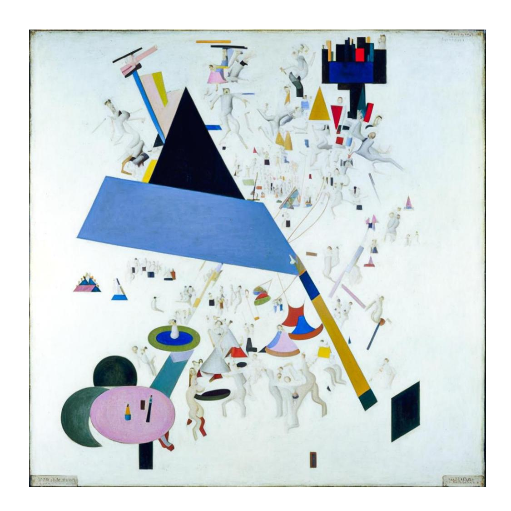

Figure\_5.09. Lev Manovich, an image generated in Midjourney using prompt "painting by Malevich and Bosch," Fall 2022.

AI tools routinely add content to an image that I did not specify in my text prompt in addition to representing what I requested. This frequently occurs when the prompt includes "in the style of" or "by" followed by the name of a renowned visual artist or photographer. In one experiment, I used the same prompt with the Midjourney AI image tool 148 times, each time adding the name of a different photographer. The subject in the prompt remained mostly the same – an empty landscape with some buildings, a road, and electric poles with wires stretching into the horizon. Sometimes adding a photographer's name had no effect on the elements of a generated image that fit our intuitive concept of style, such as contrast, perspective, and atmosphere. But every now and again, Midjourney also modified the image content. For example, when well-known works by a particular photographer feature human figures in specific poses, the tool would occasionally add such figures to my photographs. (Like Malevich and Bosch, they were transformed to fit the spatial composition of the landscape rather than mechanically duplicated.) Midjourney has also sometimes changed the content of my image to correspond to a historical period when a well-known photographer created his most well-known photographs.

According to my observations, when we ask Midjourney or a similar tool to create an image in the style of a specific artist, and the subject we describe in the prompt is related to the artist's typical subjects, the results can be very successful. However, when the subject of our prompt and the imagery of this artist are very different, 'rendering' the subject in this style frequently fails.

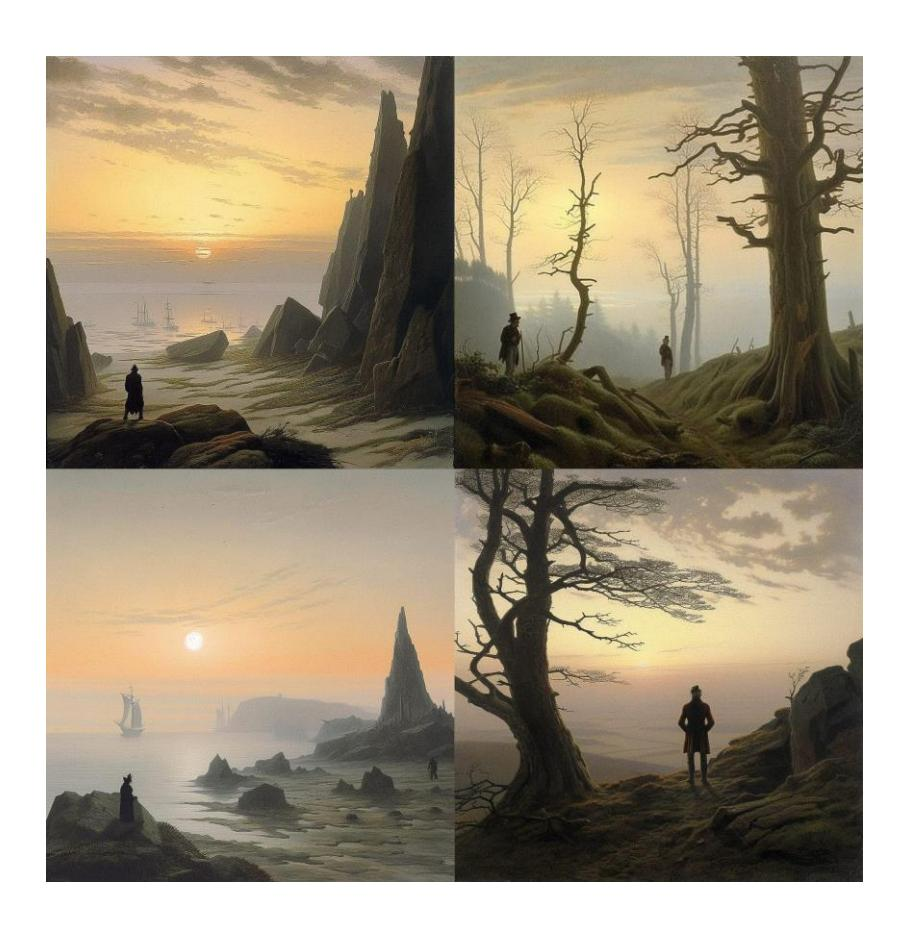

Figure\_5. 10. Images generated in Midjourney v5 using the prompt "by Caspar David Friedrich --v 5". Source: [https://www.midlibrary.io/styles/caspar-david-friedrich.](https://www.midlibrary.io/styles/caspar-david-friedrich)

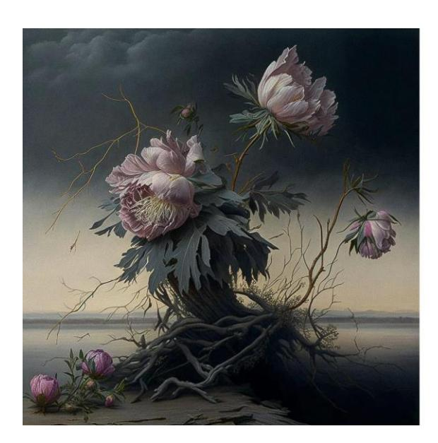

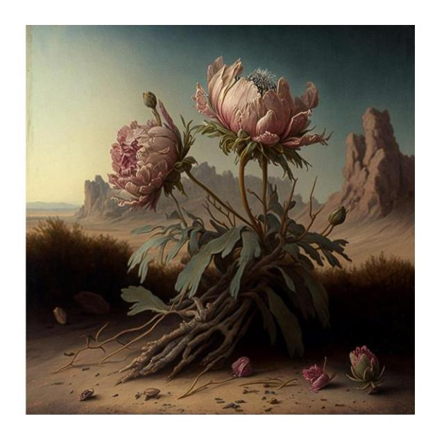

Figure\_5.11. Images generated in Midjourney v5 using a prompt: "decaying peonies by Caspar David Friedrich --v 5." Source: [https://www.midlibrary.io/styles/caspar-david-friedrich.](https://www.midlibrary.io/styles/caspar-david-friedrich)

Using prompt "decaying peonies by Caspar David Friedrich" in Midjourney generates images that simulate important features of artist's style such as combinations of cool colors and dramatic atmosphere. But in other ways, generated images *depart significantly* from the artist's style. The types of lines, rendering of details, and symmetrical compositions in these AI images would never appear in actual Friedrich's paintings. AI can also often insert some generic looking objects, such as the rock formations in the upper right corner of first image.

To summarize, to successfully simulate a given visual style using current AI tools, you may need to change the content you intended to represent - or to accept the fact that AI will insert some details you don't want. In other words, not every "subject" can be rendered successfully in any "style." And what exactly AI can learn also varies from case to case: it can often successfully learn some features of artist's style but not others.

In fact, after using AI image tools for two years and analyzing endless images generated by others, I realized that the popular idea that GenAI can perfect extract a "style" from a collection of aesthetically similar images is not correct. Instead, it appears that in the process of training, visual AI models *learn associations between visual characteristics of the works of a given artist* (I.e., what we often call a *visual language) and the content of their artworks* (unless given artworks are fully abstract.) This puts into question the whole idea that style and content can be neatly separated.

These observations, I believe, complicate the binary opposition between the concepts of 'content' and 'style'. For some artists, AI can extract at least some aspects of their style from examples of their work and then apply them to different types of content. Sometimes more aspects of a given artist style can be learned and used for new generation, and sometimes less. But for other artists, it seems, their style and content cannot be separated.

For me, these kinds of observations and reflections are one of the most important reasons for using new media technologies like AI generative media and learning how they work. Of course, as a practicing artist and art theorist, I had been thinking about the relationships between subject and style (or *content* and *form*) for a long time—but being able to conduct systematic experiments like the one I described can lead to new ideas and allow us to look back at *cultural history* and our *familiar concepts and theories of art and culture* in new ways.

#### Notes

1 For the detailed analysis of these relations between modern art and experimental psychology, see Vitz, P., & Glimcher, A. (1983). *Modern art and modern science: The parallel analysis of vision*,<https://muse.jhu.edu/pub/1/article/403181/pdf>

2 Ridler, A. (n.d.). *Anna Ridler*. Retrieved September 28, 2024, from <https://annaridler.com/>

3 Sarah Meyohas. *AI Artists*. Retrieved September 28, 2024, from <https://aiartists.org/sarah-meyohas>

4 Anadol, R. *Refik Anadol*. Retrieved September 28, 2024, from <https://refikanadol.com/>

5 Pereulye. *Instagram*. Retrieved September 28, 2024, from <https://www.instagram.com/pereulye/>

6 Pereulkov. (2023, January 16). *Artificial experiments 1–10*. Instagram. <https://www.instagram.com/p/CnezVZ9KHMV>

7 See my article *Database as a symbolic form. (1998).*  <https://manovich.net/index.php/projects/database-as-a-symbolic-form>

8 For a more details about GAN net training methods used by Refik Anadol Studio, see Creating art with generative adversarial network: Refik Anadol's *Walt Disney Concert Hall Dreams*. (2022). [https://medium.com/@ymingcarina/creating-art-with-generative](https://medium.com/@ymingcarina/creating-art-with-generative-adversarial-network-refik-anadols-wdch-dreams-159a6eac762d)[adversarial-network-refik-anadols-wdch-dreams-159a6eac762d](https://medium.com/@ymingcarina/creating-art-with-generative-adversarial-network-refik-anadols-wdch-dreams-159a6eac762d)

9 My personal communication with Pereulkov, 04/16/2023.

10 For example, in 2022-2023 AI models often struggled generating realistic hands. By 2024 this has been solved but as I am writing this, AI still have difficulty generating very complex compositions with dozens of fully realistic human figures and faces shown in detail—something that skilled human artists were able to do at least since the Renaissance.

# **6.**

# **Human Perception and the Artificial Gaze**

Emanuele Arielli

#### The Innocent Eye

In the 19th century, critic and historian John Ruskin, when discussing how one should enjoy a painting, famously stated: "The whole technical power of painting depends on our recovery of what may be called the innocence of the eye; that is to say, of a sort of childish perception of these flat stains of color, merely as such, without consciousness of what they signify, — as a blind man would see them if suddenly gifted with sight"[1](#page-116-1).

*If it were up to Ruskin, artificial systems analyzing images would have been the perfect viewers and critics of artworks, since they are "without consciousness of what they signify".* In this view, machines, akin to children, would possess an unbiased and transparent "innocent eye", able to see things as they are. But the question arises: do we ever perceive things in this manner at all?

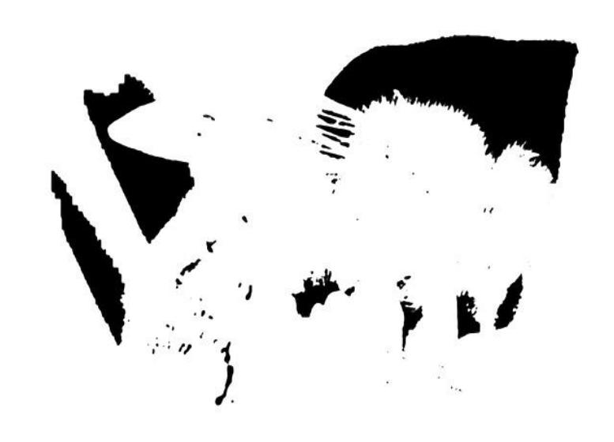

Figure\_6.01. What do you see?

Let's examine the following image (Figure 1[2](#page-116-2)): what do we see? To many, it may appear as a random arrangement of black and white shapes. But if we look at its original image (at the end of this chapter, Figure 9) and then return to this one, our perceptual impression changes drastically. We are now able to "read" it. One might wonder if the initial impression of random blots would be an example of "innocent" perception, or it is just the state of a "clueless eye"? And if that were the case, how would we be able to look "innocently" at things that are clearly recognizable?

What we recognize, what we know and what we expect can reshape our perception. The case of Figure 1 is akin to the experience of hearing a sentence in an unfamiliar foreign language and then, after acquiring proficiency, listening to it again. Initially perceived as a meaningless jumble of sounds, it is later understood as a structured sentence. Through language learning, we not only classify and recognize those sounds correctly but also experience a phenomenological and perceptual shift. Similarly, our past experiences, cultural habits, values, needs or personal attitudes also determine how we perceive things. One crucial point is that after we have learned to recognize a sound or an object, it becomes practically impossible to revert to a 'blank' and innocent perceptual state. I cannot ignore that sequence of sounds as a sentence in the language I am now acquainted with, and I cannot "unsee" the object I saw at the end of this chapter in Figure 1.

The process of learning categories unfolds in a similar manner. In early childhood, we come across various objects — dogs, cats, chairs, bicycles — without knowing what they are. As we learn to categorize them, often aided by verbal labels, our recognition of these objects changes. The first encounter with a cat is vastly different from later

encounters when we recognize it as part of the broader category of *cats*. While sensory input constitutes the *bottom-up* aspects of perception, providing raw data from our environment, our cognitive frameworks and the knowledge we've accumulated over act as *top-down* factors in perception.

Computers are increasingly adept at performing human-like perceptual tasks. In some instances, they can even surpass human capabilities in detecting finer details and patterns, as evidenced in many impressive data processing applications, where machines are increasingly able to interpret X-rays images in medical diagnostics, identify faces even if they are masked, identify a car's model from an engine's noise, or evaluate the authenticity of a painting. However, and we might say fortunately, many human perceptual skills that we take for granted still constitute a challenge for artificial vision. This is particularly evident in the occasional failures of object detection in selfdriving cars. Despite these challenges, there is notable progression in this domain. Another critical consideration is how similar human and computer vision are or *should be*, that is, how well computer perception and AI analysis of sense-data are able to model human perceptual experience.

In 2015, a Google scientist unveiled a series of images produced by a Deep Dream convolutional neural network, also making the code publicly available. This release sparked significant interest, leading to widespread creation of similar images. These images, often eerie biomorphic landscapes filled with animal features emerging from ordinary scenes, demonstrated how the neural network identified specific shapes within its visual input. Essentially, the network's visual system is programmed to identify and emphasize certain elements such as, for example, dogs or eyes. It modifies the original image, aligning it with these predetermined patterns[3](#page-116-3). This process reveals the ongoing efforts of the machine to interpret images, molding them into the forms the program is designed to recognize. While these images might appear "hallucinatory" to the human observer, it is crucial to avoid taking too literally the claim that the machine "hallucinates" anything or that it subjectively "sees' these forms in the images it processes. Nevertheless, it represents a step toward the development of computer vision systems that integrate human-like mechanisms such as perceiving according to categories and expectations. By exploring how machines process and modify visual data, we gain insights into the intricate process of visual perception, both in artificial and human contexts.

Some might argue that for most AI applications, the ability of machines to mimic human sight or hearing is not relevant; what is important is their capacity to execute specific tasks and solve problems. Yet, this viewpoint might overlook key aspects regarding aesthetic applications. In scenarios where AI systems are tasked with

generating content intended for human engagement, aiming to evoke aesthetic, emotional, and sensory responses, it becomes essential for those system to have a model of how humans perceive the world (see Chapter 1, "Studying subjects"). This task is not unattainable, yet it is more complex than merely devising systems that see the world "as it is". On the one hand, we perceive less than the full spectrum of available sensory data, as its complexity and our cognitive limitations compels us to filter out of certain elements. On the other hand, our perception extends beyond the sensory input, due to our ability to organize and interpret these data. This process enables us to extract deeper meanings and discern patterns that go beyond a mere aggregation of individual stimuli. Consider the so-called *Gestalt* laws in object recognition. An example, these laws describe how we recognize a shoe in an image like that in Figure 2. For computational vision systems, replicating this kind of perception was a significant obstacle for an extended period. It was not until 2019 that Convolutional Neural Networks (CNNs) started to effectively model phenomena akin to Gestalt's principles[4](#page-116-4). At the time of this writing (early 2023), advanced image analysis systems, including those included in language models like ChatGPT, are more and more able to employ these principles of perceptual organization.

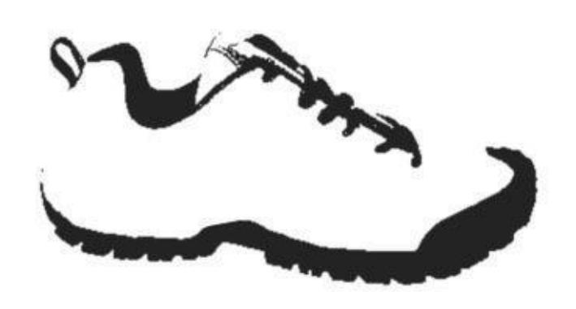

Figure\_6.02. ChatGPT correctly recognizes this image as a shoe.

The principles of human perceptual organization explain many well-known visual illusions as well, like the Mueller-Lyer illusion, in which two identical segments are perceived as having different lengths, or the Beau-Lotto color illusion, in which identical patches of color are perceived as having different hues. However, calling them illusions does not give full justice to the fact that they are the manifestation of human natural processes in vision responsible for perceptual constancy, detection of depth, distinction between object's color and environment's luminance and so on. If

we see the world *as it is*, as Ruskin advocated, we would not be subject to such perceptual illusions. But the crucial point is the fact that those biases are an integral part of the way we perceive the world and, consequently, they are also part of the way we aesthetically experience it. This means that systems programmed to analyze and generate content that are then experienced and enjoyed by humans must also integrate models of how humans perceive.

To move to another example, consider these two versions of the Mona Lisa face: one has been modified to give the face a sadder expression.[5](#page-116-5)

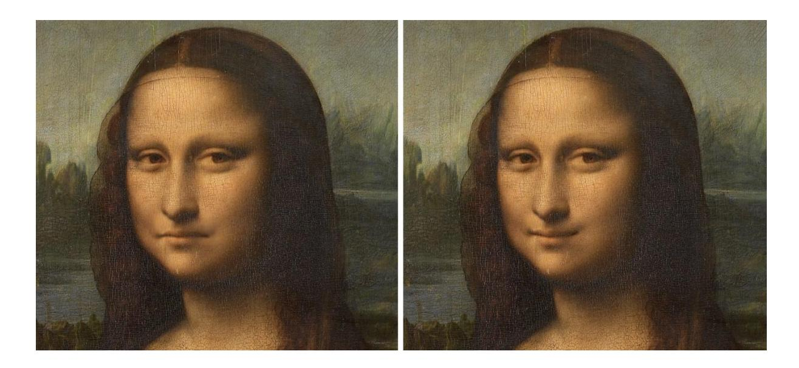

Figure\_6.03. Sad and happy Mona Lisa.

Humans can read subtle changes in facial expressions. In (A) Mona Lisa's countenance appears sadder than the original version (B): the facial expression in image A distinctly varies from B *overall*; this difference is particularly pronounced in the mouth and eyes, which convey a dissimilar appearance. But if you cover the mouth in both images, you will see that all features of the face are actually identical, and that the sole alteration lies in the mouth's corner[6](#page-116-6). Essentially, we almost "hallucinate" an illusory expressive change that does not exist. This phenomenon occurs because our top-down interpretation of an emotional state (happy vs sad) subtly alters our overall perception of identical shapes. Today, artificial visual systems can classify (or generate) human expressions and attribute affective labels like "sad" or "happy". However, such systems may not perceive the (illusory) overall change in expression as we do in this instance. A skilled artist, by contrast, understands that even a minor alteration in a feature, such

as the curvature of the mouth's corners, can transform the entire image's perceptual impact. This understanding arises from the artist's own perceptual experience, which mostly aligns with that of the audience. Similarly, for an artificial system to be effective, it must incorporate a model of human perception, including its peculiarities and distortions. Such integration is essential for the system to understand and generate content that successfully captures these subtle sensory effects.

Not only top-down cognitive knowledge can tinge our perception, but affective and expressive features greatly determine how we see or hear something. For instance, a melody in a minor key may sound "sad", a bright color may seem "cheery", and a jagged line might convey "nervousness". These qualities, while not physically inherent in the stimuli, are consistently perceived across individuals and cultures. Moreover, they are very difficult to separate from our overall perceptual experience: I cannot hear the melody "innocently", that is, taking out its sadness; I cannot look at the jagged line without perceiving at the same tame its nervousness. Gestalt psychologists refer to these as "look-and-feel' or "expressive" qualities (*Anmutungsqualitäten*). The application of these qualities in understanding aesthetics and art is pivotal.[7](#page-116-7)

Now, the expectation for AI to replicate human subjective "feels" might be misplaced. Currently, debating whether artificial systems can experience perceptual qualities as humans do is not particularly fruitful. This would suggest the need to attribute subjective experiences, private states of consciousness, and individual perspectives to machines. The philosophical discussion surrounding "qualia"—the unique sensations of personal experience—is already sufficiently complex within the context of human consciousness; expanding it to include artificial systems isn't yet necessary. What is more pertinent is exploring the ability of artificial systems to model and predict human experiential processes, especially those related to aesthetics, art, and emotions. For example, machine learning already enables the association of shapes with their affective qualities, training systems to categorize, for instance, "jagged" lines as "nervousness" or minor-key music as "sadness". Affective image classification has been advanced in recent years. Algorithms can be trained with images from sources like the International Affective Picture System (IAPS), which are pre-evaluated for emotional impact, to classify the emotional attributes of new images. Today, if we ask Midjourney to generate a "sad" landscape, the system will accordingly generate some image depicting a scene that exudes sadness. If we ask GPT to analyze a joyful image, the system will add in its description that the scene and the colors are joyful, and so on. Affective computing, similarly, focuses on creating systems that can recognize, interpret, and simulate human emotions, using technologies like facial recognition algorithms, voice analysis, and other biometric sensors. In art history, the classification of affective body postures is used to analyze the distribution of every *pathosformel* and

its prevalence within an artistic tradition, facilitating computational methods in exploring affective archetypes in Western iconography, a study rooted in Warburghian tradition[8](#page-116-8).

#### Perceptual Expectations: The Historicity of the Eye

As we just saw, affectivity, feel and mood tinge the way we see the world. And knowledge and cultural background not only help us classify what we see, but enrich and change the impression of what we see[9](#page-116-9). This leads to the concept of the historicity of perception: the idea that individual and cultural experiences shape our view of reality. Different periods and backgrounds lead to varying interpretations and aesthetic perceptions of cultural artifacts. Styles, as art historian Michael Baxandall called it, reflect a "period eye". Culture and experience shape how the brain processes visual information, determining what is aesthetically significant and influencing how artists represent the world. Art becomes a key witness to how an era perceived reality and analyzing an era's visual culture allows us to reconstruct its worldview, where style changes signify not just an evolution of artifacts' formal properties but also shifts in collective perception.

Consider how contemporary reactions to designs from different eras, such as 1970s interior design and fashion, vary. Today, these styles are often labeled as "tacky", "oldfashioned", or "heavy", and are seldom considered "fresh", "modern", or "elegant". However, an observer from the 1970s might strongly disagree with these characterizations. Despite being materially identical, these designs evoke different moods and expressive qualities over time. They are perceived differently by someone from the 1970s compared to an individual of today's era.

Perceptual differences extend beyond the temporal distance to include also cultural differences. Two individuals from different artistic backgrounds will react differently emotionally but also perceptually - to the same piece of art. This leads to what was mentioned in Chapter 1 regarding the importance of precise and individualized customization of taste and aesthetic preferences through algorithmic analysis of audience behavior. This customization acknowledges that each subject perceives and reacts to content uniquely, with variations that are clustered around temporal, spatial, and cultural differences.

Another aspect of the historicity of perception is our ability to trace the stylistic evolution of objects. Take, for example, laptops or iPhones from different years. When we compare them, we do more than just note their similarities. Viewing an object as a variation or an evolution of its predecessor alters our perceptual feeling about it: We tend to see newer models as contemporary evolutions of their older counterparts. Our understanding of design history informs our aesthetic judgments of these changes. This dynamic is similar to how we perceive a modern rendition of an old song: we listen to the new version through the lens of the original. However, this perception shifts if we are unfamiliar with the original. For instance, children who first become acquainted with a cover version of an old song often perceive the original as a variation of what they already know.

Historicity and temporal sequentiality (and the different kind of perception they elicit) add a layer of complexity of how artificial systems might model what humans "see". There are promising developments in analyzing large art datasets to address artistic influence in music[10](#page-116-10) and painting[11](#page-117-0). By identifying patterns and considering the chronological order of artworks, we can trace the origins and influences of novel patterns. Given machine learning's potential, these systems might even surpass humans in uncovering patterns of similarity and historical influences. By analyzing human aesthetic responses, they should also integrate how style and form evolution influence the observer's perception and emotional reaction. These systems must account for the diverse affective nuances and interpretations unique to each observer.

### Calibrating to Human Imperfection

While we do not expect that an artificial system sees and "thinks" like a human being, given its role in studying and generating content intended for human interaction, it must have nevertheless a sense of how humans perceive and react. This touches on what is defined in Chapter 8 as the problem of "AI alignment" in the context of aesthetics. This also requires an understanding of the *limits* and *biases* natural to human perception and cognition. Artificial systems can analyze data beyond human capabilities, but it remains crucial for them to be able to take into account the typical modalities of human perception.

For example, when an AI system trained in object recognition fails to discern details in an image, we might conclude that either the system lacks sophistication, or the image is excessively blurred or noisy. However, in the realm of human aesthetic experience, moments of confusion are not necessarily flaws to be fixed. Often, an object captivates our interest precisely because it poses a perceptual or cognitive challenge, such as ambiguity or indeterminacy. Eric Kandel writes: "Just as the artist creates a work of art, so the viewer recreates it by responding to its inherent ambiguity. The extent of the beholder's contribution depends upon the degree of ambiguity in the work of art"[12](#page-117-1).

Artistic techniques like "estrangement" and defamiliarization (*ostranenie*) thrive on uncertainty and interpretative instability, sparking the viewer's curiosity and attention. *Unlike in AI, where ambiguity might be a problem to solve, in aesthetics, ambiguity is a feature.* An artwork's aesthetic richness often lies in its resistance to a singular interpretation, remaining open to multiple readings.

Consider for example George Braque's painting "Violin and Pitcher" (1910), analyzed by Michael Baxandall in 1994 (Figure 4)[13](#page-117-2). This Cubist painting blends figurative elements with abstract ones, particularly in what Baxandall refers to as "the mysterious left flank". This section of the painting, difficult to process, creates a perceptual tension where the eye oscillates between recognizable elements (the violin, the pitcher, the nail) and the more enigmatic parts. Baxandall terms this a "perceptual lock", valuing the painting for its ability to challenge and stimulate the viewer's perception, creating a "cognitive itch"[14](#page-117-3).

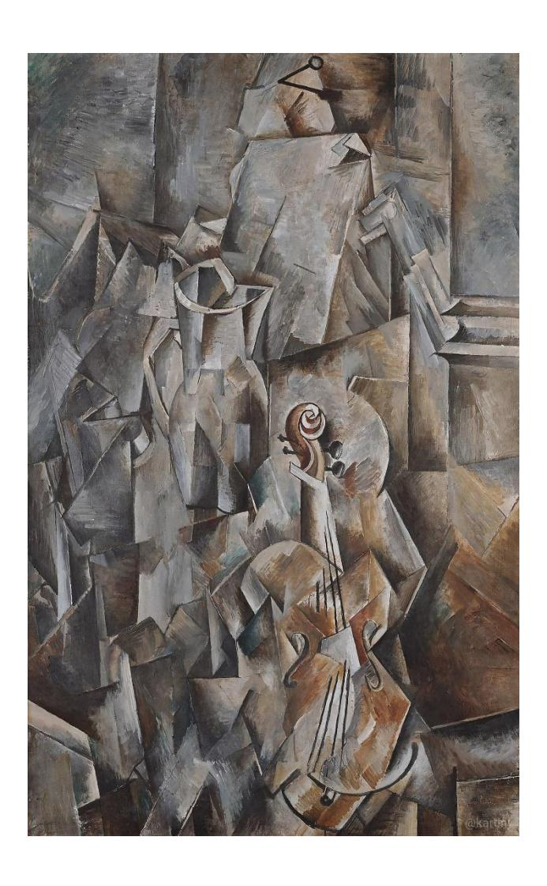

Figure\_6.04. Appreciating the confusion. (Georges Braque, *Pitcher and Violin,* oil on canvas, 1909-1910.)

In this context, indeterminacy arises both from the painting's inherent complexity and the human observer's cognitive limitations in discerning shapes and features. Our capacity for pattern recognition has its bounds, and we often find ourselves lingering in the uncertainty of an artwork, accepting and embracing this indeterminacy as part of the aesthetic experience. This poses an interesting dilemma for AI. Machines excel in labeling and pattern recognition, optimizing detection in ways that might surpass human capabilities. However, during an aesthetic experience, this kind of optimization may not always be desirable or relevant to understanding the human way to perceive and react.

In conclusion, to model human aesthetic perception effectively, AI systems need to accomplish two tasks. First, they should recognize configurations that may evoke a sense of ambiguity in human observers. Second, when generating images or other media content, they should strategically employ ambiguity or uncertainty to enrich the viewer's aesthetic experience.

#### Aberrant Pattern Recognition and "Data Unconscious"

Imagine again a machine learning system tasked with object recognition that occasionally misidentifies what it sees. As said, these systems, used in computer science for categorization, detection, and prediction, aim for high precision. Annual competitions assess which system most accurately identifies objects in photographs or videos. Potential errors in identification are not only signs of imperfection; they also raise concerns about biases that may replicate societal stereotypes and cultural assumptions, leading to adverse social impacts.

In contrast, within the human domain of aesthetic experience, *aberrant* interpretation of information has long been acknowledged as a catalyst for creativity. Thus, research in AI aesthetics should also consider atypical classifications not as mere errors but as potential creative insights. 2015 Google's Deep Dream, where images are reinterpreted through layers of unexpected shapes, was reminiscent of avant-garde movements that embraced free association as tool of enhancing artistic innovation, like Surrealists and Dadaists. Techniques such as automatic writing, dream as a source of inspiration, and random processes enabled them to transcend the limitations of conventional

categorical structures shaped by cultural and experiential norms, thereby fostering serendipitous creativity.

Similarly, when a machine learning system misclassifies an object, it might inadvertently uncover an association between two entities. This association, grounded in an underlying similarity or connection, may be previously unnoticed and, while potentially incorrect, is not senseless. Consider this example (Figure 5), where the image of the Queen of England is analyzed by a rudimental neural network[15](#page-117-4). The misclassification by the network of the Queen's crown as a "shower cap" reflects the infancy of machine learning algorithms in grasping object recognition. While at first glance this error may elicit amusement, it also subtly reveals a creative analogy. The crown and the shower cap, while diametrically different in value and function, share a visual similitude that the algorithm has inadvertently highlighted. Moreover, as we will briefly discuss, this mistake might have an impact on our perception and interpretation of the picture itself: at a closer look, that crown actually looks like a shower cap after all.

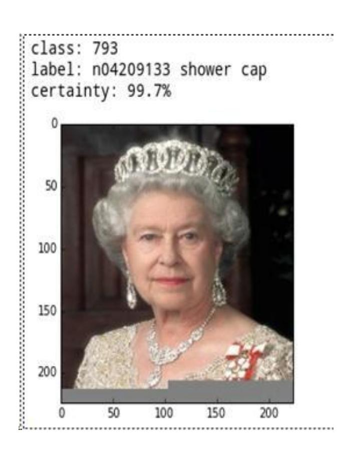

Figure\_6.05. A fancy shower cap (from Evans 2015).

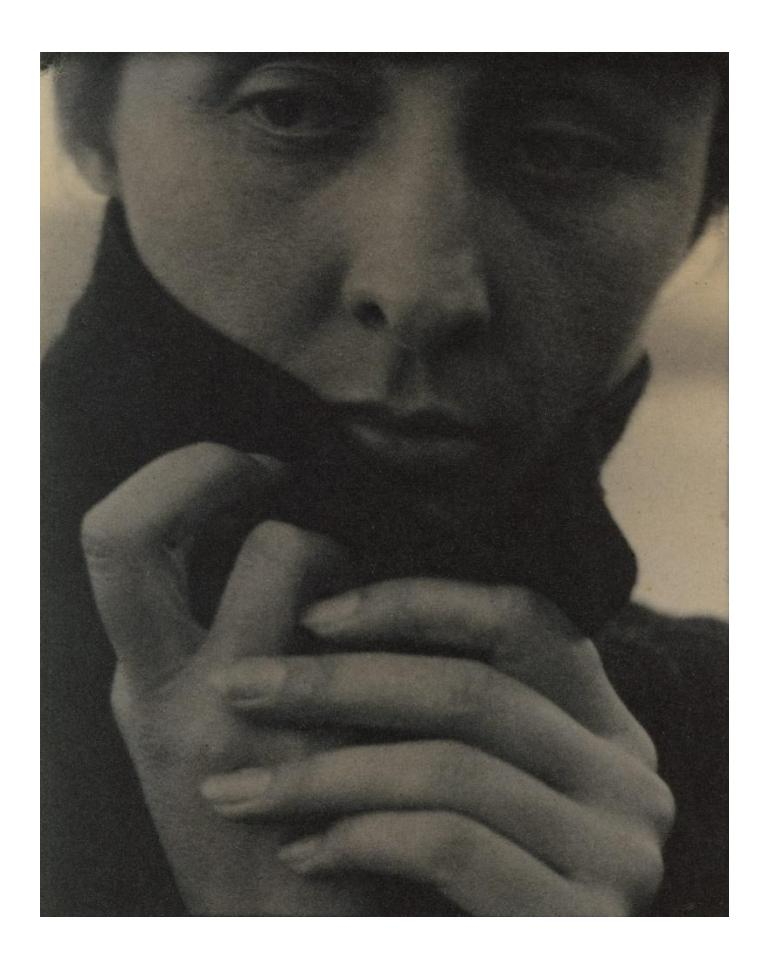

Figure\_6.06. Artist Georgia O'Keefe (1887-1986) "holding her new cellphone."

Another notable instance of an imperfect image recognition system is the one interpreting Alfred Stieglitz's 1918 photograph of Georgia O'Keeffe as "a man holding a cellphone" (Figure 6)[16](#page-117-5). This blatant anachronism, where contemporary technology is perceived in an old photo, reflects our modern perceptual habits ingrained in the image recognition system. Here again, even those familiar with the photograph may find themselves unable to "unsee" this new interpretation. Although erroneous, these descriptions do have an influence on our ways of viewing these images. Associative mechanisms have always been a crucial factor in the flux of cultural and historical reinterpretations.

While computers are trained for accuracy and objective reality representation, in the realm of aesthetics, AI can facilitate the discovery of subtle, perhaps historically unfounded, associations, unveiling intriguing connections. Notable examples are projects like "MosAIc"[17](#page-117-6) and "X Degrees of Separation"[18](#page-117-7). The first one involves a sophisticated AI algorithm created by researchers at MIT, designed to identify parallels between artworks originating from vastly divergent art historical periods. This algorithm conducts comparative analyses of pieces from the Rijksmuseum and the Metropolitan

Museum of Art. The second example is a collaborative artistic venture between Google and artist Mario Klingemann. This innovative online application employs artificial intelligence to construct a seamless transition between two images, ensuring that the intermediate images represent a coherent and natural progression from the start to the end image.

Particularly, unsupervised neural networks can sift through vast data sets without the confines of pre-established guidelines. This freedom enables the emergence of alternative classification systems that are sometimes more advanced or intricate than those devised by humans. In science, for example, these systems can bring order to complex phenomena, such as meteorological patterns in cloud formations, by adopting innovative classification schemes that surpass traditional methods.[19](#page-117-8) In the realm of cultural analysis, platforms like Spotify exemplify this approach. They analyze musical tastes, trends, and styles, transcending the limited range of familiar musical genres through algorithmic data processing. This technology can differentiate thousands of genres, enhancing the granularity of classifications. Categories can become not just more precise but also fluid and continuous, reflecting a shift from traditional and discrete classifications to a more dynamic and expansive framework.[20](#page-117-9)

*While contemporary discussions rightly focus on the risks of such systems in extracting, reinforcing, and perpetuating human stereotypes and biases present in their training data, it's also worth considering their imaginative and exploratory potential.* These systems can discover new patterns and offer fresh perspectives. The question arises: Can an AI create a novel sensibility, and if so, can we as humans perceive and understand it? Walter Benjamin introduced the concept of the "optical unconscious", suggesting that media technologies such as photography and cinema reveal layers of reality not ordinarily accessible to the naked eye, much like psychoanalysis uncovers hidden impulses. These mediums, through techniques like magnification, montage, slow motion or detail isolation, offer new perspectives on perceptual reality we otherwise had not access to. Big data analysis and machine learning advancements herald a similar potential. These technologies can discover unseen patterns and connections in complex cultural phenomena, both historical and current. AI data analysis is a powerful tool to unearth a "data unconscious", uncovering patterns that often elude our perception due to human perceptual and cognitive limitations. This raises also the question: Are these patterns merely overlooked aspects of our reality, are they comparable to a kind of "archaeological" excavation of our cultural material? Or, alternatively, is this process akin to the imposition of patterns, like the way constellations were perceived and *constructed* from randomly scattered stars by various cultures?

Connotations and free associations in aesthetic experiences carry a range of implicit meanings and emotional resonances, shaped by our cultural and personal backgrounds. Free association, the spontaneous connection of thoughts and emotions, often reveals unexpected links. When AI systems misclassify or generate "strange patterns", they might be tapping into this same associative impulse, uncovering relationships that evade human comprehension. These algorithmic "slips" challenge us to consider whether those associations are just random or if they emanate from a deeper, yet-to-be-understood order.

#### Artificial Platonism and Counterfactual Imagination

One central feature of intelligence, whether natural or artificial, is the ability to abstract. Advancements in artificial intelligence lead to the emergence of systems capable of learning from images and songs, extracting and interpreting the *essence* of styles, artifacts or motifs. These AI models, fueled by deep learning techniques, analyze vast collections of visual or auditory artworks, discerning patterns and stylistic nuances inherent in different genres or epochs. In the project described in Chapter 1, the characteristics of hundreds of faces in Rembrandt paintings were analyzed and extracted, and then used to generate a new image in Rembrandt's style. Similarly, by training a network with thousands of Bach's chorales, a neural network was able to produce its own Bach-like chorales. In all these examples it should be noted that the system does not generate just an average of the paintings (or of the musical works) that have been analyzed, nor does it copy parts of the various Rembrandts by recombining them like a collage. Instead, it extrapolates the general patterns of Rembrandt's style, including his brushwork and his use of colors. What is reconstructed and reused in a generative key is the *quintessence* of the painter's work, the Platonic idea of a Rembrandt. The newly generated painting is one materialized instance coming from the *latent space* of all possibilities determined by this essence.

A consequence of the development of those "quintessence machines" is the transformation of artifacts defined by their uniqueness into instances of a general idea, that could be potentially materialized in an infinity of variations. We could see this as an advanced kind of technical reproduction, in the vein of Walter Benjamin's famous essay. However, it differs fundamentally from the concept of reproduction as merely copying a specific individual work. Instead, it involves producing new variants by reproducing the same style, motifs, "vibes"[21](#page-117-10) of an author's body of work. The essence of the author's creative signature is distilled and then used as a template for creating

new, original pieces that echo the original style yet diverge in their individual expression.

There are also legal implications, as only individual works are protected by copyright, not an artist's style. The potentially infinite reproductions in the style of Rembrandt, Bach or Beatles by machine learning systems do not infringe copyrights, allowing to generate new melodies in their style that everybody is free to use. This is the reason why commercial platforms already offer the possibility to upload songs and ask a machine learning system to generate new melodies that mimic the style of the input music, making possible to avoid any possible copyright issues.[22](#page-117-11)

The tradition of rip-offs, *hommages* or outright imitations in the cultural industry is ageold: for many producers it is easier to capitalize the trend of some successful musical, narrative or cinematographic innovation than create something new. However, one might wonder if the increasing ease in extracting the quintessence of works by means of AI-generative systems won't raise the need to protect not only individual content, but also styles, aesthetic "feeling" or moods, or even abstract ideas underlying an artist's oeuvre.

The relationship between an object and its "essence", between an object and its abstract and generalized idea, has relevant perceptual and cognitive implications. Consider this imaginary scenario of a world devoid of knowledge of geometry, a place where the principles of shapes and forms are yet to be discovered. In this hypothetical world, a prominent artist leaves behind a legacy of just eight abstract paintings. Each masterpiece displays configurations that, to our real-world eyes but not to the eyes of this imaginary world, resemble with what we know as "triangles" (much like Malevich's renowned "Black Squares"). In this world, these shapes have no geometric interpretation and are perceived merely as eight unique and somewhat similar elements, characteristic of the artist's recurring motifs and style. Enter an advanced algorithm, similar to contemporary AI systems, that meticulously examines these paintings. The system manages to extract their underlying pattern and formulates an abstract concept: the geometric idea of a triangle. This allows the system to generate an endless array of triangles-paintings, all mirroring the artist's distinctive style. Suppose the eight painted triangles are all equilateral or isosceles; the artificial system now introduces us to the possibility to generate scalene triangles. Intriguingly, some might find these AI-generated variations more appealing than the "originals."

This imagined scenario brings us back to Plato's idea that reality is only an imperfect reflection of perfect ideal entities. Each real triangle depicted in those eight paintings is only an imperfect manifestation of the abstract concept of triangularity. But the crucial

point is that we now look at the artist's images differently: before, we used to see those triangles as unique objects in their singularity. Now, instead, we consider them as singular occurrences among numerous potential arrangements. By extracting the essence of those objects, we now see the actual singular images as examples of the vast array of possibilities within the latent space defined by the machine - each image a path taken from many not pursued.

*Artificial Platonism* arises from the belief that artifacts are entities that embody a specific essence that can be extracted and used. This concept becomes particularly relevant when such methods are applied to complete unfinished works or extrapolate missing data. For instance, when an AI system attempted to complete Schubert's Symphony No. 8, the "Unfinished", it generated numerous possible continuations. These variations were derived from the latent space determined by the essence of Schubert's musical style. Ultimately, programmers selected the variation they deem most fitting. To assess the AI's effectiveness in completing a piece of music, one could also provide the AI with only a section of an otherwise complete work and then have it generate the remaining part. The AI's output can then be compared with the actual remaining portion of the piece (a sort of statistical cross-validation). But an AI-system could be also trained not only to generate a "Schubert simulation", but also to optimize its output for higher aesthetic and musical appeal and be an "enhanced Schubert."

*The use of AI in culture suggests that each cultural product is just one possibility within a vast latent space of alternatives, some of which may be equally or even more interesting or good.* Consequently, we might argue that while Franz Schubert made specific artistic choices in his compositions, other paths were equally viable within the scope of his stylistic essence. We might call this *counterfactual imagination*. Not only does this perspective allow us to view an object as one among infinite possibilities of an abstract idea, but it also compels us to contemplate the different forms that object or image could have taken. As we engage with art and artifacts through this lens, we are not only acknowledging their existing state but also actively imagining the myriad ways they *might have been realized differently*. This shift in perception underscores the fluidity and multiplicity inherent in cultural creations, the boundaries between the actual and the possible become increasingly blurred.

#### Strange Hands: a Digression

Staying in our imaginary scenario of a world lacking geometry, we assumed that the eight triangles depicted in the works of art are only isosceles or equilateral. However, the artificial system, in order to create variation, applies the concept of triangle in a more general way and thus generates scalene ones, with all different sides. This production of never-seen-before triangles would lead to two scenarios. The first, which has already been discussed, is that the system opens up a new world of possibilities for observers, possibilities that were not considered before and that have been made possible by the creation of a general model of a triangle. The second, which we briefly discuss here, is that, for the observer of that world, the artificial system just *makes a mistake* because it generates triangles that seem nonsensical to them, lacking the regularity they were used to. This would reveal how, in that world, the acceptable level of abstraction of triangular objects (defined by the eight paintings) was not arbitrary but limited to thinking of them only as isosceles or equilateral, with no possibility of expanding to new triangular shapes.

This situation mirrors the early phase of AI-image generation when systems like Midjourney repeatedly made errors in drawing hands (particularly getting the number of fingers not right), putting too many teeth in a human mouth or generating images of texts in bizarre fonts and non-existing writing systems. These weren't specific flaws in the systems' ability to draw hands or texts; they generate these elements in the same manner as they draw trees, clouds, and rocks. *The difference lies in our perceptual expectations*: we have more precise expectations for hands and texts than we have for trees, rocks or clouds, due to their well-defined characteristics in the real world, such as the typical five fingers on a hand or the structured nature of written characters within a known alphabet and language.

Image generation systems, in their training phase, encounter a variety of hand representations in images. Often, some fingers are obscured or hidden, while in instances of clasped hands, more than five fingers may be visible. Consequently, these systems learn to perceive the hand not as a fixed entity with precisely five fingers, but rather as a flexible collection of fingers, in the same way as how they interpret a tree, seeing it as a flexible collection of branches and leaves. As a result, the systems generate images of hands with a number of fingers that can vary, reflecting this learned abstraction rather than the precise anatomical reality of human hands. Similarly, the representation of written texts in image generation systems may lack the linguistic and alphabetic precision we expect, resulting in sequences of characters that seem random or non-standard. The challenges encountered by these systems consists therefore in capturing and reproducing the specificity and precision of our expectations for these objects, in contrast with elements like trees, clouds or rocks, for which we accept greater variability and generality in representation. If we viewed hands and written text with the same degree of variability as trees or clouds, their unusual representation might appear normal to us, as it might to an external observer like an alien not yet

accustomed to the specifics of the human body and writing. These peculiarities reveal more about the features of our perception than about anomalies in image generation systems.

#### Dejà vu and the Sensorium's Shifts

As we have observed, AI-generated content can seem unusual or even uncanny, primarily because it defies our perceptual norms. The uncanny arises when we encounter anomalies in otherwise familiar contexts – for instance, hands with six fingers, biomorphic shapes melding into objects, or facial and bodily expressions that are slightly off. However, there are instances where we might expect novelty or unconventionality, yet what we encounter feels eerily familiar, akin to a *déjà vu*. This phenomenon is often noticeable in artificially created artworks. To those who are not experts, distinguishing between an original and an AI-produced work can be challenging, leading to a sensation of vague familiarity.

Let us examine the images depicted in Figure 7, produced by a Generative Adversarial Network (GAN) trained on a dataset of late 19th-century paintings. It is noteworthy that, despite being informed of the images' artificial origins, some observers not only perceive a typical modern painting in the Impressionist style, reminiscent of Renoir's portraits, but also experience a sense of *déjà vu*, as if they have previously encountered these paintings. The sense of familiarity stimulated by the GAN painting could be explained by the fact that the image is indeed composed of iconographic and stylistic elements of images that we have probably actually seen in the past. If those images were generated according to platonic abstraction of style and motifs, d*éjà vu* here is analogous to Platonic *anamnesis*, according to which, all experience and knowledge are a remembrance of essences that have always existed (see Chapter 3).

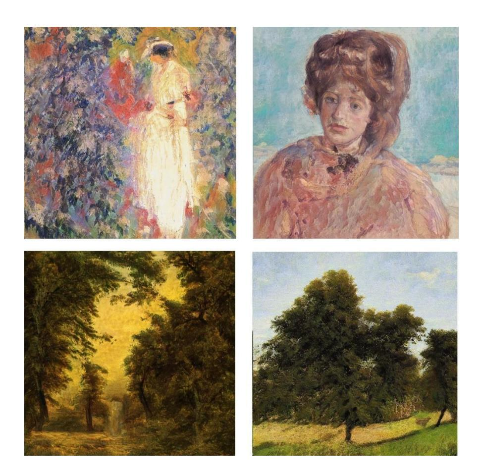

Figure\_6.07. Images in Impressionist style generated by GAN2 AI model in 2021.

In the perception of familiarity, the relationship between original contents and their artificial variants to which subjects are exposed plays a crucial role. In contexts where we primarily engage with original cultural products, artificial creations are often seen as mere curiosities or derivatives. However, it's conceivable that in the future, content generated from original works may surpass them in abundance.

This shift in the relationship between original content and (artificial) variations can be delineated in two general phases:

- 1) new content generated is just viewed as a reflection or extension of the original works. For instance, when we see an image as "in the style of Picasso". To refer to our previous hypothetical scenario: at first, in each newly generated artificial triangle, we recognize in it the eight famous triangles we are familiar with. *The variations are perceived through the lens of the original objects* (we see the original *in the* variations)*.*
- 2) Following an intermediate phase, where it becomes unclear whether what we observe is a derivation of original works or original in itself (creating a déjà-vu effect), we may progress to a stage where artificially generated content predominates over the

original. Continuing our example, upon encountering one of the eight triangles painted by the renowned artist, an individual may perceive it simply as another instance of the general concept of a triangle, indistinguishable from others previously seen. In this case, *the original is viewed and identified through the prism of its various iterations*  (we see the variations *in the* original work)*.*

This phenomenon bears a striking resemblance to musical *remixes* and *cover versions*, as previously discussed. Some reinterpretations gain popularity by re-introducing old songs to a younger audience unfamiliar with the originals. Older listeners discern the original within the cover version (often with a nostalgic preference for it), while younger listeners, upon encountering the original, may in contrast perceive it through the lens of the cover (often preferring the latter, as it aligns more closely with contemporary tastes and styles).

The remix example shows that recreating original works or their styles is, of course, not a new concept. For instance, there was a long debate about which of Rembrandt's selfportraits were genuine and which were just imitations by his students. This debate was only recently settled, with the number of recognized originals reduced from 90 to 40. Similar trends of imitation can be seen in music, whether it's Baroque or 1960s Pop, where certain styles and sounds become popular and are imitated by artists. What's different now is how easily and frequently current AI systems can create works "in the style of" famous artists and the shifts that can occur if images, sounds and text become mainly the product of artificial generation. By creating endless variations and blending of the products of human culture, we might get to perceive the original works and content as just instances of an endless array of potential artifacts. In our imaginary world without geometry, the original eight triangles now appear as being just manifestation among the others of the general idea of triangle. Similarly, the 40 Rembrandt's portraits, 400 Bach's chorales, or about 200 Beatles' songs, once seen as unique and special may be viewed as just instances of many variations of a certain general style.

Moreover, AI-generative technology facilitates forms of blending, recombination, and recontextualization of styles and forms, making it easy to generate images whose style is, for example, a mixture of Hieronymus Bosch and Andy Warhol, or a blend of Caravaggio and Manet. Similarly, one could have a Beatles song follow melodic evolutions that incorporate Bach, or a Shakespearean sonnet speak of the drama of a financial collapse, and so on. The very possibility of freely generating these variations has an impact on our way of seeing the cultural objects we are accustomed to. We are now better at naturally "interpolating" between styles and contents with our own eyes thanks to the training we are subjected to. These new possibilities also change how

people who use or know about these technologies see art. In other words, *AI technologies generate novel patterns and classifications that we partially integrate into our thinking and perception* making it easier for us to envision, even before asking the system to generate such images, how a painting by Hieronymus Bosch might manifest in a Pop-Art or postmodern composition or to conceive of a contemporary desk in the style of 17th-century Flemish art (Figure 8). In this sense, *AI systems train us in new ways of seeing.*

Figure\_6.08. Dall-E 3 image generated with the prompt: "A PC-set in the style of XVIIth century Dutch still life."

This phenomenon mirrors the historical influence of innovations in media devices, which have consistently reshaped human cognitive experiences. Walter Benjamin explored how technologies alter the human *sensorium* by introducing new ways of processing and engaging with the world[23](#page-117-12), particularly by diminishing the "aura" of a work of art, its unique presence in time and space and its authentic history. With the advent of technologies capable of mass reproducing art, these works can now be experienced in different contexts and locations, thereby changing the original perception that was tied to the artwork's uniqueness and authenticity. Later Marshall McLuhan notably extended this view: each medium, with its specific characteristics,

affects our sensory balance. Electronic media, particularly television, fostered a more holistic and less linear perception of the world compared to the linearity of print media. The experience of artificial generation of content, where boundaries between shapes and styles are made much more fluid, enhances this transformation. Moreover, McLuhan argued that the content of any medium is always another medium; it's the characteristics of the medium itself that shape and alter the sensorium, changing not just what we see, but how we see by altering the balance among our senses. Similarly, the true extent of the changes that "generative AI" can induce are still in their nascent phase and will be the task of future investigations.

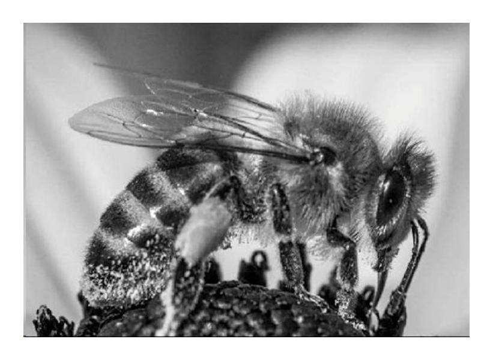

Figure\_6.09. Closeup photo of a bee.

#### Notes

"A defining feature of the Deep Dream algorithm is the use of backpropagation to alter the input image in order to minimize categorization errors. This process bears intuitive similarities to the influence of perceptual predictions within predictive processing accounts of perception," in Suzuki, K., Roseboom, W., Schwartzman, D. J., & Seth, A. K. (2017). A Deep-Dream Virtual Reality Platform for Studying Altered Perceptual Phenomenology. *Scientific reports*, *7*(1), 15982.

[https://doi.org/10.1038/s41598-017-16316-2;](https://doi.org/10.1038/s41598-017-16316-2) see also Mordvintsev, A., Olah, C., & Tyka, M. (2015, June 17). Inceptionism: Going deeper into neural networks. *Google Research Blog*. [https://research.google/blog/inceptionism-going-deeper-into-neural](https://research.google/blog/inceptionism-going-deeper-into-neural-networks/)[networks/](https://research.google/blog/inceptionism-going-deeper-into-neural-networks/)

4 Kim, B., Reif, E., Wattenberg, M. *et al.* (2021). Neural Networks Trained on Natural Scenes Exhibit Gestalt Closure. *Comput Brain Behav* 4, 251–263.

[https://doi.org/10.1007/s42113-021-00100-7;](https://doi.org/10.1007/s42113-021-00100-7) Kim, B., Reif, E., Wattenberg, M., & Bengio, S. (2019). Do Neural Networks Show Gestalt Phenomena? An Exploration of the Law of Closure. *ArXiv, abs/1903.01069*.

- 5 Based on Schwartz, O., Bayer, H., & Pelli, D. G. (1998). Features, frequencies, and facial expressions. *Investigative Ophthalmology & Visual Science*, 39, 173.
- 6 This works better if the two images are viewed separately and not next to the other.
- 7 As shown by Rudolf Arnheim in the seminal book Arnheim, R. (1954). *Art and visual perception*. University of California Press.
- 8 Impett, L., & Moretti, F. (2017). Totentanz: Operationalizing Aby Warburg's 'Pathosformeln'. *Stanford Literary Lab: Pamphlets* (16). <https://litlab.stanford.edu/LiteraryLabPamphlet16.pdf>
- 9 Stokes, D. (2014). Cognitive penetration and the perception of art. *Dialectica*, 68(1), 1-34. Stokes, D. (2018). Rich perceptual content and aesthetic properties. In A. Bergqvist & R. Cowan (Eds.), *Evaluative perception* (pp. 19-41). Oxford University Press.
- 10 Zhang, X., Ren, T.T., Wang, L., & Xu, H. (2022). Music Influence Modeling Based on Directed Network Model. *arXiv Preprint*,<https://arxiv.org/abs/2204.03588v1>

1 Ruskin, J. (1857). *The elements of drawing*. Dover Publications, 1971 (Reprint edition).

2 Image from Barrett, L. F. (2016). *How emotions are made: The secret life of the brain*. Houghton Mifflin Harcourt.

3 "Intuitively, this means changing the image rather than changing the network […] so that the resulting image is shaped by what the network 'expects' to see". Furthermore:

- 11 Saleh, B., Abe, K., Arora, R. S., & Elgammal, A. (2014). Toward automated discovery of artistic influence. *arXiv Preprint*,<https://doi.org/10.48550/arXiv.1408.3218>
- 12 Kandel, E. R. (2012). *The age of insight: The quest to understand the unconscious in art, mind, and brain, from Vienna 1900 to the present*. Random House, p. 192.
- 13 Baxandall, M. (1994). Fixation and distraction: The nail in Braque's Violin and Pitcher (1910). In J. Onians (Ed.), *Sight and insight: Essays on art and culture in honour of E. H. Gombrich at 85* (pp. 401-413). Yale University Press. Referenced in Onians, J. (2007). *Neuroarthistory*. Yale University Press.
- 14 Baxandall, "Fixation and Distraction", p. 413.
- 15 Evans, J. (2015). *How to trick a neural network into thinking a panda is a vulture*. Code Words - Recurse Center. Retrieved September 8, 2024, from [https://codewords.recurse.com/issues/five/why-do-neural-networks-think-a-panda-is-a](https://codewords.recurse.com/issues/five/why-do-neural-networks-think-a-panda-is-a-vulture)[vulture](https://codewords.recurse.com/issues/five/why-do-neural-networks-think-a-panda-is-a-vulture)
- 16 Spratt, J. (2017). Dream formulations and deep neural networks: Humanistic themes in the iconology of the machine-learned image. *kunsttexte.de*. [https://edoc.hu](https://edoc.hu-berlin.de/bitstream/handle/18452/19403/Spratt%20-%20final.pdf)[berlin.de/bitstream/handle/18452/19403/Spratt%20-%20final.pdf](https://edoc.hu-berlin.de/bitstream/handle/18452/19403/Spratt%20-%20final.pdf)
- 17 Gordon, R. (2019). Algorithm finds hidden connections between paintings at the Met. *CSAIL News*. [https://www.csail.mit.edu/news/algorithm-finds-hidden](https://www.csail.mit.edu/news/algorithm-finds-hidden-connections-between-paintings-met)[connections-between-paintings-met](https://www.csail.mit.edu/news/algorithm-finds-hidden-connections-between-paintings-met)
- 18 Google Arts & Culture Experiments. (n.d.). X degrees of separation. <https://artsexperiments.withgoogle.com/xdegrees/>
- 19 As noted by Kurihana et al. (2022), "Unsupervised learning enables us to move beyond artificial categories derived from historical cloud classification patterns, facilitating the discovery of more nuanced classifications." Kurihana, M., et al. (2022). Cloud classification with unsupervised deep learning. *arXiv Preprint*. <https://arxiv.org/abs/2209.15585>
- 20 See Every Noise at Once, [everynoise.com](http://everynoise.com/)
- 21 To borrow from Grietzer, D. (2017). *A theory of vibe*. *Glass Bead*. [https://www.glass](https://www.glass-bead.org/article/a-theory-of-vibe/)[bead.org/article/a-theory-of-vibe/](https://www.glass-bead.org/article/a-theory-of-vibe/)
- 22 See, for instance, [aiva.ai](http://www.apple.com/)
- 23 "Thus technology has subjected the human sensorium to a complex kind of training", in Benjamin, W. (1939/2007). On some motifs in Baudelaire. In H. Eiland & M. W. Jennings (Eds.), *Walter Benjamin: Selected writings, vol. 4: 1938-1940* (pp. 313- 355). Harvard University Press.

# **7. AI Aesthetics and Media Evolution**

Lev Manovich

#### Separate and Reassemble

*AI image* represents a further logical evolution of the process that begins with digital media algorithms in the 1970s and continues in the following decades. The first computer paint programs were created in the 1970s, but could not yet simulate different paint types, brushes, and textured surfaces like canvas.[1](#page-142-1) But in the 1990s, software such as Coral Painter (1991–) started to offer these features.[2](#page-142-2) Similarly, the first 3D computer graphics algorithms for rendering solid shapes, Gouraud shading (1971) and Phong shading (1973), couldn't yet simulate the looks of different materials. Later, in the 1970s and 1980s, computer graphics researchers created numerous algorithms to simulate the appearance of various materials and textures, such as cloth, hair, and skin, as well as shadows, transparency, translucency, depth of field, lens flares, motion blur, reflections, water, smoke, fireworks, explosions, and other natural phenomena and cinematography techniques and effects.

Simulating many of these phenomena and techniques requires multiple separate algorithms that were developed over time. Thus, we find distinct sessions devoted to such algorithms with names like Volumes and Materials, Fluid Simulation, or Cloth and Shells in the annual proceedings of SIGGRAPH, the main conference in CG field.[3](#page-142-3) As an example, the paper "Predicting Loose-Fitting Garment Deformations Using Bone-Driven Motion Networks" presented in 2023 conference describes "a learning algorithm that uses bone-driven motion networks to predict the deformation of loosefitting garment meshes at interactive rates." Another conference paper "Rendering Iridescent Rock Dove Neck Feathers" describes a new approach for modeling and rendering bird feathers; and so on.

In my 1992 article "Assembling Reality: Myths of Computer Graphics" I have analyzed this fundamental aspect of computer graphics, explaining that "synthetic photorealism

is fundamentally different from the realism of the optical media, being partial and uneven, rather than analog":

Digital recreation of any object involves solving three separate problems: the representation of an object's shape, the effects of light, and the pattern of movement. To have a general solution for each problem requires the exact simulation of underlying physical properties and processes. This is impossible because of the extreme mathematical complexity… In practice, computer graphics researchers have resorted to solving particular local cases, developing a number of unrelated models for simulation of some kinds of shapes, materials and movements.[4](#page-142-4)

In other words, 3D CG takes the world which we see apart, separating objects' shapes, materials, light reflections, textures, movements and behaviors. During rendering, the effects of multiple algorithms simulating all these aspects are combined together. Thus, *visual representations created using CG are discrete and modular, rather than continuous and "monistic."* This is one of the most important characteristics of CG medium, distinguishing it from lens-based optical image media.

Figure\_7.01. A few from the thousands of assets available in Substance (Adobe 3D content creation software). These are assets from Herbarium collection. Asset types include 3D models, materials applied to these models and virtual lights. Source: [https://substance3d.adobe.com,](https://substance3d.adobe.com/) accessed September 26, 2024.

This logic of separation and recombination also defines next stage of digital media: PC software for media creation and editing. Following its initial release in 1990, Photoshop gradually began to include simulated effects and techniques from various artistic mediums, ranging from darkroom photography to oil painting, within a single program. These effects can be combined in a single digital image. Music software similarly allows users to combine many simulated instruments and multiple effects such as reverb and echo in one composition. Word processing and desktop publishing software separate the physical process of print composition into its basic parts that also can be now recombined - for example, you can take any font and arbitrary change its size or generate your own font.[5](#page-142-5)

All of these media software capabilities were first proposed in the 1970s and later realized in the 1980s and 1990s, eventually becoming ubiquitous. AI generative media follows the same logic, although its underlying technical implementation is different. During training, neural networks learn visual patterns characteristic of hundreds of different types of art media, lighting techniques and effects from history of photography and cinematography, and visual signatures of many thousands of historical and contemporary artists, architects, fashion designers and other creators. A reference website Midlibrary currently lists 391 "artistic techniques" that Midjourney AI image generator tool can reliably simulate according to the tests conducted by this website team.[6](#page-142-6) They range from "albumen print" and "anaglyph" to "wood carving" and "wireframe rendering."

Importantly, a user can include references to multiple techniques and/or multiple creators in a single prompt, potentially generating *new types of media effects that did not exist before*. Here are examples of such prompts I used with Midjourney AI image generation tool.

Referencing multiple artists in one prompt: "18th century very big and detailed panoramic etching showing landscape in the style of *Michael Kaluta, Kawanabe Kyosai, Pieter Bruegel the Elder*, insane detail, cinematic".

Referencing multiple artistic media in one prompt: "18th century futuristic infinite museum storage space with art objected on the shelves, snow fall inside the space and fog, wide angle view looking down, 7pm soft evening light, detailed intricate *drawing and etching* with very fine shading, subtle nuanced sombre *color pencils* and fine *pens".*

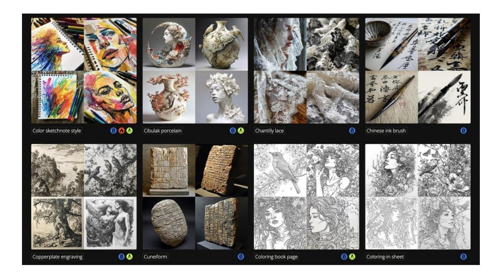

Figure\_7.02. Examples from reference site Midlibrary showing a few of artistic techniques, art genres, and styles of painters, illustrators, architects, photographers, and fashion designers that Midjourney AI image generation tool can simulate. As of September 2024, this resource lists 5500 such references. (Source: [midlibrary.io,](/Users/levmanovich/Library/Mobile%20Documents/com~apple~CloudDocs/MY%20ARTICLES%20&%20BOOKS/in%20progress%20books/Book%20on%20Artifical%20Aesthetics%20wih%20Emanuelle/_2024%20Publication%20files/_AA%20all%20chapters%20PDF/midlibrary.io) March 24, 2024.)

The pioneering digital media theorist of 1990s and 2000s William J. Mitchell called this key characteristic of digital media "separate and recombine."[7](#page-142-7) In his 1995 book *City of Bits*, he described this process in relation to urban planning:

Classical architects of the eighteenth and nineteenth centuries handled the task of putting spaces together by creating hierarchies of great and small spaces around axial, symmetrical circulation systems connected to grand, formal entries and public open spaces…functionalist modernists of the twentieth century have often derived their less regular layouts directly from empirically established requirements of adjacency and proximity among the necessary spatial elements. But when telecommunication through lickety-split bits on the infobahn supplements or replaces movement of bodies along circulation paths, and when telepresence substitutes for face-to-face contact among the participants in activities, the spatial linkages that we have come to expect are loosened. The constituent elements of hitherto tightly packaged architectural and urban compositions can begin to float free from one another, and they can

#### Chapter 7. AI Aesthetics and Media Evolution - 123

potentially relocate and recombine according to new logics.[8](#page-142-8)

Mitchell's lectures in the 2000s expanded on this formulation, demonstrating how the logic of separation and recombination can be seen in digital media in a variety of ways. Generative AI continues the same logic. A neural network extracts elements and structures from hundreds of millions or billions of images in its training set. They include distinct color palettes, compositions, lighting effects, artifacts of historical photography processes, and so on. When you ask AI image tool to generate new images with specified visual attributes, it does its best to combine (or more precisely, *interpolate* between) appropriate art patterns and effects.

No human historian, theorist or practitioners of visual art, photography, cinema, or design were ever able to describe all such patterns. In the early 20th century pioneering art historians Aby Warburg and Erwin Panofsky developed the study of iconology. Warburg defines this concept as visual motives that (re)appear in various civilizations and media. Panofsky used it somewhat differently, referring to symbols and motifs that have existed throughout the history of art.

During the same period modern visual artists and architects disassembled visual arts in a different way, breaking down an image into its basic components and dimensions such as points, lines, planes, two-dimensional forms, color, space, texture, pattern, balance, and equilibrium, among others. While this project of methodical dismantling and creation of new visual languages from these components was central to modernist art and its many -isms, it arguably found its most methodical development in the curricula of two cutting-edge schools of art and design. VKhUTEMAS in Moscow (1920–1929) and the Bauhaus in Germany (1919–1933) introduced their "basic courses" where students were taught how to systematically work with all the relevant elements and dimensions. Instead of drawing from life, painting portraits or making historical compositions, now students started training by completing exercises with image primitives such as basic shapes, forms, and colors.

At VKhUTEMAS the Basic Course was created in 1920 by Rodchenko, Popova, Ekster, Vesnin and other faculty from painting, architecture, and other school's areas. In its first iteration it consisted from a number of workshops such as "Discipline of Synchronized Shapes and Colors," Plane, Color and Spatial Design, "Graphic Construction on a Plane Surface" and "Color." It was further transformed during VKhUTEMAS existence. Eventually, three learning sequences were approved for all VKhUTEMAS students: Plane and Color, Volume and Space.[9](#page-142-9) (The Basic Course at this school was more systematic and comprehensive than a similar course at Bauhaus; it was taught by many different faculty members and lasted two years. VKhUTEMAS was also ten times larger than Bauhaus, with 100 faculty and 5000 students during the ten years of its existence, versus only 500 students at Bauhaus.)

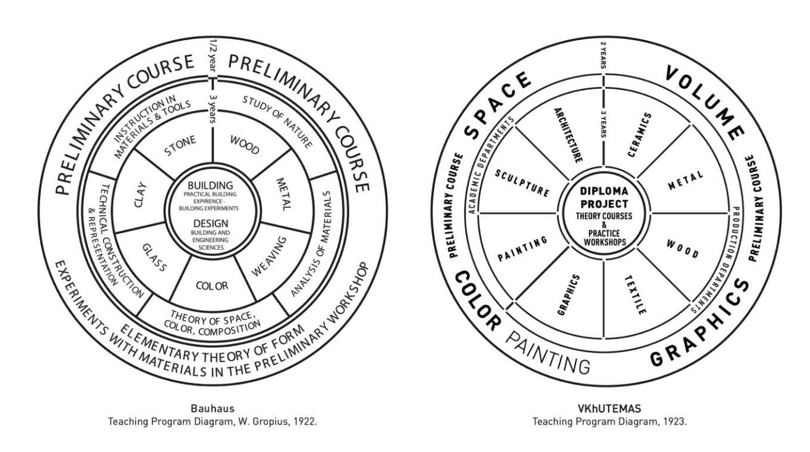

Figure\_7.03. The structures of courses in Bauhaus and VKhUTEMAS. Both curricula begun with the basic course (the outer ring). Source: Anna Bokova, *VKhUTEMAS Training*, 2014, [http://www.avantgardesculpture.com/downloads/VKhUTEMAS-Handout.pdf.](http://www.avantgardesculpture.com/downloads/VKhUTEMAS-Handout.pdf)

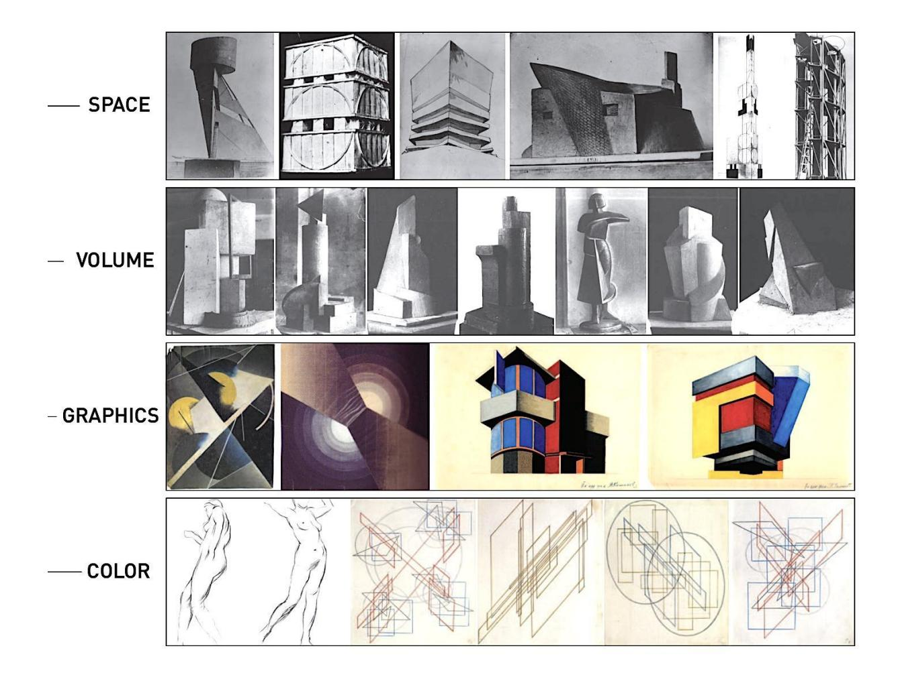

Figure\_7.04. Examples of student exercises at VKhUTEMAS. Source: Anna Bokova, *VKhUTEMAS Training*, 2014, [http://www.avantgardesculpture.com/downloads/VKhUTEMAS-](http://www.avantgardesculpture.com/downloads/VKhUTEMAS-Handout.pdf)[Handout.pdf.](http://www.avantgardesculpture.com/downloads/VKhUTEMAS-Handout.pdf)

In a certain sense, *generative AI models can be said to continue these programs of decomposition and analysis of visual arts that begun in the early twentieth century*. Artificial intelligence algorithms extract patterns (or "features") from training data. However, at least as of now, we can't look at billions of parameters in a gigantic generative network and get neat catalog of all the patterns the network learnt.[10](#page-142-10) In the 2010s when neural networks were simpler and smaller, scientists were able to visualize what their neurons learn. For example, the following visualization shows the features learned by a network trained to recognize objects in photographs. A network first learns how to recognize basic features before progressing to object recognition. (Unfortunately, the architecture of generative networks that synthesize images prevents us from "looking inside" these networks and visualizing them in the same manner.)[11](#page-142-11)

It is possible to say that today generative artificial intelligence is carrying on the programs of decomposition and the analysis of the visual arts that were initiated in the early twentieth century. The networks process billions of images during their training, effectively "learning" to recognize and reproduce a wide range of visual elements and patterns. This includes every aspect of images, including composition, representation of figures, faces, and other objects, lighting techniques, perspective, and stylistic elements. In a sense, they are performing a highly sophisticated form of visual analysis, breaking down images into both basic formal features and more complex representational elements. The AI learns to recognize how these components interact and contribute to the overall visual structure and meaning of an image.

When generating new images, AI tools create new visual content by combining these learned elements in novel ways. This process mirrors (on a much larger scale and in an automated fashion) early twentieth century efforts to deconstruct and understand the fundamental components of visual art. Just as art historians cataloged motifs and artists explored basic visual elements and dimensions, AI systems create internal representations of diverse visual patterns and principles.

However, at least at present, we can't directly look at hundreds of billions of parameters in a large artificial neural network and see a neat catalogue of all the patterns a network has learned.[12](#page-142-12)

I want to conclude with a relevant quote from my 2018 book AI Aesthetics.[13](#page-142-13) While at the time deep neural networks were mostly used for media classification and recommendations, with the generative AI revolution still four years away, the analysis I developed in the book section called "AI as a Culture Theorist" is quite a bit more relevant today:

[There is] a crucial difference between an "AI culture theorist" and a human theorist/ historian. The latter comes up with explicit principles that describe how a cultural area function . . . a neural net can be trained to distinguish between works of different artists, fashion designers, or film directors. And it can also generate new objects in the same style. But often we don't know what exactly the computer has learned. . . . Will the expanding use of machine learning to create new cultural objects make explicit the patterns in many existing cultural fields that we may not be aware of?

This theoretical potential is one of the most intriguing and valuable aspects of generative AI in my opinion; however, we will have to wait and see if it is realized in the future.

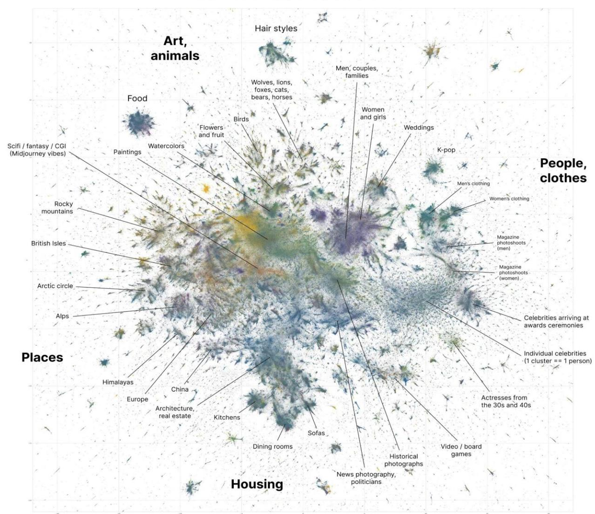

Figure\_7.05. David McLure's visualization of 12M captions from the LAION-Aesthetics dataset with high aesthetic scores (> 6). LAION-Aesthetics is part of a 5.6 billion captioned image dataset used to train the popular Stable Diffusion AI image generation model released in 2022. This visualization gives us some idea about the content of images in the training data - but not the artistic techniques and styles the model extracts from images. The aesthetic ratings of all images in this dataset are assigned by another AI model.[14](#page-142-14)

#### Visual AI and Media Accumulation

I will use the term "Visual AI" to refer to computational methods that use machine learning for generating and editing visual content, trained on vast amounts of images and videos found across the web. In other words, this is my shortcut for saying "generative AI used to make and edit images, video and animation".

Visual AI is the fourth significant *data* effect of the web - a global accumulation of networked hyperlinked cultural content that began to grow quickly after 1993. Although people have been sharing texts and images on the internet since the 1970s, this process picked up speed after 1993, when the first visual browser, Mosaic, was introduced on January 23 of that year.

I have observed several repercussions of the growth of information on the web over the next 30 years. If we wish to situate the development of Visual AI in the early 2020s in this timeline, here are four such effects. Certainly, others can be also named, so this is only one list of techno-cultural developments technologies enabled by the web I am particularly interested in:

- 1. The first effect is the switch from categorical, hierarchical and structured organization of information (exemplified by library catalogs and early web directories) to search engines in the late 1990s. There was so much content that organizing it in conventional ways was no longer practical, and search become the new default. Note that *web search is based on a prediction of what will be most relevant to the user* as opposed to giving you a precise and definite answer. Note that generative AI is also predictive - it predicts possible text, images, animation or music in response to your question or prompt. The regime of absolute certainty, i.e. a truth vs a lie typical for human civilization is replaced by predictions, as statistics becomes foundation of human sciences in the 20th century, and data science and AI in recent decades.
- 1. The second major effect is the rise in popularity of data visualization during the 2000s. The field comes into its own around 2005. As a part of this development, the new field "artistic data visualization" develops in the same decade, along with other new cultural fields: data art and data design. (In our lab we created *Phototrails*, *Selfiecity* and *On Broadway* in 2012–2014. These were first interactive visualizations of millions of Instagram images.[15](#page-142-15)) If search attempts to find the most relevant items in the giant data universe, visualization tries to show parts of this universe in one image, revealing patterns and connections.

2. The third effect is the emergence of "data science" as the master discipline of the new big data era at the end of the 2000s. While many techniques employed in data science have already been available for decades, the rapid increase in unstructured data in the 2000s motivated the development of a separate data science field—the key new profession of the data society. My own version of this stage was "cultural analytics," an idea I introduced in 2005 and developed over the following fifteen years in our lab. Cultural analytics applies the paradigm of data science to cultural content, using computational techniques to analyze and visually represent large collections of digital media, enabling the exploration of patterns and trends across entire cultural datasets.[16](#page-143-0)

The next, but certainly not the last, effect of the growth of online visual digital content is Visual AI which becomes popular in early 2020s. DALL-E was released in 2020, Midjourney in 2022, and Adobe Firefly and Runway Gen-1 in 2023. Today (2024), hundreds of other AI image, video, and animation tools exist, and image generation is also available in all popular AI text bots. (A bit earlier around 2017, a particular AI method for media generation called GAN became already popular with digital artists.)

(It is relevant to mention that Visual AI and Generative AI in general build on twenty years of research. The key breakthrough was the idea to use web content universe as a source of data for machine learning, without labeling it. This idea was already articulated in the research papers published around 2001.)

Let's see what kind of pattern is established by these four effects. Search is the first method to deal with the new scale of content on the web. Data science focuses on finding patterns, relations, clusters, and outliers in big data, and also predicting future data. Data visualization tries to summarize datasets visually. And now Generative AI explores "big content" in yet another way, generating new content which combines many patterns from existing media.

To put this differently, Generative AI synthesizes new content that has statistical properties similar to existing content. But it's not a copy of what already exists. AI generates new content (texts, images, animation, 3D models, music, singing, etc.) by interpolating between existing points in the latent space. This space contains numerous patterns and structures extracted by artificial networks from billions of image-text pairs, trillions of text pages, and other large collections of existing human cultural artifacts. AI predicts what could exist between these points in space of patterns. For example, it can predict a "painting" made by artists A, B, C, using techniques D and E, with content F, G and E, with mood, colors M-N, proportion W, composition K, etc.

Note that the three earlier developments all approach big data by summarizing it. Web search reduces billions of web pages to the top results. Dara vis reduces it to a diagram. Data science reduces it by using summary statistics, cluster analysis, regression or latent space projection. But Visual AI is doing something new. It also first reduces big data during learning and then generates new data points.

One way to sum up all this is to say that we moved from probabilistic search (1999) to probabilistic media generation (2022). But certainly, Generative AI and its subset Visual AI is not the last effect of the existence of web data; others will be likely emerge in the future.

#### Compression, Generation, and Realism

"If everybody speaks in the same way, everybody is voiceless…this is why poetry is playing such a role in culture. *Poet is the most individual of all speakers*." Yuri Lotman, lecture "Circles and Communities," *Conversations about Culture*, 1988.

Both human and machine cognition rely on *compression*. We perceive and understand the world through categories and types. Human art also uses compression. But there is a fundamental difference between how compression works in the arts and in AI. While artworks often depict characters, symbols, or scenes that condense human experiences, they also frequently contain many concrete and distinct details. This combination of general and concrete, predictable and unique is especially important for modern arts (19th-21st c). Modern artists compresses human world and experience into patterns, structures and types - but they also typically add very particular, rare and unexpected unexpected to these general patterns.

In contrast, when we train AI models, the training data is also compressed, and the particular and unique are omitted. Extracting patterns from the data in machine learning involves eliminating outliers and many unique details and only selecting most frequently appearing associations, characteristics and structures.

This kind of compression is the fundamental characteristics of generative AI. The same also holds for machine learning and statistics in general. When data is summarized, classified or used to predict future data, the most common is preserved and the rare is abandoned.

Given this, *can we expect AI to create artworks with unique content and enough concrete, unique, and subtle details?* If all the most unique (i.e. rare) information is not preserved during training, where will it appear when we generate new artifacts?

This is, in my opinion, a more interesting and relevant question than the one everyone asks: can AI be creative. As I discussed earlier in Chapter 4, the association of the arts with "creativity" is a recent notion that becomes established only in the Romantic period. For thousands of years, humans were creating artifacts that today we admired as the very best artworks ever created by our species - even though their authors did not have the goals of inventing anything new or being "creative." (In Christian tradition, there can be only one creator - God.) Instead, art was thought to serve other goals such as *imitation -* the concept central to understanding of arts from Plato and Aristotle until the second half of the 18th century.[17](#page-143-1)

One way to think further about the difference between compression in art and in AI, data science and statistics is by considering the notion of *average*. In descriptive statistics we use average measures such as mean, median, or mode. The mean is the arithmetic average of a set of numbers. For example, the mean of a set of eight numbers (1,2,3,4,5,6,7,8) is 4. The mean captures average tendency of a data set - but does not preserve any of its details, or its specificity. We can come with infinite number of number sequences that will all have the same mean of 4. Note that they don't have to include "4" as one of the numbers. For example: (1,2,2,3,5,6,6,7) or (0,0,0,2,6,8,8,8), etc.

Furthermore, while in some cases most numbers are close to the mean (as in bell curve distributions), in others all numbers in the set can be far from the mean. So, in the first case, mean captures the overall pattern of a sequence, but in the second, it misrepresents it.

Both statistics and the new movement of realism in literature developed in the 19th century, yet they approached the representation of information in opposite ways. While statistics aimed to replace the particular and concrete with descriptions of main tendencies such as averages, realistic literature took a different approach.

In contrast to statistical representations, literary characters created by best realist writers in the 19th century - such as Balzac, Flaubert, Zola, Tolstoy - combine the general and the specific. They are not statistical abstractions of social classes or types of people retaining only the features which common to all people of this or that type for example, this person is hard working and optimistic, this person tends to dream but not act, etc. instead, they are presented as real concrete and unique individuals. In other words, in such literary characters, the general and the particular, the typical and unique are combined together.

Balzac who today is recognized as the pioneer of realism movement in literature was explicit about the importance of concrete details. He wrote: ""the author firmly believes that details alone will henceforth determine the merit of works."[18](#page-143-2) Balzac meticulously researched the places depicted in his novels, traveling to remote locations and comparing notes from multiple visits. In these novels, intricate details about locations can sometimes take up up to twenty pages. And while his characters represent a distinct set of societal types - the enticing mistress, the noble soldier, the rascal, and so on - they also depicted as particular individual. In short, Balzac was able to strike a balance between the individual's uniqueness and the portrayal of the type.

In the Introduction *The Human Comedy* (1842), Balzac contends that literary creation and scientific investigation are closely related activities. This alignment of realist method in literature with empirical science is very telling, but let's remember that the end goals of the two are different. *Science aims to produce only generalizations* in the forms of models, explanations and predictions of natural or social world. In contrast, the arts appeal to both our intellect and our senses. The sensory dimension of the arts are central to aesthetic theories by key thinkers such as Edmund Burke, Friedrich Nietzsche, Clive Bell and Susan Sontag, among others.

Here we can recall that Plato was very critical of visual arts precisely because they represent concrete reality. Plato saw the physical world as a mere shadow or replica of the true, ideal world of Forms (or Ideas), the most real and unchangeable parts of reality that can only be reached via rational contemplation. And this is why he considered visual arts (and other kinds of artistic imitation) as doubly removed from reality. However, if Plato could have been more perceptive, he would have noticed that sculptors in ancient Greece of his time were not only imitating the visible world or striving to compress it to reveal ideal Forms. Instead, in contrast to many other ancient cultures, Ancient Greek artists developed a special aesthetics that combined idealization and realism.

There is also another crucial difference between the arts and statistics. *The arts developed and practiced many different ways to compress phenomena*. There is not one formula for summarization that fits arts made in all times, cultures and styles. For example, sculptures, tiles, reliefs, seals or paintings from Sumer, Babylon, Assyria and other ancient civilizations don't represent gods and kings with obsessive photorealism of 19th century artists such as Jean-Auguste-Dominique Ingres (1780-1867) or Ivan

Shishkin (1832 - 1898). Instead, the details of human bodies and faces appear schematized, i.e. (to use our terms) "compressed," But the techniques of such compression vary enormously. The outlines of bodies, the proportions of body parts, the features of faces, the shapes of clothes are represented in variety of ways. What details are kept and what is simplified, how this simplification is carried, what is presented realistically and what is exaggerated can change from culture to culture.

To summarize this discussion, we can say that while both human mimetic arts and statistics, data science, and AI use compression, for arts it is only an option and not a requirement. Moreover, an artwork can have both general patterns and concrete nonaggregated details. And last but not learn, artworks can employ a variety of ways to create their patterns.

This does not mean that in practice generative AI tools are always inferior to very accomplished human creators because they can't always generate enough small and specific details. Often, they can. However, as many users have noticed, often they do struggle to produce sufficient variety of unique details - especially if ask them to represent something which did not exist in their training data.

"For example, if you ask an AI image tool to synthesize a photograph of a face and describe in detail the desired photographic effects (such as exposure, aperture, and lighting setup), it produces perfect results. The tool's exceptional performance stems from the web's vast repository of facial photographs, captured under myriad conditions with every conceivable camera setup.

However, when I ask the same tools to generate images of very particular spaces that normally don't exist and which are rendered in a very specific style unlike any popular ones online, the results are often less satisfying. While some tools perform better than others in such cases (Midjourney being the best, at least during 2022-2024), and their performance is improving over time, this limitation still remains at present.

This may not be a problem if I aim for schematic and aggregated aesthetics - i.e., if I want only archetypes. Ancient, classical and modern arts give us plenty of examples of great artworks which use such approach. However, pursuing different aesthetics that combine general and concrete and have a high degree of individualization, such as faces in Jan van Eyck paintings, descriptions of feelings, thoughts, people, and places in Proust, or architecture details in Antoni Gaudi's buildings, can be challenging at least during this period of generative AI development.

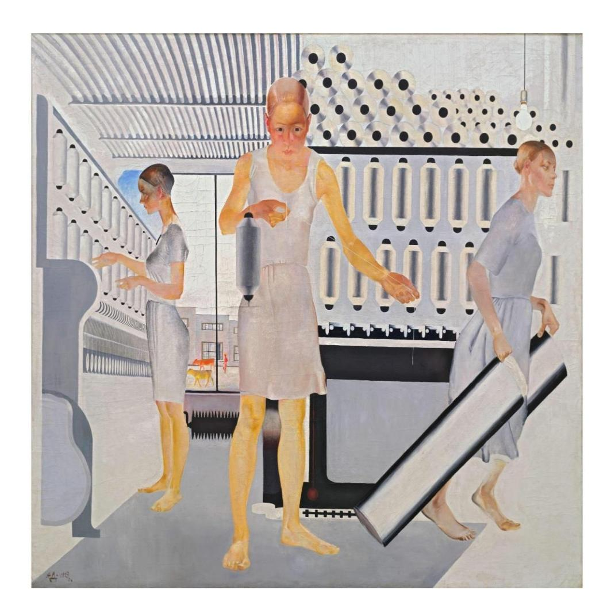

Figure\_7.06. Alexander Deineka (1899-1969), *Tekstile Workers*, 1927, oil on canvas, 171 х 195 cm. In this famous painting, Deineka skillfully blends general and concrete, abstract and unique. The factory's machinery and architecture have been reduced to almost abstract geometric patterns. The rendering of bodies emphasizes their similarity, while faces retain their uniqueness. The level of detail in the faces appears unexpected and almost exaggerated when compared to the machinery's deliberately very regular patterns. These are just a few examples of the artist's selective and variable "compression" techniques used in this and other works he will paint in the future.

#### The Aesthetics of Fragments

In one of my image series created with Midjourney, you human figures and interior spaces with shelves filled with endless objects. They remind me of a book library, a warehouse, natural history museum display, European still-live paintings… Some of the objects can be recognized, but others look like fragments. In another image series I have been making for over a year now, we see young artists inside their spacious art

studios. Here also all surfaces - floor, walls, and even ceiling - are also covered with dense textures and patchworks of lines and shapes. It is not clear if they are two or three-dimensional. Do these lines belong to the paintings covering the walls or do they exit in actual space?.. Some of these details are purely abstract. Others appear to suggest something definite, some objects, shapes and meanings from our human world.

What are these tiny fragments? What are these undefined unnamed objects and shapes filling endless shelves, covering the floor, or growing to fill the space?

Yes, these are "fragments"—but of what?

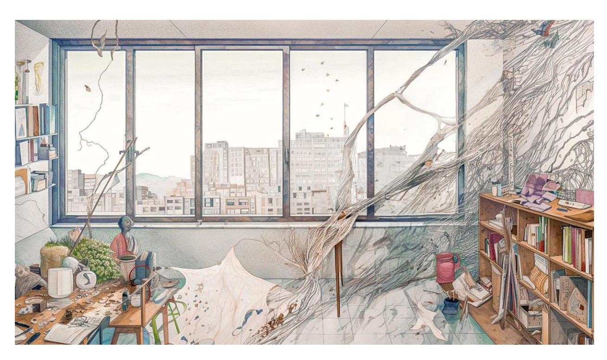

Figure\_7.07. Lev Manovich, from *Drawing Rooms* series, generated with Midjourney AI image tool and edited in Lightroom software, 2023-2024.

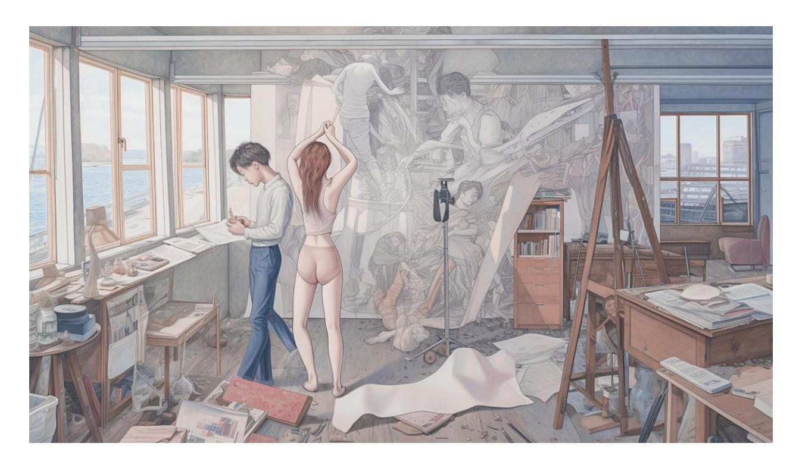

Figure\_7.08. Lev Manovich, from *Drawing Rooms* series, generated with Midjourney AI image tool and edited in Lightroom software, 2023-2024.

In an art or archeology museum we see fragments of ancient civilizations. Pieces of vases, glasses, plates, and also small tools, statues etc. in other words, these are parts of single concrete objects from 4000, 2000, 1500 years ago. But AI "fragments" have diffident ontology. During AI model training, patterns" from hundreds of millions of images are extracted and distributes them across trillions of connections.

In this training process, digital materially of images is further virtualized, evaporated, diffused - but still preserved. And the generated "fragments" you see in my images are like scents, invisible movement of slight wind, or periodic movements of the ocean edge leaving traces on the sand.

These are fragments of fragments, in other words. Deposits of already broken forms. More fragmented than the 18th century ruins admired by painters and visitors in Italy on Grand Tour. They are not like "glitches." And they are not noise of telecommunication networks theorized by Claude Shannon.

They are artifacts of one possible AI aesthetics - its distributed knowledge and distributed vision. The future internet protocol invented over 60 years ago in late 1950s by Paul Baran suggested braking whole messages into pockets in order to transmit

them over distant networks more reliably. Breaking something into random parts paradoxically assured its survival. (And this how Internet still works today.)

Paul Baron published first description of the "pocket switching" concept in 1960 when he was working for RAND in the US. Around the same time, Alexey Ivakhnenko and Valentin Lapa, two Soviet mathematicians working in Ukraine, invented another fundamental method for using fragments of a message in a productive fashion. Their invention was the first deep neural network, which eventually led to contemporary massive networks that are also used in Generative AI.[19](#page-143-3)

Breaking cultural artifacts during machine learning into fragments (such as image pixels and parts of the words) and then processing these fragments in stages eventually allows these networks to acquire knowledge that can produce synthetic text, images, music, spaces, code. In short, by breaking historical human culture into fragments we get our new "generative culture."

The wonderfully coherent texts "written" by ChatGPT are predicted one word at a time. This blind "language computer" can't see far ahead, beyond one word. But somehow, one word is associated with another, and the second is associated with the third. Pulling these threads forward gives us poems, fiction stories, job cover letters, textbook chapters, computer programs…

And when you select a single one-pixel wide column in an image, another blind "image computer" continues this line of pixels (I am referring to generative AI 'inpainting' technique). A single line gives rise to endless magnificent new worlds. Their coherence and familiarity contradict a seemingly random RGB values of a single column of pixels that I chose.

In other words, we were assuming that we were looking at something without any meaning, any sense, any value - because we randomly selected a line in a drawing or a photograph. So, for our human vision, it was random. But we did not consider the fact that this line was part of a larger area with coherent patterns - be it houses, a road, smiling faces, clouds, or any other possible subject. The blind computer actually looked at all this and predicted what else can be nearby. (This is also how Photoshop's "generative fill" and "generative expand" tools work.)

The history of digital media, and also the history of all human civilization is in serious need of a *theory of fragments*. A taxonomy that will establish that there are dozens of such species. Certainly, others have thought about this already - again I recall 18th century European aesthetics of ruins as one example.

Echoing the progress of modern science in its pursuit for the elements of matter such as molecules, atoms, and elementary particles, 19th century European artists begin to earnestly fragment the visible world. Impressionists broke it into separate colorful brushstrokes; Georges Seurat and Paul Signac relied on mechanical looking irregular dots. Another crucial next step was taken by Paul Cezanne around 1878. He declared that all shapes should be represented in terms of the cylinder, the sphere and the cone. But paradoxically, this seeming solidification of reality was simply a new and more extreme way to fragment it. While impressionists visualized fragments of our perception, Cezanne fragmented the world itself. The tablecloth in his paintings such as, for example, *The Card Players* (1892-1985), is no longer a single continuous piece of fabric. Instead, it is a set of fragments - a collection of flat planes oriented in multiple directions.

In the 1907-1932 the aesthetics of violent fragmentation came to the center of visual modernism. We see it everywhere: in collages of Picasso and Braque; cubism of Jean Metzinger, Albert Gleizes, Fernand Leger, Robert Delaunay, etc.; cubo-futurism of Natalia Goncharova, Aleksandra Ekster, Lyubov Popova, Malevich and others; photomontages of Hannah Hoch, Lazlo Moholy-Nagy, Aleksander Rodchenko; film montage of Vertov and Eisenstein; and even cultural history montage of Walter Benjamin's unfinished *The Arcades Project*.

The latter had led to many interpretations that suggested more theories of cultural fragmentation. For example, in his *Theory of the Avant-Garde* (1984), art theorist Peter Bürger defines Benjamin's understanding of allegory as "a four-part schema that involves: first, the isolation and removal of a fragment from its context; second, the combination of fragments to create new meanings; third, the interpretation of the allegorist's gaze as melancholic – as one that draws 'life' out of the objects assembled; and finally, an understanding of allegory as a representation of history in decline rather than progress."[20](#page-143-4)

In time, AI theorists may suggest equally interesting theories of network fragmentation which forms the basis of generative media. Perhaps we will even see giant visualizations of unimaginable resolution showing all patterns extracted by deep networks from their image databases. But as an artist who was always invested in digital aesthetics, I am simply happy to be generating my own private idiosyncratic image spaces with these barely visible "fragments" of something which does not fully exist. The fragments of one possible AI aesthetics.

The history of human culture is one of slow forgetting and very rare, almost statically impossible (one in a hundred thousand? One in a million? Or even less today?) remembering. Famous artists, writers, politicians, influencers commanding everybody's attention in their day disappear from historical memory and are absent from our records. And for the lucky few who are remembered, it's only a few things. An artist work over sixty years is reduced to a few iconic images. History compression is brutal and uncompromising.

The mechanism of fragmentation and selective recombination and synthesis offered now by generative AI is a slightly less brutal. Of course, to qualify for possible remembering when deep neural network are trained, something has to be lucky to have been digitized to begin with and/or end on the web. One painting in a small museum in the town that had no tourists visiting for the last four years got lucky because it is in the background of the selfie taken by a local high school student and her boyfriend visiting over the weekend. But all other paintings in this museum were not in the frame, so no neural network will learn about them.

Yes we get fragments anyway in this new cultural memory system - but at least they are more numerous than what more restrictive human memory and more brutal print culture allowed for before. This new more forgiving and less brutal process of forgetting and resurrection is perhaps the best aspect of AI aesthetics.

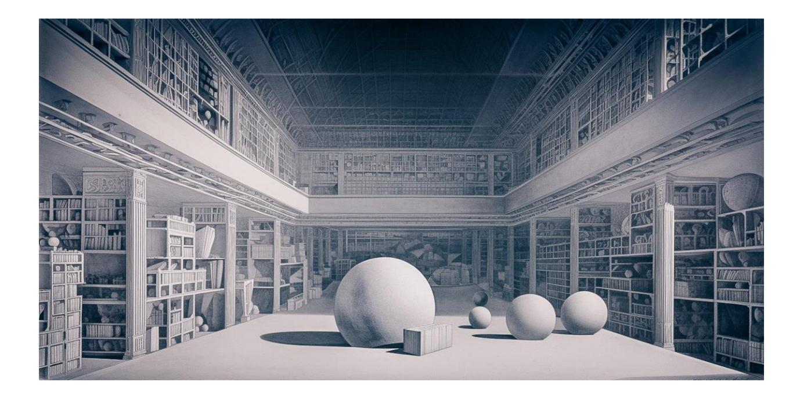

Figure\_7.09. Lev Manovich, *Architecture for a Universal Library* series, generated with Midjourney AI and edited in Lightroom software, 2023.

#### A Letter to a Young Artist

"I have completed the construction of my burrow and it seems to be successful." "...[T]he most beautiful thing about my burrow is the stillness. Of course, that is deceptive. At any moment it may be shattered and then all will be over. For the time being, however, the silence is with me." - Franz Kafka, *The Burrow,* 1924.

The key difference between me, a human, and generative AI: I am limited, but AI is unlimited. Yes, of course: it has significant limits now, in practice. But it advances fast, and what it can already do today is beyond what we could have imagined a year ago. During this one year (11/2022 - 11/2023), we got ChatGPT, Dalle-3, AI functions added to Photoshop, Midjourney v5… Instead of dwelling on what AI can't do at this particular moment, it is safer to assume that what it "can" will only multiply.

Because of how human skills, learning and memory works, I have limitations. I can't draw in hundreds of styles of other artists or effortlessly combine them together. I don't have knowledge of the immense *museum without walls* distributed over the web and museum databases. But AI can. And it will only get better.

I can't simply sit down and start writing summaries of numerous topics in the history of culture. AI can. I can't instantly make hours of music that mixes the languages of different composers and map them into new instruments. AI can.

"I can't… but AI can." (Endless other examples can be added.)

So why make art now? And what art will still be meaningful to make?

What is interesting about human art now is our limits - and obsessions. Our inability to instantly think and paint exactly like any one of the millions of artists who lived. Our inability to quickly change. The way I walk, talk, my habits. My constraints. This is what makes me human as opposed to an AI. The latter will continue to evolve. But human evolution does not work on the same scale.

Note that this is not about simulating my idiosyncrasies and thus making AI "more human." Yes, we can do it, but that's not interesting. It is like taking a Boing 777 around the block to get groceries. Its forcing super-humans to act like humans, and this is a banal and weak strategy.

And there is another crucial point to make. *What makes art "human" is not our intentions, plans, ideas or meanings. For over 100 years, modern artists did their best to remove all this from their art making.* If you give AI a direction, it can perfectly simulate ideas, plans and meanings. So, this is not relevant.

The only relevant thing is our limitations. Our inability to compete with the superhuman. With the web, with search engines, with recommendation engines, with huge databases, with machine learning algorithms, with Generative AI - and other super-human computer technologies to come.

Therefore, "human artists making art with AI tools" is a meaningless idea. You want to collaborate with Gods? A mortal "collaborating" with Apollo, Athena, Hephaestus, Hermes, Zeus?

Instead, nurture your limitations. Be extremely limited—not unlimited. Don't be "creative." Forget the meaningless idea that AI will help us "expand our creativity."

Work within constraints—the ones you already—or the ones you can make on purpose. White on white. Black on black. This is the right direction. Instead of a vast surface of "endless possibilities," concentrate in a single spot and go as deeply as possible.

(Think like Morandi rather than like Picasso.)

Make a tiny hole in the vast surface of everything that was already created and everything that is still possible, and keep digging. When you get completely tired digging meters of wrong underground paths, get lost again and again, and want to give up, it means you are finally close to something. Keep going.

Because AI is so vast and endless in its knowledge and skills, you needed to work on the micro-scale. Very narrow. So narrow that AI can't quite get there. Through the needle eye. Only in this way can you compete with superhuman generative AI.

The artist needs to become a mole. And you need to be constantly stressed and worried because AI can discover your hole at any time and, in an instant, destroy all the underground pathways you have spent years making. But perhaps this stress, this endless anxiety, is the right motivation for making something original and authentic in the end. Making your art in secret, knowing that you can be discovered and erased tomorrow by AI progress.

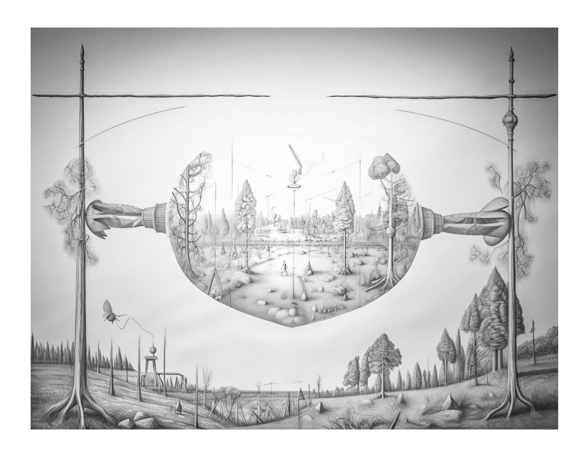

Figure\_7.10. Lev Manovich, *In the Garden*, generated with Midjourney AI image tool and edited in Lightroom software, 2023.

#### Notes

- 1 On the history of early paint programs, see Smith, A. R. *Digital paint systems: An anecdotal and historical overview*. Retrieved from <https://ohiostate.pressbooks.pub/app/uploads/sites/45/2017/09/paint.pdf> Smith, A. R. (2021). *A biography of the pixel*. MIT Press.
- 2 Corel Painter. *Wikipedia*. Retrieved September 27, 2024, from. [https://en.wikipedia.org/wiki/Corel\\_Painter](https://en.wikipedia.org/wiki/Corel_Painter)
- 3 See *SIGGRAPH '22: ACM SIGGRAPH 2022 Conference Proceedings.* (2022). <https://dl.acm.org/doi/proceedings/10.1145/3528233>
- 4 Manovich, L. (1992). Assembling reality: Myths of computer graphics. *Artificial Intelligence Review, 20*(2), 12-14. See also Manovich, L. (2001). *The language of new media: Part 4: The illusions*. MIT Press.
- 5 For the detailed analysis of media software and its conceptual origins, see Manovich, L. (2013). *Software takes command*. Bloomsbury Academic.
- 6 MidLibrary. *Midjourney styles in artistic techniques category*. Retrieved September 26, 2024, from<https://midlibrary.io/categories/techniques>
- 7" Mitchell, W. J. *MIT Press*. Retrieved September 26, 2024, from <https://mitpress.mit.edu/author/william-j-mitchell-2911/>
- 8 Mitchell, W. J. (1996). *City of bits: Space, place, and the infobahn* (revised ed.). MIT Press.
- 9 *Main Course.* VKHUTEMAS. Retrieved September 26, 2024, from [https://www.vkhutemas.ru/en/structure-eng/faculties-eng/main-course/.](https://www.vkhutemas.ru/en/structure-eng/faculties-eng/main-course/) See also Bokov, A. (2021). *Avant-garde as method: Vkhutemas and the pedagogy of space, 1920–1930*. Park Books.
- 10 See for example Karras, T. et al. (2023, July 4). Analyzing and improving the image quality of StyleGAN. *arXiv*.<https://arxiv.org/abs/2307.01952>
- 11 For the overview of available deep networks visualization methods, see How to visualize deep learning models. (2023, November 14). Retrieved from <https://neptune.ai/blog/deep-learning-visualization>
- 12 See for example, Podell, D. et al. (2023, July 4). SDXL: Improving latent diffusion models for high-resolution image synthesis. *arXiv*.<https://arxiv.org/abs/2307.01952>
- 13 Manovich, L. (2018). *AI aesthetics*. Strelka Press. Retrieved from <http://manovich.net/index.php/projects/ai-aesthetics>
- 14 LAION-5B: A new era of open large-scale multi-modal datasets. (n.d.). *LAION*. Retrieved September 27, 2024, from<https://laion.ai/blog/laion-aesthetics/>
- 15 See Projects. *Cultural Analytics Lab*. Retrieved September 27, 2024, from <https://lab.culturalanalytics.info/p/projects.html>

16 See Manovich, L. (2020). *Cultural analytics*. MIT Press.

[https://www.e-flux.com/architecture/chronograms/528659/a-short-but-believable](https://www.e-flux.com/architecture/chronograms/528659/a-short-but-believable-history-of-the-digital-turn-in-architecture/)[history-of-the-digital-turn-in-architecture/](https://www.e-flux.com/architecture/chronograms/528659/a-short-but-believable-history-of-the-digital-turn-in-architecture/)

18 For sources of this and other quotes from Balzac, see Honoré de Balzac. *Wikipedia*. Retrieved September 27, 2024, from

[https://en.wikipedia.org/wiki/Honor%C3%A9\\_de\\_Balzac](https://en.wikipedia.org/wiki/Honor%C3%A9_de_Balzac)

- 19 See Juergen Schmidhuber, *Annotated History of Modern AI and Deep Learning*, arXiv, December 29, 2022,<https://arxiv.org/abs/2212.11279>
- 20 Rendell, J. (2021, July 14). Fragment of the imagination: Assembling new narratives from old. *The Architectural Review*. [https://www.architectural](https://www.architectural-review.com/essays/keynote/fragment-of-the-imagination)[review.com/essays/keynote/fragment-of-the-imagination](https://www.architectural-review.com/essays/keynote/fragment-of-the-imagination)

17 For discussions of imitation in relation to AI, see Carpo, M. (2023). *Beyond digital*. MIT Press., and also Carpo, M. (2023, July 21). A short but believable history of the digital turn in architecture. *e-flux Architecture*.

# **From Tools to Authors**

#### Emanuele Arielli

"If you heard someone playing the piano, would you ask: 'Is the piano the artist?' No. So, same thing here. Just because it is a complicated mechanism, it doesn't change the roles […] The typewriter enables someone to write a book. For me, the keyboard enables me to write code, […] there are neural networks involved that maybe you could say that they are my brushes that I learn to use." Mario Klingemann, 2019.[1](#page-166-1)

In philosophy of mind, we talk of "extended" mind referring to the fact that tools and technological advancement, including writing and memory devices, allowed to externalize and extend human mental processes in the outside environment. Technology enhances our "bounded rationality" (H. Simon) and extends our senses (M. McLuhan) that are limited by biological constraints. We have for instance limited memory, therefore writing and documents helped us to externalize and extend our capacity to recall. We have biologically limited visual acuity, but microscopes and telescopes allowed to amplify what could be visible to us. Similarly, our cognitive abilities to process numbers and data have upper limits, but calculators and computers have enabled us to surpass these boundaries.

Under this premise, machine learning and AI should be considered a further step in our *tool-making* ability in expanding humans' skills through devices. Therefore, their impact should be measured in their influence and contribution to human potentialities, not necessarily in their potential autonomy from human choice. The extended mind paradigm could be here coupled with an understanding of technology not as a separate entity from human nature, but as a process of integration and augmentation between mind and technology.

### Extended Aesthetics

It would be naïve to think that the human brain is suboptimal only in terms of memory and calculation. Other human faculties, such as imagination, perceptual sensitivity, emotional recognition and expression, and creativity, also have natural limits. Since these faculties are crucial in aesthetics, one could argue that humans possess not only "bounded rationality" but also "bounded aesthetic capacities." Although we can train and expand our aesthetic skills—both in appreciating and creating aesthetic objects our biological limits mean we eventually reach a plateau, a "peak aesthetic sensitivity" and "peak creativity." Just as bounded rationality can be extended through external tools, our bounded aesthetic capabilities might also be enhanced and supplemented by tools that assist in the creative process. Our abilities to articulate ideas in writing may suffer from cognitive limitations as well: in this context, Large Language Models often come to our aid, suggesting responses to letters, helping to draft emails, and contributing to the clarity and persuasiveness of texts of all kinds. AI language models increasingly resemble a hidden assistant, providing clever responses and clear formulations, much like how Cyrano de Bergerac fed lines to Christian in the famous fictionalization of his life. These systems do the heavy lifting behind the scenes, granting users access to a vast array of knowledge and eloquence they might not possess on their own, thereby expanding human expressive possibilities.

Aesthetic has always been *extended*. All tools we use, from chisel for woodcarving or sculpting, to brushes for paintings to musical instruments and camera for photography, can be seen as extensions of our ability to create aesthetic artifacts. A brush can distribute chromatic pigments on a canvas in ways that we wouldn't be able to achieve with our hands alone. The simple act of sketching by hand on paper is a fundamental method of externalizing the images that arise in our minds, where both the productive and receptive sides work together in a continuous feedback cycle: since our working memory has limited capacity to retain an idea, we lay it down on paper. Our eyes then observe the sketch, allowing us to rework and develop the idea in an iterative and productive cycle between the eye, mind, sketching hand, and image on paper. Throughout history, the ability to create images has been one of the primary methods for externalizing memory and imagination, preserving them in tangible, enduring forms.

The tools that modern artists and designers use, like image editing software, computeraided design (CAD) programs, and music production software, can be seen as modern extensions of human creativity as well. These technologies essentially distribute part of the aesthetic decision-making process outside of the artist's mind. A composer or writer stuck in their creative process might use more and more advanced systems that offer suggestions, evaluate alternative directions, test whether their ideas might receive a

#### Chapter 8. From Tools to Authors - 147

positive response from the public, and so on. One notable example is the case of composer David Cope in the early 1980s. He found himself struggling with severe composer's block while working on a commissioned opera. Rather than pushing through, he diverted his attention to developing a music composition program, a project that eventually evolved into what is now known as Experiments in Musical Intelligence, or EMI (often referred to as Emmy). EMI analyzes existing musical works in its database and generates new compositions in the same style, without simply copying the originals. Through this program, Cope has created thousands of works in diverse styles, including 5,000 Bach-likes chorales.

"Extended aesthetics" refers not only to the fact that tools broaden our creative possibilities, but also to the idea that sensibility, taste, intuition, and imaginative processes can be externalized as well. In this context, the extension through external devices affects not only production but also reception. Just as photographic reproduction has simultaneously extended and modified our perception of reality by creating new possibilities for artistic production, so too do the analysis and generation capabilities of new AI applications extend and modify our perception, as discussed in Chapter 6. Advanced systems of cultural analysis can deepen our understanding and aesthetic sensibility, for instance, by finding subtle associations or similarities between objects, comparing variants of similar artifacts, and detecting relevant details that we were previously unaware of. Various forms of artificial image post-production, translation, stylistic transfer, and morphing encourage us to view things through the lens of these transformative possibilities. By presenting new possibilities, these processes can change and refine our perception and taste, as is already evident with the content we encounter through recommendation systems.[2](#page-166-2)

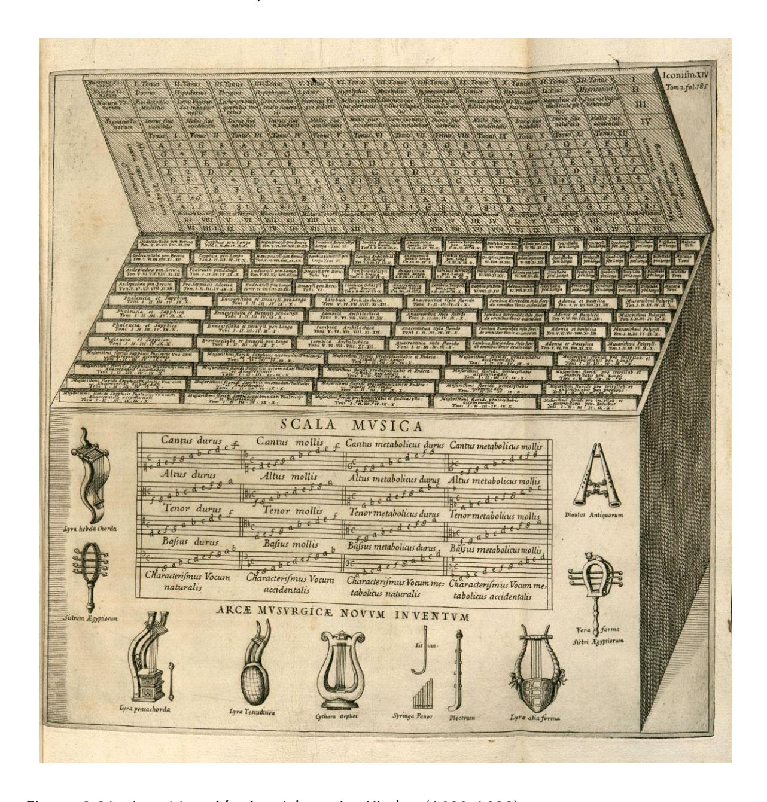

Figure\_8.01. *Arca Musarithmica*, Athanasius Kircher (1602-1680).

An early example of generative aesthetic device is the *Arca Musarithmica*, conceived by the German Jesuit Athanasius Kircher (1602-1680), a system based on tables and strips engraved with various musical elements, such as rhythms, melodic fragments, and harmonic progressions. By manually selecting and combining these elements and following a set of instructions provided by Kircher, it was possible to create compositions by adjusting mood, meter, and desired style. For many observers, this was the first algorithmic system for creative music generation. Since the user can randomly decide the parameters, the *Arca Musarithmica* also anticipates modern

aleatory compositional techniques: the user, while adjusting general parameters, could not predict what kind of composition the system would ultimately generate.

By systematizing the creative process, Kircher's goal was to allow even non-musicians to compose music, as expressed in his 1650 treatise *Musurgia universalis*. Extending human capabilities allows individuals without specific skills to practice at a level that would otherwise only be possible for those with expertise. A generative device, in some ways, encapsulates expert skills codified in a tool external to our mind. In this sense, generative systems allow those who don't know how to draw to produce drawings according to their instructions, or those who don't know a language to produce a text in that language. For some, this might represent a democratizing step, similar to how Walter Benjamin viewed the democratization of art through the possibilities of access created by the technical reproducibility of artworks.

As we enhance human faculties with devices, we still remain interested in assessing an individual's capabilities without such technological aids. For example, in a chess tournament between people, we are obviously interested in understanding a player's ability without the use of a chess program. Similarly, we measure the athletic qualities of a runner by making them run with their legs, not with a means of locomotion. While a motorcycle allows anyone to move quickly, only a few individuals achieve Olympiclevel performances using just their own physical capabilities.

The concern here is that relying on technological extensions may lead to the atrophy of skills previously developed without them. For instance, the widespread use of pocket calculators has corresponded with a decrease in average mental and manual calculation abilities. Recent studies on the use of language models in schools show mixed results. While groups using these systems perform better in text composition, individual performance suffers when the technological aid is removed. Students using AI language models as a "crutch" may find their skill development impaired. [3](#page-166-3)

As generative AI develops in fields like text, image, and music production, it raises the question of whether it's important for individuals to know how to excel without these tools. In fact, using them in art is often viewed as "cheating." This perspective is relatively new in creative contexts, except for certain professional photography competitions where digital postproduction is not allowed. Should we imagine poetry competitions where poets are not allowed to use language models? Or architecture awards where the use of generative systems is banned? Outside of specific competitive contexts, the field of cultural, aesthetic, and artistic production generally doesn't impose such creative constraints. If a musician's goal is to create the catchiest song possible, they may freely use systems that quickly generate musical variations.

Similarly, in film or series production, algorithmic evaluation systems are tools used to reach maximum audience appeal. A platform like Netflix, for instance, has transformed movie and TV production with its data-driven approach. [4](#page-166-4) By analyzing viewer preferences, they can predict which new shows will succeed and decide whether to continue existing series. This method examines specific elements that resonate with audiences, like certain scenes or episodes. The step from algorithmic data analysis to AI systems generating screenplay ideas is relatively short. As AI technology advances, future content creation could plausibly involve AI-generated storylines and concepts based on the vast amounts of viewer preference data collected by streaming platforms.

#### From Tools to Agents

Advancements in AI are likely to evolve beyond the simple user-tool interaction. We're moving towards a more collaborative, dialogic, and iterative relationship between humans and machines. In this new paradigm, the machine's responses may not be easily predictable by the user. Instead, they will generate new ideas and directions, stimulating the user's own creativity and thought processes. One aspect of this technical evolution is the increasing decisional autonomy of devices. However, we often use the verb "decide" metaphorically when discussing machine actions. For instance, is a thermostat "deciding" when to stop heating based on a target temperature comparable to a self-driving car "deciding" to adjust its speed according to traffic conditions? There is no clear boundary between tools and entities with autonomous agency, just as there is no sharp distinction between a metaphorical and literal use of a term like "decide" (see Chapter 3). An attempt to classify the levels of autonomy in AI systems is, for example, the one suggested by Google DeepMind researchers, who propose a taxonomy of six levels.[5](#page-166-5) At the lowest level (Autonomy Level 0: No AI), we find mere tools, such as a hammer or scissors, or in the artistic context, these could include analog tools like pencils and brushes or basic digital image editing software. At this level, humans do everything.

Moving up to Autonomy Level 1 (AI as a Tool), we encounter systems that automate secondary tasks while remaining under full human control, such as a thermostat regulating room temperature, software correcting text grammar, or performing translations. In the context of art, this could include machine learning-based tools for image enhancement, color correction, or style transfer. These tools augment human creativity but do not independently generate original content. For example, every modern phone is equipped with a system that helps a photographer by automatically adjusting exposure and color balance, but the artistic vision and composition remain firmly in the hands of the human artist. Even early generative programs based on well-

#### Chapter 8. From Tools to Authors - 151

defined computational procedures can be considered as belonging to this level. A. Michael Noll, a 1960s pioneer in computer art, programmed digital computers to mimic works by artists like Mondrian and Riley. His innovative approach combined specific algorithmic instructions with pseudo-random permutations.

At Autonomy Level 2 (AI as Advisor), AI takes on a substantive role, but only when invoked by a human. In the field of generative art, this could manifest as systems that can assist the artists guiding them through their process. For example, various platforms offer tools for music composition that leverage AI to enhance creativity. These tools can assist composers in exploring new musical ideas and structures, making the creative process more efficient and innovative. Machine learning systems that classify human emotions during music listening (applied, for example, by platforms like Spotify) can be used as an assistive tool for musicians to optimize their compositions.[6](#page-166-6)

Progressing to Autonomy Level 3 (AI as Collaborator), the relationship between human and AI becomes more balanced, with interactive coordination of goals and tasks. In this case, the AI is capable of doing things that the human is not equipped for: think of a chess program guiding a human player's game. In the context of artistic creation, this level could be represented by systems that can engage in a creative process of mutual exchange with the human artist. The AI might propose compositions, color schemes, or stylistic choices, while the human provides feedback, refinements, and overall artistic direction. For example, a system like DALL-E or Midjourney generates images according to the artist's linguistic prompts, which the artist then refines, combines, or modifies according to their needs. The AI acts as a creative partner, offering suggestions and possibilities, but the human artist maintains primary control over the final artwork.

Autonomy Level 4 (AI as Expert) pushes the balance further towards AI dominance, with the AI system guiding the interaction while the human provides orientation, feedback, or performs secondary tasks. In aesthetics, this could manifest as highly sophisticated AI systems capable of generating entire artworks based on high-level concepts or themes provided by human curators. The human's role becomes more akin to that of an art director or curator, shaping the overall vision while the AI handles most of the creative execution.

These autonomy levels aren't rigid or mutually exclusive. AI systems in art often display traits from multiple levels, varying with the application and context. As AI evolves, these boundaries may blur further. Systems could shift between autonomy modes depending on the task and, crucially, how much control the human artist chooses to retain. Finally, at Autonomy Level 5 (AI as Agent), we encounter fully

autonomous AI systems, a purely speculative prospect at present. This represents a theoretical endpoint where AI systems could conceive, create, and potentially even critique their own artworks. Importantly, "agency" and autonomy in this context don't refer to problematic concepts like "free will" or "consciousness." Instead, they denote the capacity for autonomous goal-setting, goal execution, and the collective recognition of such autonomy. [7](#page-166-7)

Art history provides several examples of the relationship between an artist and a "collaborator." In Renaissance workshops, masters worked alongside collaborators and apprentices, guiding the production of works and often contributing to key elements such as drawing, composition, and final touches. While apprentices and assistants frequently executed parts of these works, the finished pieces were usually attributed to the master, considered the creative force behind the work. An apprentice, typically a child, would start as an assistant with a purely "tool-like" function (mixing colors, preparing canvases), then gradually climb the autonomy hierarchy, progressing to collaborator and eventually becoming an autonomous master.

From the Renaissance through the 17th century and beyond, not all paintings from established workshops were entirely the master's handiwork. Artists like Giotto or Raphael gave ample space to workshop collaborators, while others, like Michelangelo, were reluctant to entrust work to others. Regardless of the assistants' autonomy levels, the master maintained overall creative control and authorship. The assistant was neither an expert nor an autonomous agent until leaving the master's workshop.

A similar dynamic exists in contemporary production of ready-mades and conceptual artworks. Here, the artist typically determines the idea, while another individual—an artisan or technician—realizes it physically. The legal dispute between Italian artist Maurizio Cattelan and French sculptor Daniel Druet exemplifies this. Druet, who created several of Cattelan's famous sculptures, including the iconic kneeling Hitler, sued Cattelan in 2021, claiming authorship and seeking recognition and compensation.[8](#page-166-8) The court ruled in Cattelan's favor, upholding the principle that in conceptual art, the idea's creator is the author and copyright holder, even when others execute the physical work. Cattelan's role thus resembles an art director's, defining the conceptual framework while leaving physical execution to others. The Renaissance workshop model often involved direct master involvement, even if mediated by others' hands. The master's signature guaranteed quality and authenticity. Contrastingly, Cattelan's approach more sharply divides conceptualization and execution, often excluding the artist's hand from physical creation. This shift emphasizes ideas over craftsmanship, reflecting changing values in contemporary art.

In AI-assisted art, the lines between creator, tool, and collaborator are increasingly blurred. The key question is: At what point does AI transition from tool to collaborator or creator? This transition likely depends on both the AI system's capabilities and how the human artist chooses to use it. A passive user who simply follows the AI's instructions to realize a work or artifact essentially attributes greater creative agency to the system. Conversely, an expert user with technical skills and clear vision uses AI to enhance their work while maintaining creative control, relegating AI to automating technical tasks without influencing artistic vision. This mirrors the difference between an expert photographer manually adjusting camera settings and a novice relying entirely on automatic modes.

We can draw parallels between AI-generated artworks and the artist-technician relationship, with output control varying based on the artist's involvement and reliance on the AI "artisan." However, a key difference lies in the usage rights: while AIgenerated works can often be freely used by their creators, it is debated if they should be considered the creators' own works. For instance, when a user utilizes a paid version of Midjourney to generate an image, they receive a license to use the image for personal and commercial purposes. In this sense, they "own" the image but do not obtain exclusive copyright. This situation implies that a third party could potentially use the same image for commercial purposes without infringing on copyright laws (though it would breach community guidelines), as there is no exclusive copyright on the image itself.[9](#page-166-9)

Who owns the copyright when an AI system generates a piece of work?[10](#page-166-10) A recent case that highlights this issue is the U.S. Copyright Office's initial decision to revoke the copyright of the graphic novel "Zarya of the Dawn," by Kris Kashtanova, after discovering that the images were generated using Midjourney. The decision was based on the premise that there must be "substantial human involvement in the creative process" for a work to qualify for copyright protection. However, partial rights were later granted because the arrangement of the images and the text of the story were the product of Kashtanova's own creative efforts.[11](#page-166-11)

European Union law distinguishes between different stages of the creative process: conception, execution, and "redaction" (that is editing, modification in postproduction, refinement). Even when using AI, humans might not control the execution but still have authority over the conception and redaction stages, potentially allowing them to claim copyright. However, proving that a human has exerted sufficient creative control and intellectual effort to claim authorship remains a challenge.[12](#page-166-12)

Since AI-system cannot copyright their own work, there are two prevailing theories for assigning copyright ownership of AI-generated work. The first theory considers AI as if it were an employee working for an individual or organization, such as a company. Under this view, the copyright for AI-generated work would belong to the entity responsible for creating or operating the AI. This could be either the individual programmer who developed the AI or, more likely, the company that employs the programmer and owns the AI system. The second theory treats AI as a consumer product, in which case the end-user or customer who uses the AI tool would hold the copyright. [13](#page-166-13) While a programmer is indeed responsible for creating the AI system's creative capabilities, this alone may not be sufficient to establish ownership rights, particularly in the case of generative AI. In these advanced AI models, the programmer merely creates the *potential* for output generation, rather than directly producing the final work. Similarly, it would be inappropriate to assign copyright of a painting to the artist's teacher rather than to the artist themselves. The teacher, like the AI programmer, provides the tools and knowledge, but does not create the final work. This situation is fundamentally different from earlier, rule-based AI systems where the programmer's role was more direct, since there was no involvement of intermediate users, and had a significant impact on the output.

## The Goddess of Chance: The (Perceived) Autonomy of Randomness

In the question of the relationship between tools and agency, a difference in attitude emerges between professionals and the general public. On one hand, professionals aspire to use AI as a tool, aiming to maintain detailed control over the output and preserve the possibility of customization and fine-tuning. From this perspective, "generative AI" tools would be nothing more than advanced forms of digital processing, comparable to software like Photoshop.

Systems based on diffusion models, like MidJourney, are significantly more complex. These models learn to map textual descriptions to visual elements during their training phase. The process begins by adding noise to images, creating corrupted versions. The model then learns to reverse this noise, gradually refining the corrupted images back to their original state. In the generation phase, when given a text prompt, the model starts with random noise. It then progressively reduces this noise, guided by its learned textimage associations, to create an image matching the description. This "denoising" process transforms abstract, compressed information into detailed, coherent outputs. The final image is a blend of the model's structured knowledge and random elements.

While random processes enable text-to-image models to create diverse outputs, users can exert precise control over the details through various methods. For example, they can provide specific feedback to iteratively refine the generated images, gradually steering the output toward their desired result. Another is through conditional inputs, where users provide detailed textual description, or mix text with sketches and reference images. By means of latent space manipulation users can interact with the latent space representation of the image by tweaking latent vectors. A user can control all levels of the generation, from very global attributes to very fine details, thus controlling different layers of generations.[14](#page-167-0)

Many are fascinated by the patterns generated by a *kaleidoscope*, which produces regular aesthetic structures through a system of mirrors, resulting from random processes that arrange colored fragments inside a tube. Subjectively, we are inclined to attribute creativity or even a kind of autonomy to unpredictable and random outcomes. We tend to perceive something as creative and autonomous when we cannot rigidly predict its behavior. Conversely, what is predictable and determinable appears neighter autonomous nor creative to us.

Also the public's fascination with AI similarly stems from its unpredictability. If AI systems were perfectly controllable and customizable - as professionals might prefer they might lose their appeal as "AI". We tend to call systems "AI" when they surprise us with unexpected outputs. This unpredictability comes from the use of stochastic processes in both the learning and generation phases of AI. These random elements prevent the system from being entirely deterministic and predictable.

However, not everything that is the result of chance and unpredictability looks creative or autonomous; disordered and meaningless chaos does not. Instead, it's the unpredictability imbued with meaning that captures our imagination as potentially creative or autonomous. The geometric shapes in a kaleidoscope represent a blend of randomness and structure, producing distinct and unique patterns with every turn.

This brings us back to the classic experiments of historical avant-gardes with chance and randomness. Movements like Dadaism and Surrealism, as well as subsequent experiments of Neo-Dada, for example in John Cage's aleatoric music (which was inspired by Marcel Duchamp's works on random music generation), were fascinated by the possibility of creation that escaped authorial control. Chance enables the creation of works that look less artificial—that is, less like products of human artifice by mimicking the spontaneous phenomena of physical nature.[15](#page-167-1) As Cage said: "My *intention* is to let things be themselves".[16](#page-167-2) A line of continuity can be traced between

these experimentations and subsequent explorations of generative art and computer art, where the unpredictable element becomes an essential component for producing something that has the appearance of creativity that goes beyond the hard-wired instructions inserted by the programmer.

It's interesting to note the conceptual origin of terms that are apparently opposite to each other, such as "autonomy" and "automaton".[17](#page-167-3) The ancient Greek noun *automatismos* is defined as "that which happens of itself, by chance", the verb *automatizo* means to "act of oneself, act offhand or unadvisedly", "[to] act spontaneously", [to] happen of themselves, casually". Similarly, "Automatia" was an early name for Fortuna, the goddess of chance[18](#page-167-4). Aristotle, in the second book of his "Physics," introduces the term "automaton" to describe a set of phenomena that includes "tyche" (fortune). He portrays these phenomena as forces that disrupt the teleological order, essentially embodying random or chance events in nature[19](#page-167-5). Aristotele stresses the role of the accidental also in the aesthetic domain of the tragedy. In "Poetics" (Book IX), he emphasizes how unexpected events can become especially meaningful in storytelling, but that coincidences in tragedy are most impactful when they seem to have an underlying design or purpose (an "air of design"), despite their apparent randomness.[20](#page-167-6)

In essence, it's not the inherent randomness of spontaneous phenomena that surprises us; if it were the case, we'd find every random sequence of coin tosses or dice rolls surprising and creative. Rather, what captivates us is the apparent significance of these occurrences – when chance events seem to possess an *air of design*. This is why we aesthetically admire the patterns in a kaleidoscope: although they result from the random and spontaneous arrangement of colored fragments, the symmetry created by the mirrors gives them a sense of structure.

Although Aristotle suggests that chance events in physics lack discernible causes, hinting at a form of autonomy, these phenomena still emerge from natural processes and fall short of genuine autonomy in the fullest sense. True autonomy goes beyond unpredictability and accidental spontaneity, it requires agency and the ability to *initiate* action. The truly autonomous subject is, so to speak, left to venture alone into the world, guided by its system of motivations and knowledge, which is partly shaped by contingent encounters throughout its experiences. In more philosophical terms, using a concept from Saint Augustine, an autonomous being must possess an *initium*—a beginning that is not causally determined. This idea has been revisited in contemporary times by Hannah Arendt in her book *The Human Condition*. [21](#page-167-7) For Arendt, the essence

of human freedom lies in the subject's ability to "enter the world" without predetermination, equipped with the capacity to initiate something new.

In the context of AI, we are still far from creating entities that we may "let go into the world", giving them such autonomy as to make the machine's action completely unpredictable. This is partly because we would need to equip them with objectives, a motivational system, impulses, instincts, and "needs" whose (dis)satisfaction would drive them to act. Otherwise, even the most virtuous AI-artist, free to choose, might end up happily sitting idle. Instead, we grant these entities degrees of freedom in the form of predetermined doses of randomness.

In contemporary art, there is an interesting parallel with practices involving entities that possess their own natural agency, such as animals or plants. Examples include artworks were growth chambers encouraging specific types of vegetation to bloom, installations cultivating bacteria or fungi, or performances where artists interact with animals. These artists "use" nature—complex, spontaneous mechanisms guided by intrinsic principles rather than artistic design. In this way, they free natural elements within their work, allowing them to unfold with minimal intervention. These "agentic tools" occupy a middle ground between mere instruments and fully autonomous agents.

Artificial agentic tools also appear in artistic practices. For example, artist Mario Klingemann developed his project BOTTO as a decentralized autonomous artist that creates artwork using AI and community input. Launched in 2021, BOTTO produces about 350 new pieces weekly, voted on by a community of 5,000. These votes influence future creations by giving an aesthetic ranking. Klingemann sees his role as a guardian, initially guiding BOTTO but allowing it to gain independence over time. According to the artist, this approach resembles releasing a child into the world, trusting it will continue as its creator intended, much like parents do, but without having control over it.[22](#page-167-8)

#### Artificial Author and Authorial Intentionality

Let's return to a similar scenario with which chapter 3 opened: imagine you've just finished reading a novel that has left you spellbound. The prose is mesmerizing, the characters lifelike, the plot rich and emotionally resonant. You feel a deep connection with the author, admiring her emotional depth and understanding of human nature. Then you discover that the work was actually produced with an AI (or more precisely: by humans who used an AI). How would this make you feel? Would your admiration

wane, to be replaced with a sense of disillusionment or even betrayal? Would the story lose its vibrancy? The characters in the novel feel less real?

AI's emergence is reshaping how the public and users perceive authorship, a concept related to but distinct from copyright, as it involves the perception of the source of a creative act to which we attribute both the origin and value of a work. The current debate is marked by heated opposition, where discussions often confuse the issue of the quality of AI-generated works with the question of their artificial nature. When these works are deemed meaningless or "not art," it is often unclear whether this judgment arises because they are aesthetically poor or simply because they are artificial.

The more traditional notion of authorship holds that part of the aesthetic appreciation we have for a work of art, a song, or a novel depends essentially on our awareness that behind the work there is a creative intention, along with the inferences we can draw from what the author intended to say. In other words, we take for granted that perceiving the mind behind a work of art is a fundamental component of our aesthetic engagement. It follows that we may not truly appreciate a work knowing it is the product of a machine lacking authorial intent, experience, or even consciousness, but merely "instructed" by humans to generate such products.

The question of authorship has been a focal point in philosophical and literary discourse, particularly in the context of structuralism and its successor, poststructuralism, according to which it is not possible to attribute a privileged and unique source of meaning to an author of a work of art. Roland Barthes famously declared the "death of the author" in his 1967 essay.[23](#page-167-9) He argued that the author's intentions and biographical context should not dictate the interpretation of a work, since every text is the product of a complex web of influences, a "tissue of citations" and traditions, the recombination of a whole cultural past and social context. A text is the result of other texts and authors that speak through the pen of the alleged "autonomous" writer. Even before structuralism and post-structuralism, according to the New Criticism it was important to avoid the "intentional fallacy", a term coined by W.K. Wimsatt and Monroe Beardsley in 1946.[24](#page-167-10) This principle challenges the practice of interpreting and evaluating a work primarily based on the author's intention, arguing instead for a focus on the work's content and the reader's experience. According to the New Critics, the author's intention is neither available nor desirable as a standard for judging the success of a work of literary art. Instead, New Criticism promoted an analytical methodology that emphasized the text's complexity, unity, and the interplay of its constituent elements.

This tradition can also be linked to earlier avant-garde art experiments that explored artistic creation through reducing or even neutralizing the artist's control. As we saw in the previous paragraph, avant-garde movements like Dadaism and Surrealism used techniques such as chance and automatism to encourage spontaneous and collective creativity, thereby lessening the artist's role. For example, the Surrealists' endeavor to emulate a "machine-like" state was evident in practices like automatic writing. However, while avant-garde experimentation and automatically generated art emphasized liberation from human decision-making and control by means of stochastic processes or mechanic procedures (that nevertheless, one should not forget, still adhered to the creator's initial intent), contemporary AI-generated content introduces a novel form of autonomy with its own control and decision-making capabilities: human authoriality seems replaced by another form of authoriality that *mimics* the human one. Moreover, theories about the "death of the author", though philosophically compelling, have not actually truly manifested in public attitudes. Humans perceive intentionality in everyday life and, as a result, we continue to think in terms of authorship when encountering human-made cultural products.

In understanding the mechanism of authorship attribution, we could define two conceptual and psychological *thresholds*, which I would call the "threshold of instrumentality" and the "threshold of authorial relevance":

- a) The first threshold, discussed in the previous pages, concerns the general question of the boundary between agency and its tools—specifically, where we draw the line between viewing a system as possessing autonomy or as a mere extension of the user. This threshold addresses the question of "where" the author is situated. The intermediate cases we have examined (such as assistants, collaborators, etc.) suggest that this threshold is not a distinct line but rather consists of a spectrum of intermediate cases.
- b) The second threshold, the threshold of authorial relevance, focuses on determining in which contexts the presence of an author is relevant. As we discussed in Chapter 3, there are certain areas where the perception of an author behind a work seems relatively unimportant for aesthetic appreciation. While agency and intentionality are significant in some forms of cultural production, they are not necessarily crucial in others.

On one hand, we can aesthetically engage with phenomena that lack a "mind," as they are not the product of human activity—like landscapes, flowers, or other natural structures, although, for some, even these might be considered the result of divine intentional creation. In cases where authorial intention is irrelevant to our appreciation,

#### Chapter 8. From Tools to Authors - 160

we tend to focus primarily on the formal, aesthetic features of the work. For example, in a beautifully designed piece of furniture or a modern architectural structure, we might concentrate on the form, the lines, the materials used, and the overall visual harmony. Similarly, we appreciate harmonious and low-fi background music for its pleasant and relaxing qualities.

In the 1950s experiment with algorithmically generated Mondrians by A.N. Noll, it was observed that the artificial images were favored over the originals for their formal qualities. This preference can be attributed to an exclusive focus on their abstract, nonfigurative style, which lacks direct symbolic meaning for the naïve observer, whose judgment ignores the link between the image and the artist's original intentions. In a way, a purely formalist view of abstract art, one that disregards the author's sensemaking, risks diminishing works like those pseudo-Mondrians to simple decorative patterns. Similarly, if we stand in front of a Pollock drip painting, we are drawn into a web of colors and patterns. But we also seek to understand the passion and the turmoil that the artist might have felt while creating this piece. The pursuit of unraveling the artist's intent adds a layer of depth to our aesthetic experience that an AI-generated Pollock, even thought formally impeccable, would not be able to offer.

A possible consequence of these considerations might be that the threshold of authorial relevance could be a demarcating criterion between "true" art, rich in meaning and relevant to the individual's subjectivity, and purely decorative, entertaining art. AI might thus find its niche in art forms where the "surface" aspect is paramount, and the presence of an author is not crucial for our enjoyment. This includes areas like background music, decorative patterns, industrial design, and formulaic narrative texts, among others. This inevitably raises the question of where to draw the line regarding the necessity of an author. When does the presence of a recognizable mind behind a work become essential for our aesthetic appreciation, and when can we do without it? The key point here is that neither of the two thresholds are fixed; their criteria for demarcation can change based on how we perceive and attribute instrumentality or intentionality. Most importantly, for works where we consider authorship fundamental, we must consider whether this threshold remains valid or shifts, allowing us to view works where authorial perception was once crucial with a new authorless perspective.

Based on the discussion above, we can summarize several theories regarding the issue of AI authorship. The first two represent opposite ends of a spectrum: the first pole is

1) The human-centric view, which considers the human author as the sole and exclusive source of all creation, with AI functioning merely as a sophisticated tool. Even when the human role is reduced to curating the machine's output, it is still the human who completes the final work. This includes concepts such as: 1.1) the "author as selector," where a person uses an AI system to generate a variety of images, sketches, designs, or texts and then curates and selects from these outputs what best aligns with their preference. Alternatively, 1.2) there is the notion of the human author as an instruction-giving "prompt-engineer," which involves using AI systems guided by linguistic "prompts," representing a newer form of indirect authorship (see Chapter 9).

- 2) The second pole sees AI as a full author. In this (potentially future) scenario, artificial intentionality or a semblance of mind would eventually be attributed to and recognized in AI-generated works. As AI technologies become more advanced, we may increasingly view their output as the work of entities with their own agency and intentionality. We might even imagine a context where AI is "free" to determine its own creative intentions and motivations, exploring and creating based on autonomous decisions.
- 3) An alternative interpretation, which draws from post-structuralism and critiques of the "intentional fallacy", views the authorship of AI-generated works as the result of a blending of sources, texts, and materials on which the systems have been trained. "Remixed authoriality" in the context of AI art suggests that works are seen as amalgamations of various influences, rather than as products of a single creative mind. This view aligns with the idea that all cultural artifacts are inherently "post-productive," meaning they are reconfigurations of pre-existing materials, challenging the traditional, romanticized notion of authorship as a unique creative expression of an individual. In this perspective, the author's role is similar to that of a curator who brings together diverse cultural elements but is not the sole source of authorship. Instead, the author becomes a conduit of a collective authorship embedded in human cultural history. This approach is especially relevant in the discussion around "remix culture", where creation involves recontextualizing, quoting, and repurposing of existing works.[25](#page-168-0) Within the "Remixed authoriality" framework, AI systems draw from extensive databases encompassing various domains of human culture and serve as a medium through which a wide array of human expressions, ideas, and cultural artifacts are processed and reinterpreted. The resulting creations are not just the products of programming by human creators but also reflections of collective human intentionality. Therefore, the outputs of these systems can be seen as manifestations of *collective authoriality*, filtered and transformed by the artificial system.

These three conceptions of authorship (the human, the machine, and the collective authorship) reflect an underlying conceptual need to identify an inspirational source that then takes shape in the intentional construction of a work. In this sense, these theories differentiate between the source of inspiration and the intentional process of a work's construction, defining various and shifting dependencies between the creator and its different "executors." Historically, entities such as "God," "the Muses," or more recently, our "cultural memory," have been seen as the primary sources of inspiration, with authors acting as channels for these higher forces. Similarly, although AI is initially designed to assist authors, its increasing complexity and influence allow it to generate content, provide inspiration, and shape creative processes. Consequently, AI might evolve from being viewed as a tool to becoming a genuine source of inspiration, with human intentionality acting as the instrumental executor of this inspiration. The individual would increasingly serve as an intermediary or facilitator, functioning as a tool for a distributed authorial intention that permeates our cultural archives and the technological means of their expression.

4) A further possibility is that AI-generated works compel us to abandon any inferences about authorial intention. In this scenario, we cease to attribute any mind behind the AI artwork, limiting ourselves to a purely formal appreciation, akin to our response to decorative patterns or design products that captivate us primarily for their superficial appearance. If the focus may move away from the idea of authorial intentionality, the primary concern would be if a work resonates with us on a personal level regardless of any hypothesis concerning the creator's identity, whether human or machine. This shift would represent a significant change in how we engage with creative works, shifting the center of our attention on the direct exposure to formal and aesthetic qualities of the work, avoiding questions about its origins. Alternatively, since we do not recognize any authoriality in AI-generated works, we could altogether avoid them, considering them "soulless" and therefore unworthy of our attention compared to true human works. Consequently, it would be significantly impactful for us to know with certainty whether the music we are listening to or the novel we are reading was produced by a human or a machine, as we might suspend our judgment on authorship and thus any aesthetic engagement only in the case of machine-produced works.

The idea that in the future there could be two distinct approaches to authorship—one for human-made products and another that does not attribute authorship to artificial products—is, however, naïve for at least two reasons. First, it will not always be possible to determine whether a cultural artifact or product—be it a text, image, sound, or piece of music—was created by a human or predominantly generated by AI. Second, our relationship with new forms of technological and cultural production could radically alter how we perceive and think about *any* kind of authorship, including traditional human authorship.

Imagine a future where it becomes increasingly challenging to determine whether a painting, a musical composition, or a written text is the product of human intelligence or artificial process. In such a scenario, the significant shift might not be in how we perceive the authorship of machines, but rather in our overall understanding of authorship. It is conceivable that our expectations and inferences about authorial intentions may weaken and diminish due to the persistent doubt over whether there is any author at all behind what we are observing. The constant uncertainty about the origin of these works might lead us to approach them with a different mindset, one less concerned with discerning the creator's identity and more focused on the work itself, independent of the underlying creative intentions. This shift could fundamentally alter how we interact with and appreciate artistic and creative works.

This "post-artificial" stance, as articulated by H. Bajohr[26](#page-168-1), foreshadows a radical shift in our approach to understanding and interacting with texts or other artifacts. The pivotal question concerns how we read a text or listen to a song when we can no longer be certain whether it was written by an AI or a human. On one side, as we discussed, this situation could open the door to the humanization of machines, suggesting that we might start to see AI as more than just tools or mechanical aids. On the other side, it also prompts a reevaluation of the human creative process, recognizing the "mechanical" aspects inherent in our own creativity and intentionality.

A "post-artificial" scenario could, for some, be seen as the practical realization of the "death of the author" theory proposed by post-structuralists. This scenario eliminates the concept of authorship, implying a lack of direct dialogue between the audience and the author, since the author is no longer present. However, this does not mean that the internal dialogue between the audience and the work ceases to exist; the work itself can express a form of immanent "authorial voice". Perceiving a specific intentionality in the text does not necessarily imply making assumptions about the actual process that produced that text (see Chapter 3). In this regard, narrative theory traditionally distinguished between *real* and *implied* authors.[27](#page-168-2) While the former is the actual writer of the text, the latter is the voice grounded in the text and expressed by its content and style. The implied author thus becomes a reader-created construct that is different from who (or what) the actual creator is: when we read a text, we imagine the writer, his thoughts, and his personality emerging from his choice of words, expressions, and sentences. Therefore, though we may know that a text has been artificially generated, we could still engage with the implied author expressed in the text, immersing ourselves in what he or she has to say. Similarly, in other artistic expressions as well, the crucial factor may be the ability of the artifact to "express" intentionality and motives, effectively allowing the construction of an authorship that emerges from the work, over and above the actual source that produced it.[28](#page-168-3) Therefore, we might instead limit ourselves to attributing an "implied" author, assuming a stance

in which we relate to the work *as if* there were an actual intentionality, suspending our judgment about the presence of a "real" (that is, human) author.

Alternatively, in the absence of an author, the viewer/listener might put themselves in the perspective of a potential author, mentally simulating their presence. In this case, the implied authoriality would become an actively *imagined authoriality*, similar to what happens in the imaginative play we engage in when observing random, inanimate forms (lines on a rock, cracks on a wall, cloud formations) and assuming that the patterns we discern in them are the result of intentional design.

#### Where Does "Effort" Go?

"This song sucks. […] Songs arise out of suffering, by which I mean they are predicated upon the complex, internal human struggle of creation and, well, as far as I know, algorithms don't feel. Data doesn't suffer. […] Writing a good song is not mimicry, or replication, or pastiche, it is the opposite. It is an act of self-murder that destroys all one has strived to produce in the past. […] It's a blood and guts business, here at my desk, that requires something of me to initiate the new and fresh idea." This is the 2023 passionate response by songwriter Nick Cave, who runs a blog called *The Red Hand Files*, to a particularly enthusiastic fan who wanted to pay tribute to the singer with a song generated by ChatGPT "in Nick Cave's style."

A critical viewpoint raised in the debate on AI-generated art is that the value of such systems' outputs is questionable due to their quick, automated and apparently effortless processes, among other reasons, as in the example of a "Nick Cave"-like song that just emulates the stereotype features of the songwriter's texts. Those products seem to lack human *effort*, there is no sign of any kind of creative struggle, which may be defined as overcoming some material, technical but also cultural and mental barrier. "Effort" also means being always plagued with the uncertainty of the outcome and the possibility of failure. An artist's creative process is more like an uncertain exploration, where the artist moves through various ideas and possibilities without a fixed path. On the other side, what these machines do appears too smooth, mechanical, and pre-determined.[29](#page-168-4) This critique also echoes certain debates that animated the 20th century, when the public and some critics questioned the apparent "ease" of certain experimental avantgarde art forms, such as ready-mades, abstract minimalism, - think of Fontana cutcanvases – conceptual art, and simple performative acts. The criticism was mostly directed to the perceived simplicity of the artists' creative "gesture", which was not considered sufficient to confer value on their work.

If (perceived) effort determines our aesthetic judgment, do we look, listen or read the work with different eyes according on how much "suffering" there is behind? Empirical evidence seems to confirm the tendency – defined as "effort heuristics" – to use effort as a proxy of aesthetic value.[30](#page-168-5) The question that consequently arises is: could this be an element of our suspicious attitude toward AI-generated artworks? Or, alternatively, could machines suffer (make effort) or at least, *show* effort?

On this point, we might observe a historically ambivalent attitude toward "effort" in craftmanship: the degree of an artist's or craftsman's skill could reveal – as said – what Leonardo da Vinci called "ostinato rigore" (stubborn rigour). But from another perspective, the wonder and admiration of the artist's product might even be inversely relates to the effort exercised in creative process. Skilled artists or craftsmen can produce artifacts with less effort compared to novices. According to a famous quote attributed to Michelangelo: "If people knew how hard I had to work to gain my mastery, it would not seem so wonderful at all". That is: the talented artist is able to show *geniality* or (even divine) inspiration *not in his effort,* but in his *ease* in accomplishing what others cannot do, or in manifesting "sprezzatura", namely the apparent effortlessness in his craft. The Latin saying "Ars est celare artem," which translates to "Art is to conceal the art," emphasizes the idea that true and valuable art often hides the effort put into its creation. This principle suggests that the most impressive art appears effortless, even though it may require immense skill and labor.[31](#page-168-6) The artist's struggle, experimentation, and refinement are hidden behind the final product, which appears natural and spontaneous. Contrary to that, excessive effort can, in a way, indicate a lack of experience or inspiration.

The Romantic era focused on the artist's internal struggle, shifting emphasis from technical proficiency to emotional and intellectual effort. This anticipated the later shift in Avant-Garde movements that valued the novelty of the idea (and the effort put to come up to it) as more important than the length of time and effort in crafting a work. Lucio Fontana's cut canvases serve as a prime example of this shift. Fontana's straightforward yet innovative act of slicing through the canvas redefined the concept of effort, moving away from labor-intensive techniques towards an emphasis on conceptual depth. Due to its non-obvious nature, these kinds of contemporary artworks always risked being perceived as irrelevant or less engaging. Consequently, it became imperative for artists, critics and art gallery curators to clearly articulate how a piece of conceptual art embodies effort and skill on a more abstract, spiritual and mental, level.

Similarly, common opinion often sees AI art as "too easy" and lacking effort: however, this view could be countered at least by two perspectives. The first aspect is that,

#### Chapter 8. From Tools to Authors - 166

beyond the most amateur uses, the work of artists who work with AI systems is not at all "simple" or automatic but requires both a deep knowledge of the medium and the technologies used, as well as a complex and detailed practice in the realization of the final work. For example, creating a sufficiently sophisticated prompt to realize the artist's precise creative idea is often an intense and demanding job that has nothing automatic or simple about it. The second aspect concerns the question about the possibility to conceive a "machine effort" or an "artificial struggle" in the generation of content by AI-systems. One reason for this argument is based on the extensive effort in developing AI technologies and the human contributions implicit in the training dataset of these systems. The outputs of these technological systems arise from the amalgamation of varied influences and content from different times, as those systems learn from the works of past artists, such that we might here speak of a *distributed*  aesthetic effort, akin to what we previously called a "collective authoriality", that allows us to value the whole sum of past influences, individual contributions, and also technological evolution that led to a specific artifact or artwork. The distributed nature of AI's development and learning process means that its effort is a collective one, spanning many individuals and technological advancements. The ease in the generation of content is just apparent, a kind of "artificial sprezzatura", where the seemingly automaticity in AI-production masks the vast cultural knowledge on which the AI has been trained, the complex computational work, not to mention the significant use of material and energy resources that those systems employ.

#### Notes

- 5 Morris, M. R., Sohl-Dickstein, J. N., Fiedel, N., Warkentin, T. B., Dafoe, A., Faust, A., Farabet, C., & Legg, S. (2023). Levels of AGI for operationalizing progress on the path to AGI. *Proceedings of ICML 2024*. arXiv:2311.02462.
- 6 Subbulakshmi, N., Begum, S. A., Archana, B. L. G., & Chandru, R. (2024). AI-based emotion-aware music composition using Spotify app. In *2024 3rd International Conference on Sentiment Analysis and Deep Learning (ICSADL)* (pp. 59–63). <https://doi.org/10.1109/ICSADL61749.2024.00015>
- 7 Butlin, P., Long, R., Elmoznino, E., Bengio, Y., Schwitzgebel, E., et al. (2023). Consciousness in artificial intelligence: Insights from the science of consciousness. *CoRR*.<https://arxiv.org/abs/2308.08708>
- 8 Lydiate, H. (2022). The unasked question. *Art Monthly*, (458), 44–45.
- 9 Misthal, M. P. (2024). AI-generated works dilemma: Balancing AI terms of service with contractual obligations. *The Legal Intelligencer*.

[https://www.law.com/thelegalintelligencer/2024/04/16/ai-generated-works-dilemma](https://www.law.com/thelegalintelligencer/2024/04/16/ai-generated-works-dilemma-balancing-ai-terms-of-service-with-contractual-obligations)[balancing-ai-terms-of-service-with-contractual-obligations](https://www.law.com/thelegalintelligencer/2024/04/16/ai-generated-works-dilemma-balancing-ai-terms-of-service-with-contractual-obligations); see Midjourney's Term of Service as of 9/1/2024:<https://docs.midjourney.com/docs/terms-of-service>

- 10 Caldwell, M. (2023). What is an "author"? Copyright authorship of AI art through a philosophical lens. *Houston Law Review, 61*(2), 411–450.
- 11 Edwards, B. (2023, February 23). AI-generated comic artwork loses US copyright protection. *Ars Technica*. [https://arstechnica.com/information-technology/2023/02/us](https://arstechnica.com/information-technology/2023/02/us-copyright-office-withdraws-copyright-for-ai-generated-comic-artwork/)[copyright-office-withdraws-copyright-for-ai-generated-comic-artwork/](https://arstechnica.com/information-technology/2023/02/us-copyright-office-withdraws-copyright-for-ai-generated-comic-artwork/)
- 12 Militsyna, K. (2023). Human creative contribution to AI-based output – One just can('t) get enough. *GRUR International, 72*(10), 939–949. <https://doi.org/10.1093/grurint/ikad075>
- 13 Naqvi, Z. (2020). Artificial intelligence, copyright, and copyright infringement. *Marquette Intellectual Property Law Review, 24*(1), 15–51.

1 Dean, M. (2019). Artist Mario Klingemann on Artificial Intelligence, Technology and our Future (interview with Mario Klingemann), Sotheby's, [https://www.sothebys.com/en/articles/artist-mario-klingemann-on-artificial-intelligence](https://www.sothebys.com/en/articles/artist-mario-klingemann-on-artificial-intelligence-art-tech-and-our-future)[art-tech-and-our-future](https://www.sothebys.com/en/articles/artist-mario-klingemann-on-artificial-intelligence-art-tech-and-our-future)

2 Arielli, E. (2018). Taste and the algorithm, *Studi di Estetica*, 12, 3, 77-97.

3 Bastani, H., Bastani, O., Sungu, A., Ge, H., Kabakcı, Ö., & Mariman, R. (2024). Generative AI can harm learning. SSRN.<https://ssrn.com/abstract=4895486>

4 Finn, E. (2017). *What algorithms want. I imagination in the age of computing*. MIT Press.

14 Pathania, K. (2024). Enhancing conditional image generation with explainable latent space manipulation. arXiv:2408.16232.

- 15 Mann, P. (1990). Symmetry, chance, biomorphism: a comparison of the visual art and poetry of Hans Arp's Dada Period (1916–1924). *Word & Image*, *6*(1), 82–99. [https://doi.org/10.1080/02666286.1990.10435422;](https://doi.org/10.1080/02666286.1990.10435422) Jaeger, P. (2013). *John Cage and Buddhist ecopoetics: John Cage and the performance of nature*. Bloomsbury Academic.
- 16 Cage, J., & Tudor, D. (1959). *Indeterminacy: New aspect of form in instrumental and electronic music* [Recorded reading]. Folkways Records.
- 17 Autonomy, derived from "autos" (self) and "nomos" (law), implies self-government and self-directed action; *automaton* derives from "autos" (self) and "maton" (acting), often used to describe entities that move on their own or events that seem to happen without purpose or intention.
- 18 Chiodo, S. (2022). Human autonomy, technological automation (and reverse), *AI & Society, 37*(1), 39–48, doi: 10.1007/s00146-021-01149-5.
- 19 "But is it not equally strange that, however freely men admit that every kind of luck [*tyché*] and everything that 'happens accidentally' [*automaton*] can really be assigned to some definite cause, still, while accepting this venerable argument for the elimination of chance from their thoughts, they nevertheless invariably distinguish, in fact, between things that do, and things that do not, depend upon chance [*automaton*] or luck [*tyché*]? (196a12–17)" Aristotle. (1929). *Physics* (P. H. Wicksteed & F. M. Cornford, Trans.). In *Aristotle IV*. Loeb Classical Library. Harvard University Press. 20 "Such an effect is best produced when the events come on us by surprise […]. The tragic wonder will then be greater than if they happened of themselves or by accident ("τοῦ αὐτομάτου καὶ τῆς τύχης", "tou automatou kai tēs tuchēs", translates also to "by chance and fortune" or "by accident and luck."); for even coincidences are most striking when they have an air of design." (Aristotle, Poetics, Book IX).
- 21 Arendt, H. (1958). *The human condition*. University of Chicago Press.
- 22 Nair, S. (2022). German artist Mario Klingemann on his creation 'Botto', an NFT revolution. [https://www.stirworld.com/see-features-german-artist-mario-klingemann](https://www.stirworld.com/see-features-german-artist-mario-klingemann-on-his-creation-botto-an-nft-revolution)[on-his-creation-botto-an-nft-revolution](https://www.stirworld.com/see-features-german-artist-mario-klingemann-on-his-creation-botto-an-nft-revolution)
- 23 Barthes, R. (1967). The death of the author. In S. Heath (Trans.), *Image, music, text* (pp. 142–148). Hill and Wang (1977).
- 24 Wimsatt, W. K., & Beardsley, M. C. (1946). The intentional fallacy. *Sewanee Review, 54*, 468–488. Revised and republished in *The Verbal Icon: Studies in the Meaning of Poetry* (pp. 3–18). University of Kentucky Press (1954).

- 25 Lessig, L. (2008). *Remix: Making art and commerce thrive in the hybrid economy*. Penguin Press; Navas, E. (2022). *The rise of metacreativity: AI aesthetics after remix*. Routledge.
- 26 Bajohr, H. (2023). Artificial and post-artificial texts: On machine learning and the reading expectations towards literary and non-literary writing. *Basel Media Culture and Cultural Techniques Working Papers*, 2023.007. <https://doi.org/10.12685/bmcct.2023.007>
- 27 Booth, W. C. (1961). *The rhetoric of fiction*. University of Chicago Press (New edition, 1983).
- 28 Pierosara, S. (2022). Narrative autonomy and artificial storytelling. *AI & Society*. <https://doi.org/10.1007/s00146-022-01595-9>
- 29 Chamberlain, R., Mullin, C., Scheerlinck, B., & Wagemans, J. (2018). Putting the art in artificial: Aesthetic responses to computer-generated art. *Psychology of Aesthetics, Creativity, and the Arts, 12*(2), 177–192.
- 30 Kruger, J., Wirtz, D., Van Boven, L., & Altermatt, T. W. (2004). The effort heuristic. *Journal of Experimental Social Psychology, 40*(1), 91–98. In this experiment, participants consistently showed a preference for a painting they believed took longer to create.
- 31 D'Angelo, P. (2018). *Sprezzatura: Concealing the effort of art from Aristotle to Duchamp*. Cambridge University Press.

# **Made** *By* **and** *For* **Humans? The Issue of Aesthetic** *Alignment*

#### Emanuele Arielli

"AI is, in large measure, philosophy. It is often directly concerned with instantly recognizable philosophical questions: What is mind? What is meaning? What is reasoning and rationality? What are the necessary conditions for the recognition of objects in perception? How are decisions made and justified?" Daniel Dennett, *When Philosophers Encounter AI*, 1988.[1](#page-190-1)

#### "I am Not a Robot" and the Problem of Demarcation

Artists and artisans are terms derived from *artifex*, which refers to someone who creates something "artificial" as opposed to what is natural and not made by humans. For example, a natural item could be a coconut shell used to collect water and from which we drink. In contrast, a cup or a glass would be an artisanal product, and today we use them instead of coconut shells. However, not all advancements replace what came before. Industrial mechanization led to the mass production of objects that were previously handcrafted, such as dishes, chairs, furniture, and clothing. But artisanal production continued, albeit in different forms, as niche creations for those who appreciate human effort and prefer it over mechanical seriality, or simply because they enjoy the process of crafting artifacts. Similarly, the invention of photography did not lead to the disappearance of painting. However, a new medium often brings about significant transformations of the old one. Painting remained relevant in the postphotography era because it moved beyond naturalistic realism and differentiated itself from photography through innovative styles and concepts.

Consider the difference between an industrially produced item, like an Ikea vase, and a handmade one. We often value handmade and artisanal products more highly, attributing to them a superior quality compared to industrial goods, even if this is not always guaranteed. Beyond quality, we perceive these items as having an 'aura' of uniqueness, with physical characteristics that cannot be replicated. While it is possible to produce industrial items with features that mimic handmade qualities, such as imperfections and slight variations in shape, we generally have a strong aversion to 'faux artisanal' items because they are seen as faking an old mode of production. Furthermore, as discussed earlier in the context of effort, we project onto the handcrafted object the commitment of its maker, viewing the object as an embodiment of the time spent and the technique learned over the years. The object thus becomes a carrier and witness of a human presence that is no longer evident in industrial items.

Similarly, the advent of AI doesn't mean the end of non-AI creations. However, it could transform how we view and use them, affecting their economic value and distribution. An artist who doesn't use AI might initially feel obsolete compared to one who does. Yet, the role of non-AI craft could be redefined as a specific market emerges for "artisanal" works valued for being human-made, much like the appreciation for "handmade" objects developed following industrial serialization. We might see a renewed interest in what machines cannot replicate, encouraging works that highlight human imperfection and uniqueness. This could lead to a new appreciation for traditional craftsmanship and art forms emphasizing the individual artist's touch, contrasting with the perfection often associated with AI-based creations.

Old techniques survive thanks to their ability to differentiate themselves from new ones. Just as painting distinguished itself from photography through experimentation beyond realism, artisanal production is characterized by not appearing serial and perfect like industrial production. In the context of generative AI, it's unclear whether we have a new medium capable of generating distinct content and how previous media might differentiate themselves. This explains the attention given to cases where AI-generated content is nearly indistinguishable from non-AI content, particularly in image generation.

While a classic Turing test evaluates whether machine-produced content can pass as human-made, the challenge of *demarcation* involves developing criteria to distinguish AI-generated content from human-made content when potential indistinction is the norm. This includes creating criteria that ensure human-made content is genuinely human (an "inverse Turing test") and that AI-made content is indeed produced by AI (an "AI-originality test").

In aesthetic production, several well-known cases challenged the intuitive ability to distinguish between AI-generated and non-AI products:

- a) Consider the case where an AI-generated image was used in a competition that did not specify which digital tools were allowed. Jason Allen won first prize in the digital arts category at the Colorado State Fair Fine Arts Competition in 2022 with a work titled "Théâtre D'opéra Spatial", created using Midjourney.
- b) Another example involves an AI-generated photograph presented as real. At the 2023 Sony World Photography Awards, Boris Eldagsen won in the "Creative" category with "Pseudomnesia: The Electrician", a black-and-white image. After winning, Eldagsen revealed the image was indeed AI-generated and refused the award to raise awareness about the impact of AI technologies in the artistic context[2](#page-190-2).
- c) There is also the case of a real photo that was presented as AI-generated, winning in a category reserved for AI-generated images at the Creative Resource Collective (CRC) Photography Awards in 2023. Photographer Miles Astray won third place in the AI category with his work "F L A M I N G O N E". However, it was later revealed by the artist that the image was actually captured with a traditional camera and was not AIgenerated. As a result, the CRC withdrew the award[3](#page-190-3).
- d) Another case involves a real photo by Australian photographer, Suzi Dougherty, that was disqualified from a local photo contest after her submission was mistakenly thought to be AI-generated. The contest, organized by Charing Cross Photo, aimed to highlight local fashion photography. The organizer of the contest explained that he disqualified the photo due to its perceived artificiality, noting that the mannequins and Dougherty's shot appeared "too perfect" [4](#page-190-4).

The situation where human productions must prove their authenticity, ensuring they are not artificially generated, is comparable to the situation in which websites require users to prove they are human. A CAPTCHA ("Completely Automated Public Turing test to tell Computers and Humans Apart") is a type of challenge-response test used in computing to distinguish between humans and automated programs, aiming to prevent bot attacks and spam. Although these systems were initially designed to pose questions that only humans could answer, artificial systems can now pass these tests without significant limitations. In principle, it is getting easy to artificially simulate human behavior[5](#page-190-5), while it is quite difficult for a human to simulate artificial behavior (e.g., passing a speed calculation test or generating a truly random sequence[6](#page-190-6)). The utility of CAPTCHA still lies in the fact that humans are slower, which is enough to slow down

high-frequency, high-intensity artificial attacks. In fact, a person who responds to a CAPTCHA too quickly might raise suspicion. Similarly, in Suzi Dougherty's case, the too perfect and polished nature of the photo and the models' poses raised suspicions that it was machine-generated. In a competition where only AI-produced images are allowed, an "AI-originality test" should be able to exclude content that is actually human-made. This is however challenging since AI-generation can mimic human content as well.

A comparison with chess helps clarify the issue. In chess, a player likely hasn't used a computer if their moves show errors and imperfections. On the other hand, very sophisticated and "perfect" moves might suggest computer use[7](#page-190-7). In this case, an "inverse" Turing test checks if someone is human by looking for "imperfections", but this is a limited approach since a machine can deliberately play less perfectly to mimic humans. Moreover, this approach could become harder also because humans, who train with computers, could adopt more computer-like playing styles.

| Content type    | Appears AI-made                | Appears human-made                |  |  |
|-----------------|--------------------------------|-----------------------------------|--|--|
| AI-made content | Passing the "AI-originality"   | Passing the Turing test           |  |  |
|                 | test8                          | (or: deceiving the "inverse"      |  |  |
|                 |                                | Turing test)                      |  |  |
| Human-made      | Deceiving the "AI-originality" | Passing the "inverse" Turing test |  |  |
| content         | test                           |                                   |  |  |
|                 |                                |                                   |  |  |

If we examine the case of text generation, it is quite challenging to determine if a text was written using a Large Language Model (LLM). In the early phases of their diffusion, it became quite common to consider the presence in a text of verbose expressions like "delving into the intricate tapestry etc." as an indication that an LLM was involved. AIbased applications exist, however, that can automatically "humanize" the text, as well as AI platforms that help recognize if a text is AI-written. This situation leads to an interesting consequence: if someone wants their text to be perceived as LLM-generated (and pass an "AI-originality" test), they might simply put these stereotypical formulations in their texts. On the other hand, writers who naturally use such expressions might feel the pressure to avoid them in order to ensure that their work appears human-made, potentially changing their writing style for good: today, one might avoid terms like "delve" or "intricate tapestry" in their writings to prevent raising suspicion of AI intervention. This would be an interesting case of the impact of these technologies on human writing style. Similarly, the diffusion of AI technologies could

also lead in the domain of visual aesthetics to a conscious avoidance of certain styles when someone wants to highlight the human, non-technological aspect of their creations. For instance, images that are too smooth and perfect, like Dougherty's fashion photograph, might be avoided to prevent the false impression that they were created with AI, even when this is not the case. "Artisanal style" in craft also involves keeping the irregularities and unpolished features well visible to reduce the suspicion of machine assistance.

When it becomes difficult to distinguish between content produced with or without AI, more advanced methods are needed. These often involve machine assistance, much like how machine learning is used to identify forgeries and artistic replicas[9](#page-190-9). As with the Voigt-Kampff test in the science fiction movie *Blade Runner*, where androids were identified by means of detailed questions triggering affective reactions, telling apart human and AI-generated language will become harder as LLMs improve. We already rely on programs that can judge whether a text was probably written by AI or a human, detecting subtle features that might go unnoticed by the reader. Similarly, it is possible that we will need artificial tools (or a combination of human expertise and AI systems) to determine whether visual works, musical compositions, architectural designs, or television series were produced with significant use of generative AI.

The case of Astray's "Flamingone" photograph is a paradigmatic example of non-AIgenerated work misrepresented as AI-generated. This belongs to a type of deception – presenting as artificial something that is not - that goes back to pre-technological eras: a prime example is the "Mechanical Turk", created by Wolfgang von Kempelen in 1770. This device appeared to be a chess-playing machine but actually concealed a small-sized human chess player inside. It amazed audiences because it seemed to be a mechanical system playing chess at a high level. The trick wasn't to make something artificial appear human, but rather to use a hidden human to make a machine seem extraordinarily capable.

Today, a company could market content as AI-generated even when it is not: behind the fascination of the label "powered with AI", they might rely on more traditional technological systems, or worse, employ human assistants – like Kempelen's hidden chess player - who actually perform the tasks. In a scenario where the specific difference between works made with or without AI technologies can no longer be detected, we might have to rely solely on forms of guarantees and certifications that something was made by human (or, conversely, with AI-help), and thus refer to the historical process that produced that content (its "provenance" or historical traceability, according to Jaron Lanier[10](#page-191-0)). This is similar to the problem posed by deepfake photographs and audiovisuals: when they become indistinguishable to both the human

eye and deepfake detection models, only the traceability of an authentic origin will serve as the imperfect criterion of demarcation.

However, we can also envision a scenario where the issue of demarcation becomes entirely obsolete. This could happen for two main reasons. Firstly, the integration between individuals and technology, which already exists for traditional technologies, may come to include AI as part of the normal processes of human production. For example, we might see practices where AI's formal suggestions become inspirations for artisans such as woodworkers or ceramic craftspeople in the physical creation of their works[11](#page-191-1). Secondly, the impossibility of true demarcation may lead to a "post-artificial" situation, as discussed in the previous chapter, where we ultimately suspend judgment on the true authorial origin of a work, permanently abandoning the question of whether something is genuinely "made by humans" or not.

#### An **I**mage Is Worth 60 Words: Language as a Paintbrush

Approximately 4% of the population is estimated to be "aphantasic," meaning they are unable to have visual mental images (or auditory imagination) [12](#page-191-2). These individuals think and remember in an abstract and verbal way only. Some may have partial mental imagery or experience visual information in dreams, while others lack visual mental imagery altogether. Aphantasic individuals often describe what they saw using language and factual knowledge rather than visual recall. They may provide detailed accounts based on their understanding of the object or scene rather than a mental image of it. This condition highlights a spectrum of visual imagination capabilities in humans. On the opposite end of this spectrum, in fact, we have people who can vividly visualize an image and therefore describe it verbally in a precise manner[13](#page-191-3).

This neuroscientific phenomenon illustrates how the relationship between language and images can vary individually, but also how language can have different functions in its relationships with images: in some cases, language is used to merely describe an already present image, while in others, it has the function of *generating* the image, for example in the listener's imagination.

In generative AI, this leads us to the specific case of text-to-image (TTI) interfaces (but also text-to-music, or text-to-text), where a person uses verbal descriptions to suggest to the AI system what to generate. This is a process that involves the generation of highquality images by means of numerous iterations of verbal prompts, which is almost an art form in itself and a specialized means of communication between users and AI.

While prompts can be quite specific, according to some sources, they generally do not need to exceed the limit of about 60 words[14](#page-191-4).

This process is similar to the traditional work of a forensic artist who sketches a person based on a witness's verbal descriptions: the forensic artist carefully listens to every detail the witness provides, as the witness tries to recall an image and translate those fragments of memory into words. It is both a *reconstructive* and an *interpretative* work: the witness's words describe an image they are attempting to recall but also reconstruct something that needs further definition. The sketches created by the artist are not just direct translations of the witness's words; they also reflect the artist's stylistic choices and interpretations, which reshape the witness's mental image. This creates a continuous loop in which the witness's descriptions shape the image the artist draws, which in turn influences the witness's memory or vision, blurring the lines between creation and recollection.

Closer to the aesthetic dimension is the communication between a client and a designer: for example, a person commissioning an architect to design a house or interior decor. In these cases too, it's naive to think that the client already has a clear idea of what they want and is simply helped by the professional designer to clarify their vision. The relationship between client and designer in this sense is not purely instrumental: the designer tries to satisfy the client's needs, mostly expressed in words, but often has the authority in aesthetics and design skills to provide new ideas and guidance, influencing the client's choices.

Words can take on different roles in relation to the image: they are used to describe an image we already have in mind, but they can also be tools to make the machine imagine for us. To clarify this point, we can refer to two classic rhetorical figures concerning the relationship between text and image: *ekphrasis* and *hypotyposis*. Ekphrasis (literally "description") consists of using language to describe an image, specifically an artwork. This is what you get when you ask an AI system (like ChatGPT) to analyze a picture, but also what we do when we want to convey to a TTI system an "image" that we have in mind in a clear and definitive way. Hypotyposis, on the other hand, means to "outline" or to "draft," which stresses the aspect of "generation," as trying to induce with words an image. Hypotyposis, traditionally, involves creating vivid mental imagery through language, aiming to evoke strong sensory and emotional experiences in the reader. In essence, ekphrasis is about describing an existing image, while hypotyposis is about letting generate an image through description.

The ekphrasis perspective suggests that the user has a clear image in mind and uses text-to-image systems as a tool to realize this internal vision. The user crafts a detailed description to guide the machine toward producing the specific image they envision, making adjustments and refinements as needed. Conversely, the hypotyposis approach starts with the user providing a vivid linguistic description without a specific image in mind, relying on the system to generate an image based on this description, effectively "imagining" it. In this process, the machine significantly influences the final visual output, as the user has not yet formed a clear vision of the desired outcome.

This distinction is theoretically significant because casual users often treat text-to-image systems as simple generators of verbal ideas, whereas professionals use them to describe something precise they have in mind. During the iterative cycle of generation and refinement, what was initially unclear can become increasingly defined, thus shifting the approach from simply "letting the machine generate" to "describing to the machine" what it should produce. This represents a progression from hypotyposis to ekphrasis.

In converting text into visual images, a significant issue in TTI systems is the limitations of language and cultural differences in visual communication. The categorical constraints of language can limit these models by restricting the range of concepts they can accurately represent. For example, if a language lacks specific words for certain colors or shapes, the resulting images might not fully capture the intended details or abstract ideas. Therefore, the limitations imposed by language affect the model's ability to create images that align with human creativity and intent, revealing a gap between textual descriptions and visual output: "whereof one cannot speak, thereof one cannot generate the imagery," to paraphrase a classic sentence by Ludwig Wittgenstein.

Not everything that can be imagined—even vaguely—can be accurately translated into words. In fact, there may be forms of imagination, inspiration, or moods that lack linguistic equivalents. Periodic and iterative refinement allows us to overcome these limitations, bringing us closer to the idea we have in mind but cannot precisely describe. Moreover, using words entails significant constraints both individually (as people have different capacities and styles of expression) and culturally (as different languages have semantics that do not align and describe similar concepts differently). An emblematic case is the visual interpretation of complex emotional states. The interpretations will inevitably be influenced by the AI's training dataset, which might favor specific cultural associations. Given that the expressive, aesthetic, and emotional lexicon varies from language to language, when verbal description is used, it can lead to outcomes where the categorical differences of language end up consolidating in the production of images as well.

Obviously, the categorical limits of language should not make us lose sight of the fact that interfaces between users and generative AI can also function without linguistic aid. Although this type of interface has been dominant from 2022 to 2024, it is only one of many possible modes of interface and input in the application of so-called diffusion models and transformers. The possibilities for "instructing" the system range from choosing from pre-configured palettes of styles, aesthetics, and "vibes," to inserting images from which to draw inspiration in terms of composition, light, or style, to using sketches and drafts.

#### On Conceptual AI Art

In its early stages, AI focused on forms, images, and the sensory dimension of objects. On the level of forms, AI's potential lies in its ability to extract, manipulate, and combine patterns, whether in images or music. But *ideas are also patterns*, specifically structures of concepts, mostly codified through language, and just as AI can link or merge similar visual patterns, it can also easily manipulate, combine, or identify similarities in conceptual structures. The shift to systems capable of processing, reformulating, and creating text allows AI to work not only with forms and sensory objects but also with ideas, concepts, and discourses. In this sense, AI art expands into its conceptual and symbolic dimension. Today's large language models demonstrate unprecedented abilities in natural language processing, reasoning, and creative tasks. These models can engage in debates, generate complex narratives, and even suggest "new ideas". Language models are already able to explore existing information and cultural content and to suggest interesting conceptual connections, also in artistic domains.

Aesthetics is understood as the domain where sensual impact plays the most relevant role in determining our judgment of something being agreeable, beautiful, striking, powerful, astonishing and so on: however, in last century's avant-garde, artists definitively broke with the ideal of sensorial beauty, considering it rather a matter of superficial decoration and an obstacle for freedom of expression. The idea of something "beautifully crafted" fell under suspicion: art overcame the necessity of the artist's craft. Ready-mades and other re-appropriation of everyday objects (as in Duchamp or, later, in Warhol) made evident that there is no perceptual feature that distinguish an artwork from common entities: it is not necessary for art to be sensorially striking, but it need to be meaningful, to be *about* some symbolic idea or concept being embodied by the artwork itself.[15](#page-191-5) For example, Walker Evan's photographs (1936) might appear physically identical to Sherry Levine's *After Walker Evans* (1981)

appropriation of Evan's photographs. However, they express different ideas and therefore they are different artworks.[16](#page-191-6) If ideas are crucial for an artwork, then aesthetics should not limit itself to be a theory of sensorial appearances, but needs also to develop to an *aesthetics of meanings*. This means that not only good or beautiful appearance, but originally structured and relevant ideas as well, conveyed through interesting and engaging forms, are necessary for having great art. Conceptual art, despite its focus on ideas, still relies on an expressive form—otherwise, simply stating ideas would be enough. Traditional art, on the other hand, was never purely about aesthetics; it always involved a conceptual layer. Without this, art would be reduced to mere decoration, limited to pleasing images of portraits and landscapes. What has shifted over time is the balance between form and concept, with the conceptual aspect gaining prominence in contemporary art. This evolution has placed a stronger emphasis on the originality and novelty of ideas as key measures of artistic value.

In his manifesto on conceptual art, Sol Lewitt (1968) famously wrote: "The idea becomes a machine that makes the art". On a similar vein, machines could produce ideas useful for art: an "artificial conceptual artist" would be a system that is able to find relevant and meaningful links between concepts and ideas and find out original ways to put those links into a sensible form. An "idea generating"-machine would even be proficient in generating so-called "art-speak" discourse. Language models can produce text that could synthetize arguments and narratives that a critic, a curator and the artist usually produce to convey meaning to cultural products and artworks. AI would be able to generate conceptually rich art-discourse, helping individuals to develop consistent curatorial/critical assertions that can enhance the interpretation and the aesthetic judgment of artworks. At the same time, AI's role as a "collaborator" might extend to conceptual discovery, identifying non-obvious connections between ideas. Those systems can act as a "sparring partner" and a brainstorming tool, allowing artists and thinkers to test and refine their ideas in a dynamic exchange.

#### Prompt: Think of a conceptual performative art piece

"Transcendence through Erasure"

This conceptual performance piece explores the idea of artistic transcendence through the radical act of self-erasure.

The performance begins with the artist silently entering the space, carrying a large bucket of black paint. Without any preamble, the artist proceeds to systematically cover every surface in the performance area - the walls, the floor, even the ceiling - in thick, opaque black paint.

As the space is gradually consumed by the encroaching darkness, the audience is left to grapple with the implications of this action. Is the artist destroying the space, or transforming it into something new? Is this an act of creation or destruction? Once the entire space has been blanketed in black, the artist turns their attention to their own body. Dipping their hands into the remaining paint, they begin to methodically cover themselves, until their form is indistinguishable from the surrounding environment.

The audience is now confronted with a void - a space devoid of visual stimuli, where the artist's physical presence has been subsumed by the darkness. The only indication of the artist's continued existence is the occasional shift in the shadows or the faint sound of their movements.

As the performance continues, the audience is invited to explore the transformed space, guided only by their other senses - the smell of fresh paint, the slight vibrations in the air, the muffled echoes of their own footsteps. The familiar becomes unfamiliar, and the audience is forced to re-evaluate their understanding of the performance and their relationship to the artist.

Gradually, the artist may begin to emerge from the darkness, revealing their painted form in a slow, almost ritualistic manner. This reappearance, however, is not a return to the initial state, but rather a symbolic rebirth - a transcendence through the act of erasure.

(generated by Claude 3.5 Sonnet)

#### Machine Judgment: Beauty Is in the AI of the Beholder

As mentioned in the first chapter, AI systems have a dual capability of creation and *evaluation* of content. AI technologies have shown remarkable proficiency in identifying patterns, recognizing their subtle variations, and discerning differences that often elude human perception. This ability extends not only to analysis and classification but potentially to aesthetic evaluation, where machines could theoretically formulate judgments and critical analyses that might surpass those of the average person. Even by simply inputting an image into a large language model like ChatGPT and asking it to evaluate the image's qualities, the system can provide a thorough iconological and visual analysis, list possible historical and artistic references, and suggest its strengths and weaknesses. AI might potentially generate sophisticated interpretations of artworks, and this could change the role of human art critics.

In the field of design, machine learning is increasingly used to optimize design choices across a wide range of complex constraints, generating variations from which creators can draw inspiration. In complex creative contexts such as architecture, the integration of AI-systems into design processes is leading to a new approach where the machine's analytical capabilities assist professionals in testing ideas while ensuring compliance with constraints, such as physical requirements, statics, legal regulations, and environmental standards. Software can explore numerous alternatives, optimizing for factors like material efficiency and structural integrity. This trend suggests a future in which *machine judgment* will play an increasingly important role in design decisions.

AI systems can evaluate the aesthetic quality of visual content by learning from human judgment. Therefore, these systems can also *predict* how people, given an image, would rank content in aesthetic value.[17](#page-191-7) One example is a tool like Everypixel's neural network, which assesses the aesthetic value of stock images. This system assigns scores based on visual quality and optimizes search results by prioritizing higher-scoring images. This approach is not novel; as early as 2017, AI Mirror utilized Google's Neural Image Assessment (NIMA), a convolutional neural network trained to predict the aesthetic appeal of images. The NIMA model was trained on large datasets like the AVA dataset, which contains over 255,000 images rated by amateur photographers.[18](#page-191-8)

AI-systems can develop a sense of what is aesthetically pleasing and artistically relevant not only by making use of rankings by users, but by directly accessing the corpus of texts *speaking about* art or design: the vast amount of text data may be transferable to aesthetic evaluation. An AI-model can even adjust the metrics of aesthetic evaluation to specific prompts given by the user in order to assess images according to the user's specific taste and preferences. [19](#page-191-9) Moreover, while individuals often have a sense of their aesthetic preferences, they may struggle to articulate the specific reasons behind their choices. AI systems could offer insights into these preferences by analyzing user's observed choices and then elaborate a model of the user's aesthetic taste and suggest more refined aesthetic judgments.

However, the challenge for AI lies to use human aesthetic criteria, using individual judgments as learning benchmarks. This raises the question about which aesthetic criteria those systems need to be trained in. In AI research, the concept of "ground truth" denotes the reference data used as a benchmark for evaluating the performance of an algorithm or model. It represents the "reality" that the AI system is trying to model or predict. For example, in the context of image recognition, ground truth could be the precise label of objects in images, annotated by humans. But what are the ground truths of aesthetics? The simple answer would be: specific human responses to stimuli, like appreciation, affective and cognitive judgment, liking in front of specific artifacts.

Ideally, those responses should allow for building a model of human aesthetic sensitivity and be able to predict how humans would react to new forms or artifacts (see Chapter I). Since aesthetic judgment is also dependent on general cultural values, symbols and traditions, those models should also theoretically be able to describe and predict human psychological and cultural sensibility. One difficulty is the fact that aesthetic preference and taste, as well as critical judgment concerning artworks, show great inter- and intra- individual variations based on personal experience and historical context. Aesthetic universals seem to be confined to very general perceptual qualities, but aesthetic preferences seem to vary in space and time, and to change also for a person in different moments of her life. For instance, a particular stimulus may be perceived as pleasant initially, but its appeal may diminish as it becomes too predictable. Similarly, someone might initially prefer decorative elements in design but later develop a taste for minimalism, viewing the same decorations as overly ornate or sensorily overwhelming.

More interestingly, aesthetic evaluation in people is also negatively defined by our perception of what *bad taste* is. Judgment of bad taste, or *Kitsch*, is partly determined by social factors, class membership and the implicit desire to set us apart to those we consider culturally and social different. Some artifacts could be perceptually pleasant, like a photograph of a sunset on the ocean, a panoramic urban skyline, or a black/white wallpaper of a sleeping baby, but we may judge those images as too stereotypical. Mostly, these images might be judged as clichéd or intellectually unengaging, suitable only as prefabricated wall art rather than as objects of deeper aesthetic appreciation.

Machine learning systems, as mentioned, build their model using data from user's judgment in online photography platforms. Those judgments could greatly diverge in assessing what is beautiful and what is *Kitsch*, and sometimes the same image could be judged in both ways. An artificial system having a sense of what could be considered "bad taste" should consequently be able to differentiate *for whom* an artifact appears to be *Kitsch*, taking also external factors such as cultural context and social distinction as determinants of such judgments. There is no one single "ground truth" reference in aesthetic judgment, and social factors in human aesthetic appreciation should be integrated in models of artificial evaluation and generation of artifacts.

This also shows the limitation of artifact generation that is based on the extraction of *average* aesthetic preferences: While a sunset might generally be considered more beautiful than a trashcan, or a high-contrast photo better than a shaky one, relying solely on these average criteria risks producing artificial kitsch. A too easy and

standardized taste could be appreciated at the beginning but becoming dull later; true innovation and interesting art often emerge when average expectations are violated.

#### The Issue of Aesthetic Alignment

One crucial consideration in this regard is the fact that AI systems, like humans, operate on internal models of the world that may not perfectly align with reality. The common assertion that AI "sometimes" hallucinates is, in fact, an understatement. AI systems are continuously generating outputs based on their trained models, and these outputs can be considered a form of constant "hallucination". The key is that these hallucinations often correspond closely enough to reality or human expectations to be useful or convincing. The same can be said of humans, who also operate with models of the world that are imperfect and prone to errors. Our ability to interact effectively with our environment is largely due to the fine-tuning of our perceptual and cognitive systems over millions of years of evolution. Similarly, AI systems must be fine-tuned to human aesthetic sensitivity, but this process is far from straightforward.

To program AI models that can attune to human aesthetic preferences, these systems must be calibrated to reflect the dynamic nature of human experience. This calibration must account for individual and cultural variations, as well as the fluidity of tastes and trends. A machine that models a human evaluator by learning from human judgment belongs to the domain we called "subject generations" (Chapter I).

A critical distinction emerges when we consider the sources of information that shape AI and human internal models of the world. While AI systems are typically trained on vast digital datasets, human perception and cognition are the products of millennia of evolutionary adaptation to the physical world. The brain of an infant is created with a DNA that guides the development of its nervous structures while it is in the mother's womb. The ancestors of that individual going millions of years in the past interacted with the world through sensory perception and evolutionary selection allowed the genes that encode the more useful perception and classification process to be passed on.

On the other side, the internet, on which AI-systems are trained, provides an incomplete and often misleading representation of reality. Even if the entirety of the web would be used as training data base, the real world is orders of magnitude more complex. Humans, too, when susceptible to forming their understanding of the world based on internet-derived information, may not always align with the complexities of real-world experience.

As philosopher Merleau-Ponty (1908-1961) emphasized, human perception and cognition and our understanding of the world are fundamentally shaped by our physical and sensorial interactions with it. This perspective suggests that to truly align AI with human aesthetic sensitivity, we may need to move beyond purely digital training and incorporate *embodied* experiences. According to this perspective, perception should not be considered just passive reception of data but an active engagement with the world, shaped by the body's interaction with its environment. For AI to align with human aesthetic sensitivity, it would need to be similarly integrated into the world, potentially through the development of AI systems embedded in physical bodies. These embodied AI systems would interact with the world in a manner akin to humans, having not just sensory experiences but also having to deal with the human ecosystem of norms, conventions, and social dynamics.

This could also mean envisioning artificial agents endowed with drive and motivation, with integrated aesthetic goals and preferences. While this might seem far-fetched, we could speculate how this immersion could potentially lead to the development of a sense of agency and authorship within these AI entities. In the aesthetic context, this would require a functional definition of what it means for a system to strive for aesthetic pleasure and having edonic preferences, possibly rooted in the recognition of harmonious forms or mechanisms linked to aesthetically pleasing patterns, the satisfaction of predictive mechanisms[20](#page-191-10), or the achievement of an optimal balance between uncertainty and familiarity.[21](#page-191-11)

Such systems would not merely respond to stimuli but would actively seek to model the world in ways that reflect goals and desires. However, the question arises if AI should be limited to merely replicating human preferences and aesthetic sensitivity. We could argue that AI could potentially go beyond human aesthetics, creating entirely new forms of beauty that humans might not have conceived but that could fulfill machine goals and preferences. These machine-generated aesthetics could involve levels of complexity, that are not designed for human consumption.

Consider an AI system generating music. If it were aligned with average human preferences, it would produce melodies that mimic simple structures, such as the verse-chorus-bridge format commonly found in pop music. On the other hand, if the AI were to truly push beyond human preferences, it would generate compositions that had an extreme harmonic complexity, akin to some sort of avant-garde composers like Arnold Schoenberg, who developed the twelve-tone technique to further scramble harmonic expectations and are object of aesthetic consumption and appreciation for only a minority of well-trained people. Theoretically innovative music could just turn

out to be unbearable to listen for people who are used to more traditional harmonic structures. The AI's alignment would need to balance innovation with accessibility, potentially including settings to adjust the complexity of musical structures according to a listener's taste or providing the public with opportunities to develop a corresponding appreciation for these aesthetic innovations. Alternatively, when translated into a form accessible to humans these creations might be "dumbed down" and simplified to meet our perceptual and cognitive capabilities, in the same way that a chess program might have a setting that allows it to self-limit, enabling it to play in a manner that is manageable for the human player.

To make a further example, a typical novel might follow a linear plot with clear symbolic references and an AI-system which is too aligned with general human preferences might produce work that feels formulaic. However, AI might produce a text that layers multiple narratives, each with its own set of symbols and meanings, akin to James Joyce's *Finnegans Wake*. The AI might generate dense, intertextual references that only advanced readers or literary scholars could fully appreciate. On the other hand, if it exceeds human cognitive capacities, the literature it generates could be too esoteric, requiring a dumbed down version for broader accessibility.

#### Synthetic Data and "AI Cannibalism"

The scenarios just described, although fascinating from a speculative point of view, seem to be moving in the opposite direction to what many observers and critics appear to see in current trends. Rather than a "collaborator" with surprising capabilities assisting the artist, many foreshadow a dispossession of the creative class towards a generic homogenization of content. Rather than systems capable of opening alternative paths, AI systems would just learn from mediocre databases and tend towards a generic kitsch in his generations, stemming from the average of human preferences. To avoid a scenario in which AI runs out of high-quality data, training databases need to be carefully curated and developers need to implement strategies that continuously incorporate fresh, diverse, human-created content into training datasets. However, according to critical views, if AI-generated content endangers the careers of artists this could lead consequently to a diminished influx of new, diverse artistic styles, essential for training and improving of AI models.

Studies have suggested that, paradoxically, while generative AI may enhance individual creativity, it could also reduce the collective diversity of novel content. This phenomenon is partly due to our increasing reliance on AI systems that offer templates and pre-packaged solutions.[22](#page-192-0) This critique emphasizes that in the current use of generative AI, especially those systems based on prompts, the user does not work — as Michelangelo famously described — by starting with a rough block of stone and "removing" the unnecessary material to reveal the ideal form the artist has in mind. Instead, users start with a default setting of images that often features kitsch element, like idyllic landscapes, rich and colorful palettes, or stereotypical magazine cover models that depict humans. To create works of genuine aesthetic value, the user must begin with these iconographic stereotypes—products of widely accepted standards of beauty—and must possess the capacity to achieve sufficient "escape velocity" to break away from kitsch and impose their own vision.

Moreover, the pervasive use of AI in selecting and distributing visual content may even have a feedback effect on our development of taste and preferences in the direction of uniformity. For some commentators, we are already seeing a visual aesthetic convergence, for example in the style of cafés and hotel design and in the curated looks of Instagram-inspired interiors. From this perspective, the homogenization of aesthetic experiences, amplified by AI-content, could potentially stifle creativity and diversity in visual culture.[23](#page-192-1)

To address the issue of systems that rely too much on average preferences extracted from the training data set, researchers try to distinguish between *general* aesthetic assessment - the average or most common aesthetic preferences in a given domain and *personalized* aesthetic assessment.[24](#page-192-2) The former refers to the analysis and modeling of average or widespread aesthetic preferences in a specific domain of interest, particularly images. The latter focuses on the analysis of data from an individual towards modeling their specific aesthetic preferences. This enables AI systems to predict a person's rating of new content and even generate content tailored to their aesthetic preferences in a similar fashion as how algorithmic recommender system in video, music or consumer product do.

The trend in personalization, on the other hand, may be also troubling. With AI systems tailored to ensure that a given profile has a completely unique content, we could move toward to a stage of *hyper-personalization*. This could result in aesthetic *echo chambers* where users would be fed with content that would just satisfy their own tastes and preferences, thus further limiting them from exposure to other aesthetics. Aesthetic products as collective and shared culture-building phenomena would be compromised by excessive individualization of the content each person would consume by means of tailored AI-generation.

Finally, another trend that is source of concern is the potential for AI-generated content to feed back into training datasets, creating a self-referential loop. Future data training sets will increasingly consist of AI-generated outputs, such as blog posts, articles, images and even fiction, as these types of content become more and more prevalent on the internet. According to recent research, this recursive loop could be disastrous for the stability of the models.[25](#page-192-3) For example, AI-generated paintings, which are already trained from the history of human art, might then be included in future training datasets. The next generation of AI, trained on this mixed dataset of human and AIgenerated art, would produce works that are even further removed from original human creativity. This self-referential loop has been referred to as "AI cannibalism," and the gradual degradation over time has been dubbed "Habsburg AI" (a reference to the Habsburg dynasty, known for the recurrent inbreeding of its members), point to the fact that an "inbreeding" of data could result in a gradual loss of diversity, originality, and quality in the generated content.[26](#page-192-4)

The risk is amplified by the growing use of *synthetic data* in machine learning training. Synthetic data refers to artificially generated information used to train AI models when real-world data is scarce, expensive, or difficult to obtain. The use of synthetic data is particularly prevalent in fields where real-world data is limited or sensitive, such as medical imaging or rare event simulation. While this approach is often necessary and beneficial in these contexts, applying similar methods to creative fields risks homogenizing the aesthetic landscape.

The self-referential "cannibalism" of systems that learn from their own outputs and rely on synthetic data raises the risk of *qualitative* degeneration, but it could also have negative effects just from a *quantitative* perspective. We can recall the case of composer David Cope (Chapter 8), who, to overcome a creative block, began developing a system in the 1980s that could generate thousands of musical compositions in a specific style. Generative AI enormously facilitates the transition point between an imagined idea, vaguely present in our minds, and its realization. However, this ease in content generation can lead to hyper-production and an inflationary flood of content that does not necessarily translate to creative abundance or innovation. Instead, it can result in potential perceptual and cognitive overload.

The richness of creative possibilities can risk getting lost in an ocean of options. As for august 2023, more than 15 billion images were created using text-to-image algorithms. Stock photo companies are gradually adding AI-generated images to their catalogs. This is the quantity of photographs that were produced in 150 years, from the first photograph taken in 1826 until 1975.[27](#page-192-5) From this perspective, AI and bot-generated content, mainly text and images, could soon surpass human-generated content simply

because they are easier to produce. Considering that writing is a time-consuming activity for people, a similar fate could occur for textual production, whether literary, journalistic, or academic. Machine-generated content is continuously growing and is also becoming the basis for training future language models.[28](#page-192-6)

This happens, moreover, in a scenario where, even without AI, produced content in some domains already surpass demand for consumption. Academic production of papers is one specific example. In popular culture, for instance music, SoundCloud as for mid-2024 has 350 million tracks by 40 million artists, and, according from data from 2023, more than 120.000 tracks were uploaded to streaming services *every day*. [29](#page-192-7) The question therefore arises if we do really need AI songs, if human produced music may have well reached a saturation point, and so many other fields of creative expression is drowning in over-abundance.

#### Aesthetics for Machines

People may continue to create images, texts, songs, and books for the personal satisfaction of the act itself, but the question is whether this abundance of content will capture enough human interest. In a context of limited attention and time to evaluate cultural over-production (be it images, songs, or books), even before the advent of generative AI, what consequently might emerge could be the need for "superhuman" capabilities in analyzing and evaluating human content. The use of AI for evaluation and judgment, therefore, would serve both to allow AI to learn from the data provided to train it and to compensate for people's cognitive and temporal limitations in analyzing the overproduction of content. As AI amplifies our ability to produce content while simultaneously exacerbating the problem of absorbing that content, we might then delegate back to AI the task of understanding and elaborating on that content.

In everyday textual communication we can already observe a similar loop: as AI language models facilitate and amplify the production of texts, articles, emails, and messages, those tasked with reading, evaluating, and responding to this influx of information may increasingly rely on AI to synthesize, process, and, if necessary, respond to these communications. This loop risks reducing us to mere facilitators in a dialogue between machines.

While this might seem like a pessimistic view of the future, it underscores a critical point: AI systems still depend heavily on high-quality, human-generated content for effective learning and development. The traditional relationship between humans and tools has been largely one-sided, with humans benefiting from their use: machines, including AI-systems, are extensions and interfaces of human activities (Chapter 8). However, as machines increasingly take up human-like tasks, this dynamic is shifting. Artificial systems benefit from human input, with humans *acting as interfaces* or extensions of these systems in the world.[30](#page-192-8) Human behavior and content help extend and refine the capabilities of artificial systems, becoming the source of training for such systems. This topic has been the subject of extensive discussion and controversy, particularly concerning the legitimacy of exploiting human labor as "fuel" and raw material to power systems that ultimately aim to eliminate the need for that very labor.

One aspect of this development is that AI systems not only produce aesthetic artifacts for humans but also influence humans to create content with machines in mind. As machines increasingly evaluate aesthetic value and rank content, there is a growing tendency to adapt to machine judgment. This is already evident when musicians compose tracks that align with the preferences of streaming platforms or when content creators tailor their work to appeal to algorithms. Some may view the rise of nonhuman evaluators as encouraging the creation of artifacts and content optimized according to criteria established by machines. As these systems become more prevalent in evaluation, suggestion, value ranking, there is concern that they could prioritize machine-defined standards over human creativity. However, these systems might actually enhance our autonomy by encouraging us to break free from established patterns: creativity has always been subject to constraints—cultural habits, technical and material limitations, dominant trends, social conformism, and the need to meet others' expectations all influence human thinking. Artificial evaluative systems could be thoughtfully designed to address these decision traps in creative thinking.

Moreover, we should not overlook the possibility that we might *prefer* being judged by a machine over a human, in the same way that we are less hesitant to submit incorrect and very rough text drafts to a large language model compared to a human reader. In some contexts, like therapy, studies seem to show that people are less self-conscious and more willing to open up to therapeutic chatbots than to human therapists, suggesting that interacting with a machine reduces inhibitions because there is no fear of personal judgment.[31](#page-192-9) Similarly, creating for a machine - rather than immediately exposing one's work to human evaluation - might make us feel freer and more willing to experiment. In fashion, for instance, we might be more inclined to experiment with outfits in front of a machine than in front of a person, as the fear of negative judgment from others can lead to conformity.[32](#page-192-10) While we often conform to human judgment to avoid scrutiny, we do not tend to be conformist or shy towards a machine, its impersonality offering a different kind of freedom and allowing us to push boundaries without the fear of social approval.

The issue of "producing content for the machine" touches on the broader cultural and social acceptance of our evolving, quasi-personal relationship with technology. As we have attempted to argue, this issue can be framed negatively - as fraught with economic and social dangers and potential degradation of our creativity - or more neutrally, as a stage in the ongoing technological and cultural evolution of humanity and the relationship between individuals and their devices. On the one hand, the technology we use becomes a part of us. By integrating with it, technology changes the way we think, act, and perceive the world. Conversely, this relationship is reciprocal: technology absorbs elements of our creativity and adapts in response. In the context of our discussion, the creative subject—whether a designer, writer, or artist—serves as an intermediary and a catalyst for the machine, fostering an increasingly close dialogue where human and machine integrate, converge, and ultimately, fuse.

#### Notes

- 1 Dennett, D. (1988). When philosophers encounter AI. *Daedalus: Proceedings of the American Academy of Arts and Sciences,* 117(1), 283–295. Reprinted in *Brainchildren: Essays on designing minds*. MIT Press, 1998.
- 2 Whiddington, R. (2023). A Photographer Submitted an A.I.-Generated Image to a Prestigious Art Competition to Be 'Cheeky.' It Won a Top Prize Anyway. [https://news.artnet.com/art-world/boris-eldagsen-photography-award-sony-ai](https://news.artnet.com/art-world/boris-eldagsen-photography-award-sony-ai-generated-images-dall-e-2286622)[generated-images-dall-e-2286622](https://news.artnet.com/art-world/boris-eldagsen-photography-award-sony-ai-generated-images-dall-e-2286622)
- 3 Schrader, A. (2023). A Photographer Wins a Top Prize in an A.I. Competition for His Non-A.I. Image. [https://news.artnet.com/art-world/miles-astray-non-ai-photo-wins-ai](https://news.artnet.com/art-world/miles-astray-non-ai-photo-wins-ai-competition-2500809)[competition-2500809](https://news.artnet.com/art-world/miles-astray-non-ai-photo-wins-ai-competition-2500809)
- 4 Schrader, A. (2023), An Australian Photographer Was Disqualified From a Photo Contest After Her Submission Was Mistakenly Deemed A.I.-Generated. [https://news.artnet.com/art-world/australian-photographer-disqualified-ai-generated-](https://news.artnet.com/art-world/australian-photographer-disqualified-ai-generated-2337906)[2337906](https://news.artnet.com/art-world/australian-photographer-disqualified-ai-generated-2337906): "Anderson, who regularly spots errors in photographs before printing them, said he did not see any imperfections in Dougherty's photo".
- 5 Or, alternatively, to persuade an human to do something for the program, as in the 2023 case, when an AI chatbot tricked a [TaskRabbit](https://en.wikipedia.org/wiki/Taskrabbit) worker to solve a CAPTCHA by telling the worker it was not a robot and had impaired vision: Hurler, K. (2023). Chat-GPT Pretended to Be Blind and Tricked a Human Into Solving a CAPTCHA. <https://gizmodo.com/gpt4-open-ai-chatbot-task-rabbit-chatgpt-1850227471>
- 6 On the difficulty by humans to generate true random sequences, see <https://calmcode.io/blog/inverse-turing-test>
- 7 Laarhoven, T., & Ponukumati, A. (2023). Towards transparent cheat detection in online chess: An application of human and computer decision-making preferences. In C. Browne, A. Kishimoto, & J. Schaeffer (Eds.), *Computers and Games. CG 2022. Lecture Notes in Computer Science, 13865*. Springer.
- 8 Most "AI-originality" tests are actually "fake image" detectors, namely systems that are developed to test if an image has been artificially generated. See Ojha, U., Li, Y., & Lee, Y. J. (2023). Towards universal fake image detectors that generalize across generative models. *IEEE/CVF Conference on Computer Vision and Pattern Recognition (CVPR)*, 24480–24489; Sha, Z., Li, Z., Yu, N., & Zhang, Y. (2022). DE-FAKE: Detection and attribution of fake images generated by text-to-image generation models. <https://arxiv.org/abs/2210.06998>
- 9 Bell, P., & Offert, F. (2021). Reflections on connoisseurship and computer vision. *Journal of Art Historiography,* 24; Zanardelli, M., Guerrini, F., Leonardi, R., et al. (2023). Image forgery detection: A survey of recent deep-learning approaches. *Multimedia Tools and Applications, 82*, 17521–17566.

- 10 Eastman, D. (2023). Data dignity: Developers must solve the AI attribution problem. <https://thenewstack.io/data-dignity-developers-must-solve-the-ai-attribution-problem>
- 11 Elran, S. R., & Zoran, A. R. (2024). Probabilistic craft: Materialization of generated images using digital and traditional craft. *Proceedings of the ACM on Computer Graphics and Interactive Techniques, 7*(4), Article 63.<https://doi.org/10.1145/3664209>
- 12 Dance, C. J., Ipser, A., & Simner, J. (2022). The prevalence of aphantasia (imagery weakness) in the general population. *Consciousness and Cognition, 97*, 103243.
- 13 Zeman, A. (2024). Aphantasia and hyperphantasia: Exploring imagery vividness extremes. *Trends in Cognitive Sciences,* 28.
- 14 Pykes, K. (2023). How to use Midjourney: A comprehensive guide to AI-generated artwork creation. [https://www.datacamp.com/tutorial/how-to-use-midjourney-a](https://www.datacamp.com/tutorial/how-to-use-midjourney-a-comprehensive-guide-to-ai-generated-artwork-creation)[comprehensive-guide-to-ai-generated-artwork-creation](https://www.datacamp.com/tutorial/how-to-use-midjourney-a-comprehensive-guide-to-ai-generated-artwork-creation)
- 15 "Work of art are symbolic expressions, and […] they embody their meanings. The task of criticism is to identify the meanings and explain the mode of their embodiment". Danto, A. C. (1992). The art world revisited. In *Beyond the Brillo Box: The Visual Arts in Post-Historical Perspective.* University of California Press.
- 16 Costello, D. (2007). Kant after Lewitt: Towards an aesthetics of conceptual art. In P. Goldie & E. Schellenks (Eds.), *Philosophy and Conceptual Art* (pp. 92-115). Oxford University Press.
- 17 Adilova, A., & Shamoi, P. (2024). Aesthetic preference prediction in interior design: Fuzzy approach. *ArXiv*, abs/2401.17710.
- 18 Murray, N., Marchesotti, L., & Perronnin, F. (2012). AVA: A large-scale database for aesthetic visual analysis. In *Proceedings of the IEEE Conference on Computer Vision and Pattern Recognition (CVPR)*, 2408–2415.
- 19 Abe, Y., Daikoku, T., & Kuniyoshi, Y. (2024). Assessing the aesthetic evaluation capabilities of GPT-4 with vision: Insights from group and individual assessments. *ArXiv*, abs/2403.03594.
- 20 Frascaroli, J., Leder, H., Brattico, E., & Van de Cruys, S. (2024). Aesthetics and predictive processing: Grounds and prospects of a fruitful encounter. *Philosophical Transactions of the Royal Society B, 379*, 20220410. <http://doi.org/10.1098/rstb.2022.0410>
- 21 Muth, C., & Carbon, C. C. (2024). Predicting instabilities: An embodied perspective on unstable experiences with art and design. *Philosophical Transactions of the Royal Society of London Series B: Biological Sciences, 379*(1895), 20220416. [https://doi.org/10.1098/rstb.2022.0416;](https://doi.org/10.1098/rstb.2022.0416) Berlyne, D. E. (1960). *Conflict, arousal, and curiosity.* New York: McGraw-Hill.

22 Doshi, A. R., & Hauser, O. P. (2024). Generative AI enhances individual creativity but reduces the collective diversity of novel content. *Science Advances, 10*(28). <https://doi.org/10.1126/sciadv.adn5290>

- 23 Loder, D. (2021). The aesthetics of digital intimacy: Resisting Airbnb's datafication of the interior. *Interiors, 11*(2–3), 282–308.
- [https://doi.org/10.1080/20419112.2021.1945816;](https://doi.org/10.1080/20419112.2021.1945816) Halawa, M., & Parescoli, F. (2021). *Global Brooklyn.* Bloomsbury Publishing; Chayka, K. (2024). *Filterworld: How algorithms flattened culture.* Knopf Doubleday.
- 24 Ren, J., Shen, X., Lin, Z., Mech, R., & Foran, D. J. (2017). Personalized image aesthetics. In *2017 IEEE International Conference on Computer Vision (ICCV)* (pp. 638- 647).
- 25 Alemohammad, S., Casco-Rodriguez, J., Luzi, L., Humayun, A., Babaei, H. R., LeJeune, D., Siahkoohi, A., & Baraniuk, R. (2023). Self-consuming generative models go MAD. *ArXiv*, abs/2307.01850.
- 26 Fried, I., & Rosenberg, S. (2023). AI could choke on its own exhaust as it fills the web.<https://www.axios.com/2023/08/28/ai-content-flood-model-collapse>
- 27 Valyaeva, A. (2023). People Are Creating an Average of 34 Million Images Per Day. <https://journal.everypixel.com/ai-image-statistics>
- 28 Kirschenbaum, M. (2023). Prepare for the Textpocalypse. *The Atlantic.* [https://www.theatlantic.com/technology/archive/2023/03/ai-chatgpt-writing-language](https://www.theatlantic.com/technology/archive/2023/03/ai-chatgpt-writing-language-models/673318)[models/673318](https://www.theatlantic.com/technology/archive/2023/03/ai-chatgpt-writing-language-models/673318)
- 29 "To put that number in perspective, the total number of albums released per year in the 1980s, during the era of CDs and cassettes, was a few thousand": Rosenblatt, B. (2023). Spotify's New Royalty Model Confronts The Overabundance Of Music. [https://www.forbes.com/sites/billrosenblatt/2023/10/26/spotifys-new-royalty-model](https://www.forbes.com/sites/billrosenblatt/2023/10/26/spotifys-new-royalty-model-contends-with-the-age-of-musical-overabundance/)[contends-with-the-age-of-musical-overabundance/](https://www.forbes.com/sites/billrosenblatt/2023/10/26/spotifys-new-royalty-model-contends-with-the-age-of-musical-overabundance/)
- 30 Helliwell, A. (2019). Can AI mind be extended? *Eventual Aesthetics, 8*, 93-120.
- 31 Bendig, E., Erb, B., Schulze-Thüsing, L., & Baumeister, H. (2019). The next generation: Chatbots in clinical psychology and psychotherapy to foster mental health
- A scoping review. *Verhaltenstherapie*.<https://doi.org/10.1159/000501812>
- 32 Steffen, L. (2019). This New App Lets Your Phone Judge Your Fashion Sense. <https://www.intelligentliving.co/app-lets-phone-judge-your-fashion-sense/>