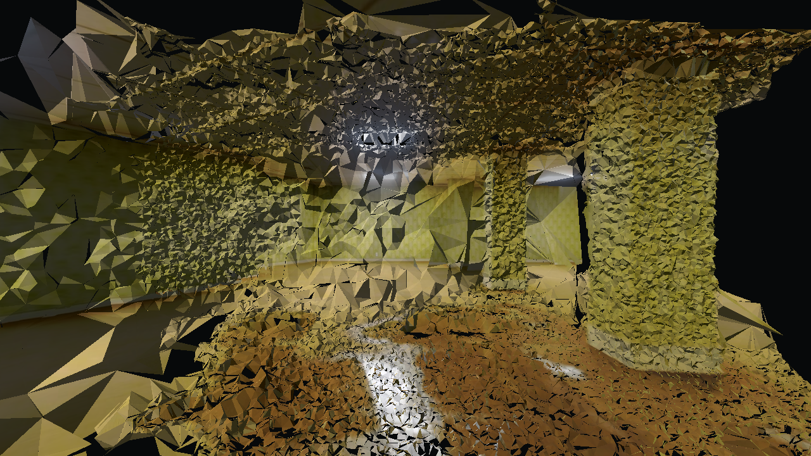

# Issue #108: Textured Mesh Scene Result

## Outcome

Negative result: a textured triangle scene was generated as a separate Godot
asset, but its surface quality and collision coverage do not support a usable
walkable scene. The scene intentionally contains no player spawn. The Gaussian
scene and assets were not modified.

## Delaunay Candidate

The input was the accepted shared source from issue #107, staged in the ignored
local output directory `data/scenes/backrooms_mesh_v1`. The reconstruction had 86
registered views and 3,000,116 fused points. Delaunay produced 79,003 vertices and
156,448 raw faces. Source-image projection textured 111,768 faces (71.4%) and
omitted the remaining 44,680 faces rather than inventing coverage. All 86 source
views contributed textures. Camera-up alignment coherence was 0.999991; model
height was normalized to 2 m using the existing doorway-height assumption.

The cleaned GLB contains 108,719 triangles and imports in Godot as 86 textured
mesh surfaces with a concave triangle collision shape. Its source-camera view is
still severely fragmented, with visible holes and tearing. Low horizontal geometry
totals 1.2987 m2, but vertical collision rays under the registered camera path hit
zero of 86 poses. Godot independently confirmed the missing floor support. No
synthetic completion was applied.



## Poisson Comparison

The existing COLMAP Poisson route was run on the same fused cloud using its seeded
sample of at most 500,000 points. It produced 7,184 faces, but after the same
camera-alignment transform its bounds were 11.946 x 10.708 x 18.327 m and it had
49.0129 m2 of low horizontal geometry without a floor hit at any of the 86 camera
poses. This broad, unsupported result is not a viable substitute.

## Reproduction

The source scene and generated mesh files are local ignored pipeline outputs. Run
the first command after staging the issue #107 source clip and sparse model at
`data/scenes/backrooms_mesh_v1`:

```bash
conda run --no-capture-output -n nerfstudio bash scripts/splat_pipeline/mesh_photogrammetry.sh data/scenes/backrooms_mesh_v1 --keep-dense
SHOT_OUTPUT_DIR=res://generated_mesh_scenes/backrooms_mesh_v1/evidence godot_walk/tools/shoot.sh res://generated_mesh_scenes/backrooms_mesh_v1/scene.tscn
godot4 --headless --path godot_walk --script res://scripts/test_mesh_candidate.gd -- res://generated_mesh_scenes/backrooms_mesh_v1/scene.tscn
conda run --no-capture-output -n nerfstudio pytest -q scripts/splat_pipeline/tests/test_mesh_photogrammetry.py scripts/splat_pipeline/tests/test_patch_match_config.py scripts/splat_pipeline/tests/test_texture_mesh_from_views.py scripts/splat_pipeline/tests/test_stage_mesh_scene.py
```

For the Poisson comparison, the pipeline's `--mesher poisson` branch creates the
seeded `dense/fused_sampled.ply`; the equivalent local command is:

```bash
conda run --no-capture-output -n nerfstudio colmap poisson_mesher --input_path data/scenes/backrooms_mesh_v1/dense/fused_sampled.ply --output_path data/scenes/backrooms_mesh_v1/mesh_poisson.ply --PoissonMeshing.depth 10 --PoissonMeshing.trim 7
```

Verification on 2026-10-12: focused Python suite, 16 passed. Godot reported 1 mesh
instance and 86 textured surfaces, created a 108,719-triangle collision shape,
and confirmed 0/86 camera poses grounded; the validation script exited successfully
with the expected negative assessment.
