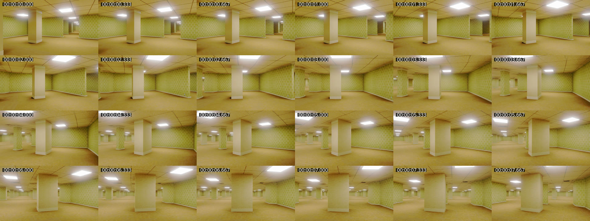
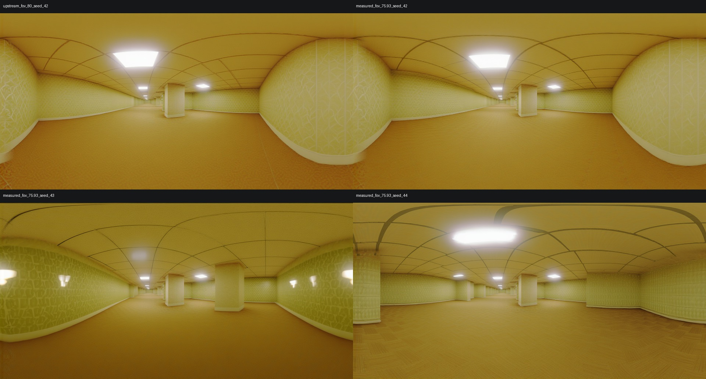
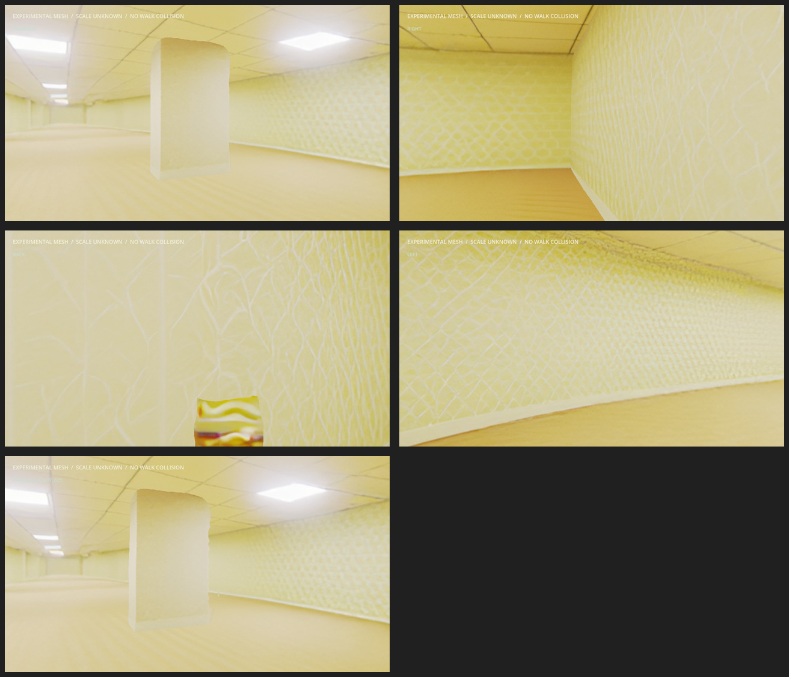

# Track A: HunyuanWorld Preflight

**Status:** Track A evaluation complete as an exploratory candidate. #123 selected
registered frame 141; #124 produced and inspected four 1280x640 panoramas; #125
converted two Hunyuan mesh layers to GLB and imported them in Godot. #126 found a
plausible registered-camera view and visible parallax at a provisional 0.25-unit
shift, but walkability is rejected: mesh scale is uncalibrated, the surfaces are
open, and no collision/player is staged. This is not a production scene.

This is an exploratory Track A result. It does not change Track B's pending
operator-approval gate, the #100 Gaussian, or the #115 baseline.

## Source And Frame

The selected input is the accepted #100 source at
`data/scenes/corridor_travel/video.mp4`: 1920x1080, 24 fps, 192 frames, 8 s,
SHA-256 `ac5cd0d1aa11aadd39cc45ff460af5e00372f8417d2514fce1bfa7c7837895c4`.
All 192 source frames are registered in the #100 COLMAP model.

Frame 141 (1-based; index 140), at 5.833333 s, was selected from the source
contact sheet. Its registered name is `frame_0141.jpg`; the #101 patch anchor
at Godot world `[0.5, -0.07, 1.7]` projects to `[937.37, 530.03]` in the
1920x1080 frame at 3.206 m depth. The camera center maps to Godot world
`[2.2503, -0.1003, 4.3989]` m. The frame is sharp and shows the central column,
the adjacent wall, and the open room around the patch.



The COLMAP camera is `SIMPLE_RADIAL` with parameters
`[1230.1892, 960, 540, -0.07134]`. The pinhole-equivalent horizontal FOV is
75.9347 degrees (vertical 47.3988 degrees); upstream's default is 80 degrees.
The upstream perspective warp does not model the recorded radial distortion.
The camera pose maps to Godot forward `[-0.5286, 0.0013, -0.8489]`, yaw
31.9124 degrees, pitch 0.0716 degrees. The complete pose, projection check,
hashes, and extraction command are in [source_selection.json](source_selection.json).

The seed PNG is at the ignored local path
`data/track-a/hunyuan/source_frame_0141.png`, SHA-256
`d3b1eb7ac7c1b737f4a79bec1e25eeecc6a8d3b1f517fa6231ba666a8ebc8408`.
It was decoded directly from the source video at 1920x1080 with no crop or
resize. The registered JPEG was used only to verify frame identity and pose.
The #100 Nerfstudio transform is staged alongside it at
`data/track-a/hunyuan/dataparser_transforms.json` so this worktree does not
need the main checkout's ignored training output.

Recreate the selection and seed with:

```bash
conda run -n nerfstudio python scripts/splat_pipeline/prepare_hunyuan_source.py \
  --video data/scenes/corridor_travel/video.mp4 \
  --colmap-model data/scenes/corridor_travel/sparse/0 \
  --alignment-manifest godot_walk/assets/corridor_splat/alignment_manifest.json \
  --dataparser-transforms data/track-a/hunyuan/dataparser_transforms.json \
  --registered-images data/scenes/corridor_travel/images \
  --frame-number 141 --target-world 0.5 -0.07 1.7 \
  --frame-out data/track-a/hunyuan/source_frame_0141.png \
  --metadata-out godot_walk/evidence/2026-10-13-hunyuan-track-a/source_selection.json
```

## Local Feasibility

The upstream checkout is pinned outside the repository at commit
`57fa9f3a79eae1079c279968cdb9d82c75fa7c86`:
`/mnt/sharedOs/backrooms-track-a-runtime/HunyuanWorld-1.0`.

- GPU: NVIDIA GeForce RTX 4070 Ti, compute capability 8.9, 12,282 MiB VRAM;
  9,588 MiB was free at the initial probe. Driver: 595.91.07.
- Existing Nerfstudio environment: Python 3.10.20, PyTorch 2.3.1+cu121,
  CUDA runtime 12.1. It remains unchanged. Upstream reports testing with
  Python 3.10 and PyTorch 2.5.0+cu124.
- The isolated Hunyuan environment imports PyTorch 2.5.0+cu124 and sees the
  RTX 4070 Ti. Runtime-only compatibility adjustments were needed: the upstream
  YAML names nonexistent `av==14.3.0`, so the local override uses the available
  14.2.0 wheel; its unpinned MoGe dependency had advanced to a NumPy-2-only
  release, so the local override pins MoGe commit
  `0286b495230a074aadf1c76cc5c679e943e5d1c6`, which still exposes the imported
  `moge.model.v1` API. Neither change touches the pinned upstream checkout or
  Nerfstudio environment. The upstream-documented `basicsr-fixed`, Real-ESRGAN,
  and ZIM packages are installed in the isolated environment.
- Hunyuan's image-to-panorama path uses gated
  `black-forest-labs/FLUX.1-Fill-dev`; its main weight file is 23.8 GB. Hugging
  Face metadata is visible, but file access requires an account, contact-info
  agreement, and acceptance of the FLUX.1 [dev] Non-Commercial License. The
  operator confirmed Colombia and non-commercial use, accepted the terms, and
  added a local Hugging Face key. A small gated config download verified access;
  the key is read process-locally from the ignored main-workspace `.env`, never
  printed or copied into this branch. Model weights and outputs stay outside
  tracked source.
- HunyuanWorld's published consumer-GPU note names an RTX 4090 for its lite
  path. This RTX 4070 Ti has half that card's nominal VRAM. Sequential CPU
  offload after FP8 conversion produced 1280x640 panoramas with about 3.39 GiB
  peak allocated VRAM. Mesh-only SceneGen composition peaked at about 3.05 GiB.
  The 1920x960 and 1536x768 panorama attempts did not fit this desktop's free
  VRAM; only the 1280x640 setting is verified. Its reference environment also
  differs from the installed Nerfstudio stack.
- The HunyuanWorld 1.0 license excludes the EU, UK, and South Korea and limits
  use to its stated territory. The operator confirmed they are in Colombia and
  this is non-commercial; FLUX.1 [dev] is also non-commercial and non-production.
  No hosted inference is being used.

The [upstream HunyuanWorld README](https://github.com/Tencent-Hunyuan/HunyuanWorld-1.0/tree/57fa9f3a79eae1079c279968cdb9d82c75fa7c86)
documents the tested software stack and 4090 lite note. The
[HunyuanWorld license](https://github.com/Tencent-Hunyuan/HunyuanWorld-1.0/blob/57fa9f3a79eae1079c279968cdb9d82c75fa7c86/LICENSE)
and [FLUX.1-Fill-dev model card](https://huggingface.co/black-forest-labs/FLUX.1-Fill-dev)
document the access and use terms.

## Gate Result

The pinned code, territory/use constraints, and gated access were checked
before the model-weight download began. The access gate passed for Colombia and
the operator's confirmed non-commercial use. Inference and mesh composition
ran locally; no hosted service was used.

## Panorama Candidates

Four candidates were generated at 1280x640, 50 steps, true CFG 1.0, with FP8
attention/GEMM and sequential CPU offload. Seeds 42, 43, and 44 used the measured
75.9347-degree horizontal FOV; seed 42 was also generated with the upstream
80-degree default. Visual inspection selected measured-FOV seed 42 as the most
coherent match to frame 141. This is a visual selection, not an operator signoff
or a multiview consistency result.



The selected panorama SHA-256 is
`523bf7a6f47212171f062e776010255cb149ac5813110acb5b88ca5741ea5427`.
Candidate hashes, FOVs, and peak allocations are in
[panorama_run_manifest.json](panorama_run_manifest.json). Larger resolutions
and model-level-only offload did not fit the free VRAM on this desktop. An
initial SceneGen run failed with a PyTorch meta-tensor device error during the
indoor flow, but its traceback was not retained. The indoor adapter now skips
the unused sky stage and does not instantiate its inpaint model. A fresh full
SceneGen pass then completed from the panorama with FP8 attention/GEMM,
sequential offload, and DeepCache disabled: it produced foreground and
background meshes with a peak CUDA allocation of 6,431,233,536 bytes (about
5.99 GiB), without recurring the meta-tensor error. The local run manifest is
`data/track-a/hunyuan/scene-run-05/scene_manifest.json` (ignored runtime data).
This confirms the adapted indoor path on this machine, though the exact failing
operation in the original run remains unknown.

## Mesh And Godot Evaluation

The fresh SceneGen pass emitted a foreground layer and a background layer. The
PLYs contain 1,603,955 / 3,235,413 vertices / triangles and 7,372,800 /
14,783,952 vertices / triangles respectively. Their vertex colors were retained
in a 344 MiB GLB; both layers are open, non-watertight sheets and their physical
unit scale remains unknown. Full mesh hashes, bounds, and import metadata are in
[hunyuan_layer_conversion_full_run.json](hunyuan_layer_conversion_full_run.json).

The local-only preview is `godot_walk/scenes/hunyuan_mesh_preview.tscn` and
loads `godot_walk/generated_mesh_scenes/hunyuan_track_a_full_run/hunyuan_layers.glb`.
It maps Hunyuan local `-X` forward, `+Y` right, and `+Z` up to the registered
COLMAP camera basis, and places the preview camera at the registered frame-141
center with its measured FOV. The central column, ceiling lights, right wall,
and open left side are compositionally plausible in the forward view. The
quarter-unit right shift produces visible parallax, but that unit is only a
display assumption. Side/back captures show severe texture stretch and broad
surfaces; radial camera distortion is also absent from the Hunyuan warp.

The transform, import, parallax probe, and walkability decision are recorded in
[mesh_evaluation.json](mesh_evaluation.json).

The pinned SceneGen decomposition, semantic-label limits, mesh ordering, PLY
attributes, and GLB conversion behavior are documented in
[SCENEGEN_LAYER_EXPORT.md](SCENEGEN_LAYER_EXPORT.md). In short, the labels
drive prompted masks, while the exported layer indices are positional and do
not preserve semantic roles in the GLB.



There is no calibrated scale, no validated route floor, and no collision body
or player in this candidate. The generated spherical depth sheets are not
accepted as walkable geometry. Do not use this mesh to replace the #100 Gaussian
or alter Track B's operator-approval gate. The local GLB and SceneGen PLY files
are deliberately ignored; regenerate them with the commands in the runner and
converter help, then run the preview with `HUNYUAN_MESH_CAPTURE_DIR` set.
The headless `godot4 --path godot_walk --script
res://scripts/test_hunyuan_mesh_preview.gd` check verifies both imported mesh
instances and the registered transform, and ensures no player/collision is
staged; it intentionally does not claim a physics walk test.
